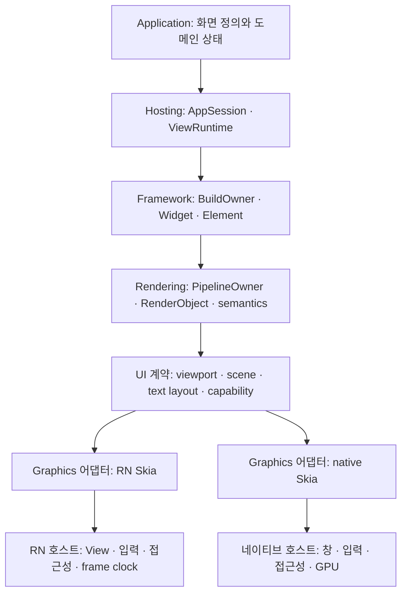
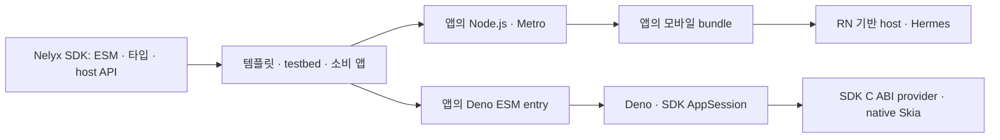

# Nelyx SDK 설계 초안 v2

작성·검토일: 2026년 10월 7일 · 구현 착수 전 설계 제안

Nelyx(오젤리)는 Flutter의 Widget·Element·RenderObject 구분을 참고하는 **TypeScript UI SDK**다. framework·공통 계약·host/graphics provider를 재사용 가능한 모듈로 제공하고 소비 앱이 화면·도메인 상태·실행 구성을 정의한다. 모바일은 React Native 기반 host와 Hermes/RN Skia를 출발점으로 사용하고 데스크톱은 Deno에서 실행한다. 창·GPU·입력기·접근성은 SDK의 플랫폼 provider가 제공한다.

SDK와 앱 도구의 책임은 분리한다. **Metro 의존성·설정·앱 entry·개발 서버·bundle 생성은 `templates/nelyx-app`과 `sample/nelyx-testbed-app` 및 생성된 소비 앱에 둔다.** SDK는 표준 ESM·타입·공개 exports·provider metadata를 제공한다. Deno의 기본 소비 경로는 표준 ESM이며 Metro→Deno 연결은 testbed의 선택 실험이다.

React Native와 RN Skia는 **필요한 소스를 가져와 불필요한 부분을 제거하거나 내부 구조·API를 수정할 수 있는 기반**으로 사용한다. upstream 패키지와 현재 React/Fabric·renderer 구조를 유지하는 것은 필수 조건이 아니다. RN 기반 host·Hermes·native 그래픽/입력 기능을 출발점으로 삼고, Nelyx의 트리·프레임·수명 계약에 맞춰 유지·교체·분리할 범위를 초기 연구에서 결정한다.

v2의 핵심 제안은 **DorotiLab의 책임 분리를 TypeScript 실행 환경에 맞춰 구성하고, 렌더러와 네이티브 입력을 먼저 검증한 뒤 공통 위젯을 확장하는 것**이다. AppSession·ViewRuntime, UI/호스트 계약, 불변 프레임과 소비자 lease를 기본 경계로 둔다. Deno의 네이티브 Skia 연결, RN Skia의 제출량 제어, 텍스트 측정과 한글 IME를 초기 관문으로 검증한다. 최초 범위는 Windows 단일 창과 모바일 단일 View다.

이 문서는 [기존 초안](nelyx-draft.md)을 재검토해 작성했다. 공식 문서, `reference/react-native-skia-main`의 TypeScript·C++ 소스와 `C:\Users\parti\Labo\DorotiLab`의 현재 소스·수명 계약·테스트를 확인했다. Nelyx 구현·빌드·기기 실행은 수행하지 않았다. 문서에 있는 Nelyx API와 디렉터리는 제안이다. DorotiLab에서 참고한 소스와 적용 범위는 20절에 정리한다.

## 1. 유지할 방향과 지원 범위

다음 방향은 기존 초안에서 유지한다.

- 이름은 Nelyx이며 TypeScript UI SDK로 제공한다. framework는 SDK의 구성 모듈이고 앱 템플릿·샘플은 SDK를 소비한다.
- Widget은 불변 구성, Element는 트리의 수명과 상태, RenderObject는 레이아웃·페인트·hit test를 담당한다.
- 모바일은 RN 기반 호스트와 Hermes를 사용하고, RN Skia의 명령형 그래픽 API와 native 구현을 출발점으로 연결한다. 필요하면 RN/RN Skia를 fork·축소·재구성해 Nelyx 전용 host/renderer로 만든다.
- 데스크톱 앱 로직은 Deno에서 실행한다. 필요한 네이티브 창·Skia 바인딩은 별도 호스트 모듈로 제공할 수 있다.
- RN 앱 템플릿과 testbed는 Metro로 JS/asset을 빌드한다. SDK의 ESM 빌드와 Deno 기본 실행은 별도로 검증하며 Deno 앱의 Metro 빌드는 선택 기능으로 조사한다.
- Flutter의 개념과 계층 경계를 참고한다. Flutter 엔진·embedder·패키지 호환성은 별도 구현 목표로 삼지 않는다. [Flutter 아키텍처 문서][flutter-architecture]

초기 지원 범위는 다음처럼 나눈다. Windows와 Android를 먼저 검증하는 순서는 현재 개발 환경을 고려한 제안이며 지원 확정이 아니다.

| 범위 | 최초 검증에 포함 | 이후 확장 |
| --- | --- | --- |
| 호스트 | Windows 단일 창, Android 단일 View | iOS 별도 검증, macOS·Linux, 복수 창 |
| 구성과 상태 | Widget·Element, 로컬 상태, 의존성 구독 | 고급 상태 라이브러리 연동, 개발 중 상태 보존 |
| 레이아웃 | Box, Padding, Align, Row, Column, Stack | 복잡한 intrinsic 계산, 고급 레이아웃 |
| 콘텐츠 | Text, Image, Button, 유한 길이 ScrollView | 가상화 목록, 고급 이미지·영상 |
| 텍스트 편집 | 네이티브 편집기 기반 TextField, 한글 조합·선택·클립보드 | Skia로 직접 그리는 편집기, rich text |
| 플랫폼 통합 | 포인터·키보드·focus, 기본 semantics, resize·DPI·복귀 | 지도·영상 뷰, 임의 transform·clip 합성 |
| 배포 | 개발 실행 절차와 네이티브 바이너리 출처 | 서명·설치·업데이트·깨끗한 환경 검증 |

완성된 Material·Cupertino, Flutter 전체 API 복제, 기존 Flutter 패키지 실행, 모든 OS의 동일 픽셀 출력은 초기 범위에 넣지 않는다. 브랜딩·도메인·공개 패키지 이름의 사용 가능 여부는 별도로 확인한다.

## 2. 기존 초안에서 보완할 핵심 판단

| 항목 | 검토 결과 | v2에서의 처리 |
| --- | --- | --- |
| Deno native surface | 공식 WebGPU 경로는 확인된다. 외부 Skia에 필요한 핸들·device·동기화 연결은 확인되지 않았다. | 창을 누가 소유하는지부터 결정하고 실제 Skia 출력으로 판정한다. |
| RN Skia 제출량 제어 | 공개 `submit()`은 `void`를 반환하며 완료·큐 길이 API가 없다. | native 관측·admission을 추가하거나 기록·큐·자원 수명 구조를 Nelyx 계약에 맞게 재구성하고 검증한다. |
| 공통 페인트 계약 | `PaintFrame`만으로는 명령 형식, 텍스트 측정, 자원 소유권이 정해지지 않는다. | 불변 display list, 자원 ID, text layout 계약을 구체화한다. |
| TextField | Skia의 문자열 그리기와 OS 텍스트 편집은 서로 다른 기능이다. | 네이티브 편집기로 한글 IME를 먼저 검증하고 직접 그리는 편집기는 별도 관문으로 둔다. |
| 런타임 호환 | TypeScript 컴파일과 npm 호환성은 Hermes·Deno 양쪽 실행을 증명하지 않는다. | 공통 코어의 전역 API와 의존성을 제한하고 두 실행 경로에서 같은 계약을 검증한다. |
| SDK와 Metro | Metro는 RN 소비 앱의 빌드 도구다. SDK의 표준 모듈 제공과 Metro의 bundle/runtime 계약은 별도다. | 앱 템플릿/testbed가 Metro 설정을 소유한다. Deno는 ESM을 기본으로 하고 Metro 연결은 선택 실험으로 둔다. |
| App·View 구성 | 공유 서비스, framework의 트리 owner, native 창 생성자의 책임을 구별해야 한다. | AppSession이 앱 수명을 조율하고 ViewRuntime에 BuildOwner·PipelineOwner·focus를 둔다. |
| resize·종료 | View 재생성, OS 크기 요청, framework metrics, GPU surface가 서로 다른 시점에 바뀐다. | owner·viewport 스냅샷·렌더러 세대와 자원 이전·퇴역을 분리한다. |
| 초기 범위 | 호스트·위젯·IME·복수 View를 한 번에 완성하면 실패 원인 분리가 어렵다. | 호스트 가능성, 최소 코어, 실제 사용 흐름, 플랫폼 확장을 순서대로 검증한다. |

위 판단 중 RN Skia API는 로컬 [Graphite 타입](reference/react-native-skia-main/packages/skia/src/skia/types/Graphite.ts)과 [네이티브 큐 구현](reference/react-native-skia-main/packages/skia/cpp/rnskia/RNSkGraphiteTarget.h)을 확인한 결과다. Deno surface에 관한 판단은 공식 문서가 제공하는 WebGPU 연결에서 외부 Skia 연동까지 보장할 수 없다는 설계상 추론이다. [Deno WebGPU 문서][deno-webgpu]

## 3. 의존성 기준선과 자료의 한계

RN Skia v3 문서는 Graphite·Dawn 경로를 안내하며 Apple은 Metal, Android는 Vulkan을 사용한다. Android는 API 26 이상, iOS는 배포 대상 15.1 이상을 요구한다. Expo Go에 포함된 v2 네이티브 코드로 v3를 검증할 수 없으므로 Expo를 선택한다면 development build가 필요하다. npm 이름은 `react-native-skia`이며 이전 `@shopify/react-native-skia`와 함께 설치하지 않는다. [RN Skia v3 전환 가이드][rns-migration]

로컬 `reference`의 [package.json](reference/react-native-skia-main/packages/skia/package.json)에는 다음 메타데이터가 있다.

| 항목 | 로컬 소스에서 확인한 값 | 해석 |
| --- | --- | --- |
| React / RN peer | `react >=19.0`, `react-native >=0.78` | 선언된 허용 범위다. Nelyx 호환성 검증 결과가 아니다. |
| Reanimated / Worklets peer | `>=4.0.0` / `>=0.7.0`, optional | worklet 경로를 사용할 때 별도로 호환 조합을 확인한다. |
| 개발 의존성 | RN `0.83.1`, Reanimated `4.3.1`, Worklets `0.8.3` | 참조 저장소의 개발 조합이다. 제품 기준선으로 자동 채택하지 않는다. |
| Graphite 바이너리 패키지 | Android·Apple 패키지 `154.1.0` | Skia·Dawn 커밋과 빌드 옵션도 추가로 확인해야 한다. |
| 패키지 자체 버전 | `0.0.0` | 이 파일만으로 실제 공개 릴리스나 태그를 식별할 수 없다. |

`reference/react-native-skia-main`은 Git 메타데이터가 없는 소스 사본이다. 디렉터리의 `main`이라는 이름은 특정 커밋을 증명하지 않는다. 공식 사이트 일부 페이지는 직접 조회가 되지 않아 upstream의 문서 원본과 로컬 소스를 함께 확인했다.

구현 단계 0에서는 다음 기준선을 별도 기록한다.

- RN·React·RN Skia의 정확한 릴리스와 소스 커밋, RN이 사용하는 Hermes 버전·빌드 설정
- RN New Architecture 설정, 필요 시 Reanimated·Worklets와 Babel·Metro 설정
- RN/RN Skia upstream revision과 Nelyx의 patch/fork revision, 유지·제거·교체한 모듈, 자체 native 바이너리의 빌드 출처
- SDK의 TypeScript/ESM·타입 빌드와 공개 exports, 소비 앱의 Node.js·Metro·metro-runtime·RN/Expo Metro config·Babel 조합과 resolver/transformer 설정
- Deno 버전, 대상 OS·CPU, 창 호스트와 GPU backend, 사용 권한
- Skia·Dawn·텍스트 shaping·Unicode·폰트 의존성의 버전과 빌드 옵션
- SDK/도구/testbed workspace와 생성된 앱의 manifest/lockfile, 앱의 `deno.lock`, 네이티브 바이너리 해시와 재현 빌드 절차

Deno 문서는 `deno desktop`과 raw backend를 v2.9부터 안내한다. 이는 raw 경로를 조사할 때의 요구사항이며, 별도 네이티브 호스트를 FFI로 사용하는 경로가 반드시 같은 데스크톱 API를 사용해야 한다는 뜻은 아니다. [Deno backend 문서][deno-backends]

DorotiLab의 조사 기준 HEAD는 `35a4ef1935690f7f23137f4a3aebd88618ebed08`이며 조사 시작 시 작업 트리는 깨끗했다. 소스와 기존 checkpoint의 전체 미완료 경계를 확인했으며 과거 테스트 결과를 새로 실행하거나 Nelyx 검증 결과로 옮기지 않았다. Doroti의 .NET·SkiaSharp·플랫폼 provider 버전을 Nelyx 의존성으로 채택하는 제안도 아니다.

## 4. 계층과 소유권

Framework는 앱의 UI 트리를 유지하고 `ui` 계층은 framework와 host/renderer 사이의 값 타입·서비스·프레임 계약을 정의한다. `graphics`는 이 계약을 구현하는 그래픽 adapter다. Doroti.Ui를 공통 계약으로 두고 Framework·Hosting·Skia.Rendering이 사용하는 구성을 참고해 공통 계약이 RN·Deno·Skia 구현을 import하지 않게 한다. [Doroti UI 계약][doroti-view-contracts], [호스트 세션][doroti-host-session]



표의 소유자는 수명과 해제 책임을 가진다. GPU 참조를 사용하는 제출이 남아 있다면 논리적 해제와 실제 자원 파괴의 시점은 달라질 수 있다.

| 객체 | 소유자 | 다른 계층에 전달하는 것 |
| --- | --- | --- |
| 서비스·도메인 상태·View 등록 | AppSession | 서비스 인터페이스, 상태 구독, View 생성 요청 |
| Element·RenderObject·focus·scroll 상태 | ViewRuntime의 BuildOwner·PipelineOwner | 값 스냅샷, 이벤트·명령 |
| 창·RN native View·OS 입력 세션 | Host | metrics, 정규화 입력, 플랫폼 기능 |
| 폰트·이미지·paragraph·GPU 자원 | Graphics/renderer의 자원 관리자 | 어댑터 범위의 불투명 자원 ID |
| 녹화 중 canvas | 해당 renderer의 기록 구간 | 공통 코어에 노출하지 않음 |
| 제출된 recording과 참조 자원 | 제출을 인수한 renderer/native 경로 | 제출 식별자, 제공 가능한 완료 신호 |

공통 코어는 RN 객체, JSI HostObject, Deno API, OS 포인터를 직접 사용하지 않는다. 같은 JS 런타임 안에서는 타입이 있는 객체·인터페이스로 협력하고, 네이티브·프로세스 경계에서만 별도의 전달 형식을 사용한다.

AppSession과 여러 View는 초기에는 같은 JS 런타임과 하나의 framework 실행 owner를 공유한다. AppSession은 서비스·앱 상태·종료 조율을 맡고, 각 ViewRuntime은 독립 root Element와 BuildOwner·PipelineOwner·FrameScheduler를 가진다. Doroti의 공유 session과 View branch 분리를 참고하되, Nelyx 최초 API에서는 View마다 root factory를 호출해 UI의 로컬 상태를 구분한다. [공유 호스트 세션][doroti-shared-session], [BuildOwner][doroti-widget-framework], [PipelineOwner][doroti-render-object]

native 창 factory는 Widget이나 Element root를 생성하지 않는다. 창·입력·renderer를 준비하고 AppSession이 root를 부착한다. RN shell 경로에서 실제 native View는 RN이 소유하고 Nelyx는 그 View에 연결된 adapter와 framework branch를 소유한다. RN을 재구성한 경로에서는 native View 생성·해제 책임을 교체한 host owner에 명시한다. 소유권은 이 두 수준을 구별한다.

서비스/capability 등록에는 `owned`와 `borrowed`를 둔다. App 소유 공유 서비스를 View가 빌려 쓰는 경우 View 종료는 등록과 진행 중 호출 lease를 정리하고, 실제 서비스 종료는 AppSession이 맡는다. 중복 소유와 종료 중 재등록은 거절한다. [Doroti capability 소유권][doroti-capability-ownership]

worklet·worker·프로세스를 추가하면 그 경계에는 불변 프레임·이벤트 데이터와 소비자별 lease를 전달한다. App 상태·Element·BuildOwner·JSI 객체를 다른 런타임으로 직접 전달하는 경로는 별도 구현·검증 없이는 제공하지 않는다.

## 5. 데스크톱 호스트 선택

### 5.1 Deno raw 경로에서 확인된 것

Deno raw backend에는 웹 엔진과 DOM이 없으며 창 관리·입력 이벤트·클립보드 등의 기능을 제공한다. `BrowserWindow.getNativeWindow()`는 WebGPU용 `UnsafeWindowSurface`를 반환한다. 이것을 HWND나 Skia surface 포인터를 직접 반환하는 API로 해석하지 않는다. `requestAnimationFrame`이 없는 환경의 프레임 스케줄링도 호스트가 담당해야 한다. [Deno backend 문서][deno-backends], [창 문서][deno-windows], [WebGPU 문서][deno-webgpu]

네이티브 surface를 얻은 뒤 `close()`가 파괴 대신 숨김으로 처리되는 제약도 문서에 있다. 따라서 이 경로는 단일 창 표시뿐 아니라 창 반복 생성·해제와 복수 View 수명까지 확인해야 한다. 창 하나를 닫을 때 `Deno.exit()`로 전체 앱을 종료하는 예제 동작을 View 해제 구현으로 재사용하지 않는다. [Deno WebGPU 문서][deno-webgpu]

### 5.2 조사 경로 비교

| 경로 | 소유권과 연결 | 장점 | 해결해야 할 항목 | v2 권장 위치 |
| --- | --- | --- | --- | --- |
| A. Deno + C ABI/FFI native host | native host가 창·이벤트 루프·Skia context·present를 함께 소유 | Deno 앱 로직을 유지하고 renderer와 창의 수명을 한곳에서 제어 | OS별 스레드, 네이티브 바이너리·입력·접근성·배포 | Windows 최초 연결 검증의 우선안 |
| B. Deno raw 창 + 외부 Skia | Deno가 창/WebGPU surface를 소유하고 외부 Skia를 연결 | Deno의 창 관리 기능 활용 | 핸들 접근, 서로 다른 GPU 구현의 공유·복사·동기화, 창 해제 | 공개 API와 재현 코드로 연결을 증명할 때 채택 |
| C. Deno 기반 custom runtime | native executable이 Deno core와 창·Skia를 통합 | 이벤트 루프·OS main thread·native ops를 직접 설계 | 일반 Deno의 모듈·권한·CLI·배포 기능 중 무엇을 유지할지 결정 | A/B의 한계가 확인되면 비용 비교 |
| D. WebView/CEF + CanvasKit | 웹 호스트 안에서 CanvasKit 실행 | 웹 입력·DOM 통합 경로 활용 | 웹 엔진, 번들링, 접근성·배포 모델 변경 | 제품 방향 변경을 수반하는 대안 |

**A를 우선 조사하는 이유는 창과 renderer를 서로 다른 소유자 사이에서 연결해야 하는 문제를 줄이기 위해서다.** 이 선택도 아직 실행 검증되지 않았다. 특정 창 라이브러리나 Skia GPU backend는 이 문서에서 확정하지 않는다. Skia CPU raster 출력은 바인딩·텍스트 검증의 중간 결과로 사용할 수 있지만, GPU·present 검증 완료와 구분한다.

Deno의 npm·Node-API 지원은 RN의 JSI 설치 환경을 제공하지 않는다. RN Skia의 TypeScript 레이어와 알고리즘을 참고할 수는 있지만 RN 네이티브 모듈을 Deno에서 그대로 로드하는 경로를 기본 전제로 삼지 않는다. Node-API 기반 별도 바인딩은 추가 후보가 될 수 있다. [Deno FFI·Node-API 문서][deno-ffi]

custom runtime을 조사할 경우 과거 `denoland/deno_core` 저장소는 현재 `denoland/deno`로 통합되었다는 안내를 따르고, 사용하는 crate와 소스 위치를 다시 확인한다. CanvasKit은 웹 대안의 그래픽 구현이며 네이티브 창·IME·접근성을 함께 제공하는 호스트가 아니다. [Deno core 이전 안내][deno-core], [CanvasKit 문서][canvaskit]

### 5.3 FFI와 OS 스레드 계약

Windows에서 창을 만든 스레드는 해당 창의 메시지 루프를 처리해야 한다. Deno FFI의 `nonblocking: true`는 함수를 별도 blocking thread에서 실행하고 Promise를 반환하는 기능이며, 창·GPU의 올바른 실행 스레드나 호출 순서를 보장하는 장치가 아니다. [Windows 메시지 루프 문서][win32-message-loop], [Deno FFI API][deno-ffi-api]

A 경로의 최초 구현에서는 다음 계약을 검증한다.

- native host가 창과 이벤트 루프의 실행 스레드를 정한다. GPU context 사용 스레드와의 관계도 문서화한다.
- Deno의 FFI 호출은 native host에 명령을 전달한다. OS 창·GPU 작업은 각 소유 스레드에서 실행한다.
- 네이티브 코드가 콜백 도중 JS 응답을 동기적으로 기다리거나 Deno가 창 메시지 루프를 장시간 막는 구조를 피한다.
- 이벤트 큐와 프레임 큐의 용량, 깨우기 방식, 순서, 종료 시 동작을 정의한다. 유휴 상태에서 바쁜 polling을 계속하지 않는다.
- 초기 페인트 전달은 명령을 묶은 버퍼를 기준으로 한다. 복사 비용과 명령별 호출 비용을 측정한 뒤 최적화한다.
- C ABI에는 버전·버퍼 길이·오류 코드·불투명 핸들의 세대를 포함한다. C++ 예외를 ABI 경계 밖으로 보내지 않는다.
- 네이티브는 인수 시 필요한 버퍼를 복사하거나 소유권을 명시적으로 이전받는다. 비동기 처리 중 JS 메모리 포인터를 임의로 보관하지 않는다.
- View와 작업·콜백이 모두 정리된 뒤 dynamic library를 닫는다.

Doroti의 Windows host session과 native provider 구성은 창 owner·framework owner·GPU 퇴역을 나누는 참조다. C# dispatcher, SkiaSharp 객체, Windows App SDK provider를 Deno에서 그대로 호출할 수 있다고 가정하지 않고 Nelyx 전용 C ABI와 JS adapter의 작업 범위를 산출한다. 첫 창·Skia 연결이 검증되기 전에는 Windows App SDK·Vulkan·특정 창 라이브러리를 확정 의존성으로 넣지 않는다. [Doroti Windows session][doroti-windows-session]

FFI에는 `--allow-ffi` 권한이 필요하며 native library는 Deno의 JS sandbox 밖에서 실행된다. 배포에서는 정확한 경로·해시·의존 DLL을 기록한다. macOS·Linux의 창 스레드와 종료 방식은 별도 검증하며 Windows의 성공을 확장 적용하지 않는다. [Deno FFI 문서][deno-ffi]

## 6. 모바일 경로와 RN Skia의 실제 계약

초기 비교 기준은 `RN host → Hermes의 Nelyx core → RN Skia adapter → SkiaGraphiteView → native surface`다. 이 경로에서 React는 호스트 View와 네이티브 overlay를 유지하고 Nelyx가 Widget·Element 트리를 유지한다. source fork 경로에서는 React shell·SkiaGraphiteView·native 등록/제출 구조를 Nelyx 전용 연결로 교체할 수 있다. Nelyx의 페인트 결과는 공통 graphics 계약으로 직접 전달한다.

RN 소비 앱의 runner·공통 앱과 import한 SDK 모듈은 앱의 Metro profile로 번들링한다. 설정 파일과 의존성은 템플릿/testbed·생성된 앱이 소유한다. RN CLI 앱이면 `@react-native/metro-config`, Expo 앱이면 해당 Expo Metro config를 확장하고 파생 host는 유지한 기능에 맞춰 앱 bootstrap·polyfill·serializer를 조정한다. native renderer의 설치·초기화는 SDK host provider와 앱 runner의 연결 책임이며 SDK 공통 entry가 Metro 서버를 시작하지 않는다. [RN Metro 설정][rn-metro]

로컬 소스에서 확인한 기록 흐름은 다음과 같다. [Graphite API][rns-graphite-api], [upstream Graphite 설명][rns-graphite-doc]

```text
View mount + 유효한 크기 확인
  → getContext()
  → beginRecording()
  → clear + display list 재생
  → finishRecording()
  → submit(recording)
```

- context의 크기와 canvas 좌표는 points다. Nelyx 논리 좌표와 맞춘 뒤 어댑터에서 DPI 변환을 중복 적용하지 않는다.
- View당 열린 recording은 하나다. Nelyx의 기록 소유자도 하나로 제한한다.
- canvas는 `finishRecording()`까지만 유효하다. 공통 코어에 보관하거나 다음 프레임에서 재사용하지 않는다.
- 제출된 recording은 순서대로 처리된다. 최신 recording 하나로 네이티브 큐를 임의 교체하지 않는다.
- 초기 페인트는 clear를 포함한 전체 프레임으로 만든다. 부분 재그리기와 이전 surface 내용의 재사용은 후속 최적화다.
- 크기가 바뀐 recording을 upstream이 처리하는 기능과 Nelyx의 최신 metrics에 맞춘 레이아웃 정확성은 별도로 검증한다.

공개 `SkGraphiteContext`에는 `submit(recording): void`가 있으며 큐 깊이, 소비 완료, GPU 완료, 표시 완료, 기록 취소 API는 없다. C++ 구현은 recording을 큐에 추가하고 소비 시 순서대로 가져간다. **Promise로 감싼 `submit()`이 resolve되는 것만으로 in-flight 작업이 끝났다고 처리할 수 없다.** [로컬 타입](reference/react-native-skia-main/packages/skia/src/skia/types/Graphite.ts), [JSI 연결](reference/react-native-skia-main/packages/skia/cpp/api/JsiSkGraphiteContext.h), [네이티브 큐](reference/react-native-skia-main/packages/skia/cpp/rnskia/RNSkGraphiteTarget.h)

따라서 공개 API만 사용하는 초기 adapter는 기록 전 갱신 병합과 호출 빈도 제한을 제공하되, 이를 네이티브 큐 상한 보장으로 표시하지 않는다. 소비가 멈춘 상황에서도 상한을 보장하려면 native admission·큐 소비 신호와 자원 보유 계약을 제공해야 한다. JS wrapper만으로 이 정보가 생기지는 않는다. 기존 target 수정과 Nelyx 전용 기록/큐/퇴역 구조로의 재구성을 모두 후보로 두고 유지할 patch/fork와 고정 버전의 범위를 단계 1에서 결정한다.

페인트 예외가 나면 열린 기록을 닫고 불완전한 결과를 제출하지 않는 복구를 시도한다. `finishRecording()` 자체 실패, native View 교체, surface 손실의 복구·퇴역은 별도 테스트가 필요하다. 공개 API에 존재하지 않는 `abortRecording()`을 구현 전제로 쓰지 않는다.

fork에는 필요한 기록 취소·명시적 인수 결과·native binding 관측 API를 새로 설계할 수 있다. 이 경우 upstream API와 자체 API를 구별하고 부분 자원·선행 업로드·GPU 참조의 수명을 구현·검증한 뒤 capability로 제공한다.

Nelyx core와 기록은 먼저 Hermes JS runtime 하나에서 실행한다. worklet은 렌더링 병목을 측정한 후 검토한다. RN Skia context의 worklet 사용 가능성이 Element 트리·상태 구독·앱 서비스 전체의 worklet 호환성을 의미하지 않는다.

### 6.1 RN·RN Skia 소스 재사용과 구조 변경

초기 연구에서는 RN을 그대로 사용하는 shell과 필요한 host/runtime 부분을 재구성한 경로를 비교한다. 불필요한 JS/native 모듈, Nelyx 트리와 겹치는 React reconciliation/layout 경로, RN Skia의 React renderer/hooks·미사용 플랫폼 기능은 제거·교체 후보가 될 수 있다. 특정 기능을 제거할 수 있는지는 실제 소스·빌드 의존성과 회귀 결과로 판단한다.

| 경계 | 재사용할 책임 | 수정·분리 시 확인할 것 |
| --- | --- | --- |
| RN runtime/host | Hermes·JSI, OS 수명·thread, native View·입력·접근성 연결 | bootstrap·모듈 등록·frame clock·종료 owner와 대체 경로 |
| React/Fabric/Codegen | 초기 shell과 native View/overlay 생성·배치 | 제거 시 surface·TextField·focus·semantics의 생성/배치/이벤트 책임 |
| RN Skia native | Skia/Dawn, 자원·paragraph·기록·surface 구현 | bounded admission, 큐 소비, GPU 퇴역, native binding 관측 |
| Nelyx graphics 연결 | display list·불변 자원·text layout·capability | 모바일 JSI와 desktop C ABI의 분리, 명시적 인수/거절·완료 의미 |

로컬 [View spec](reference/react-native-skia-main/packages/skia/src/specs/SkiaViewNativeComponent.ts)은 RN Codegen을 사용하고 [module spec](reference/react-native-skia-main/packages/skia/src/specs/NativeSkiaModule.ts)과 [초기화 코드](reference/react-native-skia-main/packages/skia/src/skia/NativeSetup.ts)는 TurboModule을 통해 JSI를 설치한다. 따라서 React/Fabric·module 경로를 줄일 때 native View와 JSI 초기화의 대체 구현을 함께 조사한다. 제거한 mount/layout 책임을 자동으로 Nelyx가 제공한다고 가정하지 않는다. [RN render/commit/mount 문서](https://reactnative.dev/architecture/render-pipeline)

고정 upstream revision, 유지/삭제/이동 목록, Nelyx 변경분, 원본 경로·라이선스 고지, 재적용·재빌드 절차와 자체 바이너리 해시를 관리한다. 수정 코드가 Git에서 제외된 `reference/`에만 남지 않게 한다. 작은 수정은 patch로, 경계가 크게 바뀌는 부분은 source fork/별도 모듈로 관리할 수 있다.

RN Skia에서 공통 Skia 자원·텍스트·기록 코드를 분리해 재사용하더라도 RN의 HostObject·ReactContext를 Deno에서 그대로 로드하는 구조로 해석하지 않는다. JS/runtime/OS 연결을 각각 adapter로 두고 변경 전후 동일 fixture의 첫 프레임·resize·복귀·입력·종료를 확인한다. 코드·의존성 축소의 효과는 시작 시간·바이너리 크기·메모리 측정으로 판단한다.

## 7. Widget·Element·상태 갱신

Widget은 불변 구성이고 상태는 Element에 연결된 지속 객체에 둔다. `build()`는 동기적으로 UI 구성을 반환하며 서비스 호출·자원 생성·구독 등록 같은 부수 효과는 mount/update/dispose 수명 구간으로 분리한다.

최초 reconciliation 규칙을 작게 정한다.

1. 같은 부모의 자식들 사이에서 Widget의 명시적 타입 ID와 key를 비교한다. `constructor.name`을 타입 식별자로 사용하지 않는다.
2. key가 없는 자식은 같은 위치와 타입일 때 재사용한다. 삽입·순서 변경으로 상태가 다른 항목에 붙을 수 있으므로 상태가 있는 목록은 key를 사용한다.
3. key가 있는 자식은 같은 부모 범위에서 이동·재사용할 수 있다. 중복 key는 개발 모드에서 오류로 처리한다.
4. 다른 부모로 이동하거나 타입이 바뀌면 기존 Element를 해제하고 새로 생성한다. 전역 key와 트리 간 재부착은 초기 범위 밖이다.
5. 해제는 구독·focus·pointer capture·타이머·비동기 작업과 RenderObject 연결을 정리한다.

상태 관리는 로컬 `State`와 읽기/구독이 가능한 작은 `Readable<T>` 계약을 우선 제공한다. 외부 상태 라이브러리는 이 계약에 연결하고 특정 라이브러리를 공통 코어의 필수 의존성으로 두지 않는다.

- 상태 변경은 해당 Element를 dirty로 표시한다. 한 프레임 전 여러 변경은 병합한다.
- build에서 읽은 의존성은 재구성 때 갱신하고 이전 구독은 제거한다. theme·locale·text scale 같은 View 환경도 의존성으로 처리한다.
- 부모와 자식이 함께 dirty이면 부모부터 처리하고 이미 갱신된 자식을 중복 처리하지 않는다.
- build/layout 도중 재진입하는 상태 변경은 다음 처리로 넘기고, 무한 갱신 루프는 진단한다.
- 비동기 응답은 요청 세대와 Element의 생존 여부를 확인한다. 무시한 응답이 자원을 만들었다면 그 자원도 해제한다.

`BuildOwner`는 View branch의 dirty Element, build scope와 해제 대기 목록을 관리한다. 프레임의 동기 build/layout이 끝나면 tree 정리를 수행하고, native가 사용하는 자원은 별도 lease로 남긴다. Doroti의 [framework/binding](../DorotiLab/Doroti/src/Doroti.Framework.Widgets/binding.cs)에서 build·pipeline·finalizeTree를 분리한 책임을 참고한다.

Doroti의 ValueNotifier/ValueListenableBuilder 패턴은 작은 값 변경의 구독 범위를 제한하는 참조로 사용한다. Nelyx의 `ValueCell<T>`와 `ValueBuilder<T>`를 제안하되, 최소 Readable 계약 위의 편의 API로 둔다. 불변 목록 부분은 유지하고 변경되는 컨트롤만 dirty로 만들며 notifier와 builder 구독을 함께 해제한다. [Doroti 변경 알림][doroti-change-notifier], [샘플의 로컬 갱신][doroti-sample2]

최소 API를 안정화하기 전 클래스 기반 구성과 함수형 구성을 모두 공개하거나 자체 hook 체계를 추가하지 않는다. 초기 앱 작성 방식은 클래스 기반 Widget과 명시적 상태 구독을 제안한다.

## 8. RenderObject·제약·dirty 전파

Element와 RenderObject는 별도 트리다. 구성 전용 Widget은 RenderObject를 만들지 않고 렌더 위젯의 Element만 지속 렌더 노드를 연결한다.

- `BoxConstraints`는 최소·최대 너비/높이를 전달하고 자식은 제약을 만족하는 크기를 반환한다. 위치는 부모가 결정한다.
- NaN·음수 크기·역전된 제약은 오류로 처리한다. 무한 최대값과 무한 크기 결과를 구별한다.
- Row/Column의 flex 자식이 주축의 무한 제약을 받는 경우를 명시적으로 처리한다. 조용히 임의 크기로 배치하지 않는다.
- 초기 ScrollView는 스크롤 축의 제한된 viewport와 콘텐츠 크기를 분리한다. 긴 목록의 전체 mount·layout 비용은 가상화 도입 전까지 제약으로 공개한다.
- 텍스트 baseline, RTL의 정렬 방향, text scale·폰트 변경을 레이아웃 입력에 포함한다.
- paint·hit test·semantics는 같은 transform·clip·scroll offset의 배치 스냅샷을 사용한다. hit test는 화면상의 위쪽 자식부터 검사하고 좌표를 역변환한다.

| 변경 | 최초 dirty 범위 |
| --- | --- |
| 자식 구성·Widget 타입/key 변경 | build, 필요 시 layout·paint·semantics |
| constraints·텍스트·폰트·padding | layout → 관련 paint·semantics |
| 색·장식·opacity | paint, 필요 시 semantics 상태 |
| semantics label·role·enabled | semantics |
| scroll offset | viewport 배치·paint·hit test·semantics, 필요한 자식만 layout |
| surface·DPI·논리 크기 변경 | metrics 갱신 → 필요한 layout, 전체 paint·semantics 위치 갱신 |

layout dirty는 부모가 자식 크기에 의존하는 범위까지 전파한다. paint dirty는 초기에는 View 단위 전체 페인트로 처리할 수 있다. 부분 build/layout을 구현하는 것과 GPU의 부분 재그리기를 구현하는 것은 구분한다.

`PipelineOwner`는 layout·paint·semantics dirty 목록과 root RenderObject를 소유한다. renderer가 RenderObject 트리를 순회해 layout이나 상태를 수정하지 않게 하고, pipeline의 결과를 기록용 값으로 닫아 전달한다. Doroti의 PipelineOwner·RepaintBoundary는 이 책임과 후속 retained picture 경계의 참조이며 초기부터 모든 layer 캐시를 복제하는 목표는 아니다. [Doroti render owner][doroti-render-object]

## 9. 공통 그래픽 계약과 자원 수명

`PaintFrame`은 Skia 객체 모음이 아니라 **순서가 고정된 불변 display list**다. 최초 명령은 clear, save/restore, transform, clip, rect/rrect/path, image, paragraph로 제한한다. 모르는 명령을 조용히 건너뛰지 않고 capability 오류로 보고한다.

- 프레임에는 App/View owner와 재생성 세대, frame ID, 한 번 캡처한 viewport 스냅샷을 포함한다. viewport에는 OS resize 요청과 framework metrics의 세대가 있다. renderer의 논리 세대와 관측 가능한 실제 context/surface binding은 인수 결과에 구별해 기록한다.
- path·paint style은 값 또는 불변 자원 ID로 전달한다. 녹화 중 변경되는 `SkPaint`를 Widget에 넣지 않는다.
- paragraph 명령은 layout에서 측정한 text layout ID를 사용한다. 문자열을 paint 단계에서 다른 조건으로 다시 shaping하지 않는다.
- 이미지·폰트·paragraph의 ID는 생성한 adapter·자원 관리자 범위에서만 유효하다. 다른 View나 GPU device에 사용할 수 있는지는 별도 기능으로 협상한다.
- TS 쪽 display list와 FFI 버퍼 형식은 분리한다. 버퍼에는 버전·길이·명령 수·자원 참조를 포함하고 수신 측에서 검증한다.
- 배열·스타일·path 데이터는 복사하거나 변경 불가능한 소유권 규칙으로 스냅샷을 만든다. TypeScript의 `readonly`만으로 런타임 변경이 막히는 것은 아니다.
- 초기에는 전체 프레임을 독립적으로 다시 그릴 수 있게 한다. 이미지 업로드 등 native recording 사이의 의존성을 임의로 제거하지 않는다.

자원 수명은 다음처럼 정의한다.

1. 프레임 준비 시 사용하는 자원에 대한 lease를 얻는다. 실제 객체의 파괴를 막는 참조다.
2. 제출을 거절하면 renderer가 프레임을 인수하지 않았으므로 호출자가 lease를 반환한다.
3. 제출을 수락하면 renderer가 필요한 참조를 확보하고 lease의 해제 책임을 인수한다. 호출자는 해당 제출용 lease를 다시 해제하지 않는다.
4. 큐 슬롯 반환과 GPU 자원 참조의 종료는 별개다. 자원은 GPU 참조가 종료되거나 native backend가 안전하게 수명을 보유하는 계약에 따라 퇴역한다.
5. Widget/View의 논리적 해제로 진행 중 GPU 작업의 자원을 즉시 파괴하지 않는다. GC·FinalizationRegistry는 보조 정리 수단으로만 취급한다.

RN Skia가 보유하는 native 참조와 Nelyx가 생성한 자원의 해제 방식이 이 계약을 충족하는지는 연결 검증에서 확인한다. 확인되지 않은 자원에 JS 측 강제 `dispose()`를 일괄 적용하지 않는다.

DorotiFrozenScene처럼 생산자의 변경 가능한 scene을 닫힌 제출 스냅샷으로 만들고, 프레임마다 렌더 소비자를 명시한다. 생산자 dispose와 소비자 완료를 구분하고 동일 native allocation을 여러 소비자가 임의 import하지 않게 한다. 다른 View로 콘텐츠를 보내려면 별도 프레임·lease와 지원되는 복사/공유 경로를 만든다. [Doroti frozen scene][doroti-frozen-scene], [native texture lease][doroti-native-texture]

retained picture를 도입하면 복사된 배열의 참조 주소를 cache key로 사용하지 않는다. 동일한 불변 콘텐츠의 `snapshotId`를 유지하고 bounds·폰트/자원 세대·context 세대 등 재사용 조건을 함께 검사한다. command cache와 pixel/texture cache를 구분하고 각각 항목 수·명령 수·바이트 예산을 둔다. Doroti의 캐시 수치는 구현 사례이며 Nelyx 기본값은 실제 측정으로 정한다. [Doroti picture cache][doroti-picture-cache]

App에서는 인코딩된 이미지 데이터·폰트 원본·로딩 정책을 공유할 수 있다. GPU 자원은 adapter/device 범위에서 관리하고 메모리 예산·캐시 크기·퇴역 대기량을 측정한다. 이미지 로딩 실패, 크기 metadata 도착, 폰트 로딩 완료는 각각 필요한 레이아웃·페인트를 다시 예약한다.

최초 색상 출력은 SDR/sRGB를 목표로 하고 픽셀 형식·premultiplied alpha·surface 색 공간을 어댑터가 맞춘다. P3·HDR·high bit depth는 별도 capability와 검증 항목이다.

## 10. 텍스트 측정은 renderer의 필수 기능

텍스트는 공통 코어에서 글자 수로 폭을 추정하지 않는다. ui 계약에 `TextLayoutService`를 포함하고 graphics adapter가 사용하는 Skia paragraph 경로로 측정·그리기를 연결한다. 로컬 RN Skia에는 paragraph의 layout, paint, 높이·line metrics·좌표 및 범위 조회 API가 있다. [Paragraph 타입](reference/react-native-skia-main/packages/skia/src/skia/types/Paragraph/Paragraph.ts), [JSI paragraph 연결](reference/react-native-skia-main/packages/skia/cpp/api/JsiSkParagraph.h)

최초 text layout 입력은 문자열, text style, 너비 제약, font collection 세대, locale, 방향, text scale, line limit, overflow 정책이다. 출력은 크기·baseline·line metrics와 paint에 재사용할 layout ID다. caret·selection용 조회는 capability로 구분하며 존재하지 않는 기능을 단순한 글자 폭 계산으로 대체하지 않는다.

- Deno native Skia 빌드에 paragraph·shaping·Unicode·폰트 탐색에 필요한 모듈이 포함되는지 확인한다.
- layout 과정에서는 이미 준비된 폰트로 동기 측정한다. 폰트 로딩은 별도 비동기 작업으로 처리하고 완료 후 재측정한다.
- text layout ID는 측정 이후 불변이다. 같은 native paragraph를 다른 너비로 다시 layout해 이미 준비·제출된 프레임의 결과를 바꾸지 않고, 조건이 달라지면 새 ID를 만든다.
- 시스템 폰트와 고정 번들 폰트 모드를 구분한다. 폰트 fallback과 emoji는 플랫폼별 검증 항목이다.
- 캐시 key에는 문자열·스타일·너비·방향·locale·text scale·폰트 세대를 포함한다.
- offset의 단위를 JS 문자열의 UTF-16 code unit으로 정한다. 각 native API의 인덱스 단위를 확인하고 경계에서 변환한다.
- 사용자에게 한 글자로 보이는 grapheme, surrogate pair, 결합 문자, RTL caret affinity를 문자열 인덱스와 구별한다.

고정 폰트의 한글·영문·emoji·RTL 혼합 문단을 두 adapter에서 측정하고 그린다. 줄바꿈·fallback·baseline·선택 범위를 확인한다. 스크린샷 비교에서는 OS·GPU·폰트별 기준과 허용 오차를 기록한다.

Doroti의 SemanticsTextGeometry는 실제 문단에서 얻은 UTF-16 범위·글자 경계·line bounds를 접근성에 전달하는 참조다. Nelyx에서도 paragraph 결과로 caret·선택·접근성 범위를 만들고 Node의 전체 사각형을 글자 geometry로 대체하지 않는다. Doroti가 사용하는 .NET Unicode 기능은 TS에서 별도 segmentation 서비스나 검증된 런타임 기능으로 제공해야 한다. [Doroti 텍스트 geometry][doroti-semantics-text]

## 11. TextField와 한글 IME

최초 TextField는 공통 편집 모델과 플랫폼의 실제 네이티브 편집기를 연결한다. RN shell에서는 TextInput을, RN을 재구성한 host에서는 RN 입력 구현의 재사용/수정 또는 직접 연결한 OS 편집기를, Windows에서는 네이티브 텍스트 입력 컨트롤을 조사한다. 이 단계에서는 입력 필드 내부의 폰트·caret·선택이 네이티브 편집기에 의해 그려질 수 있으며 Skia Text와 완전히 동일한 외형을 보장하지 않는다.

편집 값의 기본 형태는 다음과 같다. 이는 제안 API다.

```ts
interface TextEditingValue {
  readonly text: string;
  readonly selection: {
    readonly base: number;
    readonly extent: number;
  };
  readonly composing: { readonly start: number; readonly end: number } | null;
  readonly revision: number;
}
```

선택과 composing 범위는 UTF-16의 유효한 경계이며 범위의 끝은 exclusive다. 역방향 선택은 base/extent로 보존한다. native 편집 이벤트와 앱의 programmatic 변경을 구별하고 revision·session ID로 중복 반영과 늦은 응답을 처리한다.

**조합 중에는 플랫폼 편집기가 편집 동작의 주체이고 Nelyx는 그 상태를 반영한다.** 앱이 매 이벤트마다 이전 문자열을 다시 밀어 넣어 한글 조합을 끊지 않게 한다. 입력 adapter가 composing 범위를 제공하지 못하면 해당 값은 미지원으로 표시하고, Skia 기반 직접 편집 기능을 지원한다고 판정하지 않는다.

입력 adapter는 Doroti의 typed text-input 경계처럼 client 연결/해제, 설정·편집 상태·스타일·geometry 갱신, 연결 종료 이벤트를 구분한다. `composing`, 방향 있는 selection, endpoint 교체 시 조합 유지 여부를 feature로 조회하고 제한 이유를 반환한다. 이 feature가 Doroti 소스에 존재한다는 사실로 RN TextInput의 동일한 지원을 가정하지 않는다. [Doroti 텍스트 입력 계약][doroti-platform-messaging]

최초 native 편집기 배치는 축에 맞춘 사각형과 제한된 clip으로 시작한다. scroll·키보드 inset·DPI 변경 시 위치를 갱신하고 실제 편집기와 semantics 노드를 중복 생성하지 않는다.

Skia로 직접 그리는 편집기는 다음 기능을 검증한 후 별도로 추가한다.

- 조합 시작·갱신·확정·취소와 programmatic 변경의 동기화
- caret/selection geometry, 후보창의 화면 좌표, focus·키보드 종류
- backspace·delete·붙여넣기·undo, emoji·결합 문자 경계
- 스크린 리더의 편집 동작, 비밀번호·자동 완성·장문·여러 줄 입력

숨겨진 TextInput으로 문자열을 받는 것만으로 위 기능이 완성되었다고 보지 않는다. 물리 키보드·모바일 입력기·후보창·스크린 리더를 실제 환경에서 검증한다.

## 12. 입력·접근성·네이티브 뷰

### 12.1 입력의 책임

Host는 OS 이벤트를 공통 형식으로 정규화하고 View의 입력 시스템은 routing과 focus를 처리한다. 이벤트에는 App/View owner와 재생성 세대, pointer/key 식별자, timestamp, 좌표, metrics 세대, 필요한 sequence를 포함한다.

- pointer down/move/up/cancel, hover, capture, touch·mouse·pen 차이를 구분한다.
- key down/up와 텍스트 편집 이벤트를 분리한다. 한글 입력을 key code 조합으로 재구현하지 않는다.
- wheel은 단위와 phase를 정규화한다. 호환되는 연속 move/wheel만 병합하고 gesture 경계·버튼 변경·종료 이벤트는 보존한다.
- drag·tap·scroll 간 gesture arbitration을 두고 네이티브 편집기 영역의 입력 주체를 명시한다.
- focus는 View별로 관리한다. Tab/Shift+Tab, 키보드 activation, 앱 shortcut, focus 상실 시 capture 취소를 검증한다.
- 기본 ScrollView의 위치와 관성은 Nelyx가 관리한다. RN ScrollView와 같은 콘텐츠의 스크롤 상태를 동시에 소유하지 않는다.

큐가 포화되어도 down/up/cancel·key·IME commit을 조용히 버리지 않는다. 비병합 이벤트를 보존할 경로와 복구 정책을 정의하고 큐 최대 길이를 기록한다. metrics가 바뀌면 좌표를 현재 기준으로 변환하거나 명시적으로 취소하며 서로 다른 좌표 세대의 이벤트를 그대로 섞지 않는다.

### 12.2 Semantics

semantics는 Element나 draw 명령을 그대로 공개하는 트리가 아니다. 안정적인 노드 ID, 역할, 이름, 값, enabled/selected 상태, focus, 읽기 순서, bounds, 지원 action을 별도 스냅샷으로 만든다.

RN Skia는 내부 요소 접근성에 overlay View를 활용하는 방식을 안내한다. 이는 렌더 트리 전체를 자동으로 접근성 트리에 변환한다는 뜻이 아니다. 모바일 adapter는 기본 버튼·텍스트·편집기를 유지한 RN 접근성 기능 또는 대체 native provider에 연결하고 desktop adapter도 OS 접근성 provider의 구현 범위를 명시한다. [RN Skia Canvas 문서 원본][rns-canvas-doc]

paint·hit test·semantics·native overlay는 같은 배치 스냅샷에서 bounds를 얻는다. native 적용과 화면 표시를 같은 시점에 완료할 수 있는지는 adapter별로 확인하며, 제출 수락을 원자적 표시의 증거로 사용하지 않는다.

최초 접근성 검증에는 역할·이름·읽기 순서·focus 이동·버튼 activation·TextField 편집·text scale을 포함한다. 모바일 스크린 리더와 Windows 스크린 리더의 실제 동작은 자동 트리 검사와 구분한다.

호스트 지원 여부는 capability의 존재와 세부 feature로 나눈다. 예를 들어 semantics 계층을 제공하면서 텍스트 geometry는 제공하지 않을 수 있다. attach·native View 재생성·context 손실 뒤 지원 정보의 세대와 제한 이유를 다시 조회한다. Doroti의 feature support와 semantics snapshot을 참고해 boolean 하나를 전체 접근성 지원으로 해석하지 않는다. [Doroti feature support][doroti-feature-support], [semantics snapshot][doroti-semantics-snapshot]

### 12.3 합성 제약

Android의 SurfaceView와 TextureView는 transform·clip·overlay·지연 특성이 다르다. 최초로 native 편집기·접근성 overlay를 연결할 때 TextureView를 우선 비교하고, 성능과 합성 결과에 따라 backing을 선택한다. 임의 transform·영상·지도 합성을 초기 지원으로 약속하지 않는다. [RN Skia Canvas 문서 원본][rns-canvas-doc]

## 13. 프레임 스케줄러와 제출량 제어

View마다 dirty 집합과 하나의 예약된 frame callback을 둔다. 시간은 호스트가 제공하는 단조 증가 clock을 사용하고 core가 DOM이나 고정 60 Hz에 의존하지 않게 한다. timer fallback은 실제 vsync clock과 구분한다. OS·JS·GPU timestamp의 단위와 기준점을 기록하고 변환 없이 서로 빼서 지연을 계산하지 않는다.

한 프레임의 처리 순서는 다음을 제안한다.

1. 입력·상태 변경을 적용하고 dirty Element를 부모부터 갱신한다.
2. 필요한 layout을 수행하고 hit test·semantics·overlay 배치 스냅샷을 만든다.
3. View 상태·owner 세대·캡처한 viewport와 renderer admission을 확인한다.
4. 전체 paint display list를 만들고 자원 lease를 확보한다.
5. adapter가 기록하고 제출한다. 거절되면 lease를 반환하고 최신 dirty 상태를 유지한다.
6. 수락 시 제공되는 신호에 따라 큐 슬롯과 자원 퇴역을 각각 처리한다.
7. 남은 dirty나 활성 animation이 있으면 다음 callback을 예약한다.

FrameScheduler는 animation callback, 동기 build/layout/paint, tree 정리, post-frame callback의 실행 구간을 구분한다. build/layout 중에는 await로 중단하지 않고 그동안 들어온 후속 변경은 다음 처리로 넘긴다. post-frame은 framework의 작업 구간 종료이며 GPU·표시 완료 callback이 아니다. Dart microtask 실행 방식을 그대로 이식하지 않고 Hermes·Deno의 Promise/event loop에서 순서를 검증한다. [Doroti 스케줄러][doroti-scheduler]

admission은 불필요한 기록 비용을 줄이기 위해 기록 전에 확인하고, 실제 제출에서도 다시 검사한다. 크기·세대 변경이나 큐 경쟁이 생길 수 있으므로 사전 확인만으로 제출 성공을 가정하지 않는다.

| 상태/신호 | 의미 | 이 신호만으로 증명할 수 없는 것 |
| --- | --- | --- |
| frame callback | framework가 다음 작업을 할 기회 | 이전 native recording의 소비 완료 |
| accepted | renderer가 제출과 자원 참조를 인수 | GPU 완료·화면 표시 |
| queue slot released | 해당 큐의 capacity를 반환할 수 있음 | GPU가 모든 자원을 사용 완료 |
| GPU retired | 해당 GPU 작업이 자원을 더 참조하지 않음 | 사용자가 픽셀을 실제로 봄 |
| present observed | 특정 방법으로 표시/present를 관측 | 별도 측정 없는 물리 scanout·입력 지연 |

소비 신호가 있는 adapter는 native에 수락된 프레임 수·전달 버퍼 바이트 상한과 framework의 최신 대기 프레임 하나를 관리한다. 수락 전 대기 프레임은 최신 상태로 교체할 수 있지만 이미 native가 인수한 recording을 임의 폐기하지 않는다. 사전 admission에는 예상 크기를 사용하더라도 실제 수락 전에 정확한 버퍼 크기로 다시 확인하고 너무 큰 단일 프레임은 거절·진단한다. native recording·GPU 이미지의 메모리는 전달 버퍼 크기와 별도 예산·계측으로 관리한다.

DorotiLatestFrameMailbox의 현재 작업+최신 대기 작업 구조는 Nelyx의 **native 기록 전** mailbox에 적용한다. 교체된 대기 프레임의 lease는 반환하고 진행 중 소비자의 lease는 유지한다. 이 규칙을 `finishRecording()`이 끝난 Graphite recording이나 upstream 제출 큐에 적용하지 않는다. adapter가 별도 안전성을 증명하지 않은 recording은 선행 업로드 등의 의존성을 가질 수 있다. [Doroti resize/mailbox 계약][doroti-resize]

RN Skia 공개 API만 사용하는 adapter는 `rate-limited-only`로 표시한다. 호스트 callback당 제출 수 제한·갱신 병합·숨김 시 정지는 제공할 수 있지만 native consumer 정지 중 큐가 무한히 늘지 않는다는 보장은 단계 1의 관측·제어 구현 없이는 미검증이다.

입력 처리를 GPU 완료 Promise에 연결해 멈추지 않는다. 숨김·백그라운드·0 크기의 View는 제출을 멈추고 복귀 시 최신 상태의 전체 프레임을 만든다. 복귀 후 animation delta는 긴 휴지 시간을 그대로 적분하지 않도록 정책을 정한다.

측정은 입력 접수, build, layout, text layout, display list 생성, native recording, 큐 대기, GPU 작업, 관측 가능한 present를 구분한다. 시작 시간은 프로세스 시작·View 부착·첫 제출·첫 표시를 각각 기록한다. FPS 평균만으로 UI 지연을 설명하지 않는다.

frame trace는 View/owner 세대, input sequence, framework frame, scene sequence, viewport/context 세대, 처리 결과·원인을 기록하는 제한된 ring buffer로 둔다. trace가 scene·콜백·자원 객체를 붙잡지 않게 하고 교체·거절·실패·완료에 따른 lease 정리는 한 번만 수행한다. present waiter에도 용량·취소·종료 처리를 둔다. 실제로 관측하지 못한 표시를 제출 이벤트로 채우지 않는다. [Doroti frame trace][doroti-frame-lifecycle], [표시 대기 계약][doroti-frame-presentation]

## 14. View·surface 수명과 복수 창

View는 `creating → ready ↔ suspended → closing → closed`의 수명을 가진다. renderer 오류는 `recovering` 또는 `failed`로 별도 보고한다. 모든 이벤트·비동기 작업은 App/View owner와 재생성 세대를 확인하고 renderer 자원은 context/surface 세대도 확인한다.

- **owner 세대**: ViewRuntime 재생성·재부착 때 바뀐다. OS/RN View ID가 재사용되어도 이전 callback을 구별한다.
- **resize target 세대**: OS가 요구하는 viewport 변경을 식별한다.
- **metrics 세대**: framework가 해당 viewport·DPI·inset 등을 전달받은 publication을 식별한다.
- **context/surface 세대**: renderer가 실제로 사용한 GPU context와 surface 인스턴스를 식별한다.
- adapter가 보고한 logical/physical 크기를 보존한다. DPI를 두 번 적용하거나 physical 크기를 추정값으로 덮어쓰지 않는다.
- layout에는 logical 크기, surface에는 physical 크기를 사용한다. 일시적인 0 크기는 제출 가능한 surface로 취급하지 않는다.
- resize 중 아직 수락하지 않은 프레임은 폐기하고 최신 metrics로 다시 만든다. 이미 수락된 이전 프레임의 처리·자원 퇴역은 adapter 계약을 따른다.
- device/context 손실 때 자원 ID를 무효화하고 원본 데이터에서 복구한다. 이전 세대의 결과는 새 View에 연결하지 않는다.

DorotiSceneBuildToken처럼 framework 프레임 시작 시 metrics·resize target·logical/physical 크기·scale을 **한 publication에서 한 번** 캡처한다. layout과 paint가 진행되는 동안 서로 다른 시점의 값을 다시 섞지 않는다. renderer는 현재 target과 이 token을 비교해 수락하고 관측 가능한 실제 binding의 context/surface 세대를 영수증에 붙인다. 새 surface가 커밋되기 전에 framework frame이 이미 존재할 수 있으므로 viewport 세대와 surface 세대를 같은 값으로 두지 않는다. [Doroti viewport와 frame descriptor][doroti-resize]

RN Skia 공개 API가 실제 native context/surface identity를 제공하지 않는 경우 adapter가 유지하는 논리 `rendererEpoch`만 기록한다. JS wrapper의 번호를 native context 교체를 관측한 증거로 사용하지 않는다. 정확한 native binding 검사가 필요한 경로는 별도 native 관측 기능을 제공해야 한다.

시작 단계도 `HostPrepared → AppConfigured → ViewAttached → FirstFrameSubmitted → PresentObserved`로 나누어 진단한다. 모바일의 HostPrepared는 RN 또는 파생 host의 Hermes/native 연결 준비를 뜻한다. `attachView()`가 반환했다는 사실과 첫 콘텐츠가 표시되었다는 사실을 구별하며, 표시 신호가 없는 adapter는 마지막 단계를 `notVerified`로 남긴다. [Doroti 앱 정의와 bootstrap][doroti-application-bootstrap], [frame presentation][doroti-frame-presentation]

View 종료 순서는 다음을 제안한다.

1. `closing`으로 전환해 새 입력 세션·frame callback·제출을 차단한다.
2. framework branch를 detach하고 새 callback·서비스 호출을 차단한다. 예약 작업·구독·pointer capture·focus·편집 세션을 정리한다. native 편집 세션 종료가 필요한 호출은 가능한 동안 수행한다.
3. 수락 전 대기 프레임과 자원 lease를 반환한다.
4. renderer가 인수한 작업과 참조를 안전하게 퇴역시킨다. backend의 완료 신호 또는 native 소유권 계약을 따른다.
5. paragraph·이미지·surface/context와 overlay를 해제하고 마지막에 창/View를 파괴한다.
6. callback과 native 스레드 작업이 정리되었는지 확인한 뒤 `closed`를 보고한다.

View·renderer·host의 `dispose()`는 여러 번 호출해도 같은 종료 결과를 기다리도록 한다. View가 종료 순서를 조율하고 각 소유자는 자기 자원만 해제한다. 퇴역 제한 시간이 끝나면 오류·잔여 자원·복구 상태를 기록하고 완료로 보고하지 않는다. timeout만으로 native 작업이 중단되었다고 가정하거나 사용 중인 라이브러리를 unload하지 않는다.

복수 View는 이 수명 계약을 단일 View에서 검증한 뒤 확장한다. View 하나의 종료로 App 서비스나 다른 View를 종료하지 않으며 App 종료는 모든 View의 결과를 기다린다. GPU device 공유와 이미지 공유는 별도 capability다.

서비스 호출의 취소 요청과 실제 native 작업 완료를 구별한다. 늦은 결과가 올 때까지 필요한 호출/자원 lease는 유지하고, 종료 오류를 모아 다른 소유 자원의 정리도 진행한다. AppSession은 모든 View·borrowed 등록·진행 중 호출이 정리된 뒤 공유 서비스를 닫는다. Android native View 교체에서도 이전 소비자의 퇴역과 새 View의 admission을 조율한다. [Doroti shared close][doroti-shared-session], [capability lifetime][doroti-capability-ownership], [Android retirement][doroti-android-handler]

## 15. 호스트·렌더러 계약 예시

아래 TypeScript는 책임과 완료 의미를 설명하는 제안이다. RN Skia나 Deno의 실제 API가 아니며 이 인터페이스가 이미 구현되어 있다는 뜻도 아니다.

```ts
type Cancel = () => void;
type ViewId = string;
type ResourceId = string; // adapter/resource-manager 범위에서만 유효

interface ViewOwner {
  readonly appId: string;
  readonly viewId: ViewId;
  readonly generation: number; // ViewRuntime 재생성 시 변경
}

interface ViewMetrics {
  readonly logicalWidth: number;
  readonly logicalHeight: number;
  readonly physicalWidth: number;
  readonly physicalHeight: number;
  readonly deviceScaleX: number;
  readonly deviceScaleY: number;
  readonly resizeTargetEpoch: number;
  readonly metricsEpoch: number;
}

interface FrameBuildToken {
  readonly owner: ViewOwner;
  readonly frameId: number;
  readonly viewport: ViewMetrics; // framework 프레임 시작 시 한 번 캡처
}

interface RendererCapabilities {
  readonly admission: "bounded" | "rate-limited-only";
  readonly gpuRetirement: "observable" | "native-owned";
  readonly presentObservation: "available" | "unavailable";
  readonly nativeBindingObservation: "available" | "unavailable";
}

type PaintCommand =
  | { readonly op: "clear"; readonly rgba: readonly [number, number, number, number] }
  | { readonly op: "save" }
  | { readonly op: "restore" }
  | { readonly op: "drawParagraph"; readonly layout: ResourceId;
      readonly x: number; readonly y: number };
// rect/image/path/transform/clip 등은 실제 명령 스키마에서 추가한다.

interface PaintFrame {
  readonly token: FrameBuildToken;
  readonly commands: readonly PaintCommand[];
  readonly resources: readonly ResourceId[];
}

interface PreparedFrame {
  readonly frame: PaintFrame;
  // 해당 자원 관리자가 발급한 lease token. FFI 전달 전에 adapter가 해석한다.
  readonly resourceLeaseId: string;
}

interface AcceptedSubmission {
  readonly kind: "accepted";
  readonly owner: ViewOwner;
  readonly frameId: number;
  readonly rendererEpoch: number; // adapter가 유지하는 논리 세대
  readonly nativeBinding?: {
    readonly contextEpoch: number;
    readonly surfaceEpoch: number;
  };
  // accepted부터 renderer가 이 프레임의 자원 lease를 소유한다.
  readonly queueSlotReleased?: Promise<void>;
  readonly gpuRetired?: Promise<void>;
  readonly presentObserved?: Promise<{
    readonly timeMs: number;
    readonly method: string;
  }>;
}

type SubmitResult = AcceptedSubmission | {
  readonly kind: "rejected";
  readonly reason: "busy" | "stale" | "inactive" | "unsupported";
  // rejected이면 호출자가 프레임의 자원 lease를 계속 소유한다.
};

interface Renderer {
  readonly capabilities: RendererCapabilities;
  canAccept(estimatedBytes: number): boolean;
  submit(prepared: PreparedFrame): Promise<SubmitResult>;
  resize(metrics: ViewMetrics): Promise<void>; // target 접수이며 표시 완료가 아님
  dispose(): Promise<void>;
}

interface TextLayoutService {
  // 요청과 결과의 실제 구조는 10절의 측정 계약에서 정의한다.
  layout(request: TextLayoutRequest): TextLayoutResult;
  release(layout: ResourceId): void; // 논리 참조 반환, 진행 중 lease는 유지
}

interface ViewHost {
  readonly owner: ViewOwner;
  readonly renderer: Renderer;
  readonly textLayout: TextLayoutService;
  readonly input: InputAdapter;
  readonly textInput: TextInputAdapter;
  readonly semantics: SemanticsAdapter;
  metrics(): ViewMetrics;
  nowMs(): number;
  requestFrame(callback: (tick: {
    readonly timeMs: number;
    readonly viewport: ViewMetrics;
  }) => void): Cancel;
  dispose(): Promise<void>;
}
```

`TextLayoutRequest`, `TextLayoutResult`, 입력·semantics adapter는 별도 세부 계약이다. text editing·semantics·native view 지원 수준도 capabilities로 공개해야 하며 위 코드에서는 생략했다. `PreparedFrame`의 lease는 프레임 자원 전체를 보호하며 수락/거절 결과에 따라 한 번만 이전·반환한다. RN Skia adapter 설계에서는 존재하지 않는 완료 Promise를 채워 넣는 대신 제공하지 않는 신호를 명시한다.

frame callback은 host가 실제로 전달한 viewport를 함께 반환한다. FrameBuildToken은 이 publication을 보존하고 renderer의 `resize()` 완료는 target 접수를 뜻한다. 실제 surface 커밋·표시 완료를 의미하지 않는다. AcceptedSubmission에는 논리 renderer 세대와 제공 가능한 native binding 정보를 구별해 둔다.

`submit()`의 예상된 거절은 값으로 반환하고 예외·native 오류는 renderer 오류로 처리한다. 수락 전에 실패했다면 adapter가 부분 생성 자원을 정리해 호출자가 lease를 계속 소유하게 한다. 인수 여부를 판정할 수 없는 실패는 renderer를 복구/실패 상태로 전환하고 안전한 정리 결과를 보고해야 한다.

앱 작성 API는 Doroti의 불변 application descriptor와 host runner 분리를 참고해 다음 형태를 제안한다. 공통 앱 정의에는 state/service/root factory와 자원 metadata를 두고 플랫폼 창 생성은 runner가 수행한다. `createWindowsDenoHost`와 `createRnHost`의 실제 구현·이름은 호스트 관문 이후 확정한다. [Doroti application definition][doroti-application-bootstrap], [App SDK의 플랫폼 중립 검사][doroti-app-sdk]

```ts
// 공통 앱 모듈. 서비스와 상태는 AppSession별로 생성한다.
const application = defineNelyxApplication({
  createServices,
  createState,
  createRoot: () => new CounterScreen(),
});

// Deno runner. 모바일 runner도 같은 application 정의를 import한다.
const host = await createWindowsDenoHost({ title: "Nelyx", width: 960, height: 640 });
const app = createNelyxApp(application);
const view = await app.attachView({ host });
// 모바일에서는 RN View mount 뒤 createRnHost(...)로 root를 부착한다.
await view.dispose();
await app.dispose();
```

AppSession이 ViewRuntime을 소유하고 ViewRuntime이 host adapter의 종료 책임을 인수하는 것을 기본안으로 한다. 실제 native View·공유 서비스의 owned/borrowed 관계는 별도 등록에 따른다. App 종료 중 서비스 호출·View 등록을 다시 시작하지 않는다.

## 16. SDK 모듈·소비 앱·개발 도구

Doroti의 공통 UI 계약·Framework·Hosting·Graphics·플랫폼 provider 분리를 SDK 모듈로 구성하고 앱 정의·runner·빌드 도구는 소비 앱에 둔다. SDK는 `Nelyx/`, 템플릿은 `templates/nelyx-app`, 실제 검증 앱은 `sample/nelyx-testbed-app`에 배치한다. 모듈마다 공개 npm 패키지를 하나씩 만들 필요는 없다.

| 모듈 | 책임 | 허용 의존성 |
| --- | --- | --- |
| `foundation` | 구독·취소·컬렉션·오류·진단 기본형 | 플랫폼 독립 코드 |
| `ui` | geometry·viewport·frame·자원 ID·text layout·입력·semantics·host 계약 | foundation |
| `framework/scheduler` | FrameScheduler·animation/post-frame 구간·dirty 예약 | foundation, ui |
| `framework/rendering` | PipelineOwner·RenderObject·constraints·layout·hit test·paint 스냅샷 | foundation, ui |
| `framework/core` | BuildOwner·Widget·Element·State·BuildContext | foundation, ui, rendering, scheduler |
| `framework/widgets` | 기본 위젯, ValueBuilder, scroll·focus·편집 모델 | core, rendering, services |
| `framework/services` | typed 서비스 호출·text input connection·capability 조회 | foundation, ui |
| `hosting` | application definition·AppSession·ViewRuntime·시작/종료 조율 | 공통 framework, ui |
| `graphics/react-native` | RN Skia 또는 파생 native renderer의 기록·자원·paragraph adapter | ui, 선정한 graphics 구현 |
| `graphics/native` | native Skia 전달·자원·text layout adapter | ui, 검증된 native ABI |
| `platforms/android`, `platforms/windows` | 앱이 사용하는 Nelyx 플랫폼 API·시작/종료·controls·typed events | hosting, ui, SDK backend |
| `backends/react-native` | Android RN/Hermes/Skia binding·자원·Surface·overlay·입력 연결 | hosting, ui, graphics/react-native, 선정한 host 구현 |
| `backends/deno` | Windows Deno FFI/native host·frame·paragraph 연결 | hosting, ui, graphics/native, Deno |
| `native/desktop` | 창·메시지 루프·Skia·폰트·OS 입력·접근성 | native 도구 체계 |
| `native/mobile`, `native/graphics/skia`, `upstream` | 필요 시 RN/Skia에서 분리·수정한 host/graphics와 소스 기준선·변경분 | 선정한 native/runtime 계약, 고정 upstream 소스 |
| `testing`, `tests` | SDK 계약 fixture·fake host·public entry 검사 | 공통 SDK 모듈; sample 구현에 역의존하지 않음 |
| `sample/nelyx-testbed-app` | 공통 앱 정의·자원·fixture, Nelyx Android/Windows entry, 앱 빌드·서버·reload | SDK public platform exports, 앱의 RN·Metro/Babel·Deno 빌드 도구 |
| `templates/nelyx-app` | 소비 앱의 manifest·설정·entry·native runner 원본 | 생성 후 앱이 SDK와 필요한 도구에 의존 |
| `tools/nelyx` | SDK 검사·템플릿 생성/소비 검사·workspace 작업 조율 | 개발용 Node.js·검사 도구; SDK runtime에서 분리 |

스케줄러 정책은 ViewRuntime이 구성한 FrameScheduler에 두고 clock/admission은 ui의 host 계약에서 받는다. `ui`는 framework·hosting·graphics 구현을 import하지 않으며, 공통 앱은 platform runner를 import하지 않는다. 초기 painting·gestures·semantics 코드는 위 모듈 안에서 시작하고 책임이나 의존성이 커질 때 Doroti처럼 별도 하위 모듈로 나눈다.

```text
Nelyx/
  package.json  tsconfig.*.json
  src/
    foundation/  ui/
    framework/core/  framework/rendering/  framework/widgets/
    framework/scheduler/  framework/services/
    hosting/
    graphics/react-native/  graphics/native/
    platforms/android/  backends/react-native/
  platforms/windows/  backends/deno/
  platforms/deno/                 # 기존 low-level entry 호환
  native/desktop/  native/mobile/  native/graphics/skia/
  upstream/sources.json  upstream/patches/
  tests/contracts/  tests/runtime/  tests/native/
  eng/  docs/design/  docs/validation/
tools/nelyx/checks/  tools/nelyx/templates/
templates/nelyx-app/
  package.json.template  metro.config.cjs  babel.config.cjs  deno.json
  src/index.ts  src/app.ts  src/diagnostics/  tests/runtime.ts  android/runner/  android/app/  windows/runner/
sample/nelyx-testbed-app/
  package.json  metro.config.cjs  babel.config.cjs  deno.json  deno.lock
  src/index.ts  src/app.ts  src/diagnostics/  tests/runtime.ts  assets/  android/runner/  android/app/  windows/runner/
  experiments/metro-deno/         # 선택적인 앱 실험
```

core/widget와 선택적인 디자인 위젯 패키지, host provider의 version을 이후 분리할 수 있게 exports와 ABI/schema 호환 범위를 기록한다. 공통 SDK entry는 표준 ESM·타입을 제공하고 플랫폼별 entry는 필요한 host 의존성을 명시한다. provider metadata에는 대상 OS·CPU·renderer·native ABI·지원 capability를 둔다. SDK package에는 앱의 Metro 설정·bundle·개발 서버를 포함하지 않는다. Doroti의 App SDK와 runner/provider 구성은 이 분리의 참조이며 NuGet·MSBuild·.NET assembly loader는 이식 범위에 넣지 않는다.

공통 런타임·패키징 규칙은 다음을 제안한다.

- 코어는 RN·Deno·Node·DOM 전역을 import 시점에 참조하지 않는다.
- 공통 앱/framework의 import graph에 host 구현이 들어오는 것을 정적 검사한다. SDK production graph가 sample/template·Metro 설정을 import하는 것도 거절한다. 실행 테스트와 함께 앱 정의·SDK 공통 runtime·provider 경계를 유지한다.
- 시간·로그·환경·파일·네트워크는 주입된 서비스로 사용한다.
- TypeScript 타입 제거와 런타임 기능 지원을 구분한다. `Intl`, WeakRef, FinalizationRegistry 등은 공통 코드의 필수 전제로 두기 전에 두 환경에서 확인한다.
- SDK의 표준 ESM·타입 선언·package exports를 검증하고 앱은 public entry를 사용한다. RN 앱의 Metro 해석과 Deno 앱의 ESM import를 각각 검사하며 루트에 hoist된 앱 의존성 없이 SDK 공통 entry를 소비할 수 있어야 한다.
- 개발 모드에서는 Element/RenderObject ID, dirty 원인, key 충돌, layout overflow, 자원·큐 수치를 조회할 수 있게 한다.
- 최초 개발 중 reload는 SDK의 AppSession/ViewRuntime 종료·재생성 계약을 사용한다. 파일 감시·서버·프로세스 교체는 앱 tooling이 맡고 상태 보존은 별도 검증한다.

Doroti.Runtime의 Dart 호환 Future·Zone·컬렉션·번역 보조 기능은 기능별 필요성을 검토한다. Nelyx의 비동기는 JS Promise와 검증된 취소 계약을 기본으로 하고, Flutter/Dart 이름을 유지하기 위해 별도 runtime 전체를 먼저 만들지 않는다. CLI·IDE 기능도 작은 실행·진단 명령부터 시작하고 UI framework 완료 조건에 섞지 않는다.

빌드만 통과하는 공통 코어와 실제 Hermes에서 실행되는 코어를 구분한다. native가 없는 논리 테스트는 일반 JS 환경에서 수행할 수 있지만 Hermes 실기기 검증을 대체하지 않는다.

### 16.1 SDK 제공물과 앱의 빌드·실행 경로

SDK는 소비 앱이 import할 ESM·타입·공개 exports·native provider metadata를 빌드한다. 모바일 앱은 자기 Node.js/Metro 도구로 SDK와 앱 코드를 번들링하고 Hermes에서 실행한다. Deno 앱은 표준 ESM entry에서 Nelyx Windows 플랫폼 API를 import한다. 앱의 직접 RN/Skia/FFI 구성은 SDK backend가 맡는다. Metro가 맡는 모듈 해석·변환·bundle·감시·서버·source map은 앱 빌드의 책임이다. [RN Metro 문서][rn-metro], [Metro build/dev server][metro-start]



같은 SDK public API와 공통 앱 정의를 각 target runner에서 소비한다. 앱이 root/state/service와 실행 entry·권한·자원 경로를 정하고 SDK host provider가 창/View·입력·renderer를 제공한다. provider-specific import는 runner에 두고 공통 앱/SDK core의 graph에 RN·Deno 구현이 섞이지 않게 한다.

실행 프로젝트별 파일의 owner는 다음과 같다. 경로와 형식은 제안이며 생성된 앱은 자기 설정을 가진다.

| 구성 | 역할 |
| --- | --- |
| `Nelyx/package.json`·SDK build | 표준 ESM·types·exports·provider/native metadata; 앱 build 설정에 역의존하지 않음 |
| `templates/nelyx-app` | 생성될 앱의 package manifest·Metro/Babel·Deno 설정·entry/native 프로젝트 원본 |
| `sample/nelyx-testbed-app/package.json` | SDK 참조와 RN·Metro·Babel 등 앱 의존성, 앱 build/run script |
| `sample/nelyx-testbed-app/metro.config.cjs` | RN/Expo 기본 설정 확장, 앱 entry·workspace SDK·asset/cache 연결 |
| `sample/nelyx-testbed-app/deno.json` | 앱 ESM entry·의존성·권한·자원/native provider 경로 |
| `sample/nelyx-testbed-app/experiments/metro-deno` | 필요할 때만 만드는 Deno용 Metro 설정·entry bridge·map/asset 검증 |

루트 npm workspace/lockfile은 SDK·도구·testbed의 개발 작업을 조율한다. Metro가 루트 `node_modules`에 hoist되거나 앱 설정이 repo 전체를 스캔하더라도 Metro의 의존성·서버 owner는 앱이다. SDK 소비 환경에는 sample/template 도구가 자동 유입되지 않게 한다.

반복되는 Metro helper가 필요하면 호환 범위를 검증한 별도 개발 도구로 제공할 수 있다. 앱이 선택해서 import하며 SDK runtime이 사용자의 설정·서버를 강제로 소유하는 구조는 만들지 않는다.

### 16.2 모듈 해석·변환·asset 정책

- 앱의 `projectRoot`/`watchFolders`에서 workspace SDK·앱 소스·symlink 대상이 해석되게 한다. `reference`·다른 저장소·native 생성물은 범위에서 제외한다. SDK 소스가 앱의 Metro 설정을 import하는 것은 거절한다.
- RN 앱 profile은 RN resolver를 확장한다. Deno 기본 entry는 표준 ESM과 Deno provider를 선택하며 RN 조건·Metro runtime을 요구하지 않는다.
- SDK `package.json`의 public exports/types/provider entry를 두 소비 경로에서 검증한다. RN platform 확장자와 exports에 매칭된 경로의 선택을 별도로 검사한다.
- workspace 연결과 package 산출물을 통한 외부 소비를 모두 검사한다. React/SDK 모듈의 이중 인스턴스와 루트 hoisting에 숨은 미선언 의존성을 확인한다.
- SDK ESM/타입 빌드, 앱의 Babel 변환, 각 타입 검사를 분리한다. 앱 bundle 성공으로 SDK public entry·타입 검사를 대신하지 않는다.
- worklet transform은 선택한 모바일 앱에 설정한다. SDK core·Deno 기본 경로에 모바일 transform/polyfill을 일괄 적용하지 않는다.

Metro의 프로젝트 가시 범위와 resolver/exports 동작은 고정한 버전의 설정을 기준으로 확인한다. RN의 TypeScript 소스는 기본적으로 Babel에서 변환되며 타입 검사는 별도다. [Metro 설정][metro-config], [Metro package exports][metro-exports], [RN TypeScript][rn-typescript]

SDK는 `AssetRef`와 자원 loader/metadata 계약을 제공한다. 앱이 이미지·폰트의 논리 key·해시·종류·크기·density/font metadata와 실제 bytes/URI 연결을 정의한다. RN asset ID를 Deno 파일 경로로 사용하지 않으며 모바일의 Metro 자원 연결과 Deno의 로컬/URI 자원 연결은 앱 runner가 구성한다. SDK에 포함하는 native/기본 자원은 provider의 배포 metadata로 구별한다.

앱 artifact·source map·asset manifest는 같은 build ID로 묶고 SDK/provider version과 연결한다. SDK의 라이브러리 source map과 앱 bundle/map을 구별하고 선택적인 entry bridge의 추가 코드 위치도 반영한다. 폰트/native library는 별도 배포 자원이며 JS artifact 하나에 모든 의존성이 포함된다고 판정하지 않는다.

로컬 RN Skia의 [Metro 설정](reference/react-native-skia-main/apps/example/metro.config.js)과 [Babel 설정](reference/react-native-skia-main/apps/example/babel.config.js)은 소비 앱 설정의 참조다. web/three.js 처리나 plugin 목록은 testbed/템플릿이 실제 사용하는 기능과 버전 조합에 맞춰 선택한다.

### 16.3 Deno 기본 ESM 소비와 선택적인 Metro 실험

필수 경로는 Deno 앱이 표준 ESM entry에서 SDK public exports와 Deno host provider를 직접 import하는 것이다. AppSession·앱 정의·provider는 같은 SDK 인스턴스를 사용한다. testbed와 repo 밖의 템플릿 소비 앱에서 import/type-check·자원·종료/재실행을 확인한다.

Metro로 Deno 앱도 빌드할 필요가 있으면 testbed의 `experiments/metro-deno`에 별도 실험을 둔다. Metro 기본 bundle에는 require/module runtime과 `__r(moduleId)` entry가 있으므로 SDK의 ESM 제공과 같은 것으로 처리하지 않는다. [Metro module API][metro-module-api], [serializer entry 설정][metro-config], [기본 bundle serializer][metro-serializer]

이 선택 실험에서 다음 앱 adapter를 조사한다.

1. 플랫폼 중립 앱 definition을 export하는 entry를 Metro로 빌드한다. 코드 생성 단계에서 native 창이나 AppSession을 시작하지 않는다.
2. standalone bundle에 필요한 Metro module runtime·prelude를 포함하고 RN용 초기화·native global에 대한 숨은 의존성을 제거한다. modules-only 출력은 standalone 검증으로 취급하지 않는다.
3. serializer의 entry 실행 지점과 ESM bridge를 연결해 앱 definition과 같은 graph의 AppSession 생성 factory를 Deno bootstrap에 반환한다. `.mjs`로 확장자를 바꾸는 것만으로 이를 구현했다고 보지 않는다.
4. Deno bootstrap이 생성된 로컬 artifact를 import한 뒤 그 factory로 AppSession을 만들고 native host에 View를 부착한다. 첫 검증에서는 Deno 프로세스당 eager app bundle 하나를 사용하고 lazy segment·동적 bundle 로딩은 후속으로 둔다.
5. dev와 minified release 모두에서 앱 export, 오류 stack/source map, asset 로딩, 종료·재실행을 확인한다.

Metro 내부 module ID/global 구조에 결합하는 코드는 앱 실험의 `deno-output` adapter에 모으고 버전·회귀 조건을 고정한다. SDK public API에는 노출하지 않는다. Deno가 Metro HMR·segment 로딩을 자동 제공한다고 가정하지 않는다. [Metro entry 실행 구현][metro-append-scripts], [Metro require runtime][metro-runtime]

실험의 Deno bootstrap이 bundle과 별개로 같은 SDK 공통 소스를 다시 import해 runtime 사본을 만들지 않게 한다. bundle이 내보낸 factory와 외부 host의 ui 값/함수 계약을 연결하고 타입 ID·구독·자원 registry의 중복을 검사한다. 이 factory 전달 방식은 선택 bridge의 구현이며 일반 SDK 소비 API의 필수 형식으로 만들지 않는다.

실험을 하지 않거나 실패해도 RN 앱의 Metro 경로와 Deno 기본 ESM 경로를 유지한다. 선택 기능의 결과는 따로 기록하며 SDK·기본 host 관문의 실패로 합산하지 않는다. Deno runtime과 native host 선택은 이 앱 bundler 실험과 별도 결정이다.

### 16.4 개발 서버·새로고침·배포 정책

RN Fast Refresh는 React 컴포넌트의 갱신 기능이다. Nelyx Widget·Element·State와 native 자원에 대한 migration/정리 계약은 별도로 구현해야 한다. 최초에는 RN 호스트 shell의 Fast Refresh 범위와 Nelyx 앱/framework 수정 시의 전체 reload 또는 명시적인 AppSession 재생성을 구분한다. Nelyx의 클래스 State 보존을 Metro 채택의 기본 기능으로 약속하지 않는다. [RN Fast Refresh][rn-fast-refresh]

Deno 앱 tooling은 파일 감시/build 완료 뒤 **기존 AppSession·View·native 작업을 정리하고 프로세스를 재시작**한다. 기본 ESM 경로에는 Metro 서버를 요구하지 않는다. 같은 프로세스에서 module cache만 지우거나 새 코드를 덧씌우는 HMR은 후속이다. 오래된 build/event/입력 결과는 build ID와 owner 세대로 차단하고 실패한 build는 실행 중인 결과를 교체하지 않는다.

Metro 서버와 Deno 실행 프로세스의 수명은 소비 앱의 script/tooling이 소유한다. SDK CLI가 앱 작업을 위임하는 경우에도 앱 설정을 사용하고 SDK runtime은 서버를 생성하지 않는다. 서버 준비·artifact 생성·runtime 시작·첫 제출·첫 표시를 별도 기록한다. RN 기기/서버의 접속·재연결, 타입·native build·서명도 각각 검증한다.

소비 앱 release는 개발 서버 없이 해당 앱의 bundle/ESM·필수 asset·native 바이너리로 실행한다. Hermes bytecode는 앱의 RN/Hermes 빌드 절차와 버전을 따라 생성하고 Deno는 선정한 ESM artifact를 실행한다. SDK ESM/types 패키지 제공과 최종 앱 배포·서명 검증을 구별한다. [RN Hermes 빌드 안내][rn-hermes]

## 17. 진행 단계와 중단·전환 기준

### 단계 0. 기준선과 최소 재현 프로젝트

Windows와 Android의 첫 검증 환경을 선정하고 의존성을 고정한다. 모바일 호스트 앱과 Deno native-host 재현 앱을 분리해 실패 원인을 식별한다. iOS 검증은 사용할 기기·빌드 환경과 함께 별도 항목으로 남긴다.

산출물은 SDK의 ESM/타입·public exports·provider metadata, 버전·커밋·바이너리 목록, 설치/빌드·소비 앱 실행 절차, Hermes 설정과 desktop 스레드·창 소유권 설계다. RN/RN Skia의 유지·제거·교체 경계와 patch/fork·재빌드 절차도 정한다. Doroti 대응표를 기준으로 `ui` 계약·AppSession/ViewRuntime·application definition·provider 경계를 정하고 SDK가 앱 설정·Metro에 역의존하지 않는지 검사한다. 템플릿/testbed의 RN Metro·Deno ESM entry·asset/source map과 repo 밖의 SDK 소비도 확인한다. Metro→Deno bridge는 필요할 때 별도 실험한다. **문서의 최소 버전이나 참조 저장소의 개발 의존성 표만으로 완료하지 않는다.** 최초 실행 작업은 [work1 계획](work1.md)에 구성한다.

### 단계 1. 렌더러·수명·입력의 가능성 검증

공통 위젯을 넓히기 전에 다음 관문을 통과한다.

| 관문 | 통과 증거 | 막혔을 때의 처리 |
| --- | --- | --- |
| SDK 제공/소비 | ESM·타입·public exports가 앱 도구 없이 소비되고 템플릿/testbed의 같은 앱 정의가 RN/Hermes와 Deno ESM에서 실행 | SDK exports/의존성·앱 설정·provider 연결을 분리해 수정; 선택 Metro→Deno 실험은 별도 결과 |
| Windows Skia 출력 | Deno 경로에서 도형·이미지·고정 폰트 한글 문단을 실제 창에 표시 | raw/FFI/custom host의 원인·추가 범위 비교 |
| 모바일 기록 | Hermes에서 명령형 recording·clear·submit·resize·복귀 동작 | 고정 버전과 API의 지원 범위 재검토 |
| GPU 연결 | 사용할 backend의 context/surface/present 및 소유 스레드 기록 | CPU raster 결과는 중간 결과로 남김 |
| 제출량 제어 | consumer 지연/정지 중 프레임·바이트 상한과 복귀를 로그로 증명 | public API만 가능한 경우 PARTIAL, native 확장 비용 결정 |
| 자원 수명 | 참조 이전·큐 소비·GPU 퇴역·반복 종료가 안전한 경로 | 완료 신호 또는 native 보유 계약 보완 |
| 입력과 기본 접근성 | native TextField 한글 조합·focus·클립보드, 기본 버튼 읽기·동작 | 필요한 OS/RN 연동 범위를 산출 |

단색 WebGPU 창·삼각형·PNG 파일 출력만으로 native Skia 관문을 통과하지 않는다. 창 핸들을 얻는 것과 실제 Skia GPU 출력도 구분한다.

여기서 구현 경로를 하나 선택해 근거를 남긴다. A가 실패해 C/D를 선택해야 한다면 필요한 제품 방향 변경과 유지 비용을 구체화하고 결정한다. 같은 경계를 여러 어댑터로 동시에 완성하는 것을 초기 목표로 삼지 않는다.

### 단계 2. 최소 공통 코어와 두 호스트의 동일 화면

BuildOwner·Widget·Element·PipelineOwner·RenderObject·FrameScheduler, 상태 구독, Box/Row/Column/Stack/Text/Image/Button, dirty 처리와 전체 페인트를 구현한다. 같은 application definition으로 카운터와 크기 변경 화면을 두 호스트에서 실행한다.

완료 조건은 key/타입별 상태 보존·해제, constraints·dirty 전파, 텍스트 측정/그리기 일치, 두 adapter의 자원·명령 처리, 오류·지원하지 않는 기능의 보고다. mutable 데이터가 freeze 뒤 변경되지 않는지, producer 종료 뒤 consumer lease가 유지되는지, 이전 owner callback이 새 View에 들어오지 않는지도 확인한다.

### 단계 3. 실제 사용자 흐름

ScrollView·native TextField·focus·animation·theme/text scale·semantics를 통합한다. 한글 입력 폼과 이미지가 있는 목록에서 입력·스크롤·창 resize·백그라운드 복귀를 검증한다.

완료 조건은 물리 입력과 IME, 네이티브 overlay 위치, 스크린 리더 동작, 프레임 대기와 자원 사용의 제한이 기준 환경에서 확인되는 것이다. 자동 입력 smoke만 통과한 항목은 별도로 남긴다.

### 단계 4. 플랫폼 확장과 성능 판단

복수 View의 독립 focus·scroll·종료, primary View 종료 뒤 survivor의 입력/갱신, shared service의 borrowed 등록 해제, 종료 중 재등록 거절을 확인한다. iOS와 필요 시 다른 데스크톱 OS도 각각 검증한다. 가상화·부분 페인트·worklet·GPU 공유는 실제 병목과 제품 필요에 따라 순서를 정한다.

cold/warm 시작 시간, JS/build/layout/text/recording 시간, p50/p95/p99 프레임 분포, 큐 지연, native/JS 메모리, 장시간 반복 사용을 같은 시나리오와 release build 조건에서 측정한다. 비교 조건 없이 Flutter·RN 대비 우위를 약속하지 않는다.

### 단계 5. 배포 가능 여부

SDK package 제공과 최종 앱 배포를 구분한다. SDK 공개 exports·타입·native ABI/metadata·호환 정책을 확인하고 소비 앱에서 개발 서버 없는 release, bundle/ESM·manifest/map의 build ID, native library 경로, DLL/폰트, 권한, 오프라인 실행·설치/제거·서명·깨끗한 환경의 시작을 검증한다. 공개 패키지·API 안정성 정책과 버전 지원 기간을 이 시점에 결정한다.

## 18. 검증 기록과 판정 범위

각 관문에는 테스트 ID, 코드/의존성 revision, OS·기기·GPU·배율, 실행 절차, 로그·스크린샷, 결과와 남은 제한을 남긴다. 아래 횟수와 배율은 최초 검사 시나리오 제안이며 성능 보장값이 아니다.

| 검증 층 | 대표 시나리오 | 증명 범위 |
| --- | --- | --- |
| SDK/앱 모듈 | SDK ESM·타입·exports·외부 소비, 앱 RN/Deno graph·workspace, 단일 SDK 인스턴스, 앱 dev/release·asset/map·reload 후 이전 owner 차단 | SDK 제공 계약과 각 소비 앱의 모듈/개발 계약 |
| 코어 논리 | keyed reorder, 교체·해제, 구독 해제, 오래된 async 응답, constraints·dirty·transform | 트리·상태·레이아웃 규칙 |
| renderer 계약 | 잘못된 ID/버퍼/세대, 기록 중 예외, consumer stall, 제출 거절·오류, lease 퇴역 | 자원·전달·큐 계약 |
| native 수명 | 창/View 10~30회 생성·종료, 연속 resize, 0 크기·최소화·복귀, 종료 중 제출 | 해당 환경의 수명 안정성 |
| 공유 세션 | 첫 View detach 후 survivor 동작, borrowed 서비스 유지, 종료 중 재등록·late callback | 앱과 View 수명 경계 |
| DPI·텍스트 | Windows 100/125/150/200%와 화면 간 이동, 한글·emoji·RTL·fallback·text scale | 좌표·폰트·문단 동작 |
| 입력·IME | 한글 조합 확정/취소, 선택·붙여넣기·역방향 선택, focus 상실, 물리 wheel·touch | 검사한 입력 경로의 동작 |
| 접근성·합성 | 스크린 리더 읽기·동작, overlay와 caret 위치, Android backing 비교 | 실제 플랫폼 연결 |
| 성능·배포 | release profile, 장시간 실행, 설치·서명·clean machine | 측정 조건과 배포 환경 |

반복 종료 검사는 살아 있는 View·핸들·lease·큐 수가 기준선으로 돌아오는지와 메모리의 증가 추세를 함께 확인한다. native의 의도된 프로세스 캐시는 기준선과 정책을 기록한다. RSS가 한 번 감소하거나 정해진 반복을 끝냈다는 사실만으로 누수 부재를 판정하지 않는다.

Doroti의 테스트는 acceptance 시나리오의 참조이며 Nelyx에서 다시 작성·실행한다. 특히 [FrameSubmissionRegression][doroti-frame-test]의 freeze 후 배열 변경, producer/consumer 수명, 대기 프레임 교체, 역순 완료, device-loss 정리와 [SharedSessionCloseRegression][doroti-shared-test]의 survivor·재진입 종료를 우선 반영한다. 해당 Doroti 소스는 CPU 계약 검사와 native GPU fence 수락도 구분한다. 이번 문서 작업에서는 이 테스트들을 실행하지 않았다.

결과 표시는 다음으로 통일한다.

- `PASS`: 지정한 환경과 acceptance를 실제로 확인했다.
- `PARTIAL`: 일부 acceptance만 확인했고 남은 항목을 기록했다.
- `FAIL`: 재현되는 오류나 acceptance 실패가 있다.
- `SKIPPED`: 해당 실행에서 검사를 하지 않았고 이유가 있다.
- `notVerified`: 아직 동작 근거가 없다.

fake host·단위 테스트·브라우저 실행·스크린샷 검사는 native IME·접근성·GPU scanout·서명·깨끗한 환경을 증명하지 않는다. GPU 제출 시간을 입력부터 화면 표시까지의 지연으로 표기하지 않는다. device loss를 실제로 유발하지 못했다면 복구 로직 테스트와 실제 손실 검증도 분리한다.

현재 이 문서의 상태는 **설계 검토 완료, 구현과 모든 실행 관문은 `notVerified`**다.

Metro→Deno 등 선택적인 앱 도구 실험은 기본 SDK/RN/Deno ESM 관문과 분리해 기록한다. 선택 실험 미실행이나 실패만으로 SDK 전체가 미완료/실패라고 판정하지 않는다.

## 19. 먼저 정할 사항과 주요 위험

| 결정 | v2의 권장안 | 결정 시점 |
| --- | --- | --- |
| SDK와 앱 도구 | SDK는 ESM/types·exports·provider API 제공; Metro는 템플릿/testbed의 RN 앱 도구, Deno는 ESM 기본 | 단계 0 |
| Metro→Deno | testbed의 선택 실험과 자체 bridge; SDK 필수 API/관문에 포함하지 않음 | 앱 필요가 확인될 때 |
| 새로고침 | RN shell Fast Refresh 범위 명시, Nelyx AppSession 재생성, Deno 프로세스 재시작부터 검증 | 단계 0~1 |
| 최초 환경 | Windows + Android 단일 View, iOS 별도 검증 | 단계 0 |
| desktop 창 소유자 | FFI native host가 창·Skia·이벤트 루프를 함께 소유하는 A 조사 | 단계 0~1 |
| RN Skia 큐 관측·제어 | native 관측·admission 추가 또는 기록·큐·퇴역 구조 재구성; 변경분과 자체 API 검증 | 단계 1 |
| RN/RN Skia 소스 구조 | shell 유지 또는 필요한 host/runtime/graphics 소스의 추출·수정; 제거한 책임의 대체 owner 명시 | 단계 0~1 |
| TextField | native 편집기 우선, composing 노출 수준을 명시 | 단계 1 |
| UI 작성 API | 클래스 기반 Widget, 명시적 상태 구독 | 단계 2 전 |
| 폰트 | 고정 번들 폰트로 기준 검증 후 시스템 fallback 확장 | 단계 1~2 |
| 복수 창·worklet·가상화 | 단일 View 계약과 측정 결과에 따라 추가 | 단계 3 이후 |
| 공개 패키지·네이티브 배포 | 지원 플랫폼과 배포 검증 후 확정 | 단계 5 |

가장 큰 위험은 위젯 API의 부족보다 **native host와 입력·GPU 수명의 경계가 불완전한 상태에서 공통 코어를 크게 만드는 것**이다. 따라서 다음 실패는 우선 해결한다.

1. desktop 실제 Skia 연결이 되지 않는 경우: 창·GPU 소유권과 FFI/custom host의 추가 구현 범위를 다시 결정한다.
2. native consumer 정지 중 큐 상한을 지킬 수 없는 경우: release 기준을 통과시키지 않고 관측·admission 확장을 먼저 해결한다.
3. 한글 조합·후보창·스크린 리더가 동작하지 않는 경우: 직접 그리는 편집기를 확장하기 전에 native 입력 경로를 보완한다.
4. layout과 paint의 문단 결과가 다른 경우: text layout 계약과 폰트/Unicode 의존성을 먼저 고친다.
5. 종료 후 callback·GPU 참조가 남는 경우: 복수 View와 최적화를 추가하기 전에 수명 계약을 수정한다.

라이선스·재배포 고지는 사용하는 RN Skia·Skia·Dawn·폰트와 전이 의존성별로 확인한다. 자료 링크나 MIT 패키지 표기 하나로 전체 바이너리의 재배포 검토가 완료된 것으로 처리하지 않는다.

최초 개발 결과물은 SDK의 최소 제공물, 이를 소비하는 템플릿과 `sample/nelyx-testbed-app`의 두 host 실행 및 그 근거다. 그 결과로 SDK의 공통 UI·그래픽·입력·수명 계약을 고정한 뒤 위젯과 지원 플랫폼을 확장한다.

## 20. DorotiLab 참조와 Nelyx 적용표

아래는 현재 소스에서 확인한 책임을 Nelyx의 제안 구성으로 연결한 표다. C# 코드의 자동 번역·직접 링크·기존 실행 결과의 승계를 의미하지 않는다. Doroti의 Flutter API 범위와 .NET 호환 계층을 모두 따라가는 목표도 아니다.

| Doroti 참조 | 소스에서 참고한 책임 | Nelyx 적용 |
| --- | --- | --- |
| [Widget·Element·BuildOwner][doroti-widget-framework], [PipelineOwner·RenderObject][doroti-render-object] | 트리 수명과 dirty build, layout·paint·semantics owner 분리 | ViewRuntime의 BuildOwner·PipelineOwner, 동기 pipeline과 해제 구간 |
| [SchedulerBinding][doroti-scheduler] | animation·persistent·post-frame 구간과 프레임 예약 | FrameScheduler의 명시적 실행 구간, JS event loop 순서 검증 |
| [application descriptor][doroti-application-bootstrap], [host session][doroti-host-session], [shared session][doroti-shared-session] | 공통 앱 정의, bootstrap/attach/detach, 공유 앱 수명과 View branch | defineNelyxApplication, AppSession, ViewRuntime, host factory/root 부착 분리 |
| [capability registry][doroti-capabilities], [Owned/Borrowed lifetime][doroti-capability-ownership] | typed 서비스 조회, 등록 소유자, 진행 중 호출 lease | ui의 typed capability, feature/제한 이유, 단일 종료 책임 |
| [DorotiFrozenScene][doroti-frozen-scene], [NativeTextureFrame][doroti-native-texture] | 변경 가능한 생산자와 불변 제출, 소비자별 자원 참조 | PaintFrame/PreparedFrame, freeze·소비자 lease·owner 검증 |
| [viewport·frame descriptor·mailbox][doroti-resize] | resize target와 metrics publication, 프레임 identity, bounded pending | FrameBuildToken, owner/viewport/context 분리, 기록 전 최신 대기 프레임 |
| [frame trace][doroti-frame-lifecycle], [presentation waiter][doroti-frame-presentation] | 단조 clock, 제한된 metadata 기록, 관측 가능한 표시 대기 | input→framework→native trace, 별도 완료 신호와 제한된 waiter |
| [typed text input][doroti-platform-messaging], [text geometry][doroti-semantics-text] | 조합/선택/geometry/client 연결과 기능별 지원 | TextInputAdapter, UTF-16 모델, paragraph 기반 선택·접근성 geometry |
| [semantics snapshot][doroti-semantics-snapshot], [feature support][doroti-feature-support] | 별도 semantics 전달 데이터와 세부 capability | 같은 배치 스냅샷의 semantics/overlay, 미지원 항목과 세대 조회 |
| [ValueNotifier][doroti-change-notifier], [SampleApp2][doroti-sample2], [picture cache][doroti-picture-cache] | 작은 갱신 범위와 안정적인 picture identity·cache 예산 | ValueCell/ValueBuilder, 후속 repaint 경계와 snapshotId cache |
| [App SDK][doroti-app-sdk], [Runner SDK][doroti-runner-sdk] | 공통 앱의 플랫폼 중립 검사와 provider 실행 프로젝트 분리 | Nelyx SDK exports/metadata와 소비 앱 정의·runner/도구 분리, import graph·외부 소비 검사 |
| [Windows session][doroti-windows-session], [Android native handler][doroti-android-handler] | OS/JS owner 협력, 공유 서비스 종료, surface 교체·retirement | C ABI/FFI owner 전달, View 교체 시 admission·퇴역 조율 |
| [frame 계약 테스트][doroti-frame-test], [공유 종료 테스트][doroti-shared-test] | freeze·lease·큐·늦은 완료·survivor/재진입 시나리오 | Nelyx fake host/adapter 계약과 실제 native 검증의 별도 acceptance |

적용 우선순위는 `ui`의 값/수명 계약 → AppSession/ViewRuntime → host/renderer 연결 → BuildOwner/PipelineOwner/FrameScheduler → 기본 widgets다. retained cache·추가 디자인 패키지·worklet·IDE 기능은 측정과 실제 제품 요구에 따라 확장한다.

Doroti의 .NET async/dispatcher·SkiaSharp·Dart 호환 runtime·MSBuild/NuGet·MAUI/Qt/Windows App SDK 구현은 각각 실행 환경에 종속된다. Nelyx에서는 JS Promise·명시적 실행 owner·TypeScript 모듈·RN Skia·C ABI adapter로 구현 범위를 다시 정한다. 소스에 있는 계약과 그 계약의 모든 플랫폼 수락 완료를 구분한다.

## 참고 자료와 검토에 사용한 소스

온라인 링크는 검토일에 확인한 공식 문서·upstream 소스이며 `main` 링크는 이후 변경될 수 있다. 구현 기준선은 별도로 고정해야 한다. 로컬 RN Skia 링크는 현재 `reference` 사본을, `../DorotiLab/` 링크는 사용자가 지정한 인접 저장소를 가리킨다. Doroti 소스 기준 revision은 3절에 기록했다.

- [Flutter architectural overview][flutter-architecture]: Widget·Element·RenderObject와 계층 구분
- [RN Skia v3 migration 원본][rns-migration]: 패키지 이름, Graphite·Dawn, 플랫폼 요구사항
- [RN Skia Graphite 문서 원본][rns-graphite-doc] / [공개 타입][rns-graphite-api]: 기록·제출·좌표·큐 처리 의미
- [RN Skia Canvas 문서 원본][rns-canvas-doc]: native backing과 접근성 overlay
- [Deno desktop backends][deno-backends] / [windows][deno-windows] / [WebGPU][deno-webgpu]: raw 기능과 surface 수명
- [Deno FFI 가이드][deno-ffi] / [FFI API][deno-ffi-api]: 권한, 바이너리 로딩, nonblocking 실행 의미
- [Deno core 저장소 이전 안내][deno-core]: custom runtime 조사 시 현재 소스 확인
- [Win32 message loop][win32-message-loop]: 창 소유 스레드와 메시지 처리
- [CanvasKit][canvaskit]: 웹 대안의 그래픽 기반
- [Metro build/dev server][metro-start] / [설정][metro-config] / [module API][metro-module-api] / [package exports][metro-exports]: RN 소비 앱과 선택적인 Deno 앱 실험의 모듈·bundle·resolver 경계
- [Metro 기본 serializer][metro-serializer] / [entry 실행][metro-append-scripts] / [require runtime][metro-runtime]: 선택적인 Deno entry bridge 조사에 사용하는 upstream 구현
- [RN Metro][rn-metro] / [TypeScript][rn-typescript] / [Fast Refresh][rn-fast-refresh] / [Hermes][rn-hermes]: 모바일 기본 설정·타입 검사·새로고침·실행 artifact의 지원 범위
- [로컬 package.json](reference/react-native-skia-main/packages/skia/package.json): 버전·peer·native 바이너리 메타데이터
- [로컬 SkiaGraphiteView](reference/react-native-skia-main/packages/skia/src/views/SkiaGraphiteView.tsx): mount와 context 연결
- [로컬 Graphite 타입](reference/react-native-skia-main/packages/skia/src/skia/types/Graphite.ts) / [JSI context](reference/react-native-skia-main/packages/skia/cpp/api/JsiSkGraphiteContext.h) / [native target](reference/react-native-skia-main/packages/skia/cpp/rnskia/RNSkGraphiteTarget.h): 공개 API와 native 큐의 경계
- [로컬 paragraph 타입](reference/react-native-skia-main/packages/skia/src/skia/types/Paragraph/Paragraph.ts) / [JSI paragraph](reference/react-native-skia-main/packages/skia/cpp/api/JsiSkParagraph.h): 측정·paint·범위 조회
- DorotiLab: 20절의 파일별 적용표와 아래 참조 정의. 현재 소스·[handoff](../DorotiLab/Doroti/docs/migrations/design-platform/session-handoff-2026-10-05.md)·[최신 checkpoint](../DorotiLab/Doroti/docs/migrations/design-platform/latest-checkpoint.json)를 읽었으며, 코드·실행·배포 변경은 수행하지 않았다.

[flutter-architecture]: https://docs.flutter.dev/resources/architectural-overview
[rns-migration]: https://github.com/wcandillon/react-native-skia/blob/main/apps/docs/docs/getting-started/migration.md
[rns-graphite-doc]: https://github.com/wcandillon/react-native-skia/blob/main/apps/docs/docs/canvas/graphite.md
[rns-graphite-api]: https://github.com/wcandillon/react-native-skia/blob/main/packages/skia/src/skia/types/Graphite.ts
[rns-canvas-doc]: https://github.com/wcandillon/react-native-skia/blob/main/apps/docs/docs/canvas/canvas.md
[deno-backends]: https://docs.deno.com/runtime/desktop/backends/
[deno-windows]: https://docs.deno.com/runtime/desktop/windows/
[deno-webgpu]: https://docs.deno.com/runtime/desktop/webgpu/
[deno-ffi]: https://docs.deno.com/runtime/fundamentals/ffi/
[deno-ffi-api]: https://docs.deno.com/api/deno/ffi/
[deno-core]: https://github.com/denoland/deno_core
[win32-message-loop]: https://learn.microsoft.com/en-us/windows/win32/winmsg/using-messages-and-message-queues
[canvaskit]: https://skia.org/docs/user/modules/canvaskit/
[metro-start]: https://metrobundler.dev/docs/getting-started/
[metro-config]: https://metrobundler.dev/docs/configuration/
[metro-module-api]: https://metrobundler.dev/docs/module-api/
[metro-exports]: https://metrobundler.dev/docs/package-exports/
[metro-serializer]: https://github.com/facebook/metro/blob/main/packages/metro/src/DeltaBundler/Serializers/baseJSBundle.js
[metro-append-scripts]: https://github.com/facebook/metro/blob/main/packages/metro/src/lib/getAppendScripts.js
[metro-runtime]: https://github.com/facebook/metro/blob/main/packages/metro-runtime/src/polyfills/require.js
[rn-metro]: https://reactnative.dev/docs/metro
[rn-typescript]: https://reactnative.dev/docs/typescript
[rn-fast-refresh]: https://reactnative.dev/docs/fast-refresh
[rn-hermes]: https://reactnative.dev/docs/hermes
[doroti-widget-framework]: ../DorotiLab/Doroti/src/Doroti.Framework.Widgets/framework.cs
[doroti-render-object]: ../DorotiLab/Doroti/src/Doroti.Framework.Rendering/object.cs
[doroti-scheduler]: ../DorotiLab/Doroti/src/Doroti.Framework.Scheduler/binding.cs
[doroti-view-contracts]: ../DorotiLab/Doroti/src/Doroti.Ui/ViewContracts.cs
[doroti-application-bootstrap]: ../DorotiLab/Doroti/src/Doroti.Hosting/DorotiApplicationBootstrap.cs
[doroti-host-session]: ../DorotiLab/Doroti/src/Doroti.Hosting/DorotiHostSession.cs
[doroti-shared-session]: ../DorotiLab/Doroti/src/Doroti.Hosting/DorotiSharedHostSession.cs
[doroti-capabilities]: ../DorotiLab/Doroti/src/Doroti.Ui/Capabilities.cs
[doroti-capability-ownership]: ../DorotiLab/Doroti/src/Doroti.Ui/CapabilityOwnership.cs
[doroti-frozen-scene]: ../DorotiLab/Doroti/src/Doroti.Ui/DorotiFrozenScene.cs
[doroti-native-texture]: ../DorotiLab/Doroti/src/Doroti.Ui/NativeTextureContracts.cs
[doroti-resize]: ../DorotiLab/Doroti/src/Doroti.Ui/ResizeLifecycle.cs
[doroti-frame-lifecycle]: ../DorotiLab/Doroti/src/Doroti.Ui/FrameLifecycle.cs
[doroti-frame-presentation]: ../DorotiLab/Doroti/src/Doroti.Ui/FramePresentation.cs
[doroti-platform-messaging]: ../DorotiLab/Doroti/src/Doroti.Ui/PlatformMessaging.cs
[doroti-semantics-text]: ../DorotiLab/Doroti/src/Doroti.Ui/SemanticsTextGeometry.cs
[doroti-semantics-snapshot]: ../DorotiLab/Doroti/src/Doroti.Ui/SemanticsTreeSnapshot.cs
[doroti-feature-support]: ../DorotiLab/Doroti/src/Doroti.Ui/FeatureSupport.cs
[doroti-change-notifier]: ../DorotiLab/Doroti/src/Doroti.Framework.Foundation/change_notifier.cs
[doroti-sample2]: ../DorotiLab/samples/DorotiSampleApp2/src/App.cs
[doroti-picture-cache]: ../DorotiLab/Doroti/src/Doroti.Skia.Rendering/SkiaPictureCommandCache.cs
[doroti-app-sdk]: ../DorotiLab/Doroti/src/Doroti.App.Sdk/Sdk/Sdk.targets
[doroti-runner-sdk]: ../DorotiLab/Doroti/src/Doroti.Runner.Sdk/Sdk/Sdk.props
[doroti-windows-session]: ../DorotiLab/packages/platforms/windowsappsdk/Doroti.Host.WindowsAppSdk/WindowsApplicationSession.cs
[doroti-android-handler]: ../DorotiLab/packages/platforms/maui/Doroti.Host.Maui/DorotiAndroidVulkanViewHandler.cs
[doroti-frame-test]: ../DorotiLab/Doroti/tests/Doroti.Platform.Contracts.Tests/FrameSubmissionRegression.cs
[doroti-shared-test]: ../DorotiLab/Doroti/tests/Doroti.Platform.Contracts.Tests/SharedSessionCloseRegression.cs
