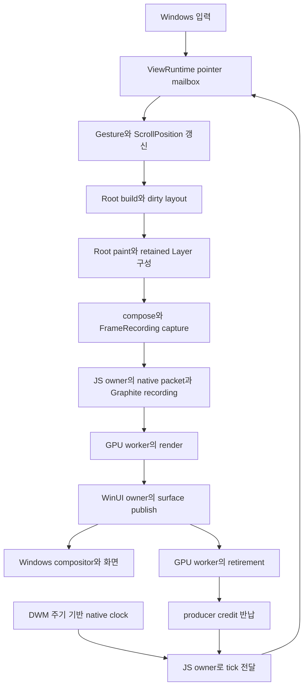

# 스크롤 잔끊김 개선 — Flutter 소스 비교와 렌더링·엔진 작업계획

작성: **2026-10-30 KST** · 상태: **분석·계획 작성 완료 / 구현 NOT_STARTED / 현재 제품 성능 notVerified**

## 1. 목표와 판단

목표는 스크롤을 시작할 때, 연속 이동할 때, 새 섹션이 들어올 때, 버튼·텍스트필드 위에 포인터가 있을 때 발생하는 짧은 끊김을 줄이는 것이다. 평균 FPS보다 **입력 이후 화면이 움직이기까지의 지연, 프레임 간격의 흔들림, p99·최대 긴 프레임**을 우선한다.

**권고는 기존 TypeScript UI Runtime과 Skia/Graphite를 유지하면서, Flutter가 사용하는 변경 경계별 paint 처리와 프레임 생산·소비 계약을 엔진에 완성하는 것이다.** Nelyx에는 이미 Widget/Element/RenderObject, sliver, RepaintBoundary, retained Layer/Picture, 제한된 프레임 제출이 있다. 이를 처음부터 다시 만들거나 렌더러만 교체하는 계획으로 잡지 않는다.

소스에서 확인한 주요 차이는 다음과 같다. 이것들은 개선 후보의 근거이며, 현재 사용자가 느낀 끊김의 원인을 확정한 측정 결과는 아니다.

1. Flutter는 dirty repaint boundary를 모아 paint하고 layer 속성 변경을 따로 처리한다. Nelyx는 하위 recording을 재사용하지만 Root에서 매 요청마다 `recordPaint → compose → capture`를 시작한다.
2. Flutter는 프레임 생산 슬롯과 vsync 시작·목표 시간을 연결한다. Nelyx의 Windows 경로는 제출 상한과 clock을 갖췄지만 **worker가 깨어난 시각과 JS dispatch 시각만 전달**한다. 선택 작업에 필요한 deadline은 전달하지 않는다.
3. 현재 Gallery는 이미 lazy list다. 그러나 lazy child 하나가 큰 데모 섹션 전체이므로, 처음 들어오는 child의 동기 build/layout/텍스트·Picture 생성 비용이 한 프레임에 몰릴 수 있다.
4. native GPU worker가 이미 있어도 **JS owner에서 수행하는 packet 구성·검증·Graphite recording** 비용까지 자동으로 사라지지는 않는다. 이 경계를 실제 AOT에서 계측해야 한다.

진행 순서는 **P0 기준 측정 → P1 clock·생산 여유 계약 → P2 dirty paint 파이프라인 → P3 cold 생성 단위 개선 → P4 입력·보조 작업 → 필요할 때 P5 전송/P6 GPU 개선 → P7 제품 검증**으로 둔다. 기존 리사이즈 계획의 단계 번호와 별개인 새 스크롤 계획이다.

## 2. 검토 범위와 증거 수준

### 2.1 이번 검토 기준

- Nelyx 저장소 기준 HEAD: `44f34da836536a949cb7bc5ea780bb6e7e72e6b5`. 시작 시 변경은 빈 untracked `work.md` 하나였다.
- 실제 비교 대상은 로컬 [`reference/flutter-master`](reference/flutter-master)의 프레임워크·엔진 소스다. 이 폴더는 Git 추적 제외 대상이며 `.git`이 없고 Flutter 본체의 확정 revision/version을 확인하지 못했다. 폴더명 `master`나 `flutter_packages.version`의 의존성 revision을 Flutter 본체 버전으로 해석하지 않는다.
- 따라서 아래 결론은 **검토한 로컬 snapshot 기준**이다. 최신 Flutter stable과의 완전한 일치·Flutter와 Nelyx의 실행 성능 우열을 주장하지 않는다. 공식 upstream 소스와 문서는 §9에 별도로 연결했다.
- 현재 요청에서 화면·입력 장치가 특정되지 않았으므로, 최신 기록의 **최대화 All Components 두 열 + 트랙패드 + 버튼/텍스트필드 hover**를 첫 대표 장면으로 삼고 ListView·Cupertino를 함께 확인한다. P0에서 실제 재현 장면과 다르면 그 장면을 우선한다.
- 이번 작업은 소스·기존 기록 검토와 계획 작성이다. 앱 실행, 새 프로파일링, 빌드, 물리 입력·화면 표시 검증은 수행하지 않았다.

검토한 Flutter 핵심 파일의 SHA-256은 다음과 같다. 로컬 reference를 교체한 뒤에는 같은 snapshot이라고 가정하지 않는다.

| 로컬 Flutter 파일 | SHA-256 |
| --- | --- |
| [`packages/flutter/lib/src/rendering/object.dart`](reference/flutter-master/packages/flutter/lib/src/rendering/object.dart) | `19206a10d5d0b71689aad2ad6f5a855d6a10504596e752d9028840af54234f14` |
| [`packages/flutter/lib/src/rendering/binding.dart`](reference/flutter-master/packages/flutter/lib/src/rendering/binding.dart) | `a428a2423a54a11ecdab6969abf3df5c8870dccf88b1c43441f40d71b2e89d33` |
| [`engine/src/flutter/shell/common/animator.cc`](reference/flutter-master/engine/src/flutter/shell/common/animator.cc) | `8454701fbc99fb3ac4d34a7774c54b14faebc9d16a515e6d83eb141c7460f7f0` |
| [`engine/src/flutter/shell/common/pipeline.h`](reference/flutter-master/engine/src/flutter/shell/common/pipeline.h) | `c6e9e9c44f52351e079e7fd3591b84f266c361bdb9f7c09cf2dc0d996a0a7152` |
| [`engine/src/flutter/shell/platform/windows/flutter_windows_engine.cc`](reference/flutter-master/engine/src/flutter/shell/platform/windows/flutter_windows_engine.cc) | `a38935d750fd0a86f318a3d956f0d089678db2f62f9e0528b906b11a39e85718` |

### 2.2 기존 결과를 해석하는 기준

아래는 [`history/26/10/30/work-summary.md`](history/26/10/30/work-summary.md)에 보관된 **이전 실행 결과**다. 이번 checkout의 새 측정값으로 사용하지 않는다.

| 이전 관찰 | 이번 계획에 주는 의미 |
| --- | --- |
| ListView 트랙패드 시작·연속·재접촉 사용자 확인 PASS-scoped | 입력 정지 회귀를 막는 기준이다. 모든 장면의 부드러움을 수락한 결과가 아니다. |
| All Components가 직전 빌드보다 부드럽다는 사용자 확인, 잔끊김은 PARTIAL | 기존 개선은 보존하되 새 긴 프레임과 간격 분포를 측정한다. |
| native 진단 CPU p95: no-hover 23.21→15.95ms, field-hover 22.97→19.18ms | CPU 여유가 작았다는 단서다. 서로 다른 빌드의 단일 전후 진단을 현재 성능이나 FPS로 환산하지 않는다. |
| hit test p95 1.220→1.001ms, p99 3.64→4.65ms, cold 최대 245.87ms | 평균·p95 개선만으로 잔끊김이 사라지지 않는다. cold와 tail을 분리한다. |
| Static AOT resize 약 19~20 geometry/s, CPU p95 약 22~27ms | 기존 `resizePerformanceAccepted=false`는 유지한다. resize 동기화 제거를 스크롤 개선으로 묶지 않는다. |
| 10월 30일 포맷·소스 정리 후 native/AOT 제품 재검증 없음 | P0는 현재 소스·설치본·실행 제품의 일치부터 확인한다. |

기존 `performanceAccepted=false`, 표시·scanout `notVerified`도 이번 문서 작성으로 바꾸지 않는다.

## 3. 실제 경로 비교

### 3.1 Nelyx 현재 경로



이는 책임의 흐름이다. GPU render·UI publish·retirement는 단계별로 오가며, 모든 프레임이 그림처럼 순차 완료된다는 뜻은 아니다.

- [`ViewRuntime.queuePointer/flushPointerInput/schedulePump`](Nelyx/src/hosting/runtime.ts): move·hover·wheel·panZoomUpdate를 최대 256개 보관하고 owned tick 전에 순서대로 dispatch한다. 시작/종료 등은 앞선 입력을 flush한다. 같은 frame request의 중복 예약도 이미 줄이고 있다.
- [`Root.build`](Nelyx/src/framework/widgets/root.ts): scheduler callback, build, layout, 선택 작업, paint/compose, 입력 geometry, semantics, capture, post-frame을 담당한다. `flushBuild/flushLayout` 호출이 존재한다고 매번 전체 트리를 rebuild/layout한다는 뜻은 아니다.
- [`PipelineOwner`](Nelyx/src/framework/rendering/object.ts): dirty layout·layout callback과 hidden paint retirement 큐가 있다. Flutter의 독립 `flushCompositingBits/flushPaint`에 해당하는 공개 단계는 현재 없다.
- [`RenderRepaintBoundary`](Nelyx/src/framework/rendering/repaint-boundary.ts), [`PaintingContext.compose`](Nelyx/src/framework/painting/context.ts), [`Layer`](Nelyx/src/framework/rendering/layer.ts), [`LayerRecording.drawNative`](Nelyx/src/ui/scene.ts): 하위 recording과 native Picture를 이미 재사용한다. 전체 primitive가 매번 모두 재생성·전송된다고 해석하면 안 된다.
- [`GraphiteFrameRenderer.submit`](Nelyx/skia/packages/native/src/renderer.ts): native reserve 뒤 JS owner에서 recording을 만들고 제출한다. accepted·GPU-retired는 관찰하지만 `present: 'unobserved'`다.
- [`RNSkWindowsWindowSurface`](Nelyx/skia/packages/rn/native/windows/RNSkWindowsWindowSurface.h): GPU worker에서 render·retire하고 WinUI owner에서 publish한다. [`WindowsFrameWorker`](Nelyx/skia/native/host/windows/WindowsFrameWorker.h)의 128-job 제한은 작업 큐의 상한이며 화면 프레임 128개를 쌓는다는 뜻이 아니다. renderer의 2-recording 제한과 구분한다.

### 3.2 Flutter와 대응표

아래 Flutter 경로는 모두 `reference/flutter-master/` 아래다. 함수명은 검토 지점이며 동일한 파일명을 도입하자는 제안은 아니다.

| 책임 | Flutter 소스에서 확인한 구조 | Nelyx 현재 구조와 검토 결론 |
| --- | --- | --- |
| vsync와 프레임 생산 | [`animator.cc`](reference/flutter-master/engine/src/flutter/shell/common/animator.cc) `BeginFrame/RequestFrame`, [`vsync_waiter.cc`](reference/flutter-master/engine/src/flutter/shell/common/vsync_waiter.cc) `FireCallback`: 중복 요청을 합치고 시작·목표 시각을 전달한다. pipeline이 가득 차면 생산을 미룬다. | [`CompositorFrameClock`](Nelyx/skia/native/host/windows/CompositorFrameClock.h), [`frame-clock.ts`](Nelyx/sdk/src/platforms/windows/frame-clock.ts), [`ViewRuntime`](Nelyx/src/hosting/runtime.ts): pacing·backpressure는 존재하지만 target/deadline·생산 여유 계약을 완성해야 한다. |
| 생산자·소비자 분리 | [`pipeline.h`](reference/flutter-master/engine/src/flutter/shell/common/pipeline.h)의 producer continuation과 [`rasterizer.cc`](reference/flutter-master/engine/src/flutter/shell/common/rasterizer.cc)의 consume 경계 | native worker는 이미 존재한다. UI/JS packet·recording 비용과 GPU 실행 비용을 나누고, 추가 thread보다 기존 소유권 경계를 먼저 정리한다. snapshot의 Flutter queue depth도 구성에 따라 1/2다. |
| layout·paint 단계 | [`rendering/binding.dart`](reference/flutter-master/packages/flutter/lib/src/rendering/binding.dart) `drawFrame`, [`rendering/object.dart`](reference/flutter-master/packages/flutter/lib/src/rendering/object.dart) `flushPaint`: dirty 경계를 깊이 순으로 처리하고 layer 속성 갱신을 구분한다. | Nelyx는 dirty layout이 있지만 Root paint 진입 뒤 boundary가 스스로 재사용을 판정한다. dirty boundary 중심 paint와 composition-only 갱신이 가장 직접적인 엔진 구조 개선 후보다. |
| retained scene | [`rendering/layer.dart`](reference/flutter-master/packages/flutter/lib/src/rendering/layer.dart) `addRetained`, [`display_list_layer.cc`](reference/flutter-master/engine/src/flutter/flow/layers/display_list_layer.cc) `Preroll/Paint` | Nelyx에도 EngineLayer와 native Picture 캐시가 있다. 차이는 유지되는 데이터의 범위와 매 프레임 남는 검증·조합·캡처 비용이다. native scene 전달을 전면 재작성하기 전에 비용을 확인한다. |
| 목록 가상화 | [`scroll_delegate.dart`](reference/flutter-master/packages/flutter/lib/src/widgets/scroll_delegate.dart)의 lazy builder·RepaintBoundary·선택적 keep-alive, [`sliver_multi_box_adaptor.dart`](reference/flutter-master/packages/flutter/lib/src/rendering/sliver_multi_box_adaptor.dart)의 child 수명 | [`scroll-delegate.ts`](Nelyx/src/framework/widgets/scroll-delegate.ts)도 기본 boundary를 제공한다. Gallery는 bounded retention이 이미 있다. 추가할 것은 일괄 keep-alive가 아니라 비싼 child의 생성 단위와 준비 예산이다. |
| 스크롤 위치와 layout | [`scroll_position_with_single_context.dart`](reference/flutter-master/packages/flutter/lib/src/widgets/scroll_position_with_single_context.dart), [`viewport.dart`](reference/flutter-master/packages/flutter/lib/src/rendering/viewport.dart) | Nelyx도 offset 변경으로 viewport layout을 요청한다. Flutter의 일반 스크롤도 UI layout과 paint/composition을 거친다. 모든 스크롤이 native transform만으로 끝난다는 전제는 채택하지 않는다. |
| 입력·hover | [`pointer_data_dispatcher.cc`](reference/flutter-master/engine/src/flutter/shell/common/pointer_data_dispatcher.cc)의 선택 가능한 dispatcher, [`gestures/binding.dart`](reference/flutter-master/packages/flutter/lib/src/gestures/binding.dart)의 resampler, rendering binding의 post-frame mouse 갱신 | Nelyx도 mailbox와 post-frame mouse 갱신을 사용한다. 이 Flutter snapshot의 resampling 기본은 false이고 resampler는 touch에 적용한다. Windows trackpad/wheel에 같은 보간을 그대로 적용하지 않는다. |
| raster 캐시 | [`flow/raster_cache.cc`](reference/flutter-master/engine/src/flutter/flow/raster_cache.cc), `DisplayListLayer::Paint`의 조건부 cache 사용 | Nelyx의 SkPicture 재사용은 명령 recording 재사용이다. raster 결과 texture 재사용과 구분한다. 실제 GPU 병목일 때만 P6에서 검토한다. Flutter도 backend·build 조건에 따라 cache 경로가 달라진다. |

## 4. 병목 후보와 확인 방법

### A. Root paint 시작 비용과 dirty 경계 갱신 — 구조 차이 확인, 영향도 미측정

현재 [`Root.build`](Nelyx/src/framework/widgets/root.ts)는 새 PaintingContext를 만들고 `recordPaint`를 호출한다. boundary 안의 static recording은 재사용되지만, 그곳까지 가는 paint 진입·버전 전파·composition 확인·frame command/resource 캡처는 남는다. [`RenderObject.invalidatePaint`](Nelyx/src/framework/rendering/object.ts)는 내용 변경과 상위 경계의 변화 버전을 구분하며 이미 일부 전파를 합친다. 이를 무시하고 같은 최적화를 중복 도입하지 않는다.

확인할 값은 **실제 repaint 경계 수, paint에 진입한 RenderObject 수, 재기록한 Picture 수, composition-only 갱신 수, frame command 수·bytes**다. 동작 중인 TextField나 버튼 하나 때문에 정적인 형제까지 방문하는지 조사한다. 기존 retained Picture hit가 높아도 composition 방문 비용은 별도로 남을 수 있다.

### B. clock과 생산 여유의 불완전한 연결 — 소스로 확인

현재 Windows clock은 DWM timing에서 다음 주기를 계산해 고해상도 timer로 기다린다. [`RNSkWindowsHost`](Nelyx/skia/packages/rn/native/windows/RNSkWindowsHost.h)는 깨어난 뒤의 monotonic 시각을 `nativeTick`으로 기록한다. SDK가 QPC/JS epoch를 보정하지만 목표 시각·refresh interval은 받지 않는다. **현재 tick은 실제 vblank나 표시 완료 시각이 아니다.**

[`FrameTiming.observedDeadline`](Nelyx/src/foundation/clock.ts)은 선택 속성이고, [`ViewWorkBudget.runOptional`](Nelyx/src/framework/widgets/view-work-budget.ts)은 유효한 deadline이 없으면 실행하지 않는다. Gallery도 [`preparation: 'disabled'`](sample/nelyx-testbed-app-2/src/gallery.ts)다. 설정을 `observed-budget`으로 바꾸는 것만으로 Windows 사전 준비가 켜지지 않는다.

`ViewRuntime.buildPending`의 gate는 **이미 pending CPU frame이 있을 때** renderer 여유를 확인하는 힌트다. GPU가 바쁠 때 최대 한 장을 미리 만드는 정책은 의도된 동작이다. Flutter식 producer continuation과 비교해, 그 한 장이 오래된 상태로 남는 시간·불필요한 재캡처·credit 복귀 지연을 계측하고 실제 예약 계약이 필요한 범위를 결정한다.

### C. cold 섹션의 큰 동기 생성 — 이전 긴 프레임 단서, 현재 원인 미확정

[`gallery.ts`](sample/nelyx-testbed-app-2/src/gallery.ts)의 item 하나는 `GallerySection(ListenableBuilder(...group...))`다. 목록 전체는 lazy지만 section 내부의 여러 control·paragraph·layout·초기 Picture compile은 함께 발생할 수 있다. [`gallery-section.ts`](sample/nelyx-testbed-app-2/src/gallery-section.ts)는 editor section만 keep-alive한다.

이전 cold 최대 245.87ms의 정확한 현재 기여율은 모른다. **mount/build, layout·intrinsic query, paragraph shape/layout, Picture compile, GC**로 나눠 가장 긴 섹션부터 찾는다. atomic build 하나가 예산보다 길면 deadline 유무와 관계없이 멈출 수 없으므로 생성 단위를 줄이는 것이 먼저다.

### D. 입력 burst와 hover·IME geometry·semantics — 일부 개선됨, tail 확인 필요

mailbox는 입력을 보존하지만 한 tick에서 최대 256개를 모두 처리할 수 있다. 각 입력은 gesture/hit-test/ScrollPosition 알림을 발생시킬 수 있다. 반대로 단순 delta 합산은 두 열 사이 target 변경·중첩 스크롤·방향 전환·extent 경계·알림 의미를 바꿀 수 있다.

semantics는 현재 Gallery에서 **300ms 및 정지 후 100ms quiet 갱신**, focus·값·action은 즉시 처리한다. 입력 geometry와 post-frame MouseTracker도 이미 별도 경로가 있다. hover를 끄거나 semantics 간격을 늘려 얻는 결과는 제품 해결로 수락하지 않는다. hover 유무, editor focus 유무, semantics 실사용 유무를 같은 소스·같은 제품에서 비교하고 실제 긴 frame의 동반 작업을 찾는다.

### E. JS/native packet·recording 할당 — 작업 존재 확인, 병목 여부 미측정

[`FrameRecording.capture`](Nelyx/src/ui/frame.ts)는 owned command도 frame admission·resource 수집을 수행한다. [`ScenePacket`](Nelyx/skia/packages/native/src/scene.ts)은 Float64Array와 handle table을 만들고 유효 범위를 `ArrayBuffer.slice`로 넘긴다. [`JsiDisplayList.h`](Nelyx/skia/native/adapters/jsi/cpp/api/JsiDisplayList.h)는 입력을 native 메모리로 복사해 검증한 뒤 명령을 실행한다. 이 경로는 JSI 호출 시점의 동기 작업이다.

다만 [`LayerRecording.drawNative`](Nelyx/src/ui/scene.ts)는 retained recording을 native Picture로 재사용하므로 항상 모든 leaf primitive를 다루는 것은 아니다. GC·packet·validation·Picture compile·Graphite recording 시간을 구분한다. native 복사는 handle getter가 원본 buffer를 변경하는 경우를 막는 역할도 있어, 단순 제거해서는 안 된다.

### F. GPU·presentation 간격 — 추가 증거 필요

그림자·clip·opacity·큰 surface의 replay, upload, allocator miss, publish 지연이 원인일 가능성도 있다. 기존 warm allocator 진단이 좋았다는 기록은 현재 AOT·최대화·cold 장면의 GPU 통과 증거가 아니다. `GPU producer → surface publish → retirement`를 frame identity로 연결한다. CPU와 GPU가 겹치므로 각 p95를 더해 frame latency라고 계산하지 않는다.

**현재 소스만으로 GC, GPU, DirectManipulation, RNW 중 하나를 단독 원인으로 확정하지 않는다.**

## 5. 목표 엔진 구성과 유지할 계약

Flutter에서 가져올 것은 **변경된 작업을 정해진 owner와 단계에서 수행하는 계약**이다. 물리 thread 수나 Dart VM·Impeller의 구현 전체를 복제하는 것이 아니다.

| 계층 | 맡을 책임 | 다음 계층에 넘길 것 |
| --- | --- | --- |
| Windows host | 입력 timestamp·view identity, refresh pacing, WinUI surface 수명 | 입력 packet, clock source·start/target/interval·불확실성 |
| UI Runtime | gesture·ScrollPosition·physics, Widget/Element, dirty layout, text/editor 논리 상태 | 현재 layout과 변경된 paint boundary |
| 공통 렌더 엔진 | dirty boundary paint, layer 속성 갱신, immutable scene/frame capture, resource accounting | owner/generation이 검증된 recording과 제한된 생산 슬롯 |
| native 렌더 경계 | 검증된 scene/handle 해석, native Picture/Graphite recording, 제출 | JSI에 의존하지 않는 native recording·resource hold |
| GPU worker·WinUI publish | GPU 실행·copy·fence retirement, 현재 세대의 surface publish | submitted/updated/retired 관찰과 credit 복귀 |

구현 시 지켜야 할 조건:

- JS/TS 객체·callback·mutable canvas·JSI handle을 GPU worker로 넘기지 않는다. 새로운 native snapshot을 도입한다면 JS owner에서 해석·검증하고 worker가 소유할 native 값과 독립 resource hold로 변환한다. Graphite context/recorder의 thread affinity도 함께 검증한다.
- UI layout과 hit-test의 기준 scroll offset은 하나다. 일반 스크롤을 native에서만 별도로 움직이는 이중 offset 체계를 이번 1차 범위에 넣지 않는다.
- `contents dirty`, `layer properties dirty`, `semantics configuration dirty`, `geometry dirty`를 구분하되 외부 subclass/custom hook은 보수 경로로 처리한다.
- 한 view의 미제출 CPU frame은 최대 1개, native recording admission은 현재 2개 상한을 출발점으로 삼는다. **front recording·consumer·retirement의 슬롯 의미를 확인한 뒤** credit을 정하며 큐 크기를 키워 FPS를 가리지 않는다.
- stale frame은 제출 전에 폐기할 수 있지만 이미 승인된 GPU 작업의 upload·retirement·resource 해제는 끝낸다. owner/view/viewport/renderer/native context/surface 세대를 보존한다.
- Picture 캐시와 raster texture 캐시는 별도다. 기존 Picture **64-entry / 32MiB**, optional child **16개 / Element 2,048개**, Gallery capacity 2를 우선 유지한다. keep-alive 등 mandatory resident 비용도 별도로 집계한다.
- explicit redraw·forced geometry·persistent animation·caret blink는 계속 동작해야 한다. `accepted`, 같은 paint epoch, `present='unobserved'`만으로 다음 요청 제출을 생략하지 않는다. 이전 두 번째 제출 누락 회귀를 재도입하지 않는다.
- 매 프레임 입력 geometry의 최신 transform·clip·visibility와 TSF/IME 정합성을 유지한다. semantics를 더 늦추거나 hover를 없애는 방식은 해결 조건이 아니다.
- resize의 이전 front 보존·exact generation commit·native synchronization은 유지한다. 변경이 필요하면 resize 정합성과 성능을 별도 검증한다.

## 6. 작업 단계

모든 구현 단계는 **NOT_STARTED**다. 각 단계는 비용 감소와 동작 보존을 함께 확인한 뒤 다음 단계로 넘어간다. 성능 근거가 없는 변경은 롤백하고 짧은 판단만 이 문서에 남긴다.

### P0. 현재 제품에서 끊기는 프레임 찾기

대상: [`runtime.ts`](Nelyx/src/hosting/runtime.ts), [`root.ts`](Nelyx/src/framework/widgets/root.ts), [`WindowsFrameTrace.h`](Nelyx/skia/packages/rn/native/windows/WindowsFrameTrace.h), [`windows-scroll-observer.ps1`](Nelyx/eng/windows-scroll-observer.ps1), 기존 native 측정 runner.

- [ ] 사용자가 사용하는 일반 명령으로 현재 제품을 먼저 실행한다. 화면, 창 크기, DPI·모니터·주사율, 입력 장치, hover/focus, engine/AOT·bytecode/profile/Debug·Release를 확인한다. 마지막 실행 구성은 자동 유지되므로 임의로 Release 결과로 대체하지 않는다.
- [ ] 현재 소스→dist/설치 패키지→빌드 acknowledgement→실행 EXE/AOT의 연결을 확인한다. 과거 SHA·PID를 현재 제품의 식별자로 재사용하지 않는다.
- [ ] idle/시작·재접촉, warm 왕복 no-hover, warm 버튼·TextField hover/focus, cold 첫 섹션 진입을 분리한다. 두 열은 왼쪽/오른쪽 및 pointer 이동을 포함하고 ListView·Cupertino를 회귀 장면으로 둔다.
- [ ] 기존 trace를 확장해 input→dispatch, build, layout, paint, compose, capture, geometry, semantics, post-frame hit-test, packet/validation/Picture compile/Graphite recording, GPU·publish·retirement를 동일 frame identity로 연결한다. host가 기록하지 않는 단계는 먼저 작은 계측을 추가한다.
- [ ] 시간뿐 아니라 dirty node 수, boundary 방문·재기록 수, command/packet bytes, mailbox 깊이·입력 나이, pending frame 나이, native credit, paragraph/Picture 생성·cache miss·GC를 기록한다. GC pause를 관찰할 수 없는 실행은 `unobserved`로 둔다.
- [ ] 기본은 저비용 bounded RAM 표본, 느린 프레임에서만 상세 수집이다. source 내부 함수 monkey patch 진단의 오버헤드를 구분하고 최종 판정은 계측을 끈 동일 제품에서 한다.

완료 조건: 주 재현 장면별 기준 trial 3회로 어느 구간이 긴 frame 또는 제출 공백과 함께 발생했는지 설명할 수 있다. 이 기준 실행은 P7의 변경 전후 비교에 재사용하며 같은 조건을 불필요하게 다시 측정하지 않는다. 모든 원인을 한 수치로 뭉치지 않는다. [`profile-gallery-scroll.mjs`](Nelyx/eng/profile-gallery-scroll.mjs)는 실제 sample Widget을 쓰는 **Node/CanvasKit CPU 진단**이므로 코드 기여 분석에만 사용하고 Hermes native 성능 수락으로 쓰지 않는다.

### P1. clock·deadline·생산 여유를 하나의 계약으로 연결

의존: P0. 대상: [`CompositorFrameClock.h`](Nelyx/skia/native/host/windows/CompositorFrameClock.h), [`RNSkWindowsHost.h`](Nelyx/skia/packages/rn/native/windows/RNSkWindowsHost.h), [`frame-clock.ts`](Nelyx/sdk/src/platforms/windows/frame-clock.ts), [`clock.ts`](Nelyx/src/foundation/clock.ts), [`runtime.ts`](Nelyx/src/hosting/runtime.ts), [`renderer.ts`](Nelyx/skia/packages/native/src/renderer.ts).

- [ ] native에서 계산한 frame start/target·refresh interval·timer wake/dispatch를 구분해 전달한다. DWM 예측, fallback, clock uncertainty와 monitor/DPI 변경 시 재보정을 포함한다. 예측 target은 실제 표시 receipt가 아니다.
- [ ] `observedDeadline`의 의미를 host-advertised 작업 한계로 명시하고, 부정확하거나 이미 지난 값에서는 선택 작업을 금지한다. Core에서 `tick + 16.67ms`로 만들어 넣지 않는다. wire/API 확장 시 SDK·native 버전과 공급 검사도 함께 갱신한다.
- [ ] 현재 한 장 CPU 선행 정책을 계측한 뒤, 필요하면 producer credit 예약·취소·반납을 추가한다. hint 조회와 실제 `nelyxReserve`의 경합을 구분하고, JS build 동안 GPU lock이나 WinUI 대기를 잡지 않는다.
- [ ] busy 상태에서도 입력 dispatch·필요한 forced geometry는 진행한다. 최신 dirty 상태로 미제출 frame을 교체하되 old lease는 새 capture 성공까지 유지한다. retirement/credit 알림 뒤 재시도와 숨김·복원·종료를 처리한다.
- [ ] animation/scroll의 다음 요청, explicit redraw, 여러 view의 공정성, clock callback 도중 재진입을 회귀 검증한다. 불필요한 polling이 크면 completion wake를 사용하되 정지 후 재개 누락이 없어야 한다.

완료 조건: deadline 없는 호스트는 기존 필수 경로로 동작하고 선택 작업은 비활성이다. busy 중 무한 CPU 재기록·credit 누수·입력 starvation·닫기 hang이 없고, 입력→dispatch/submit tail이 기준보다 악화되지 않는다.

### P2. dirty repaint boundary 중심의 공통 paint 파이프라인

의존: P0·P1. 대상: [`object.ts`](Nelyx/src/framework/rendering/object.ts), [`repaint-boundary.ts`](Nelyx/src/framework/rendering/repaint-boundary.ts), [`context.ts`](Nelyx/src/framework/painting/context.ts), [`layer.ts`](Nelyx/src/framework/rendering/layer.ts), [`root.ts`](Nelyx/src/framework/widgets/root.ts), [`scene.ts`](Nelyx/src/ui/scene.ts).

- [ ] dirty boundary와 layer 속성 변경을 소유하는 PipelineOwner 단계를 설계한다. 기존 layout·paint version·hidden retirement·nested boundary 캐시를 연결하고 같은 역할의 별도 트리를 만들지 않는다.
- [ ] 내용 변경은 해당 boundary의 recording을 갱신하고, offset/transform/opacity 등 내용이 같은 변경은 검증된 layer 속성만 갱신한다. compositing 필요 여부가 바뀌는 shape/clip/effect도 반영한다.
- [ ] attach·초기 frame·boundary 생성/제거·부모 변경·detached/hidden·custom paint의 안전한 fallback을 유지한다. dirty collection 순서와 부모/자식 중복 처리는 Flutter의 deepest-first 원칙을 참고해 수명 계약에 맞게 정한다.
- [ ] Root는 dirty layout/paint 수렴 후 scene을 compose·capture한다. 실제 요청 frame의 capture·submit과 post-frame 동작은 유지한다. 재사용하는 것은 검증된 recording이며 요청 자체를 취소하지 않는다.
- [ ] paint 도중 다시 무효화된 version을 clean으로 확정하지 않는다. 현재 refresh가 paint 이전 version을 잡는 규칙을 보존하고 다음 frame으로 남긴다.

완료 조건: 같은 화면에서 버튼·caret 하나의 animation이 정적인 형제 recording을 다시 만들지 않는다. 구조 fixture에서 방문·재기록 수로 입증하고 native AOT에서 paint/compose/capture 및 frame CPU p99가 개선돼야 한다. 실측 이득 없이 복잡성만 늘어나면 해당 경로를 채택하지 않는다.

### P3. cold child의 동기 작업량을 줄이는 sliver 구성

의존: P0, 선택적 준비는 P1 완료 후. 대상: [`sliver.ts`](Nelyx/src/framework/widgets/sliver.ts), [`sliver-multi-box-adaptor.ts`](Nelyx/src/framework/rendering/sliver-multi-box-adaptor.ts), [`sliver-list.ts`](Nelyx/src/framework/rendering/sliver-list.ts), [`view-work-budget.ts`](Nelyx/src/framework/widgets/view-work-budget.ts), [`gallery.ts`](sample/nelyx-testbed-app-2/src/gallery.ts), [`gallery-section.ts`](sample/nelyx-testbed-app-2/src/gallery-section.ts).

- [ ] P0에서 가장 비싼 section을 작은 lazy child 단위로 나눈다. 우선 header/control group 등 의미 있는 단위로 분할하고 샘플의 일회성 memo만으로 공통 엔진 문제를 덮지 않는다.
- [ ] 공통 delegate가 분할된 항목의 stable key·측정 extent·index lookup을 지원하도록 정리한다. 한 열↔두 열·filter·theme·font/DPI 변경에서 extent cache를 무효화하고 scroll anchor를 보존한다.
- [ ] controller·Form·selection/focus·IME 수명은 child 생성 단위와 분리한다. editor keep-alive를 유지하며 모든 section을 영구 보관하지 않는다.
- [ ] 비용이 충분히 작은 이웃 child만 선택적으로 준비하는 실험을 한다. 기존 1 child/tick·예상 2ms 이하·4ms reserve와 View 예산을 출발점으로 삼고 paint/submit tail까지 고려한다. 남은 시간이 없거나 새 입력·방향 전환·메모리 압력이 있으면 취소한다.
- [ ] 준비 작업의 p99·과소 추정·overrun을 측정한다. 동기 child 생성은 중간 취소할 수 없으므로 큰 작업을 잘게 나누기 전에는 자동 준비를 기본값으로 켜지 않는다.

완료 조건: 첫 진입의 긴 frame과 되돌아올 때의 재생성 비용이 함께 감소하고, producer/paragraph·Element·native bytes가 예산 안에 있다. cold 결과를 warm 평균에 섞지 않는다. ListView의 `dormant` 정책과 Gallery의 `bounded` 정책을 구분해 검증한다.

### P4. 입력·hover·semantics·IME의 중복 계산 정리

의존: P0 및 변경된 layout/paint 경계. 대상: [`runtime.ts`](Nelyx/src/hosting/runtime.ts), [`root.ts`](Nelyx/src/framework/widgets/root.ts), [`mouse-tracker.ts`](Nelyx/src/framework/rendering/mouse-tracker.ts), [`scroll-position-with-single-context.ts`](Nelyx/src/framework/widgets/scroll-position-with-single-context.ts), [`semantics-pipeline.ts`](Nelyx/src/framework/rendering/semantics-pipeline.ts).

- [ ] mailbox burst의 dispatch·hit-test·알림 수를 측정한다. 우선 allocation·변환 snapshot·dirty 전파의 중복을 줄인다. delta를 합치려면 동일 view/device/gesture/viewport/target·transform 범위를 증명해야 하고, 경계 clamp·반전·listener side effect가 있으면 원순서를 유지한다.
- [ ] down/up/cancel·panZoom start/end·focus 전환과 key 입력의 선후 관계를 유지한다. coalescing을 도입해도 원본 sequence/timestamp와 진단 연결을 보존한다.
- [ ] layout 후의 hover 재검사는 유지한다. 포인터가 정지해 있어도 content가 움직여 target이 바뀔 수 있다. scene/hit-test revision이 같은 경우만 재사용하고 enter/exit·cursor 변화는 빠뜨리지 않는다.
- [ ] semantics의 configuration 변경과 위치 변경을 기존 큐에서 구분한다. 300ms/quiet 정책을 더 늘리지 않고 계산·transport 중복을 줄인다. value/focus/action과 지연 action의 revision 재검증은 유지한다.
- [ ] text shaping/selection local geometry는 재사용하되 매 frame의 부모 transform·clip·TSF/caret 화면 좌표를 적용한다. 스크롤 후 재클릭 없이 입력·선택·조합이 계속돼야 한다.

완료 조건: hover/focus 장면 p99가 개선되고 입력 누락·중복/지연, nested scroll·두 열 target 오류, accessibility/IME 회귀가 없다. 보간·가속도·마찰 계수 조정은 이 단계의 CPU 개선과 분리한다.

### P5. 남는 frame packet·native recording 비용 축소 — 조건부

진입 조건: P0~P4 이후에도 packet/validation/Graphite recording이 deadline 초과의 주요 기여로 관찰됨. 대상: [`frame.ts`](Nelyx/src/ui/frame.ts), [`scene.ts`](Nelyx/src/ui/scene.ts), [`scene.ts(native)`](Nelyx/skia/packages/native/src/scene.ts), [`pictures.ts`](Nelyx/skia/packages/native/src/pictures.ts), [`JsiDisplayList.h`](Nelyx/skia/native/adapters/jsi/cpp/api/JsiDisplayList.h).

- [ ] 먼저 현재 retained Picture hit/miss와 바뀐 frame command 수를 확인한다. 이미 한 번 compile한 recording을 다시 캐시하는 계층을 추가하지 않는다.
- [ ] 내부에서 검증·소유한 immutable 명령은 admission metadata·resource hold를 재사용할 수 있는지 검토한다. 외부 mutable/frozen 배열·getter·custom hook에는 기존 검증을 유지한다.
- [ ] packet의 frame-local buffer 재사용 또는 native immutable scene handle을 작은 범위에서 비교한다. 기존 동기 replay와 수명·세대·오류 복구가 같아야 한다. JS buffer 공유·무검증 zero-copy는 채택하지 않는다.
- [ ] native scene/recording을 worker로 옮기는 경우 typed native resource와 generation 검증을 먼저 설계한다. 같은 Graphite recorder를 여러 thread에서 사용하거나 JSI 객체를 worker에 보관하지 않는다.

완료 조건: 실제 AOT에서 command bytes·할당/복사·recording 시간과 전체 p99가 함께 줄고 memory/retirement가 악화되지 않는다. 이득이 작으면 기존 경로를 유지하고 조건부 미진입 사유를 기록한다.

### P6. GPU replay·effect·raster 캐시 검토 — 조건부

진입 조건: CPU 프레임이 예산에 들어온 뒤에도 GPU producer/publish가 주요 지연으로 남음. 대상: 기존 native Picture backend, [`CompositionSurface.h`](Nelyx/skia/packages/rn/native/windows/CompositionSurface.h), Vulkan/Graphite 실행과 effect 경로.

- [ ] GPU 구간·upload·할당·fence 대기와 WinUI publish를 분리하고 shadow/clip/opacity/backdrop·surface 크기와의 관계를 본다.
- [ ] 먼저 재생 불필요한 scene 방문·불필요한 offscreen pass를 줄인다. 화면 효과·그림자 품질을 임의로 제거하지 않는다.
- [ ] 반복 replay가 비싼 정적 boundary에 한해 raster texture cache를 실험한다. 생성 비용, reuse 횟수, DPR·scale·transform·clip·context loss·fractional scroll의 cache key와 해제를 정의한다. blur·backdrop처럼 배경 의존 효과를 정적으로 캐시하지 않는다.
- [ ] Picture 한도와 별도의 GPU bytes·eviction 예산을 명시하고 warm/cold·GPU memory를 함께 비교한다. 기존 48 bytes/physical pixel 등의 allocator 설정은 병목 증거 없이 확대하지 않는다.

완료 조건: GPU 시간과 실제 surface update 간격이 함께 개선되고, 소수점 위치의 글자·그림자·clip 정합성과 device/context 수명이 유지된다. Impeller 도입·Skia 교체는 이번 1차 계획의 기본 항목이 아니다.

### P7. 일반 실행 제품에서 통합 검증·정리

의존: P1~P4, P5/P6는 진입 여부와 판단 기록. 대상: 실제 Testbed, 기존 tests·SDK 공급·README·현재 문서.

- [ ] 변경한 공통 경로에 맞는 회귀 검사·타입 검사와 native supplier rebuild/reinstall을 완료한다. AOT·bytecode는 각각 식별·검증하며 한쪽 결과를 다른 쪽에 승계하지 않는다.
- [ ] 같은 화면·배율·장치·제품 구성의 변경 전후 paired trial을 최소 3쌍 수행한다. 주요 네 장면 기준 24회 이내를 기본으로 하고 기존 검증과 중복되는 반복을 늘리지 않는다.
- [ ] 물리 트랙패드 시작·연속·반전·재접촉, 두 열 사이 pointer 이동, Button hover/press, 편집 중 스크롤 후 입력·한국어 IME, minimize/restore·close를 확인한다. 자동 OS wheel은 물리 트랙패드 확인과 별도로 기록한다.
- [ ] 공통 Core 변경은 Web/Android에도 layout·입력·수명 smoke를 적용한다. 이번 Windows 결과를 다른 플랫폼 성능 수락으로 확장하지 않는다.
- [ ] 계측을 끈 일반 명령에서 사용자 체감을 확인하고, 남은 문제는 장면·입력·단계별로 PARTIAL/notVerified를 유지한다. 사용 방법이 바뀐 경우에만 기존 한/영 README를 갱신한다.
- [ ] 실행별 임시 파일·생성 runner·staging·profile은 성공/실패/중단 모두 finally에서 정리한다. 현재 dist/제품만 유지하고 이 문서에 짧은 결과·잔여 작업을 남긴다.

## 7. 측정·수락 기준

### 7.1 비교 방법

P0에서 엔진·프로파일·AOT/bytecode·native inputs·실행 제품, 화면·창·DPI·모니터·주사율, semantics 설정, 입력 패턴과 cold/warm 조건을 고정한다. 성능 비교는 같은 조건의 optimized Release를 별도 기준으로 삼되, 사용자의 일반 명령에서 문제를 재현하고 마지막에 같은 명령으로 확인하는 절차도 유지한다.

primary 장면은 **All Components 두 열의 warm no-hover / Button hover / TextField hover·focus / cold 첫 탐색**이다. 한 trial은 정지→시작→10초 이상 연속→왕복·반전→손을 뗀 뒤 재접촉을 포함한다. cold는 재시작한 프로세스의 첫 진입만 측정하며 font/asset·driver cache 상태도 적는다. frame 표본이 적으면 p99를 안정된 값으로 제시하지 않고 n·max와 함께 남긴다.

### 7.2 제안 목표

아래 수치는 **새 작업의 제안 목표이며 아직 통과하지 않았다.** P0 직후 같은 조건의 기준값과 함께 확정한다. 실제 cadence를 얻지 못한 실행에서는 deadline miss를 계산하지 않는다.

`R = 해당 실행에서 선택한 목표 frame cadence`, `B = 1000 / R ms`로 정의한다. 먼저 60Hz 조건을 맞추고, 현재 주 모니터의 고주사율을 별도 조건으로 확인한다. 실제 165Hz로 구동하면서 결과를 60Hz 예산으로 통과시키지 않는다. 명시적 frame cap이 있으면 실제 cap과 표시 주사율을 모두 적는다.

| 항목 | 1차 목표 | 60Hz 예시 |
| --- | --- | --- |
| warm UI frame CPU | p95 ≤ 0.6B, p99 ≤ B | 10ms / 16.67ms |
| GPU producer의 독립 실행 시간 | p95 ≤ 0.6B, p99 ≤ B. publish 지연은 별도 집계 | 10ms / 16.67ms |
| host target까지 ready/publish | 유효한 target이 있는 표본의 miss ≤ 1%, 원인별 집계 | 실측 target 기준 |
| 연속 이동의 native surface update 간격 | p95 ≤ 1.5B, p99 ≤ 2B, warm 중 설명되지 않은 50ms 초과 정지 0회 | 25ms / 33.33ms |
| 입력→해당 입력을 반영한 surface update | p95 ≤ 3B. input sequence 연결 가능한 표본만 사용 | 50ms |
| cold 첫 진입 | 대표 section의 CPU max ≤ 3B를 1차 목표로 하고 초과 section을 명시 | 50ms |
| 입력·제출·수명 | 입력 누락·중복, stale publish, resource leak, shutdown failure 0 | 정합성 필수 |
| 메모리 | 기존 child/Picture 예산 유지, 같은 이동·복귀 후 live resource 증가 누적 없음 | peak와 복귀 후 resident 함께 확인 |

native surface update·GPU retirement는 scanout/FPS 증명이 아니다. 물리 입력 체감은 별도 PASS-scoped로 기록하고, source frame→desktop/display 연결이 없으면 표시 성능 수락은 `notVerified`로 둔다. 정지 frame·관찰 표본 누락을 연속 이동 frame gap에 섞지 않는다.

구조 변경은 관련 단계의 비용과 warm/cold p99가 함께 줄고 정확성·memory·다른 주 장면이 악화되지 않을 때 채택한다. 평균 개선과 max 악화가 같이 나오면 느린 frame을 분석하고 자동 수락하지 않는다. 기존 resize 목표·수락 상태는 이 표로 대체하지 않는다.

## 8. 실행 명령과 검증 경계

일반 실행 기준 명령:

```powershell
npm.cmd run run:windows --workspace @nelyx/testbed-2
```

구현 뒤에는 변경 범위에 맞춰 다음의 **기존** 검사를 선택한다. 이번 문서 작성에서는 실행하지 않았다. 각 테스트 timeout은 저장소 지침대로 20분을 유지한다.

```powershell
# clock·backpressure·입력 수명
npm.cmd run test:windows-animation
npm.cmd run test:native-paint-replay
npm.cmd run test:scroll-engine

# dirty paint·retained layer·geometry·반복 redraw
npm.cmd run test:paint-recording

# 실제 Windows 연속 OS wheel과 닫기 회귀
npm.cmd run test:windows-continuous-scroll

# 공통 Core 변경의 타입·공급 확인
npm.cmd run check:types
npm.cmd run test:runner-supply
git diff --check
```

특히 [`frame-visual-commit.test.mjs`](Nelyx/eng/tests/frame-visual-commit.test.mjs)의 unobserved admission 이후 explicit redraw, [`frame-backpressure.test.mjs`](Nelyx/eng/tests/frame-backpressure.test.mjs)의 forced/deferred 요청과 lease·busy 경합, [`repaint-isolation.test.mjs`](Nelyx/eng/tests/repaint-isolation.test.mjs)의 nested repaint, [`optional-sliver-work.test.mjs`](Nelyx/eng/tests/optional-sliver-work.test.mjs)의 deadline·선택 작업을 변경 계약에 맞게 보강한다. GPU/shadow를 바꾸면 `test:native-shadows`, native 공급·ABI를 바꾸면 해당 공급 검사도 추가한다. source test·빌드 통과를 물리 입력·표시 성능 PASS로 바꾸지 않는다.

[`copilot-instructions.md`](.github/copilot-instructions.md)의 임시 산출물·검증 로그·독립 설치본 누적 금지를 따른다. `Nelyx/docs/plans/`, `Nelyx/docs/migrations/`를 만들지 않으며 과거 archive를 새 checkpoint 저장소로 사용하지 않는다. baseline도 제품 전체 사본을 계속 쌓는 방식 대신 실행 중 비교 후 필요한 요약만 남긴다.

## 9. Flutter 공식 참고자료

아래 GitHub `master` 링크는 이동하는 upstream 참고 링크다. 상세 비교·함수 위치의 기준은 §2의 로컬 snapshot이며 두 소스의 byte 일치를 주장하지 않는다.

- [Flutter architecture](https://docs.flutter.dev/resources/architectural-overview): framework·engine·embedder와 rendering 책임의 전체 맥락.
- [Animator 소스](https://github.com/flutter/flutter/blob/master/engine/src/flutter/shell/common/animator.cc), [Pipeline 소스](https://github.com/flutter/flutter/blob/master/engine/src/flutter/shell/common/pipeline.h): frame 생산과 bounded consumer 경계.
- [Rendering binding](https://github.com/flutter/flutter/blob/master/packages/flutter/lib/src/rendering/binding.dart), [RenderObject/PipelineOwner](https://github.com/flutter/flutter/blob/master/packages/flutter/lib/src/rendering/object.dart): frame 단계와 dirty repaint boundary 처리.
- [Windows engine](https://github.com/flutter/flutter/blob/master/engine/src/flutter/shell/platform/windows/flutter_windows_engine.cc): Windows refresh interval·vsync target 구성.
- [Performance profiling](https://docs.flutter.dev/perf/ui-performance): 실제 실행 조건에서 UI·raster 시간을 나눠 분석하는 기준.
- [Performance best practices](https://docs.flutter.dev/perf/best-practices): build 범위, lazy 목록, intrinsic layout·offscreen layer 비용을 검토할 때의 보조 기준.

## 10. 현재 진행 상태

| 항목 | 상태 |
| --- | --- |
| 현재 Nelyx·로컬 Flutter 소스 및 기존 기록 검토 | DONE |
| 원인 후보·목표 책임·단계·수락 기준 작성 | DONE |
| P0 현재 제품 계측 | NOT_STARTED |
| P1~P4 기본 개선 | NOT_STARTED |
| P5/P6 추가 엔진·GPU 개선 | CONDITIONAL / NOT_STARTED |
| P7 제품·물리 입력·표시 검증 | NOT_STARTED |
| 스크롤 성능 최종 수락 | `performanceAccepted=false` 유지 |
| resize 성능 수락 | `resizePerformanceAccepted=false` 유지 |

이번 산출물은 이 `work.md` 하나다. 구현 결과와 새 성능 수치는 다음 작업에서 확인한 범위만 여기에 갱신한다.
