# Windows 창 크기 조절 FPS 개선 계획

- 작성일: 2026-10-27
- 상태: **PARTIAL — 2026-10-28 최신 AOT의 세 화면 연속 OS 휠·정상 종료 및 사용자 트랙패드 시작·연속·재접촉 확인 PASS-scoped. AOT 리사이즈 10사례·1,533캡처 통과. 51 geometry 변화/s·CPU p95 10ms는 미달이며 `resizePerformanceAccepted=false` 유지**
- 대상: `sample/nelyx-testbed-app-2` 및 공통 Windows 리사이즈·프레임 처리 경로
- 계획 기준 커밋: `708d9edffa5dab673e15e142c833286eeb4a6b72` / 구현 시작: `dd98826b25b19c158258d6df24ffc99d8c19af52`
- 성능 수락: **`resizePerformanceAccepted=false`**

## 1. 목표와 선행 수정의 경계

사용자가 확인한 남은 문제는 Skia가 창 크기를 뒤늦게 따라오는 현상보다 **창의 실제 크기가 변하는 FPS 자체가 낮은 것**이다. 이전 동기화 수정을 유지하면서, 드래그 입력부터 실제 창 크기 변경과 콘텐츠 표시까지 걸리는 시간을 줄인다.

선행 수정의 프레임 사전 준비, 실제 크기 확인 후 적용, 최상위 HWND 직접 합성, 입력 전달과 종료 처리는 유지한다. 이번 작업은 이 경로의 처리량과 지연을 개선하는 후속 작업이다. 과거 엔진·컴파일러 작업 문서를 재개하지 않는다.

2026-10-27 사용자의 전체 작업 요청으로 구현을 시작했다. 2026-10-28 기반 전반 검토 요청에 따라 공통 Core의 paint·제출·무효화 계약도 개선했다. 최신 단계별 결과는 §8에 갱신한다.

## 2. 기준 상태와 아직 증명하지 않은 것

아래 실행 결과는 **앞선 작업에서 얻은 기록**이며 이번 계획 작성 중 다시 실행한 측정이 아니다.

| 항목 | 선행 기록 | 해석 |
| --- | --- | --- |
| 실행 구성 | Windows x64 Release, Hermes bytecode / optimized | 우선 비교할 실행 구성 |
| 실행 파일 SHA-256 | `99422cc8a9920dd9069059091d85a3f8d779ac5fdb4ee2b5f1ea1ce0b5573d1f` | 현재 빌드 manifest에서도 확인한 비교 식별자 |
| native inputs SHA-256 | `2bbc534572a81996b56325345cf190631c3399e35ea13e6fe3b31a957d38ea2e` | 현재 manifest의 공급 입력 식별자 |
| 화면 정합성 | Material·ListView·Cupertino × 우하단·좌상단, 총 6조합 / 304개 캡처 샘플 | 배경 노출·글자 크기 변화·표시 경계 불일치·준비 timeout 0건 |
| 실제 geometry 관찰 | 조합당 약 1초에 16~18회 | 낮은 갱신 빈도의 단서이며 정식 FPS 측정값은 아님 |
| JS 프레임 CPU p95 | 약 26~32ms | `Frame.cpu` 콜백 전체 비용이며 build/layout만의 비용은 아님 |
| 요청→surface update p95 | 약 58~83ms | 포인터 입력→geometry 또는 실제 표시 지연과 구분해야 함 |
| surface update 최대 간격 | 약 67~86ms | HWND 크기 변경 간격이나 scanout 간격으로 대체 해석하지 않음 |
| 일반 앱 확인 | 클릭·테마·휠·최대화·복원·종료 코드 0 | 연속 리사이즈 FPS 수락 근거는 아님 |

기존 입력 fixture는 기본 35ms 간격으로 24회 이동하며, 주기 허용 범위도 35~120ms다. 따라서 입력 발생 자체가 약 28.6Hz 이하로 제한되고, 이 검사로 60fps 개선을 입증할 수 없다. 기존의 최소 4회 갱신 조건은 멈춤 감지 조건으로만 유지한다.

새 작업의 시작 시 커밋, dirty 상태, 실행 구성, 공급 입력과 설치된 native header 바이트, 실제 실행 파일을 다시 확인한다. 버전 문자열이나 이전 실행 파일의 존재만으로 기준 일치를 인정하지 않는다.

## 3. 현재 코드에서 확인한 경로와 병목 후보

| 구간 | 주요 파일 | 확인할 비용 |
| --- | --- | --- |
| 제안 크기·실제 HWND 크기 처리 | `Nelyx/sdk/native/windows/WindowsAppHost.h` | `WM_SIZING`, `arrangeExtent`, `WM_WINDOWPOSCHANGED`, 중복 Arrange |
| UI 소유 작업·세대별 준비 대기 | `Nelyx/skia/packages/rn/native/windows/WindowsResizeCoordinator.h` | mailbox 도착, 실제 대기 시간, ready 판정, 취소된 제안 |
| Windows 프레임 예약 | `Nelyx/sdk/src/platforms/windows/frame-clock.ts` | native tick→JS dispatch, 다음 프레임까지의 예약 지연 |
| Core 프레임 처리 | `Nelyx/src/hosting/runtime.ts` | `updateMetrics`, pointer flush, pending 교체, frame 예약·admission |
| Widget·layout·paint·semantics | `Nelyx/src/framework/widgets/root.ts`, `Nelyx/src/framework/widgets/framework.ts`, `Nelyx/src/framework/rendering/semantics-pipeline.ts` | 크기 변경으로 발생하는 실제 재작업과 할당 |
| raster·copy·retirement | `Nelyx/skia/packages/rn/native/windows/RNSkWindowsWindowSurface.h`, `CompositionSurface.h` | worker 큐, GPU 처리·복사, fence, prepared frame 완료 |
| 합성·OS 대기 | `WindowsAppHost.h`, `Nelyx/skia/packages/rn/native/windows/CompositionDevice.h` | WinUI commit, native commit/`WaitForCommitCompletion`, `DwmFlush` |
| 계측·재현 | `Nelyx/skia/packages/rn/native/windows/WindowsFrameTrace.h`, `Nelyx/eng/tests/windows-animation.cpp`, `windows-animation.tsx`, `windows-resize-pixels.h` | 입력·geometry·표시 변화의 독립된 빈도와 지연 |

현재 `prepareSizing`은 최대 100ms의 프레임 준비 rendezvous 뒤 합성 클록을 최대 32ms 기다린다. 실제 크기가 확정되면 WinUI commit, native commit 처리 완료 대기, `DwmFlush`를 수행한다. **100ms와 32ms는 항상 소비하는 시간이 아니라 상한**이며, 실제 소비 시간과 겹치는 대기를 측정해야 한다. OS commit/flush 호출의 대기까지 이 상한으로 제한된다고 보지 않는다.

유력한 가설은 다음과 같다. 아직 원인 확정이나 제거할 대기의 목록으로 취급하지 않는다.

1. JS 프레임 예약, 준비 후 합성 클록, commit/flush가 여러 표시 주기를 직렬로 소비한다.
2. 크기 변경의 build/layout/paint/semantics 또는 프레임 직렬화 비용이 한 표시 주기의 예산을 넘는다.
3. 불필요한 native status, Arrange, pending frame 교체나 stale 작업 때문에 최신 크기의 준비가 늦어진다.
4. raster/copy/retirement의 admission 제약으로 CPU와 GPU가 겹쳐 일할 기회를 잃는다.

Doroti의 사전 준비·합성 클록 정렬·실제 geometry 직후 적용 방식은 참고하되, Nelyx의 D3D11 drawing surface와 JS 프레임 소유권에 필요한 대기를 별도로 증명한다. Doroti의 DXGI 표시 통계와 Nelyx의 commit 완료를 같은 완료 신호로 취급하지 않는다.

## 4. 유지해야 할 조건

- 배경 선행 칠하기, 오래된 이미지 확대·축소, padding·crop으로 미완성 영역을 숨기는 방식으로 FPS를 올리지 않는다.
- 실제 extent와 일치하는 prepared frame을 적용하고 owner/view/viewport/surface generation을 검증한다. A→B→A도 같은 세대로 간주하지 않는다.
- fence retirement, 취소·실패·닫기 완료와 native 객체의 UI/JS/GPU 소유권을 유지한다.
- resize 대기 중 일반 Win32/RNW 메시지를 재진입 처리하거나 UI 스레드에서 JS·raster를 실행하지 않는다.
- 입력, focus, IME, 접근성 action과 pointer capture를 성능용으로 끄거나 버리지 않는다. 크기만 바뀐 semantics geometry의 기존 지연 정책과 실제 action 처리를 구분한다.
- 같은 장면을 정확하게 더 빨리 처리하는 것을 우선한다. 엔진 전환, compiler 재설계나 샘플의 기능·위젯 수 감소를 기본 해법으로 삼지 않는다.
- 새로운 보관·재사용이 필요하면 owner, 보관 이익, 무효화·해제 시점, pressure/failure 동작을 명시한다. 임의의 전역 MB·cache 개수 상한으로 정당화하지 않는다.

## 5. 작업 단계

### S0 — FPS 재현과 비교 기준 확정

- [x] 현재 Release 앱과 선행 정합성 검사를 짧게 재확인하고 기준 식별자를 갱신한다.
- [x] 고해상도 단조 시계와 경과 시간 기반 궤적으로 입력 fixture를 확장한다. 60Hz를 첫 비교 입력으로 사용하고, 필요하면 대표 조합에서 120Hz를 추가한다.
- [x] 요청한 입력 빈도와 실제 주입·처리 빈도를 모두 보고한다. OS의 mouse move 병합을 앱이 처리한 입력으로 세지 않는다.
- [x] 같은 크기를 반복 통지한 횟수를 제외하고 실제 HWND/client rect 변화 시각과 XYWH를 기록한다. 왕복 궤적의 재등장 크기도 새로운 변화로 센다.
- [x] 모니터/DPI/주사율, GPU, 엔진·compiler profile, 접근성 설정, warm-up, 측정 구간과 입력 속도를 고정한다.
- [x] Material·ListView·Cupertino의 우하단/좌상단을 기준 조합으로 하고, 높은 빈도의 장시간 측정은 대표 조합부터 시작한다.

**완료 조건:** 입력 빈도, geometry FPS, surface update 빈도, 캡처에서 관찰한 표시 변화 빈도가 분리된 기준 표가 있어야 한다. 기존 35ms fixture의 수치를 60fps 성능 기준으로 재사용하지 않는다.

### S1 — 한 resize transaction의 시간 분해

- [ ] 입력 수신, `WM_SIZING` 진입/종료, metrics 송신·JS 수신, 프레임 예약/실행, build/layout/paint/semantics, 기록·제출을 구분한다.
- [ ] native admission, worker 대기, raster, copy, fence retirement, ready, stage 13 클록 대기, actual geometry, 각 commit/flush의 시작·종료를 연결한다.
- [x] frame·surface·viewport·transaction 식별자와 clock domain을 보존한다. 서로 보정하지 않은 JS·QPC·capture 시각을 빼서 지연을 만들지 않는다.
- [x] critical path와 중첩 구간을 그린다. CPU 전체 비용을 단순히 Core build 비용으로 부르거나 겹치는 시간을 중복 합산하지 않는다.
- [x] 계측 켜기/끄기의 비용을 대표 사례에서 비교한다. bitmap readback과 고밀도 JS 래핑이 붙은 진단 실행은 최종 성능 수락에서 제외한다.

**완료 조건:** 낮은 FPS를 설명하는 주된 구간과 지불하지 않아도 될 것으로 의심되는 대기가 수치로 특정되어야 한다. 아래 단계는 확인된 병목의 순서대로 진행하며 불필요한 단계의 코드를 바꾸지 않는다.

### S2 — 프레임 예약과 직렬 대기 개선

- [x] resize 준비 요청이 이미 프레임 tick에 정렬됐는데 다시 다음 tick을 기다리는지 확인한다.
- [ ] 필요한 경우 현재 프레임 scheduler·owner/admission 계약 안에서 resize 준비의 우선순위나 예약 방식을 개선한다. 기존 forced frame 경로를 무조건 우회 호출하지 않는다.
- [ ] 같은 extent·scale의 중복 Arrange/status와 아직 제출하지 않은 오래된 metrics 작업을 줄인다. 입력 순서와 이미 제출된 recording의 upload/retirement는 보존한다.
- [x] pre-geometry clock, WinUI/native commit, 완료 대기, `DwmFlush` 각각의 역할을 검증한다. 측정 근거가 있는 중복 대기만 한 항목씩 줄이거나 합친다.
- [ ] 취소·실제 크기 불일치·DPI 변경·최소화·종료 시 즉시 기존 안전 경로로 수렴하게 한다.

**완료 조건:** 동일 입력에서 geometry 간격이 개선되고 기존 정합성 검사가 유지된다. timeout을 늘리거나 창이 콘텐츠보다 먼저 커지도록 바꾸는 것으로 완료하지 않는다.

### S3 — 크기 변경의 Core CPU 비용 절감

- [ ] S1에서 큰 것으로 확인한 build/layout/paint/semantics·직렬화 구간부터 최적화한다.
- [x] viewport 크기 변경과 environment/theme/DPI·renderer 교체의 invalidation 범위를 구분한다. 크기에 의존하는 위젯은 반드시 다시 계산한다.
- [ ] 불필요한 전체 subtree 재빌드, 반복 paragraph/layout 계산, 동일한 불변 데이터 생성과 semantics geometry 재작업을 확인한다.
- [ ] 기존 semantics 지연만으로 CPU를 숨기지 않는다. action·focus·텍스트 입력 geometry의 즉시성과 접근성 켜짐 상태를 유지한다.
- [x] 재사용을 도입하면 dependency·generation·해제 규칙을 함께 구현하고, 가변 label/callback/스타일이 오래된 값으로 남지 않는 회귀 검사를 붙인다.

**완료 조건:** 프레임 CPU의 실제 감소와 geometry FPS 개선이 함께 나타나야 한다. 빈 RAF나 idle 구간을 섞어서 평균만 낮추지 않는다.

### S4 — GPU·복사·준비 처리량 개선

- [x] S1에서 GPU나 admission 직렬화가 남은 병목일 때 진행한다. 현재는 CPU가 우선이므로 GPU 구조 변경을 진행하지 않는다.
- [ ] 현재 준비 프레임과 아직 제출하지 않은 최신 CPU 작업이 안전하게 겹칠 수 있는지 검토한다. 오래된 제안을 쌓는 queue를 만들지 않는다.
- [ ] surface/texture 생성, GPU copy, fence/commit 대기 비용을 분리하고 필요한 재사용만 적용한다.
- [ ] 늦게 끝난 프레임은 실제 크기·세대에 맞을 때만 표시한다. superseded 작업도 upload/retirement와 자원 해제를 끝낸다.
- [ ] 버퍼·bridge capacity 변경 시 Window/device owner의 보관·해제 정책과 실패 동작을 검증한다.

**완료 조건:** GPU/critical path 지연이 감소하고 취소·닫기 후 자원과 consumer가 남지 않는다. 근거 없이 swap chain이나 전체 renderer를 교체하지 않는다.

### S5 — 통합 수락·배포 출력·정리

- [x] 낮은/높은 입력 빈도, 양방향 왕복, 네 변과 모서리의 대표 사례, 창 이동을 동반하는 좌상단 변경을 확인한다.
- [x] 고정 typography 구간은 기존 glyph·marker 검사를 유지한다. 반응형 breakpoint를 넘는 별도 사례는 정상적인 글꼴·layout 전환의 예상값을 사용한다. 현재 short header 18px·padding 16↔28 범위이며 높이 600 이상 28/36px 제목은 별도 notVerified다.
- [ ] 실제 OS 입력으로 클릭·휠·capture loss·드래그 유지, 최대화/복원, 취소, 종료를 확인한다. 물리 IME·터치패드 미검증은 별도 표기한다.
- [x] 변경한 영역의 회귀 검사·typecheck, Release 빌드, 설치 header 바이트와 실행/패키지 SHA 일치를 확인한다. deadline·실패 취소 보완도 §9의 최신 AOT에 반영됐으며 §10에서 현재 공급·패키지와 세 화면 연속 OS 휠을 다시 확인했다. 최신 리사이즈 성능 검증은 별도다.
- [ ] 대표 사용자 드래그에서 창 자체의 부드러움과 콘텐츠 정합성을 함께 확인한다. 자동 캡처 결과로 사용자의 체감이나 전체 scanout을 대신 수락하지 않는다.
- [x] 최신 결과·미달 항목·다음 시작점만 이 문서에 남기고, 제품 실행 방법은 기존 README에 반영한다.

## 6. 성능과 화면 품질의 수락 기준

아래 수치는 **개선 목표이며 아직 달성한 결과가 아니다.** 첫 성능 목표는 60Hz에 상응하는 연속 크기 변경이다. 실제 주사율과 입력 한계를 기록하고, 60Hz보다 낮은 환경은 도달 가능한 주기에 정규화한다. 제품에 60fps 고정 제한을 추가하는 뜻이 아니다.

`R = min(실제 표시 주사율, 60)`, `B = 1000/R ms`로 첫 목표를 정의한다. 입력 주입이 최소 `R`을 충족하고 계측 overhead가 통제된 구간에서 판정한다.

| 지표 | 목표 |
| --- | --- |
| 실제 geometry 변화 FPS | 각 기준 조합에서 `0.85 × R` 이상 — 60Hz 기준 51회/초 이상 |
| geometry 변화 간격 | 중앙값 `1.2B` 이하, p95 `2B` 이하, 최대 `4B` 이하 |
| 입력→일치하는 actual geometry 적용 | p95 `3B` 이하; 좌표·시계 연결이 유효한 표본만 사용 |
| metrics 수신→prepared copy ready | p95 `B` 이내를 목표로 critical path 단축 |
| CPU | 큰 CPU 구간을 별도 예산화하고, 프레임 CPU p95는 `0.6B` 이내를 목표로 함 |
| 표시 변화 빈도 | 같은 desktop frame의 caption/client 경계 변화로 별도 보고; capture 누락 시 수락 보류 |
| 기존 화면 품질 | 배경 노출·글자 늘어남·잘못된 세대 표시·marker X/Y 경계 불일치 0건 |
| 수명·입력 | cancel/close/focus/capture 회귀 없음, 정상 종료 시 GPU·입력 owner 정리 |

FPS는 측정 구간의 연속적인 rect 변화로 구한다. 전체 구간에서 서로 다른 width의 개수, `WM_SIZING` 호출 수, surface update 수를 표시 FPS로 대체하지 않는다. p95는 전체 유효 분포를 사용하고 시작·종료와 responsive reflow 비용을 따로 보고하되 숨기지 않는다.

목표에 미달하면 개선 전후 수치와 남은 critical path를 적고 **`PARTIAL` / `resizePerformanceAccepted=false`**로 남긴다. 단순한 배율 개선, 빌드 통과, 기존 정합성 검사 통과만으로 성능 수락을 완료하지 않는다.

## 7. 검증 운영

- 모든 테스트는 20분 timeout을 사용한다. 예: `node --test --test-timeout=1200000 <변경 영역의 test.mjs>`.
- 기준 측정→주요 병목별 대표 사례→전체 수락 조합 순서로 진행한다. 일반 검증은 30회 이내로 제한하고 같은 바이너리를 이유 없이 반복 실행하지 않는다.
- 동일 장면·궤적·설정으로 비교하고, 한 번에 원인이 다른 최적화를 섞지 않는다. 개선되지 않거나 화면 품질을 깨뜨린 변경은 제거한다.
- 드래그 시작 전 실제 OS move 입력으로 커서를 테두리에 옮기고 hover/포인터 피드백을 정리한다. 안정된 resting 캡처로 기준을 잡되 드래그 중 불리한 프레임은 버리지 않는다.
- 측정은 앱이 소유한 영역으로 제한한다. 원본 캡처·긴 trace·과거 실행 receipt·consumer 설치본·profile을 누적하지 않는다.
- 한 실행에 필요한 임시 디렉터리만 쓰고 `finally`에서 성공·실패·중단 모두 정리한다. 현재 실행 안에서는 가능하면 증분 native 빌드를 사용하되, 설치된 header의 내용 변경을 timestamp나 버전 문자열만으로 놓치지 않는다.
- 패키지는 현재 dist만 남기고 staging/이전 출력은 정리한다. `Nelyx/docs/plans/`, `Nelyx/docs/migrations/` 또는 새 history 보관 경로를 만들지 않는다.

## 8. 현재 결과와 남은 작업

- 아래는 중간 마무리 당시의 결과다. **2026-10-28 / 리사이즈 PAUSED / PARTIAL / `resizePerformanceAccepted=false`**로 구현·고비용 검증을 중단했다. 이후 실제 AOT 사용 확인에서 사용자는 **창 크기 조절 FPS는 괜찮게 느껴진다**고 답했으나 §6 수치 수락으로 옮기지 않는다. 트랙패드와 마우스 휠의 간헐적 먹통 조사 이력은 §9, 이번 전체 작업 재개의 최신 상태는 §10을 따른다.
- 이번 재개 시작점은 `491ea1d`, 당시 dirty 없음이었다. 중간 마무리 뒤 저장소 HEAD가 `a09b23b0216f2827887de1a00a6a8bb8f8a2e251`이고 clean인 것을 확인했다. 추가 조사에서 새 commit은 만들지 않았다. 리사이즈 test·compiler는 멈췄으며 사용자 재현용 진단 앱은 §9에 따라 켜두었다. 과거 엔진·컴파일러 계획은 재개하지 않았다.

| 단계 | 상태 | 현재 결과와 남은 범위 |
| --- | --- | --- |
| S0 FPS 기준 | DONE-scoped | QPC·시간 기반 왕복 입력, 주입/WM_SIZING/연속 HWND rect/surface/desktop 변화 구분 |
| S1 시간 분해 | PARTIAL | Core metrics·예약·layout/paint/semantics/capture와 native frame을 QPC로 연결. 세부 native 구간·transaction 전체 연결과 지속적인 overhead 수락은 남음 |
| S2 예약·대기 | PARTIAL | width 68/68·height 101/101 metrics가 기존 예약 재사용. metrics→build p95 3.99/4.37ms. height의 native 대기도 분리했으나 동기화 변경은 없음 |
| S3 Core CPU | PARTIAL | 동일 primitive picture·불변 상태값·변경 batch의 하위 scope 재사용 검증. deadline 대기의 조기 Root 실행은 source에서 제거했지만 native FPS 개선·추가 build 감소는 입증하지 못함 |
| S4 GPU·처리량 | CONDITIONAL | 현재 CPU가 우선. GPU buffer/admission/renderer 구조와 자원 소유권 변경 없음 |
| S5 통합 수락 | PARTIAL | picture 재사용 Core의 10 resize 사례·실제 Release 스크롤 통과. 뒤이은 deadline 수정은 아직 실제 AOT에 미반영. 과거 실패·큰 창 전환 timeout·물리 표시 수락 경계 유지 |

### 구현과 보관·해제 계약

- 실제 extent·owner/view/viewport/surface 세대를 맞춘 prepared frame만 적용한다. 100ms 준비 deadline을 넘으면 USER32 제안을 실제 기존 rect로 되돌리고 canonical metrics를 복원한다. view별 취소 세대 fence가 늦은 producer의 표시를 막지만 upload/retirement는 완료한다. view unbind 때 fence를 해제한다. 과거 제안 queue나 장면·GPU 객체를 보관하지 않는다.
- GPU copy retirement → pre-geometry clock → 실제 geometry → WinUI/native commit 완료 → DwmFlush를 유지한다. 대기 제거 실험은 확장 화면 검사 실패로 철회했다. 배경 선행 칠하기·과거 이미지 확대·crop으로 정합성을 숨기지 않는다.
- Root paint 재사용·visual/submitted epoch·admission 기반 제출 생략은 명시적 redraw와 persistent callback의 두 번째 제출 누락(`1 !== 2`)으로 철회했다. `FrameworkRoot`는 요청 프레임마다 recordPaint → compose → capture → submit한다. repaint boundary의 paint 진입 version 보존은 유지한다.
- 새 수정은 **깊이 검증된 immutable primitive 명령과 resource owner가 같은 batch**에 한정한다. viewport bounds만 바뀌면 기존 PictureLayer의 bounds metadata를 현재 값으로 갱신하고 같은 picture producer를 이동한다. Picture는 CPU 명령의 소유자이며 이전 크기의 raster 이미지가 아니다. 독립 Scene/제출 프레임은 각자의 자원 hold를 유지한다. 명령·스타일·resource owner/generation 변경과 실패는 기존 재기록·해제 경로를 따른다. layer 퇴역 때 producer를 해제하며 전역 cache·임의 MB/capacity 제한을 추가하지 않는다.
- 수정 전 같은 primitive batch의 viewport 변경에서 컴파일 수 **`4 !== 2`** 실패를 재현했다. 수정 후 root/child layer 양쪽의 A→B→A, 현재 bounds, 바뀐 색, annotation 좌표, 이전 제출 프레임의 독립 수명과 정상 해제를 확인했다. 실제 CanvasKit 픽셀에서도 옛 bounds 밖의 내용이 새 viewport에서 정확히 드러나고 다시 가려지는 것을 확인했다.
- built-in Canvas/PaintingContext는 자원이 없는 save/restore 명령과 Core가 캡처한 불변 행렬의 transform 명령을 공유한다. 행렬의 finite SkScalar 검증은 유지한다. 임의의 frozen 외부 배열·stateful iterator는 새로 캡처·검증하며, custom recording hook에는 매번 독립적인 가변 인자를 준다. 행렬→명령과 명령→검증된 composition metadata는 WeakMap/WeakSet이므로 render/scene/recording이 놓은 값을 전역 cache가 붙들지 않는다. 캡처된 ResourceId 바인딩은 재바인딩할 수 없으므로 owner 비교 결과도 같은 수명을 따른다.
- 처음에는 기존의 큰 batch를 유지한다. 이후 명령 수와 op 순서가 맞는 직전 batch에서만 값·자원 owner를 비교하고, 바뀐 내용 주변의 state를 현재 composition program으로 옮겨 불변의 균형 잡힌 하위 scope를 분리·재사용한다. 연속 draw를 하나씩 분할하지 않는다. 분할 경계는 같은 내용의 다음 프레임에도 유지하고, 구조 변경은 전체 batch로 복귀한다. 보관 범위는 현재 body의 명령·part 수이며 검색 history·새 임의 capacity는 없다. body/Layer 퇴역 때 producer와 상태 hold를 해제하고, 기존 native picture LRU·frame budget·실패 rollback을 유지한다. 이전 제출 프레임은 독립 hold로 살아 있다.
- 실제 샘플의 **source recipe 진단**에서는 width 변경 때 backend compile에 넘긴 명령이 워밍업 뒤 **856→6개/frame**, source fixture의 FramePictureService 항목은 **32개**였다. 이 진단의 backend는 CPU fixture이며 실제 native compile 시간·GPU 수락이 아니다. 같은 V8 sampled-allocation 진단 24프레임에서 paint 표본은 **27.06→24.16MB**, 전체는 **66.00→63.24MB**, composition metadata 함수의 paint당 표본은 약 **120→38KB**였다. 이를 Hermes 메모리·FPS 개선율로 옮기지 않는다.
- 크기 변경 한 번 뒤 기존 semantics 간격 50ms를 기다리는 source 재현에서 Root가 **9회** 깨어났다. 새 `requestFrameAt`은 View의 같은 owner clock에서 deadline을 기다리며, 그 전 tick에는 Root를 build하지 않는다. due callback과 redraw는 같은 tick에 합쳐지고 일반·forced·action 요청은 먼저 실행될 수 있다. View/Root/scheduler 종료·숨김·실패 때 callback을 해제하며 다른 View의 예약을 취소하지 않는다. 시간 배율은 시스템 시각의 기존 deadline을 늦추지 않는다. 실제 요청 프레임은 계속 paint/capture/submit한다. source와 bytecode native 검사를 통과했지만 native의 추가 Root 실행과 FPS는 이전과 비슷하므로 주된 병목으로 확정하지 않는다.
- 후속 수명 검사에서 native 실패 통지 뒤 deferred callback이 owner 종료까지 남는 **`1 !== 0`**을 재현했다. 실패 통지·불확실 제출·제출 예외에서 callback을 즉시 놓도록 보완했고, 관련 **131/131** source 회귀를 다시 통과했다. 이 마지막 보완은 아래 bytecode 성능 측정 뒤 추가했으며 아직 실제 AOT에는 반영하지 않았다.
- 창의 수직·수평 휠을 이미 처리했으면 0을 반환해 자식 HWND의 동일 휠이 부모에서 재전달되지 않게 한다. 닫기를 수락하면 입력·가시성을 먼저 차단하고 창을 숨긴 뒤 기존 ACK/GPU drain으로 owner를 파괴한다. 신규 Skia binding은 active 세션에만 허가한다. 이 native 수정은 재개 전 최종 공급본을 유지한다.

### 동일 조건 비교와 최신 resize 결과

- 환경은 주 모니터 **2560×1600 / 165Hz / DPI 192**, AMD Radeon 780M이다. 비교 fixture는 **Hermes bytecode / optimized / x64 Release**, 실제 사용 패키지는 **Static Hermes / optimized / x64 Release**다. 두 모드의 성능을 합치지 않는다. 접근성 켜짐·semantics 간격 50ms, 준비 500ms, 캡처 hover 정리 300ms, 왕복 입력 4초를 사용했다.
- 초기 bounds 수정의 같은 설치 경로·Material 우하단·61Hz·capture on/trace off 한 쌍은 geometry **15.83→16.83/s**, desktop 변화 **15.59→16.58/s**, geometry 간격 p95 **72.86→66.72ms**, resize CPU p95 **40.93→32.20ms**였다. 화면 오류·timeout·제안 거절 0건, 취소·종료 drain PASS다. 이후 baseline 확장의 CPU는 **36.50~40.75ms**였다. 한 쌍의 32.20ms를 일관된 최종 성능으로 부르지 않는다.
- 고밀도 진단의 native picture compile은 **418/121→383/129 frame**, 즉 frame당 약 **3.45→2.97회**였다. 동일 primitive의 재컴파일 절감은 확인했지만 고밀도 진단의 CPU와 작은 실행 간 차이는 최종 FPS 수락에 쓰지 않는다.

아래는 deadline 수정 Core `18c6eaac04110daaea777ac29714283429ceab10b29d7bb3d0a85abbfa0ffe20`의 기본 6조합이며 capture on·trace off다. 입력·geometry·surface·desktop 변화의 정의는 §6을 따른다. 직전 picture 재사용 Core는 geometry **17.44~18.43/s**, resize CPU p95 **30.39~37.03ms**였다. 뚜렷한 추가 FPS 개선은 입증하지 못했으며 두 실행을 반복 분포나 최종 성능 수락으로 확대하지 않는다.

| 장면 / 모서리 | 실제 입력Hz | geometry/s | desktop 변화/s | geometry 간격 p95 | resize CPU p95 |
| --- | --- | --- | --- | --- | --- |
| Material / bottom-right | 60.98 | 17.91 | 17.66 | 66.57ms | 34.69ms |
| Material / top-left | 60.98 | 18.13 | 17.89 | 60.79ms | 30.08ms |
| ListView / bottom-right | 60.99 | 17.86 | 17.61 | 66.69ms | 34.56ms |
| ListView / top-left | 60.98 | 17.98 | 17.73 | 61.04ms | 34.12ms |
| Cupertino / bottom-right | 60.99 | 17.76 | 17.51 | 66.71ms | 37.51ms |
| Cupertino / top-left | 60.99 | 17.72 | 17.72 | 66.67ms | 34.35ms |

- deadline Core의 **10 resize 사례**(기본 6·최소 계측·width/height QPC·breakpoint)는 **종료 코드 0**이다. capture on 7사례의 **1,538개**에서 배경·glyph 크기·우측 marker·예상 origin·실제 geometry/generation 오류 0건이다. capture off 3사례는 화면 `notObserved`다. **5개 앱** 모두 정상 close/drain이다. 최소 계측 Material 우하단은 **17.27 geometry/s**, CPU p95 **37.77ms**로 여전히 목표 미달이다. 직전 picture 재사용 Core의 10사례·1,540캡처 통과와 구분한다.
- metadata 재사용 직전의 같은 scope 분할본에서도 13사례를 통과했다. 120ms 강제 지연은 timeout·제안 거절 **각 2건** 뒤 실제 기존 크기로 복귀했다. 120Hz 입력의 geometry는 **17.93/s**, height-only 위/아래는 **26.45/26.74/s**, CPU p95 **12.40/13.18ms**였다. 이전 bounds-only 16사례/3,016캡처·두 추가 진단도 통과했으나 현재 Core의 전체 네 변·20Hz 재실행으로 대체하지 않는다. 이전 왼쪽/오른쪽 **16.24/16.08/s**, 20/120Hz 실제 입력 **20.00/119.98Hz** 기록도 그 당시 범위다.
- 최신 600 logical px breakpoint는 **16.03 geometry/s**, CPU p95 **91.38ms**, timeout·제안 거절 **각 4건**이다. 캡처 219개에서 source-defined origin 두 전환과 최대 오차 **0px**를 확인했다. 제목은 short header의 **18px 고정**이며 padding **16↔28 logical px**만 변한다. 앞선 별도 진단의 **1208px에서 x=59 / 1190px에서 x=35**, 217캡처·CPU p95 103.97ms·각 4 timeout/거절 기록도 같은 구분을 뒷받침한다. 첫 일반 origin 검사의 35→59px는 정상 padding 전환이었다. 높이 600 logical px 이상 제목 **28/36px** 전환은 별도 `notVerified`다.

### QPC 진단의 범위

```mermaid
flowchart LR
  proposal[WM_SIZING 제안] --> arrange[Arrange와 native layout 요청]
  arrange --> metrics[Core metrics 수신]
  metrics --> scheduled[기존 예약과 Core build]
  scheduled --> cpu[layout와 paint와 semantics와 capture]
  cpu --> submit[같은 frame의 native 제출]
  submit --> gpu[producer와 UI copy와 retirement]
  gpu --> ready[prepared copy]
  ready --> clock[pre-geometry clock]
  clock --> actual[실제 HWND geometry]
  actual --> commit[WinUI와 native commit과 DwmFlush]
  cpu -. 다음 프레임 예약 .-> scheduled
```



한 프레임의 의존 순서다. 다음 JS callback과 이미 제출한 native packet의 worker/retirement는 겹칠 수 있다. 이를 구간별 p95 합계로 해석하지 않는다.

- opt-in trace에서 JS Core metrics 수신·기존 예약 유무·새 예약·Root 실행·layout·recordPaint·compose·semantics·capture의 시작/끝을 **native QPC 직접 호출**로 기록한다. JS performance 시각과 보정하지 않은 뺄셈을 하지 않는다. View/owner/viewport/surface/context/frame 식별자를 유지하고 관찰은 실행별 숫자 배열 4,096개 이내이며 장면·callback·파일 로그를 보관하지 않는다.
- 최신 width 진단은 **2,022 event·invalid 0**, metrics **68/68회** 기존 예약 재사용, 첫 build **68/68개**가 정확한 native prepared copy에 대응했다. 총 build는 **139개**다. native layout 요청→Core metrics 수신 p95 **3.67ms**, metrics→build **3.99ms**, metrics→prepared copy retirement **47.78ms**다. 이 cohort의 p95는 Root build **34.87ms**, recordPaint **17.50ms**, compose **6.90ms**, capture **0.25ms**, build 종료→native 제출 **1.69ms**다. layout은 136 flush / p95 **11.92ms**, semantics는 3 flush / p95 **10.96ms**다. 직전 138 build / 67 metrics와 비슷하며 여전히 paint/layout 비용이 크다.
- 최신 height 진단은 **3,003 event·invalid 0**, metrics **101/101회** 기존 예약 재사용, 첫 build **101/101개**가 prepared copy에 대응하며 총 build는 **207개**다. 해당 Root build의 중앙값/p95는 **7.51/17.11ms**, recordPaint **1.85/5.97ms**, compose **1.05/2.13ms**다. metrics→build p95 **4.37ms**, metrics→prepared copy retirement p95 **29.79ms**인데 geometry는 **25.02/s**다. UI 측 prepare-after-arrange 중앙값은 **18.51ms**이며, 그 뒤 pre-geometry clock **3.05ms**, WinUI commit **0.38ms**, native commit 완료 **7.27ms**, DwmFlush tail **5.00ms**의 각 중앙값을 관찰했다. 직전 212 build / 103 metrics와 비슷하다. 준비와 native 동기화 양쪽을 계속 줄여야 하며 이 구간들의 p95를 합하지 않는다.
- 전체 활성 프레임의 Root build/layout/paint/semantics/capture는 중첩된다. 전체 활성 프레임의 제출 대기를 resize 준비의 critical path로 대체하지 않는다. native prepared copy는 실제 표시 receipt가 아니며, GPU producer/queue와 copy/retirement도 순수 GPU 실행 시간이 아니다. 첫 진단의 63/63 기존 예약 재사용과 같은 결과이므로 별도의 double-tick 낭비는 관찰하지 못했다.
- 이전 capture off의 trace off/on은 geometry **15.59/15.40/s**, CPU p95 **39.61/43.89ms**였다. 최신 같은 비교는 **17.27/16.60/s**, **37.77/36.43ms**다. 작은 실행 간 분산 때문에 overhead의 크기나 방향을 고정하지 않는다. 최종 성능 기준은 최소 계측 실행이며 지속적인 overhead 수락은 남는다.

### 회귀·공급·Release 패키지

- 마지막 native 실패 취소 보완 전, paint/scene/semantics/liveness·bounds와 분할의 실제 픽셀·resource 세대·root metrics·backpressure/close·frame terminal·QPC·responsive glyph·native scene와 접근성 회귀 **275/275 PASS**, 전체 workspace typecheck **PASS**였다. 당시 deadline 전용 8검사는 조기 build·취소·숨김·다중 View·action·scheduler 종료 경계를 확인했다. 후속 보완 뒤 131/131 targeted 회귀와 typecheck를 다시 통과했으며 두 검사 수를 합산하지 않는다. 테스트 timeout은 모두 **20분**이다. 분할의 픽셀 비교는 clip·affine/perspective/singular matrix·offscreen/backdrop filter 등 9 recipe의 A→B→A, 총 27회다. 외부 값·custom recording hook·이전 프레임의 자원 수명과 실패 rollback도 유지한다.
- picture 재사용 단계의 설치 Core source **623개**·dist **2,492개**, Windows header **50개**(SDK 29 + Skia RN 14 + 공통 host 7)가 원본과 byte 일치했다. 당시 Core archive는 `4786402144b0781fa37236b6552b979eb0ca145c0e9f3b64981e22faabf89787`다. SDK `e7facda71b17e847ff019666cf255f41ffde748201c310e4262dd711d443822f`, Skia RN `6d5b6075730db5c7013fb84c207fb5e3cc5ad6ec86e01ecd8e8f5c105eea1175`와 native supplier `9fa53dc1f48284aa645f3efbb63a8d7d1a03d18df227e986c8357273596bc13b`는 유지한다. archive 파일명 digest와 실제 SHA가 일치한다.
- 아래 **Static Hermes / optimized / x64 Release 전체 앱 빌드 PASS**는 picture 재사용 Core `4786402144b0781fa37236b6552b979eb0ca145c0e9f3b64981e22faabf89787`를 포함한다. 1,774파일 inventory·runtime·build/package/locator digest 검사 PASS-scoped다. deadline와 마지막 실패 취소 보완은 아직 이 AOT에 미반영이다. **현재 공급·설치 Core는 `9c2a4bd08e5548ce0e5b2c1130b178e6364d9e376579288ac439687bd35b9804`**이며 source 623개·dist 2,492개가 원본과 byte 일치한다. 최신 targeted source 회귀 131/131과 전체 typecheck는 PASS다. `qualification=notVerified`는 유지한다.

| 실제 Release 출력 — picture 재사용 반영 / deadline 수정 전 | SHA-256 |
| --- | --- |
| exe | `d14cb237b976f99caef7e689e84f643167c352ad4585347315ed0a56bdb9ed88` |
| AOT DLL | `3a2ee95ec6ee5088a6569a7ad935be5d23d5948c478ee4d74c4dd28bbe0fba39` |
| package manifest | `a432f27b96300c3cd7d0166d82bf1fd516603d7cf1c83211bd9f6117677ee9d6` |

### 일반 스크롤·입력·닫기

- 재개 직후 최종 native header의 held-producer 종료 검사(`NELYX_WINDOWS_INPUT_CLOSE_ONLY=1`) **PASS**. `admitted=1 before=active after=closing`, 좌표 매핑 12회 동안 입력 객체 동일성, `views=0 consumers=0 gpuDrained=1 inputRetired=1`을 확인했다. 당시 Core는 이전 공급본이며 이 검사를 새 Core 전체 TSF/UIA/IME 수락으로 옮기지 않는다.
- 사용자는 이전 재현 구간에서는 **“현재는 정상 동작함”**이라고 답했지만, 중간 마무리 뒤 같은 실제 AOT에서 **트랙패드와 마우스 휠 모두 간헐적 먹통**을 다시 보고했다. 정상 확인과 자동 OS 휠 통과를 장시간 물리 입력의 해결로 확대하지 않는다. 최신 원인 조사 범위는 §9를 따른다.
- 새 Core가 포함된 위 실제 Release 패키지의 `test:windows-continuous-scroll`도 **PASS**. 세 화면에서 방향을 반전하는 3초 연속 OS 휠을 2회씩, 입력 직후 닫기를 실행했다. Material은 최대화·복원과 포인터 이동도 포함했다. UIA는 초기 화면 선택에만 사용했고 JS offset이나 UIA 변화로 표시를 대신 수락하지 않았다.

| 화면 | 입력 중 최대 픽셀 변화 간격 | 숨김 | HWND 파괴 | 프로세스 종료 |
| --- | --- | --- | --- | --- |
| Material | 218.38ms | 2.07ms | 662.41ms | 706.82ms |
| ListView | 168.05ms | 2.03ms | 1,823.55ms | 1,896.37ms |
| Cupertino | 194.02ms | 1.96ms | 1,776.22ms | 1,838.71ms |

- 세 실행 모두 exit **0**, `REACT_ERROR` 등 오류 **0**, 정상 입력/GPU drain이다. Material 최대화/복원의 `actual-frame`·`actual-commit` timeout은 여전히 **각 2회**다. 새 연속 스크롤 통과를 큰 창 전환의 화면/FPS 통과로 확대하지 않는다.
- 앞선 두 전체 실행은 Cupertino 휠 시작 전 `Own caption is occluded`로 종료됐다. 고정 좌표 대신 해당 앱 HWND·DPI·실제 HTCAPTION을 확인하는 활성화로 검사를 보강했다. 전체 세 화면 통과 뒤 `-CaptionActivation`으로 fallback을 직접 실행했고, owned caption 클릭·Cupertino 연속 휠·exit 0·drain까지 통과했다. 이 harness 실패를 renderer 정지로 기록하지 않는다.

### 실패·정리·다음 시작점

- 과거 native commit 완료 대기 제거의 **11px**, DwmFlush 제거 확장 검사의 변/timeout **6/4px**, 복원 후 Cupertino 좌상단의 **6px**, 최초 기준의 **8px** 일시적 marker 실패는 과거 실패로 유지한다. 과거 최소 계측의 준비 timeout 2건도 보존한다. 이번 성공한 행렬로 그 원인이 증명되거나 전체 scanout 수락이 끝났다고 보지 않는다.
- 이전 중단 폴더 `C:\Users\parti\AppData\Local\Temp\nelyx-windows-input-surface-DkFyS3`는 남아 있다. 검증한 절대 경로에 대한 PowerShell 삭제가 재개 때도 자동 승인 검토에서 **`blocked by policy`**로 거부됐다. 우회 삭제나 archive 이동은 하지 않는다. 새 native fixture·공급 임시 디렉터리·AOT staging은 실행의 `finally`에서 정리하고 이전 dist·archive·receipt·consumer·profile·history를 누적하지 않는다.
- 현재 실행은 저장소 루트의 `npm run run:windows --workspace @nelyx/testbed-2`다. 검사·진단 사용법은 Testbed 한·영 README에 둔다.
- **재개 시작점:** 먼저 diff·위 supply/package SHA와 설치 바이트를 확인한다. `windows-animation.tsx`에 추가한 scheduler 단계별 `resizeRequestSources`(횟수·단계당 1개/1,800자 stack)는 아직 native 실행 검증 전이다. 이 계측을 검토한 뒤 **`NELYX_ANIMATION_HERMES_MODE=static-aot`**, live-resize / optimized / semantics 50ms / 61Hz / 4초의 같은 기본 6조합·최소 계측·width/height QPC·600px breakpoint를 실행한다. Static AOT 비교 시도는 결과를 확보하지 못했고 중간 마무리 확인 때 관련 프로세스·임시 폴더가 없었다. 이를 AOT 성능 검사 통과로 세지 않는다.
- 그 다음 필요 변경을 source·native에서 검증하고 **`npm run build:windows:static-aot --workspace @nelyx/testbed-2`**의 전체 종료 코드 0을 기다린 뒤 package inventory·runtime·locator/hash와 실제 연속 스크롤을 확인한다. 중간 마무리 때 실행은 위 표의 picture 재사용 AOT였으며 최신 deadline 소스와 달랐다. 그 뒤 입력 예방 보강용으로 갱신한 패키지는 §9를 따른다. width **139 build/68 metrics**·height **207 build/101 metrics**의 추가 요청 원인과 width layout/paint·height native 동기화가 남았다. 접근성 간격·action/focus/input geometry 즉시성, 모든 실제 요청의 paint/capture/submit과 paint 중 무효화를 보존한다. 철회한 Root 재사용·admission 기반 제출 생략을 재도입하지 않는다. native 대기를 바꾸기 전 source frame·desktop frame·composition commit의 관계를 더 연결한다.
- 일시적 marker 실패의 source frame·viewport·desktop frame·composition commit 연결, 큰 최대화/복원, 비-short typography, 물리 DPI 전환·IME·장시간 트랙패드·사용자 resize 체감·전체 scanout은 **notVerified / 미수락**이다. §6 목표가 미달하므로 전체 계획을 완료로 바꾸지 않는다.
- 중간 마무리 당시 exe·AOT DLL·package manifest SHA와 last-package locator가 위 표와 일치했다. 새 fixture·공급 임시 폴더와 staging은 남지 않았고 현재 dist·각 패키지의 최신 공급 archive만 유지했다. 당시 작업 소유 실행 프로세스 0개, 새 commit 없음이었다. work·한/영 README 3문서의 local link 22개·anchor·fence·공백과 `git diff --check`가 통과했다. 이는 문서·출력 확인이며 추가 native·AOT 성능 수락이 아니다. 이후 사용자가 확인할 앱을 실행했고 최신 진단 실행 상태는 §9를 따른다.

## 9. 별도 수정 — Windows 트랙패드 반복 스크롤 중단 (2026-10-27)

- 아래는 재개 전 조사 이력이다. 당시 상태는 **REOPENED / 예방 보강 후 물리 재현 — 실행 경로 차이 조사 중**이었다. 앞선 수정본의 반복 스크롤·ListView 왕복은 한 차례 정상 확인을 받았으나, 뒤이은 사용자 확인에서는 **트랙패드와 마우스 휠 모두 손을 떼고 다시 스크롤하면 회복되다가 간헐적으로 먹통**이 된다고 답했다. 이 과거 재현을 삭제하지 않으며, 최신 Flutter 주기 반영 AOT의 자동·사용자 확인 범위는 §10을 따른다.
- 실행에서 확인한 원인: 같은 Skia 화면의 부팅 중 DirectManipulation 객체가 **17개** 생성됐고 스크롤 중에도 추가 생성됐다. `TextInputSkiaSurface::resolve`가 서비스·접근성 요소의 좌표 매핑 요청마다 트랙패드 viewport까지 등록하고, 화면은 마지막 객체만 약한 참조로 관찰했다. 좌표 독자의 생성·해제가 실제 입력 소유자를 교체하는 구조였다.
- 수정: 실제 `WindowsSkiaViewState`가 입력 객체 하나를 소유한다. 좌표 매핑의 생성·해제는 이 객체를 교체하지 않는다. 입력 객체는 자신의 화면 매퍼를 유지하고, 매퍼는 화면을 약하게 참조한다. 화면 binding 종료 시 contact·viewport·clock과 매퍼를 함께 정리한다.
- 선행 제스처 수정: 접촉의 `BEGIN`/`END`와 초기화 중에도 compositor tick을 유지하고, 갱신 후 실제 `READY` 상태로 초기화 완료를 판정한다. 관성 없는 종료도 transform을 초기화하고 취소 시 native contact를 종료한다. 이 수정의 자동 검사 통과가 실제 재발 해결을 의미하지 않았음을 사용자 재현으로 확인했다.
- 회귀: `windows-precision`, `windows-window-pointer`, `windows-pointer-timing` **3/3 PASS**. 제어된 콜백의 12회 반복, 이동 전 대기, 관성 없는 종료 4회, 관성 중 재접촉, 취소 후 재입력을 검사했다. 추가 `windows-input-surface` 통합 검사 **PASS**: 실제 Fabric 화면에서 좌표 매핑 12회 생성·해제 후 입력 객체 동일성 유지, admitted producer 종료 중 입력·GPU drain 및 `views=0 consumers=0 gpuDrained=1 inputRetired=1` 확인. 추가 실행은 `NELYX_WINDOWS_INPUT_CLOSE_ONLY=1` 범위이며 전체 TSF/UIA/IME 수락이 아니다. 테스트 timeout은 모두 20분이다.
- 공급·빌드: 현재 SDK·Skia 패키지를 다시 공급·설치하고 설치 header와 원본의 SHA-256 일치를 확인했다. 기존 증분 native 입력을 재사용했다. **Static Hermes / optimized / x64 Release 빌드 PASS**. 현재 실행에서 트랙패드 초기화 객체 **1개**, `Responding=True`를 확인했다.
- 진단: `NELYX_TRACKPAD_DIAGNOSTICS=1`이면 native 상태·오류·JS 전달 및 host 오류를 현재 실행의 콘솔에 출력한다. 파일·이전 실행 로그는 누적하지 않는다. 일반 실행에서는 출력하지 않는다.
- 식별자: 실행 파일 SHA-256 `9f52c765b57e5d5ec2efeef71dc69988475478de9bad46957cbdf28c32d6406a`; native inputs SHA-256 `9fa53dc1f48284aa645f3efbb63a8d7d1a03d18df227e986c8357273596bc13b`.
- 실제 재확인: 사용자 반복 스크롤·ListView 왕복 중 초기화 객체와 입력 pointer가 **1개**로 유지됐고 native 시작·종료가 JS에 전달됐다. 수집한 진단 구간의 오류는 0건이었다. 사용자가 계속 조작 중인 수정 앱은 켜두었다. 다음 실행도 기존 `run:windows` 명령을 사용한다.
- 범위: 창 전환·리사이즈 후 물리 재입력과 다른 트랙패드 장치의 장시간 사용은 별도 **`notVerified`**이며, 리사이즈 FPS 성능 수락과 전체 TSF/UIA/IME 수락으로 확대하지 않는다.
- 추가 진단(2026-10-28): 같은 실제 Release 패키지를 **`NELYX_TRACKPAD_DIAGNOSTICS=1`와 `NELYX_WINDOWS_FRAME_DIAGNOSTICS=1`**로 새 실행했다. 사용자는 이 진단 창에서는 **“지금은 재현되지않음”**이라고 답했다. 확보한 로그에서 precision 객체 하나의 RUNNING/INERTIA/READY 전환과 native event writer 호출을 관찰했다. `js-delivered`라는 기존 로그는 native payload writer 내부 기록이므로 실제 SDK 수신·Core 처리·화면 표시의 완료 증거로 해석하지 않는다. 약 101ms의 JS frame work/queue 지연도 있었지만 신고된 먹통과 동일 구간인지 확인되지 않았다. 일반 실행과 진단 실행의 차이만으로 원인을 확정하거나 해결로 판정하지 않는다.
- 예방 보강 전 조사 범위: **공통 입력 순서·프레임 예약/admission·native UI/GPU completion과 실제 화면 변화 연결**을 먼저 확인한다. DirectManipulation reset 중 새 contact가 겹치는 경로도 후보이지만, 마우스 휠 재발을 함께 설명하는 증거는 아직 없다. 당시에는 runtime 수정·빌드·수정 완료 판정 없이 진단 앱을 사용자 재현용으로 켜두었다. 이후 변경·검증은 아래 예방 보강을 따른다. 재발 시점·화면(Material/ListView/Cupertino)을 받아 같은 실행의 입력 sequence와 프레임을 연결하는 것이 다음 시작점이다. 콘솔 로그·별도 checkpoint/history 파일은 보관하지 않는다.
- 접근성 포커스 가설(2026-10-28): `SemanticsComponent.h::syncFocus`는 Core의 focused 값과 native focused component가 다르면 `focusSurface`/`TryFocus` 또는 `focusCanvas`로 실제 포커스를 동기화한다. UIA의 명시적 `SetFocus`도 별도 이동 경로다. 따라서 가설은 조사 대상으로 유지한다. Windows semantics View는 `pointerEvents:'none'`이며, `SkiaView::precision`/`wheelPoint`의 입력 허용 조건에는 keyboardFocused 검사가 없다. 포커스 변경 하나만으로 공통 스크롤 정지의 원인을 확정하지 않는다.
- 같은 실행을 **120초간 읽기 전용으로 관찰**했다. 자기 앱 process로 필터링한 UIA focus 기록은 시작 시의 **Window 1건**, 관찰 오류 **0건**이었고 접근성 요소로의 이동은 관찰하지 못했다. native focus는 처음 앱 최상위 HWND였으며, 이후 앱이 foreground를 잃을 때 0으로 바뀌고 정상 cancel이 기록됐다. 관찰 구간에 native pan 이벤트도 있었다. 이 실행에서 사용자가 신고한 먹통은 재현되지 않았으므로 간헐적 포커스 경합을 배제하는 결과는 아니다. observer는 `finally`에서 해제했고 runtime 소스·설치 패키지는 바꾸지 않았다. 다음 재발에서 포커스·입력 sequence·프레임 지연을 같은 시각으로 연결한다.
### 예방 보강 (2026-10-28)

- 사용자 요청에 따라 포커스·정밀 스크롤의 확인 가능한 취약 경로를 보강한다. 최초 간헐적 먹통의 원인은 아직 확정하지 않았으며 물리 입력 해결 판정은 `notVerified`다. §8 리사이즈 성능 작업은 **PAUSED / PARTIAL**을 유지한다.
- 접근성: geometry·selection·metadata만 갱신되는 snapshot은 native 포커스를 다시 가져오거나 아직 Core가 승인하지 않은 UIA 포커스를 해제하지 않는다. 실제 논리 포커스 전환만 활성 island 안에서 동기화하며 비활성 island의 passive 갱신·peer 해제는 다른 창의 포커스를 가져오지 않는다. 명시적 UIA `SetFocus`와 Core의 실제 focus/blur 전환 경로는 유지한다.
- 정밀 스크롤: 새 contact 직전에 이전 reset의 callback을 먼저 처리하고 `READY` 확인 후 접촉을 등록한다. reset 중 합성 callback을 실제 제스처로 해석하지 않는다. 화면 좌표를 얻지 못해 precision 시작을 내보내지 않은 stream은 fallback 휠을 차단하지 않는다.
- 제어된 회귀에서 수정 전 포커스 반복 요청·reset 직후 빠른 재접촉·좌표 없는 관성의 휠 차단 실패를 확인했다. 수정 후 회귀에는 미승인 UIA 포커스 해제 방지도 포함한다. `windows-precision`, `windows-semantics-text`, `windows-window-pointer`, `windows-pointer-timing` **4/4 PASS**, 접근성 tree·packet·action·편집 검사 **31/31 PASS**, 전체 workspace typecheck **PASS**. 실제 Fabric/UIA·TSF 전체 통합 검사도 **PASS**다. UIA blur/focus 8회, Core 승인 전 새 commit에서도 native peer 유지(22→23), 캔버스 포커스의 passive 갱신 보존과 명시적 UIA 복원, 텍스트·선택·privacy·range reveal·OS keyboard/Unicode·픽셀·backing resize를 확인했다. `views=0 consumers=0 gpuDrained=1 inputRetired=1`, exit 0이다. Hermes supplier / optimized bytecode 범위이며 물리 IME·reader 수락은 아니다. 모든 테스트 timeout은 20분이다.
- 공급을 갱신하고 Core source **623개**·dist **2,492개**, Windows header **54개**(SDK 33 + Skia RN 14 + 공통 host 7)가 설치본과 byte 일치함을 확인했다. Core `9c2a4bd08e5548ce0e5b2c1130b178e6364d9e376579288ac439687bd35b9804`, SDK `0800feb9c44111b2ff63788aabe7eefbdbc8a15e7068aa21ec00bcb91d64b640`, Skia RN `9444254ae37889bcde4033e0d61047dd263cee5f37aea1fa2f9399b4add52cc3`, Skia Native archive `e4cdb6c3909405305f17977e6c572cdfb3d68ceeb3a2d4ae0e0d26e7aaa1fad0`다. 첫 통합 시도의 이전 compiled-source manifest 불일치를 native 증분 빌드·재준비로 해소했으며 새 native inputs는 `e020d665ac6bb962b5ce7bfeac4a7ec14576443fd776f6685920d34637ac0ccd`다.
- 기존 진단 앱은 정상 닫기로 종료했다. exit **0**, `views=0 consumers=0 gpuDrained=1 inputRetired=1`을 확인했다. 새 Static Hermes / optimized / x64 Release AOT 앱의 빌드·패키징 **PASS / exit 0**다. 이전 AOT에 없던 최신 Core deadline·실패 취소 보완과 이번 native 입력 보강이 포함된다. 1,774개 파일 inventory·runtime·last-package locator digest 검사를 통과했다. 이 빌드의 성공을 §8 리사이즈 성능 재검증으로 확대하지 않는다. 새 패키지의 `test:windows-continuous-scroll`도 **PASS**다. 세 화면마다 양방향 3초 OS 휠, 입력 후 닫기와 실제 desktop pixel 변화를 확인했다. 세 프로세스 모두 exit 0·drain 정상이다. 별도 로그·history·checkpoint는 만들지 않는다.

| 예방 보강·최신 Core 반영 Release 출력 | SHA-256 |
| --- | --- |
| exe | `92cb6b450ded733095987108742cfe63bdee0ecb0ab76c10053c007d396515f1` |
| AOT DLL | `66cd390bb8839f0cb08a5cc89a2b6f1026c37755820040389a497a4ce3fdc16b` |
| package manifest | `968a2fb37ce6448690fd0d2868913e71703f658a2fb1cbc177a4e4593a6ace1f` |

| 예방 보강 AOT의 실제 연속 OS 휠 | 입력 중 최대 픽셀 변화 간격 | 숨김 | HWND 파괴 | 프로세스 종료 |
| --- | --- | --- | --- | --- |
| Material | 219.13ms | 2.19ms | 1,800.29ms | 1,845.94ms |
| ListView | 146.01ms | 2.65ms | 1,838.62ms | 1,904.22ms |
| Cupertino | 170.09ms | 1.95ms | 627.60ms | 691.80ms |

- Material 최대화·복원과 포인터 이동도 포함했다. 기존과 같이 큰 창 전환에서 `actual-frame`·`actual-commit` timeout이 각 2회 있었다. 이를 새 회귀 실패나 리사이즈 성능 통과로 바꾸지 않으며 §8의 미수락 경계를 유지한다. 장시간 실제 마우스·트랙패드와 원래 간헐적 먹통의 해소는 아직 `notVerified`다.
- 진단 옵션을 끈 일반 `npm run run:windows --workspace @nelyx/testbed-2`로 수정 패키지를 사용자 재확인용으로 실행해두었다. PID **10436**, `NelyxTestbed2`, visible·`Responding=True`를 확인했다. native 통합 임시 폴더·AOT staging은 정리됐고 별도 로그·이전 dist·archive·checkpoint는 추가 보관하지 않았다. 기존 자동 승인 검토에서 거절된 임시 폴더는 위 기록대로 유지한다.

### 예방 보강 후 재현·실행 경로 분리 (2026-10-28)

- 사용자는 위 예방 보강 AOT에서도 **스크롤 막힘이 재현됐다**고 답했다. 따라서 원래 간헐적 문제는 미해결이다. 앞선 회귀·UIA/TSF·자동 OS 휠 통과 범위를 유지하되 물리 입력 해결로 판정하지 않는다. 발생 화면은 아직 특정하지 못했다.
- 추가 단서: **에이전트가 켜둔 창을 대화 종료 후 조작할 때만 막히고, 사용자 직접 실행이나 에이전트 테스트 중에는 재현되지 않는다**는 사용자 보고다. 실행 세션·출력 연결·활성화 차이를 먼저 분리한다. `startWindowsProcess`는 stdout/stderr를 CLI의 stderr로 pipe한다. 그러나 남아 있던 일반 실행에서 확보한 출력은 시작·종료뿐이라 출력 폭주나 backpressure가 원인이라고 확정하지 않는다. 기존 PID 10436은 exit 0으로 종료됐고 재발 구간의 내부 입력 로그는 없었다.
- 제품 바이너리는 바꾸지 않고 같은 exe SHA `92cb6b450ded733095987108742cfe63bdee0ecb0ab76c10053c007d396515f1`를 **desktop Explorer 자동화를 통해 독립 실행**했다. 현재 앱 **PID 6692**, parent **explorer PID 9668**, visible·`Responding=True`다. 단순 `Shell.Application.ShellExecute`의 첫 시도는 parent가 pwsh로 남아 정상 닫은 뒤, desktop의 실제 Shell automation으로 다시 실행해 Explorer parent를 확인했다.
- `Nelyx/eng/windows-scroll-observer.ps1`를 추가했다. 관찰자도 Explorer 자식으로 독립 실행하며 현재 **PID 28564**, 공유 메모리 `Local\NelyxScrollObserver.v1.6692`다. 최대 20분 동안 QPC·이 앱 위의 OS 휠 수·합계·포커스/capture·foreground·커서 소유창·UI WM_NULL 응답·CPU 누계·화면 hash를 약 200ms 간격으로 읽는다. 최근 512개 표본(약 102초)만 RAM에 두고 이미지·키보드 내용·파일 로그는 저장하지 않는다. 앱 종료 시 hook을 해제하고 마지막 기록을 최대 2분 유지한다. 시간 만료나 `-Stop`은 hook·GDI·메모리를 정리한다.
- 범위: 휠 감지는 **OS mouse hook 관찰**이며 앱의 WM_MOUSEWHEEL·SDK 수신·Core 소비의 완료 증거가 아니다. 모든 DirectManipulation 제스처를 감지하지는 않는다. 화면 hash도 32×64 축소 표본으로 전체 화면/FPS/scanout 수락이 아니다. native→SDK→Core 상세 계측은 이번 실행 경로 비교 결과가 필요할 때 추가한다.
- 관찰 도구 검증: C# 컴파일·공유 메모리 읽기·제한 시간 종료·메모리 제거·`-Stop` 협력 종료와 앱 응답 유지 **PASS-scoped**다. 초기 휠 필터의 보정 입력 누락을 발견해 현재 커서의 소유창으로 필터를 보완했다. 보완 후 앱 안의 OS 주입 휠 **3회 / delta -360**이 관찰됐고 같은 구간에 desktop hash **3개**, UI timeout **0**을 확인했다. 현재 관찰자는 보정 뒤 새로 시작해 카운터 0이며 hook error 0이다. 이전 관찰 프로세스는 모두 종료됐다. 이는 관찰기의 기능 검증이며 신고된 재현을 포착한 결과가 아니다.
- 사용법은 Testbed 한·영 README에 반영했다. 재현 직후 앱을 열어둔 채 다음 명령으로 현재 관찰을 읽는다. 대화 종료 뒤의 독립 실행에서도 발생하는지는 다음 사용자 확인 사항이다. 이번 단계에는 제품 runtime 변경·재빌드가 없으며 §8 리사이즈 작업은 PAUSED다.

```powershell
pwsh -NoProfile -File Nelyx/eng/windows-scroll-observer.ps1 -TargetProcessId 6692 -Read
```

### 독립 실행 재현과 약 1초 스크롤 화면 정지 진단 (2026-10-28)

- 사용자는 Explorer에서 독립 실행한 PID 6692에서도 **트랙패드 재현**을 보고했다. 증상은 창이 계속 멈추는 것이 아니라 **스크롤 중 약 1초 화면 움직임이 끊겼다가 이어지는 현상**이다. 입력은 계속되지만 화면 갱신이 밀릴 수 있다는 사용자 가설을 포함해, native 입력→SDK→Core→프레임→화면의 시간 간격을 비교한다. CLI pipe 연결만으로 원인을 확정하지 않는다.
- 즉시 읽은 외부 관찰 512개 표본에서 조작 구간의 native HWND focus는 일정하고 capture는 0이었다. UI WM_NULL timeout 0, 해당 구간 최대 응답 약 **1.79ms**였다. 이는 창 전체의 응답성 관찰이며 1초 스크롤 끊김을 부정하거나 UIA의 논리 focus 이동을 배제하는 증거가 아니다. 일부 초 단위 구간은 화면 hash가 유지됐지만 물리 입력 시점과 연결할 내부 기록이 없어 그 구간을 신고된 정지로 확정할 수 없다. OS mouse-wheel count 0은 DirectManipulation 트랙패드 입력 중단의 증거가 아니다.
- 새 진단은 `NELYX_WINDOWS_INPUT_TRACE=1`로만 활성화한다. `WindowsInputTrace.h`가 현재 process의 32개 단계별 누계·최신값과 최대 **8,192개 numeric entry**를 공유 메모리에 유지한다. 일반 갱신은 16회당 1개를 표본화하고, 상태 전환·거절·200ms 이상 SDK/Core 입력 지연·100ms 이상 JS frame work·250ms 이상 단계 간격은 남긴다. console/file 출력·scene/callback/resource 보관·추가 입력/pump·예약/admission 변경은 없다. 비활성 시 메모리도 할당하지 않는다.
- native DirectManipulation 상태·contact·clock/tick·content·발행/거절, RNW payload 작성, 실제 SDK 수신/세대·순서 거절, Core queue·controller 처리 시작/종료, frame request/clock/JS·UI 작업, native 제출·producer 완료·surface update·retirement, canvas/UIA focus를 관찰한다. **native packet sequence와 Core 내부 input counter를 따로 기록**하며 Core 관찰로 둘을 연결한다. SDK/Core의 지연은 같은 시계 domain 안에서 계산하고, 관찰 시각은 native QPC다. 기존 `js-delivered` 문구는 실제 의미인 `payload-written`으로 바꾼다.
- `windows-input-trace.ps1 -TargetProcessId <PID>`가 기록을 읽고 `-Raw`로 현재 표본을 반환한다. 읽기에는 JS·UI callback이 필요 없고 파일을 쓰지 않는다. native retirement/surface update는 실제 desktop pixel receipt가 아니므로, 다음 진단에는 기존 화면 관찰기를 **`-NoHook`**로 실행해 OS input hook 없이 화면 hash와 연결한다. 외부 관찰기는 이미 정상 종료했으며 기존 앱도 닫힌 상태다. 기존 앱 ExitCode는 독립적으로 검증하지 못해 종료 코드 0으로 기록하지 않는다.
- 회귀: 새 recorder의 opt-in/미할당·표본화·희귀 거절 보존·RAII 정리, SDK 수신/거절 관찰, 진단 callback 실패 시 입력 보존, Core queue/dispatch/거절/원래 예외 보존과 frame/backpressure·clock 검사 **38/38 PASS**. 전체 workspace typecheck **PASS**. precision·UIA text·runtime close는 **15/15 PASS**였고 window-pointer standalone의 새 common-header include 누락을 harness에서 고친 뒤 해당 검사 **1/1 PASS**다. 진단을 켠 실제 Fabric/UIA·TSF 전체 통합도 **PASS**다(Hermes supplier optimized bytecode, 약 162.5초). 8회 UIA blur/focus·queued native focus·canvas 보존·text/selection/privacy·pixel·backing resize·정상 close/drain을 유지했다. native recorder와 PowerShell reader를 실제 별도 프로세스로 연결한 protocol 검사도 PASS다. 새 Static Hermes / optimized / x64 Release AOT 빌드·패키징 **PASS / exit 0**다. 최종 1,775개 파일 inventory·runtime·last-package digest 검사도 PASS이며 SDK source 113개도 설치본과 byte 일치한다. 모든 테스트 timeout은 20분이다. SDK의 optional property type 오류는 공급 전 빌드 단계에서 수정했다.
- 새 Core·SDK dist 및 네이티브 패키지를 다시 공급·설치했다. native source manifest는 `c46d594817e80d8514165c7f84faf7c17004ec7b725678a7d6af4feb3ad0e148`다. 이전 실제 AOT의 예방 보강과 이번 계측 소스를 구분한다. 현재 설치 Core source 623개·dist 2,492개, Windows header 55개(SDK 33 + RN 14 + host 8)가 원본과 byte 일치한다. 현재 archive SHA는 Core `88017afdfabc914e2f1de458acfa80dbcb80e99cf2e302cda5b2ff7a6debb98a`, SDK `3c7f5900c877527da688c8287c968a63155d73c4314e4f16c3abe2fd6c0baa99`, RN `174c7f10547a9a36f3d5359e3357acae56c0aabe1800920be627748b5ab15ef6`, Skia Native `98a3e1fc0649116c4358bcb641458b7710635ea27361900d16928a1fe0573e28`다. 원래 약 1초 끊김은 계속 **미해결 / notVerified**, 리사이즈 성능 작업은 **PAUSED / PARTIAL**이다.

| 약 1초 스크롤 끊김 진단을 포함한 Release 출력 | SHA-256 |
| --- | --- |
| exe | `38c6bfb5c8a111fa5a6cefee092c44b25e74001c9b7b8794f17c1b9406486edf` |
| AOT DLL | `f93c29d1d65f6a59ff59133c7ea9d427bc4bdab80c37b0a6f64f9efe1f18333a` |
| package manifest | `337c33f5bd171d2b1e896c4246add14097449b3c0638a5b71ba58ba6aad84802` |

- 당시 진단 앱 **PID 27828**, `NelyxTestbed2`, visible·`Responding=True`를 확인했다. Explorer에서 시작한 독립 launcher가 이 앱에만 `NELYX_WINDOWS_INPUT_TRACE=1`을 전달했고 npm/도구의 stdout pipe에 묶지 않았다. 실제 native 공유 메모리와 SDK/Core 관찰이 활성화됐고 화면 관찰자 **PID 23844**는 **`-NoHook` / hookInstalled=false**였다. 이 앱과 관찰자는 이후 종료됐으며 종료 코드는 독립 검증하지 않았다. 아래 재현 분석은 재현 직후 읽었던 기록을 기준으로 한다.
- 실제 AOT의 owned foreground canvas에 주입한 OS 휠 **3회씩 2묶음(총 6회)**으로 진단 경로를 확인했다. 마지막 묶음의 native packet **52 → SDK 52 → Core nativeInput 52**, Core counter **52 → frame-retired counter 52**가 연결됐고 마지막 Core 처리까지의 입력 지연은 **7.69ms**였다. 같은 초에 외부 desktop hash **4개**를 관찰했고 UI timeout은 0이다. 이는 계측의 연결 검증이며 사용자의 물리 트랙패드 재현이나 원인 규명 결과가 아니다. 새 패키지의 3화면 연속 OS 휠을 다시 실행했다고 기록하지 않는다.
- 현재 기록의 약 199.6ms JS frame work 1건은 초기 첫 프레임이며 1초 스크롤 정지 원인으로 해석하지 않는다. Microsoft [compositor clock 안내](https://learn.microsoft.com/en-us/windows/win32/directcomp/compositor-clock/compositor-clock)도 확인했다. 문서는 display가 갱신되는 동안 compositor가 idle이어도 clock 신호가 진행된다고 설명한다. 소스의 1000ms wait timeout 숫자와 신고된 정지 시간의 유사성만으로 clock 원인을 확정하지 않는다.
- 재현 후 앱을 닫기 전에 아래 두 기록을 같은 QPC 구간으로 읽는다. native의 `gaps`는 500ms 이상 단계 표본 간격과 그동안의 이동 입력 표본 수를 보여주며 정상 idle도 포함할 수 있다. 상세 표본은 `-Raw -Tail 512`로 제한해 읽을 수 있다. 다음 물리 재현에서 입력이 진행되는 동안 frame/surface/pixel 갱신이 밀리는지를 판별한다. 파일 로그·이전 dist·별도 receipt/history를 추가 보관하지 않는다. 기존 거절된 임시 폴더는 앞선 기록을 유지한다.

```powershell
pwsh -NoProfile -File Nelyx/eng/windows-input-trace.ps1 -TargetProcessId 27828
pwsh -NoProfile -File Nelyx/eng/windows-scroll-observer.ps1 -TargetProcessId 27828 -Read
```

### 물리 재현의 조기 종료·초기화 경로 보강 (2026-10-28)

- 사용자는 **후반부에 재현됐고 손가락을 계속 움직이는 도중** 약 0.7~1초 끊긴다고 명확히 했다. 종료·관성 취소가 보였다는 이유로 해당 공백을 정상적인 제스처 사이 대기로 해석했던 판단을 철회한다. §8 리사이즈 작업은 **PAUSED / PARTIAL**을 유지한다.
- 직전 진단의 누계는 native 입력·payload 작성·SDK 수신·Core 처리 시작/종료가 각각 **4,272건**이며 SDK/Core drop·frame failure는 없었다. 마지막 30초의 보존된 관찰에서 SDK 지연 최대 약 34.74ms, Core 처리 종료까지 약 121.52ms, JS frame work 약 43.12ms였다. 1초 입력 backlog나 JS CPU 정지가 이 구간에서 확인되지는 않았으나, native에서 이미 끝난 것으로 처리해 발행하지 못한 물리 입력까지 이 누계로 정상 판정하지 않는다. 마지막 조작 구간에 명시적 UIA focus 전환 기록도 없었다.
- 실제 연속 native submission **3009 → 3010** 사이에 **713.42ms** 공백이 있었다. QPC **23846489.8973**의 RUNNING→INERTIA 직전 flags **107**, **23846505.6152**의 INERTIA→READY 직전 flags **109** 모두 `interacting=true`다. 그 사이 `panZoomEnd`가 발행됐고 READY 직후 **23846505.6162**에 `inertiaCancel`, 이어 합성 RUNNING→READY 초기화가 실행됐다. 다음 start는 **23847203.5017**이었다. 이것은 실제 종료·초기화 순서의 증거이며 해당 callback을 물리 손 떼기의 증거로 해석하지 않는다.
- 소스에서 `status(READY)`가 interaction 활성 여부와 관계없이 즉시 `inertiaCancel`·`ZoomToRect`를 실행하던 경로를 보강했다. READY의 취소·초기화는 보류하고 `Update`의 callback 처리가 끝난 뒤 interaction·RUNNING·INERTIA가 모두 종료된 경우에만 적용한다. 그 전에 새 RUNNING이 오면 이전 보류를 폐기해 계속되는 입력의 transform을 초기화하지 않는다. 합성 초기화의 BEGIN/END는 실제 interaction 소유권을 변경하지 않으며, 창 비활성화·명시적 취소는 보류된 취소까지 정확히 정리한다. **조기 초기화가 이번 물리 증상의 확정 원인인지는 수정 앱에서 별도 확인해야 한다.**
- Windows의 [상태 callback 안내](https://learn.microsoft.com/en-us/windows/win32/api/directmanipulation/nf-directmanipulation-idirectmanipulationviewporteventhandler-onviewportstatuschanged)도 통지가 비동기이므로 callback 안의 GetStatus와 통지 상태가 다를 수 있음을 명시한다. 상태 통지 하나를 실제 손동작 종료와 동일시하지 않는다.
- `windows-input-trace.ps1`에 `frameGaps`를 추가했다. 300ms 이상 간격에서 native submission id가 연속인지와 주변 start/end/cancel을 함께 보여준다. `consecutiveSubmissions=true`만 실제 연속 제출 공백이며 표본 누락 간격과 구분한다. 종료·취소가 포함된 공백을 정상 idle로 자동 분류하지 않는다. 현재 테스트는 실제 C++ 공유 메모리→PowerShell 판독으로 **700ms 연속 제출 공백과 terminal 보존·submission 16개 생략·다른 surface 제외**를 확인했다. 입력 recorder 검사 **1/1 PASS**다.
- 네이티브 회귀는 active interaction의 READY 후 초기화 보류, 보류 중 새 RUNNING의 정상 update, 실제 END 후 취소·초기화 정리, 합성 BEGIN/END 소유권 보존, 명시적 취소 시 보류 취소 정리를 추가했다. precision·native window pointer·compositor clock **3/3 PASS**다. 물리 접촉 주입 검사는 아니며 기존 12회 반복·stationary·관성 없는 종료·재접촉·cancel/close 경로도 유지했다. 모든 테스트 timeout은 20분이며 임시 디렉터리는 finally에서 정리했다.
- 공급한 RN·Skia Native의 공통 헤더와 설치 헤더 SHA-256은 **`3a5a32ba2beb82ca2734b3205fb9097026788bdf7ac58ff7a9329a0b6b1b67a2`**로 일치한다. 새 native inputs는 **`a24ef05b9de6298335840f11262bb6e1ccb3a2ec81d7996d30251e2883366e23`**다. RN archive는 `6b148e0f236726ed3c17bc3f5189e59c5df1cfb4d02a44a2f69598027b5311f3`, Skia Native archive는 `215dc514da82a7a8a3f8dd2b180ff8843372d799f14c35b70a023beacbaae95f`다. Core·SDK TypeScript는 이번 단계에서 변경하지 않았다. 실제 Static Hermes / optimized / x64 Release 앱 빌드·패키징은 **PASS / exit 0**이며 1,775개 파일 inventory·runtime·last-package locator 검사를 통과했다. 물리 스크롤 해결 판정은 **`notVerified`**다.
- 새 실제 패키지의 ListView에서 양방향 각각 3초 OS 휠을 확인했다. 입력 530/534개, 입력 중 화면 변화 123/116개, 최대 화면 변화 간격 **30.00/146.67ms**였다. 창 숨김 **2.01ms**, HWND 파괴 약 **2,078.74ms**, 프로세스 종료 약 **2,140.03ms**, exit 0·`views=0 consumers=0 gpuDrained=1 inputRetired=1`을 확인했다. 이번 단계에서 Material/Cupertino나 리사이즈 성능 검사를 다시 실행한 것으로 기록하지 않는다. 물리 트랙패드 재현 해결과 별도의 자동 검증이다.
- 사용자 재확인용 수정 앱 **PID 15972**, `NelyxTestbed2`, visible·`Responding=True`를 확인했다. Explorer가 시작한 숨김 launcher를 통해 독립 실행했고 앱에만 `NELYX_WINDOWS_INPUT_TRACE=1`을 전달했다. 콘솔용 trackpad/frame 진단은 끄고 native 공유 메모리 활성 상태를 읽었다. 화면 관찰자 **PID 23380**, **`-NoHook` / hookInstalled=false**, 최대 20분이다. 앱이 닫히기 전에 아래 명령으로 같은 실행의 기록을 읽는다. 새 AOT staging·supply 임시 디렉터리는 모두 0개이며 별도 로그·receipt·history는 만들지 않았다.

| 조기 종료·초기화 보강 Release 출력 | SHA-256 |
| --- | --- |
| exe | `c9e7d8954797b9be921f26c9d00c7e94d9a15478dd06c19a590c1ea4d6b9887e` |
| AOT DLL | `b1ffa3c021199bbb512b86e28a6ec57919b85e405f0ea6ccd0b2f79798f04c8b` |
| package manifest | `c3bbee4d0d4d30471f2f843d08a02d82e1cd79d6abc11ce87eb00195df167e88` |

```powershell
pwsh -NoProfile -File Nelyx/eng/windows-input-trace.ps1 -TargetProcessId 15972
pwsh -NoProfile -File Nelyx/eng/windows-scroll-observer.ps1 -TargetProcessId 15972 -Read
```

### Flutter Windows 입력·프레임 주기 적용과 합성 reset 회귀 수정 (2026-10-28)

- 직전 중단 상태: **PAUSED / PARTIAL — 사용자 외출·마무리 요청으로 구현·검증 중단점 정리 완료**. 당시 최신 AOT 빌드·공급 검증과 추가 종료 전용 검사는 통과했고 세 화면 연속 휠 재검과 물리 트랙패드 수락이 남았다. 이후 전체 작업 재개 요청에 따른 결과는 §10을 따른다.
- 사용자는 위 PID 15972 수정본에서도 **스크롤이 약 0.7초 늦게 끊기듯 움직인다**고 보고했고, Flutter와 비슷한 방식의 수정을 요청했다. 따라서 앞선 조기 초기화 보강은 문제 해결이 아니며 **REOPENED / 물리 입력 notVerified**다. §8 리사이즈 작업은 **PAUSED / PARTIAL**을 유지한다.
- 재현 직후 읽은 RAM 기록에서 native·payload·SDK·Core 처리 누계는 각각 **3,805건**이며 drop·frame failure는 없었다. 한 실제 구간은 native start **26322047.9436** → SDK **26322048.1514** → Core 처리 종료 **26322049.3484**였지만 첫 이동은 **26322230.4772**에 발행됐다. 시작 인식보다 **첫 이동 발행까지 약 182.53ms 공백 후 deltaY 약 749.93 logical units가 전달되는 경로**가 확인됐다. 일반 clock 기록은 표본이므로 표본 간 간격만으로 모든 clock 대기 시간을 확정하지 않는다.
- 앞선 보강에는 회귀도 있었다. 초기화를 Update 뒤로 미루면서 같은 Update 안의 `GetStatus(READY)`로 합성 억제를 너무 일찍 해제했다. 뒤늦은 합성 RUNNING→READY가 실제 panZoomStart/update/end로 새어 나갔다. 보존된 start/end 127구간 중 54구간은 1ms 미만이었으며, 예를 들어 **26330478.6081~26330478.6338**의 짧은 제스처가 초기화 직후 SDK/Core에 전달된 것을 확인했다. 기존 회귀 fixture는 실제 native transform이 identity라 이 callback을 만들지 않아 놓쳤다.
- Flutter 공식 [Windows 입력 구현](https://api.flutter.dev/windows-embedder/classflutter_1_1_flutter_window.html)은 DirectManipulation을 14ms HWND timer로 갱신한다. [Windows 엔진의 OnVsync·FrameInterval](https://api.flutter.dev/windows-embedder/flutter__windows__engine_8cc_source.html)은 DWM 주기로 다음 tick을 계산한다. [DirectManipulation 상태 처리](https://api.flutter.dev/windows-embedder/direct__manipulation_8cc_source.html)는 reset 콜백을 합성으로 억제하고 native inertia 이동과 framework momentum을 구분한다. 현재 [hit slop](https://api.flutter.dev/flutter/gestures/computeHitSlop.html)은 Flutter와 같아 임계값을 줄이는 변경은 하지 않았다.
- 트랙패드의 compositor 대기 worker를 제거하고 활성 입력 동안 **14ms HWND timer**로 Update를 실행한다. idle·종료 시 자기 timer를 정리하며 다른 WM_TIMER를 소비하지 않는다. 프레임 clock은 **DWM refresh 주기와 QPC phase를 기준으로 한 취소 가능한 고해상도 waitable timer**로 다음 요청을 예약한다. DWM 정보를 얻지 못하면 Flutter처럼 60Hz 기본 주기를 사용한다. 입력 시작에 새 compositor 활동을 기다리는 의존을 제거하며, 이 tick을 실제 vblank·표시 receipt로 판정하지 않는다.
- 이전 READY 취소·초기화 보류 변경을 철회하고 Flutter의 상태 처리 순서로 되돌렸다. 합성 reset은 READY까지 억제하고, GetStatus 보정도 **해당 reset 이후의 Update를 실제로 처리한 경우에만** 허용하도록 reset serial을 확인한다. 실제 새 제스처 직전 reset drain, 명시적 취소·fallback 휠·단일 입력 소유권은 유지한다. SDK의 두 네이티브 호스트도 더 이상 precision 입력용 UI-post callback을 전달하지 않는다.
- 관련 회귀 **40/40 PASS**다. 기존 frame/backpressure·native receipt·SDK sequence·정상 취소 외에 실제 HWND timer의 stationary 갱신·idle 정리·다른 timer 제외, **실제 nonidentity native transform의 ZoomToRect reset callback**을 추가했다. native frame clock의 요청 8회 최대 대기는 **6.54ms**, idle 중 자체 tick 0, stop 후 callback 0이었다. 이는 clock 검사이며 앱 FPS·물리 스크롤 해결 수치가 아니다. 모든 테스트 timeout은 20분이고 임시 폴더는 finally에서 정리했다.
- 공통 precision/header 설치본은 원본과 byte 일치한다. precision SHA-256은 `9b0dfed73feb0fedb3f2e0ebdc82a304c4e00abc1bd06197ca1475d00f746f08`, frame clock은 `c484cfd9bdf44034b936c11d188d6fc9c2e03e8225d0e5ef8c969cdb7f3abb0c`다. SDK archive `a73020207bb0359707dca069b6928c7b58ac7f065020aacd7828b4bf9d1a5edd`, RN `928e829c4b7f7ff0dcbc907e92e69952260895219aa7de761938172ee483bf63`, Skia Native `5cce6cfc42562e8eaf29862440bc7538cd19211531b58c523703393b444cc1ae`를 설치했고 새 native inputs는 `bd21dc7581ae9c71cc5cf7ed970aedc6578ace752009c272d29665c822e21a9e`다. Core·SDK TypeScript 변경은 없다.
- 이전 진단 앱은 정상 닫기 요청 뒤 종료를 확인했고 관찰자도 협력 종료했다. 종료 코드 조회는 null이라 exit 0으로 기록하지 않는다. Flutter 주기 반영 AOT 빌드·패키징은 exit 0이며, 전체 native UI 통합 검증도 **PASS**였다(Hermes supplier optimized bytecode, 약 165.89초). 실제 Fabric/UIA·TSF·픽셀·입력 소유자 1개·정상 close/drain 범위다. 새 물리 재현 해결 판정은 아직 **notVerified**다. raw 로그·별도 receipt·history는 보관하지 않는다.
- 뒤이은 실제 AOT 세 화면의 연속 OS 휠 검사에서는 Material 최대 화면 변화 간격 **169.64ms**, ListView **98.25ms**, Cupertino **98.11ms**였다. 세 프로세스 모두 exit 0·drain을 관찰했지만 **Cupertino 종료 중 `Windows UI requires its active JS platform` / `REACT_ERROR`가 발생해 전체 검사는 FAIL**이다. Material 창 전환의 기존 actual-frame/actual-commit resize timeout 각 2회도 유지했다. 이를 스크롤·리사이즈 성능 수락으로 바꾸지 않는다.
- 종료 경합 보강: UI의 Composition 상태가 이미 closing/closed/failed이면 큐에 남아 있던 JS frame batch와 그 안의 다음 callback을 실행하지 않는다. UI close에서 JS shutdown handler 도착까지의 틈에 새 UI 작업을 시작하지 않도록 `RNSkWindowsHost::canDeliverFrames`를 추가했다. 이미 승인된 GPU producer의 별도 drain permit은 유지한다. **수정 후 실제 종료 전용 통합 1/1 PASS**다(약 145.00초, supplier optimized bytecode). native producer가 active에서 승인된 뒤 closing에서 완료되고 `views=0 consumers=0 gpuDrained=1 inputRetired=1`로 종료됐다. harness에 위 React/platform 오류가 없어야 한다는 조건도 추가했다. **최신 AOT의 원래 세 화면 검사 전체는 사용자 마무리 요청으로 다시 실행하지 않았다.**
- 최신 RN archive는 **`080765e384fd55284142d34fa508cc40e8d2a41fc73736f795903d9a065c45b0`**, 설치·원본 host header는 **`f8e006f74ffe71f6084ea76a5782f20b077c442e6183c295b9dfd8ecfac4eab1`**로 일치한다. native inputs `bd21dc7581ae9c71cc5cf7ed970aedc6578ace752009c272d29665c822e21a9e`와 위 precision/frame clock·SDK·Core 공급은 그대로다. 최신 Static Hermes / optimized / x64 Release 빌드·패키징은 **PASS / exit 0**, 1,775개 파일 inventory·runtime·last-package locator 검증도 PASS다.

| 현재 중단점의 최종 Release 출력 | SHA-256 |
| --- | --- |
| exe | `adc6f7c306c17a0f330979bde39509e118f5d48509b3ac46d99392900e1f089b` |
| AOT DLL | `a7277de3c12f69e2a033733c975043cb4ffbe13c6db14fff0bf3cfb2142c3f60` |
| package manifest | `7e357735ba60b25a200922839c7f2eb23558094abc4aa9a216170136c0fa9cbb` |

- 재개 순서: 최신 패키지의 `test:windows-continuous-scroll`을 다시 실행해 Cupertino 종료 오류 보강을 원래 조건에서 확인한 뒤, 사용자의 실제 트랙패드 시작 지연·연속 움직임·제스처 전환을 확인한다. 자동 휠 통과만으로 물리 문제 해결을 선언하지 않는다. 수정 패키지는 아래 기존 명령으로 실행할 수 있다. 현재 진단 앱·화면 관찰자·진행 중 검증은 종료된 상태이며 새 임시 staging·추가 로그를 남기지 않는다. 기존 자동 승인에서 거절된 옛 임시 폴더는 재시도하지 않았다.

```powershell
npm.cmd run test:windows-continuous-scroll
npm.cmd run run:windows --workspace @nelyx/testbed-2
```

## 10. 전체 작업 재개 (2026-10-28)

- 시작 HEAD `8ea9db8`, dirty 없음, 시작 work SHA-256 `ed88d0dcfa905f6a036e70c467955b1154490f030e883fda6e34cf1a99c19c8f`. 저장소의 20분 timeout·실행별 finally 정리·로그/receipt/history 비누적 규칙을 적용한다. 과거에 거절된 임시 폴더 삭제는 재시도하지 않는다.
- 최신 package locator manifest SHA-256은 §9 최종 표의 `7e357735ba60b25a200922839c7f2eb23558094abc4aa9a216170136c0fa9cbb`와 일치한다. 패키지 inventory/runtime 검증 뒤 같은 실제 Static Hermes / optimized / x64 Release 앱의 `test:windows-continuous-scroll` **1/1 PASS**(약 59.81초). 세 화면 양방향 각 3초 연속 OS 휠, Material 최대화·복원/포인터 이동, 입력 직후 닫기를 확인했다.

| 화면 | 입력 중 최대 화면 변화 간격 | 숨김 | HWND 파괴 | 프로세스 종료 |
| --- | --- | --- | --- | --- |
| Material | 144.88ms | 2.04ms | 1,886.22ms | 1,936.54ms |
| ListView | 115.09ms | 3.48ms | 1,870.79ms | 1,930.12ms |
| Cupertino | 115.01ms | 2.24ms | 1,836.50ms | 1,896.04ms |

- 세 프로세스 모두 exit 0·`views=0 consumers=0 gpuDrained=1 inputRetired=1`. 직전 Cupertino 종료의 React/platform 오류는 재현되지 않았다. Material 최대화·복원의 기존 actual-frame/actual-commit timeout 각 2회는 남았다. 자동 OS 휠 통과는 물리 트랙패드의 시작 지연·연속 동작·재접촉 해결 판정이 아니며 **`notVerified`**를 유지한다.
- 아래 Static AOT 리사이즈 기본 6조합, 최소 계측, width/height QPC 및 600px breakpoint를 같은 실행의 빌드에서 측정했다. CPU와 native 동기화 비용이 남아 있으며 GPU 구조·대기 제거 변경은 추가하지 않았다.
- AOT fixture가 native 실행 전 타입 오류로 중단되는 문제를 수정했다. 통계 helper를 타입이 있는 공통 `.ts`로 바꾸고 recording/배열 구분·RenderBox 좌표 접근·QPC 통계 키를 바로잡았다. 묶음 실행에서도 AOT 초기화와 실제 선택 함수 호출을 확인한다. 948모듈 사전 검사 PASS, 통계·glyph·정확한 세대/취소 native 회귀 **8/8 PASS**, 전체 workspace typecheck PASS다. 제품 Core·SDK·native 로직은 이번 재개에서 아직 변경하지 않았다.
- 현재 Core source 623개·dist 2,492개, SDK source 113개와 Windows 3개 원본/설치 디렉터리의 전체 파일이 byte 일치한다. 실제 Release exe·AOT DLL·manifest SHA는 §9 최종 표와 같다. 제품 패키지를 새 빌드로 교체한 것으로 기록하지 않는다.
- 리사이즈 기본 궤적은 live-resize에서 4초 왕복으로 맞췄다(다른 검사 모드의 기존 2초는 유지). 단기 V8/CanvasKit·CPU picture fixture의 표본은 추가 최적화 후보를 좁히는 진단이며 Hermes 성능이나 실제 표시 수락으로 쓰지 않는다. path 기록은 이 소스 진단에서 paint 비용의 작은 부분이므로 최적화하지 않았다.

### 현재 Static AOT 리사이즈 결과

- 현재 설치 Core·native host, Static Hermes / optimized / x64 Release, semantics 50ms, 요청 61Hz·4초 왕복이다. 5개 프로세스에서 기본 6·최소 계측·width/height QPC·600px breakpoint **총 10사례 PASS / exit 0**다. 전체 실행 약 **1,069.27초**, 테스트 timeout 20분 안에 완료했다. 앱 전체 native AOT 커버리지와 각 실행의 초기화·실제 선택 함수 호출도 확인했다. 컴파일 약 800.74초, host 빌드 약 182.25초는 성능 표의 프레임 비용과 구분한다.

| 장면 / 모서리 | 실제 입력Hz | geometry/s | desktop 변화/s | geometry 간격 p95 | resize CPU p95 |
| --- | --- | --- | --- | --- | --- |
| Material / bottom-right | 60.99 | 19.95 | 19.71 | 54.99ms | 22.34ms |
| Material / top-left | 60.98 | 20.00 | 19.76 | 55.00ms | 23.85ms |
| ListView / bottom-right | 60.97 | 19.29 | 19.04 | 60.31ms | 25.41ms |
| ListView / top-left | 60.99 | 19.36 | 19.11 | 60.39ms | 26.98ms |
| Cupertino / bottom-right | 60.99 | 20.10 | 19.85 | 55.27ms | 23.13ms |
| Cupertino / top-left | 60.98 | 19.18 | 18.93 | 60.69ms | 26.60ms |

- capture on 7사례 **1,533개**에서 배경 노출·glyph 변형/누락·우측 marker·잘못된 geometry/generation·예상 origin 오류 0건이다. 전체 10사례의 준비 timeout·제안 거절도 0건이다. capture off 3사례의 화면은 `notObserved`다. 각 프로세스에서 보이지 않는 후보 준비 취소·실제 geometry 복원과 `views=0 consumers=0 gpuDrained=1 inputRetired=1`을 확인했다. §8의 과거 marker 실패와 큰 창 전환 timeout을 소급해 해결로 바꾸지 않는다.
- 최소 계측은 **19.68 geometry/s, resize CPU p95 26.05ms**다. 캡처 기본 결과와 작은 차이만으로 overhead의 방향을 확정하지 않는다. §8은 bytecode, 이번 표는 Static AOT이므로 수치 차이를 이번 코드 수정의 개선율로 계산하지 않는다. **51 geometry/s·CPU p95 10ms 목표 미달**이며 `resizePerformanceAccepted=false`다.
- width QPC: **1,618 event / invalid 0**, metrics **82/82**가 기존 예약과 합쳐졌고 첫 build 82개 모두 정확한 prepared-copy와 연결됐다. 총 Root build **93개**, metrics→build p95 **8.78ms**, metrics→copy retirement **36.20ms**다. exact resize Root p95 **24.28ms**, layout flush **7.57ms**, recordPaint **9.11ms**, compose **4.04ms**, capture **0.18ms**다. layout·paint·semantics는 Root와 중첩되므로 합산하지 않는다.
- height QPC: **3,064 event / invalid 0**, metrics **103/103**이 기존 예약과 합쳐졌다. 총 build **211개**이고 첫 build 103개 중 **102개**만 prepared-copy와 연결됐다. exact prepared-copy frame 자체는 103개다. 모든 첫 build가 준비에 사용됐다고 기록하지 않는다. exact resize Root p95 **11.28ms**, layout flush **2.56ms**, recordPaint **3.61ms**, compose **1.66ms**, capture **0.14ms**다. metrics→copy retirement p95 **24.90ms**, geometry **25.47/s**다. UI prepare-after-arrange 중앙값 **17.10ms**, 뒤이은 pre-geometry clock **3.64ms**, WinUI commit **0.43ms**, native commit completion **6.90ms**, DwmFlush tail **5.78ms**를 각각 관찰했다.
- 추가 프레임 요청 계측도 실제 AOT에서 동작했다. width는 idle **15회**·transient **11회**, height는 idle **99회**·transient **14회**가 예약을 만들었다. idle에서 처음 보존한 stack은 mouse exit→highlight/state→layout 요청, transient의 첫 stack은 animation tick이었다. 단계당 첫 stack 하나이므로 같은 단계의 전체 횟수를 한 원인에 귀속하지 않는다. 입력·hover·애니메이션의 실제 요청을 버리는 최적화는 하지 않았다. GPU producer/queue·copy/retirement는 순수 GPU 실행 시간이나 표시 receipt가 아니다.
- breakpoint는 **18.58 geometry/s, resize CPU p95 58.97ms**다. 218캡처에서 예상 padding 전환 4회·origin 최대 오차 **0px**, glyph 변화 0건이다. 여전히 18px short header 범위이며 큰 제목의 28/36px 전환은 `notVerified`다.

### 사용자 트랙패드 확인과 남은 범위

- 같은 제품 패키지를 Explorer가 시작한 숨김 launcher에서 독립 실행했다. 앱 **PID 11420**, `NelyxTestbed2`, visible·`Responding=True`다. 앱에만 `NELYX_WINDOWS_INPUT_TRACE=1`을 전달하고 콘솔 trackpad/frame 진단은 껐다. RAM 화면 관찰은 **NoHook / hookInstalled=false**로 실행했다.
- 사용자 확인: ListView의 처음 스크롤·10초 이상 연속 이동·손을 뗀 뒤 재접촉에 대해 **“시작·연속·재접촉 모두 정상”**이라고 답했다. 이 실행의 물리 입력 확인은 **PASS-scoped**다. 과거 0.7~1초 끊김의 모든 장치·장시간 재발을 배제한 것으로 확대하지 않는다.
- 같은 실행에서 native 입력→payload→SDK 수신→Core 처리 시작/종료가 모두 **2,590건**으로 일치했다. SDK/Core drop·frame failure 표본은 없고, 마지막 native submission **3,118**은 Core input **2,590**까지 surface update·retirement로 연결됐다. 이는 입력 보존·native 완료 관찰이며 표시/scanout 완료 receipt가 아니다. 보존된 JS frame work 197.14ms·112.65ms 표본 두 건은 별도로 남기며, 사용자에게 정상 확인을 받은 동작을 1초 정지로 재해석하지 않는다. reader의 300ms 이상 frameGaps는 모두 submissionDelta>1인 표본 누락 간격이어서 연속 제출 정지로 세지 않는다.
- 관찰자는 협력 종료했고 worker 0개를 확인했다. 사용자 앱은 계속 사용할 수 있게 열어두었다. 실행의 finally 뒤 새 검증 임시 디렉터리·AOT staging·동적 runner entry는 모두 0개다. 파일 로그·receipt·별도 history는 추가하지 않았다. work·한/영 README의 local link/anchor 22개·fence와 `git diff --check`도 PASS다. 문서 검사 결과를 추가 제품 수락으로 세지 않는다.
- 남은 구현/수락: width layout·paint 비용, height의 추가 요청별 원인과 native 동기화의 중첩 가능성, source frame/commit/desktop frame 연결, 큰 최대화·복원 timeout, 큰 제목 전환, 물리 DPI·IME·다른 장치/장시간 사용과 전체 scanout이다. 현재 수치로 전체 계획을 완료로 바꾸지 않는다. 다음 변경은 동일 AOT 조건의 시간 분해를 기준으로 한 병목 하나에 한정하고, 이미 실패한 native 대기 제거·Root paint/제출 생략을 재도입하지 않는다.

## 11. 텍스트필드 구간 스크롤 후속 (2026-10-28)

- **PARTIAL / SDK 수정·runner 설치·제품 AOT 반영 완료, 텍스트필드의 물리 스크롤·IME 수락은 notVerified**. 최신 빌드·실행 상태는 §14를 따른다. 사용자가 일반 `npm run run:windows --workspace @nelyx/testbed-2`에서 텍스트필드가 있는 구간만 특히 버벅인다고 범위를 좁혔다. §10의 ListView 트랙패드 PASS-scoped를 이 구간의 수락으로 확대하지 않는다. 시작 HEAD `2208b94ae8f5fd48930e2dc4743fd9d14b727794`, dirty 없음, 시작 work SHA-256 `04ab5e792d7ac88f9742bb05428e2fb03ff1227d5f961c02a6f9bf2a0d88cf33`.
- 같은 일반 명령으로 기존 패키지를 실행해 `NelyxTestbed2` PID 20060의 Material 텍스트필드 구간에 OS 휠로 접근했다. 화면 관찰 중 물리 Escape로 Computer Use가 중단되어 이후 앱 조작을 멈췄다. 새 SDK를 반영한 제품 실행·표시 성능은 확인하지 않았다.
- 공통 `NativeInteraction.updateGeometry`는 입력 좌표를 native port에 전달한 뒤, 필드 bounds가 움직일 때마다 전체 호스트 store도 발행했다. 실제 Material gallery CPU fixture의 동일 24프레임 진단에서 일반 selection 구간은 24회, text 구간은 **120회(프레임당 5회)** 발행했다. Windows의 nonvisual TSF에는 backing control 위치 변경이 필요 없는데, 필드 4개가 각자 이전 semantics snapshot의 React 트리를 다시 갱신하도록 알린다. 이 중복 발행은 확인된 비용이며 실제 사용자가 느낀 전체 정지의 유일한 원인으로 확정하지 않는다.
- `NativeInteractionPolicy.inputControl`로 nonvisual 입력을 명시하고 `WindowsInteraction`에 적용했다. 입력 geometry·bounds 저장·TSF 전달·configuration/수명 알림을 유지하며 필드 이동만으로 전체 store를 발행하지 않는다. 완성된 semantics snapshot이 해당 프레임의 접근성 트리를 갱신한다. Android 등 기존 visual 입력은 bounds 변경 알림을 유지한다. 같은 CPU fixture에서 text 구간 발행은 **120→24회**다. React/native 실행이 없는 진단이므로 앱 FPS나 체감 개선율로 계산하지 않는다.
- `windows-editor-scroll.test.mjs`에서 실제 Core ListView의 필드 4개를 스크롤하며 Windows 접근성 on/off·Android의 호스트 발행 횟수, 모든 입력창 좌표/epoch 전달, semantics의 동일 프레임 geometry, 텍스트 보존을 확인했다. 기존 native editing/query·retirement·Windows service/view와 함께 **54/54 PASS**, 모두 20분 timeout이다. `test:windows-input`에 새 회귀를 연결했다. SDK build와 `git diff --check`도 PASS다.
- SDK archive는 `83a2cee8cb86b8bfa7af5ab1c41b183f616652f4301712625c3610ef152e85ce`다. 이 절의 직전 중단 시점에는 공급 참조만 갱신했고 설치본·앱은 이전 바이트였다. 이후 설치·제품 재빌드를 마쳤으며 §12의 자동 갱신 명령을 사용한다. 남은 수락은 Material·Cupertino의 텍스트필드/폼 구간을 비포커스·포커스 상태로 실제 스크롤해 확인하는 것이다.
- 이번 진단용 `.tmp/text-field-scroll-profile.mjs`와 supply staging은 정리했다. 별도 로그·receipt·history를 남기지 않았다. 제품 성능 수락과 물리 IME는 `notVerified`, 기존 리사이즈 `PARTIAL / resizePerformanceAccepted=false`는 유지한다.

## 12. Windows run의 SDK 자동 갱신 (2026-10-28)

- **자동 갱신·재빌드·실행 구현과 검증 완료.** 텍스트필드 체감·물리 IME·전체 성능 수락은 별도 `notVerified`다.
- 사용자는 SDK 변경 시 `run`이 빌드 후 실행하도록 요청했다. Testbed `run:windows`에 저장소 소스/설치본 내용 비교를 연결했고, 변경된 패키지의 오래된 TypeScript 출력만 빌드한 뒤 공급·설치한다. 새 CLI는 설치 뒤에 로드해 이전 모듈을 재사용하지 않으며 기존 신호·native close/drain 처리를 유지한다.
- 공통 RNW `run`은 설치된 Nelyx 패키지의 내용 SHA-256과 앱 manifest의 `sdkInputsSha256`을 비교한다. 변경이 있거나 이전 manifest에 기록이 없으면 마지막 패키지의 엔진·AOT/bytecode·compiler profile·Debug/Release로 재빌드한다. 같은 내용이면 재빌드하지 않는다. 명시한 `--package`는 선택한 패키지를 그대로 검증·실행한다. 빌드 중 설치본 변경이나 빌드 실패 시 이전 실행 파일로 진행하지 않는다. 현재 패키지가 실행 중이면 기존 교체 방지 규칙을 유지한다.
- 새 검사는 같은 버전·mtime의 소스/JS/header 변경, 추가·삭제, 저장소 자동 빌드/공급/설치, 새 미참조 TS 모듈의 emit, 변경 없는 실행, 빌드/설치 실패, 실행 인자 전달과 Hermes AOT/bytecode·JSC interpreter·V8 설정 유지를 다룬다. 실행 회귀 **15/15 PASS**, 별도 기존 패키지 교체·rollback 회귀 **16/16 PASS**, CLI 선언 typecheck와 `git diff --check` PASS. 변경한 한/영 README 4개의 local link 44개·fence도 PASS다. 모든 테스트 timeout 20분, 임시 폴더는 finally 정리다.
- CLI가 SDK 지문을 runner에 전달하고 기존 `NelyxAppConfig.h`에 포함시킨다. 같은 버전·오래된 archive mtime의 헤더 교체도 native TU를 다시 컴파일하며 `last-build.json`의 같은 지문을 확인한 뒤에만 패키지를 발행한다. 템플릿만 먼저 갱신해 기존 sample runner의 기록이 누락된 중간 통합은 **exit 1 / 앱 실행 없음**으로 중단됐다. sample runner도 템플릿과 byte 일치하도록 수정했고 일치 회귀를 추가했다. 최종 실행에서 SDK 지문이 포함된 헤더에 따라 C++ host 24,429개 함수가 실제 재컴파일된 것을 확인했다.
- 실제 일반 명령 `npm run run:windows --workspace @nelyx/testbed-2`에서 CLI·Metro·Static AOT tooling의 기존 설치 내용 차이도 감지해 자동 공급·재설치했다. §11의 수정 SDK도 설치·AOT 앱 반영을 마쳤다. 최종 구성은 기존 **Static Hermes AOT / optimized / x64 Release**다. 최종 보강 실행 PID 13860의 visible title·`Responding=True`와 정상 close 후 CLI **exitCode 0**을 확인했다. 이후 같은 명령을 다시 실행했을 때 SDK build/supply/install·native/AOT build 출력 없이 기존 패키지에서 앱 **PID 3180 / NelyxTestbed2 / Responding=True**가 시작됐다. 이 앱은 사용자가 확인할 수 있게 열어두었다.
- 실제 패키지 1,775파일 inventory·runtime·locator manifest, 설치 SDK 지문·build acknowledgement·generated header·앱 manifest의 일치를 확인했다. AOT 소스에 `inputControl: 'nonvisual'`과 중복 발행 억제 분기가 포함됐다. SDK 지문 `9ce3abc29bf108ba72077e76f3088fb7d73bdcc269762ebf0c8e273200722f55`, exe SHA `e5b854da9e074d3989f4da643d4b493f11d2fb07d052cad97adcd44909f2d15c`, AOT DLL `f74b1cf0ad07cb2b7bb6eabcedc9e1b2477a13158a19cf37165cf41388393095`, manifest `aaab608eb1c801f3110cfbe71d6aa82ba4ef604bedb3ba0a1b3c023495f388ea`다. 변경 없는 SDK 확인의 별도 읽기 진단도 약 1.75초·추가 build/install 0회였다. 이 시간은 앱 전체 시작 시간이나 표시 성능이 아니다.
- 이번 supply staging·native AOT staging은 모두 finally 정리됐다. 별도 로그·receipt·history를 남기지 않았고 이전 삭제 거절 경로는 건드리지 않았다. 원래 `resizePerformanceAccepted=false` 및 텍스트필드의 물리 스크롤/IME `notVerified`를 유지한다.

## 13. 접근성 스크롤 갱신 간격 (2026-10-29)

- **PARTIAL / 구현·Core 회귀·Windows UIA 진단·일반 AOT 재빌드/실행 완료, 물리 체감 수락 notVerified.** 사용자가 접근성 위젯 전반에서 버벅임이 남는다고 보고했고 갱신을 약 1초로 제한하자고 제안했다. §11의 중복 발행 제거와 §12의 재빌드 성공을 체감 해결로 취급하지 않는다.
- 기존 설치본의 Windows Hermes bytecode 진단에서 호스트 전달을 켠/보류한 text 구간 frame CPU p95는 **30.65/30.20ms**로 비슷했다. 전달 보류 중에도 Core 계산은 유지했다. 접근성 계산이 매 프레임 실행되는 비용을 먼저 줄이는 근거이며, 호스트 비용만을 원인으로 확정하지 않는다.
- Gallery `semanticsUpdateInterval`을 **1000ms**로 설정했다. 텍스트필드도 위치만 변하면 계산을 합치고, 마지막 semantic invalidation 뒤 **100ms** 또는 1초 상한 중 이른 시점에 최신 snapshot을 발행한다. 같은 dirty 집합에 새 움직임이 추가되는 경우도 revision으로 구분하며 clock polling·관계없는 프레임은 quiet deadline을 연장하지 않는다. TSF 입력 geometry는 계속 매 프레임 commit한다. 위젯 상태·포커스·뷰 수명 변경과 접근성 요청은 기존 즉시 갱신 경로를 유지한다.
- 지연 중 text/selection/range 요청은 새 snapshot을 먼저 요청하고 내용·selection revision·editing owner·privacy·readOnly·source visibility를 재검사한 뒤 실행한다. 이전 내용에 대한 요청이나 disabled/retired 필드의 요청은 수행하지 않는다. 입력 geometry/paragraph가 있는 snapshot을 idle paint에 재사용하지 않는다.
- 실제 Core ListView의 필드 4개·20프레임/1초에서 접근성 계산 1회와 매 프레임 입력 geometry를 확인했다. 정지 100ms 후 최종 좌표, 즉시 값 변경, 지연 edit·selection·range reveal, 변경된 revision/disabled 요청 거절과 wake 취소를 검증했다. 관련 기존 회귀 **202/202 PASS**, 추가 지연 selection/range 포함 편집 회귀 **12/12 PASS**, timeout은 모두 20분이다. 한/영 sample README에 동작을 반영했다.
- Windows Hermes bytecode/optimized의 같은 프로그램 스크롤 진단에서 selection/text 접근성 capture는 **45/84→9/3회**, frame CPU p95는 **13.86/30.65→11.76/22.46ms**였다. 변경 후 측정에는 일반 앱 AOT 컴파일이 동시에 실행됐고 단일 비교이므로 전체 FPS나 체감 개선율로 확대하지 않는다. native UIA에서 실제 selection 컨트롤과 text-field의 정지 후 bounds가 Core·DPI 좌표와 1px 이내로 일치했다. fixture는 `closed views=0 consumers=0 gpuDrained=1 inputRetired=1`로 정상 종료했고 임시 빌드·runner entry를 finally 정리했다.
- 일반 `npm run run:windows --workspace @nelyx/testbed-2`가 Core 변경을 감지해 공급·설치 후 기존 **Static Hermes AOT/optimized/x64 Release**로 자동 재빌드했다. 설치 Core와 저장소 출력이 일치하고, 1,775개 제품 파일·runtime·locator와 SDK 지문/빌드 acknowledgement/manifest 일치를 확인했다. AOT 소스에도 `1000ms`, quiet deadline `100ms`, 지연 text action 재검사가 포함됐다. 앱 **PID 26320 / NelyxTestbed2 / Responding=True**와 정상 close 후 CLI **exitCode 0**을 확인했다. 같은 명령으로 다시 실행했을 때 SDK 공급·설치·AOT/native 재빌드 없이 앱 **PID 23232 / Responding=True**가 열렸다. 사용자가 확인할 수 있게 열어두었다.
- 최신 SDK 지문은 `c3dba9489554226de7a4f11dec2d0570a42f3235059d62adc9a96b630ad4985a`, 제품 manifest SHA-256은 `094927a42d531f3af968826bf2a5a51caf5ad80069d5d1569209dd461b34abe4`다. native AOT·supply staging과 Windows fixture 임시 폴더/entry는 모두 정리됐고 현재 Release 패키지만 남는다. 별도 로그·receipt·history는 추가하지 않았다. 물리 스크롤·IME와 전체 성능 수락은 **notVerified**, 기존 `resizePerformanceAccepted=false`는 유지한다.

## 14. 접근성 위치 갱신 300ms 조정 (2026-10-29)

- **사용자 요청으로 작업 종료 / 설정·회귀 PASS, 새 제품 패키지 반영·실행 미완료.** 사용자 요청에 따라 Gallery의 `semanticsUpdateInterval`을 1000ms에서 **300ms**로 변경했다. 정지 후 100ms 최종 갱신, 포커스·값·활성 상태·접근성 동작·IME 좌표의 즉시 반영은 유지한다. Core와 SDK 코드는 추가 변경하지 않았다.
- 실제 Core ListView의 필드 4개를 18프레임/900ms 동안 이동시켜 접근성 계산·발행 3회와 매 프레임 입력 geometry를 확인했다. 정지 후 100ms 최종 좌표, 즉시 값 변경, 지연 편집·revision 거절·wake 취소를 포함한 관련 회귀 **4/4 PASS**, timeout 20분이다. 한/영 sample README도 300ms로 맞췄다.
- `npm run start:windows:static-aot --workspace @nelyx/testbed-2`의 재빌드 도중 사용자가 외출을 위해 종료를 요청했다. 해당 npm/CLI 빌드 프로세스 트리를 중단했고 새 앱은 실행하지 않았다. 현재 배포 Release 패키지는 §13의 **1000ms 설정**이며 300ms 소스의 제품 반영은 완료하지 않았다. 새 native AOT staging·package staging은 남아 있지 않다. 재개 요청이 오면 같은 명령으로 빌드·패키징부터 이어갈 수 있다. §13의 성능 수치·UIA 결과와 제품 manifest는 이전 1000ms 설정의 기록이다. 300ms의 물리 스크롤 체감·IME와 전체 성능 수락은 **notVerified**이며 기존 `resizePerformanceAccepted=false`를 유지한다.
