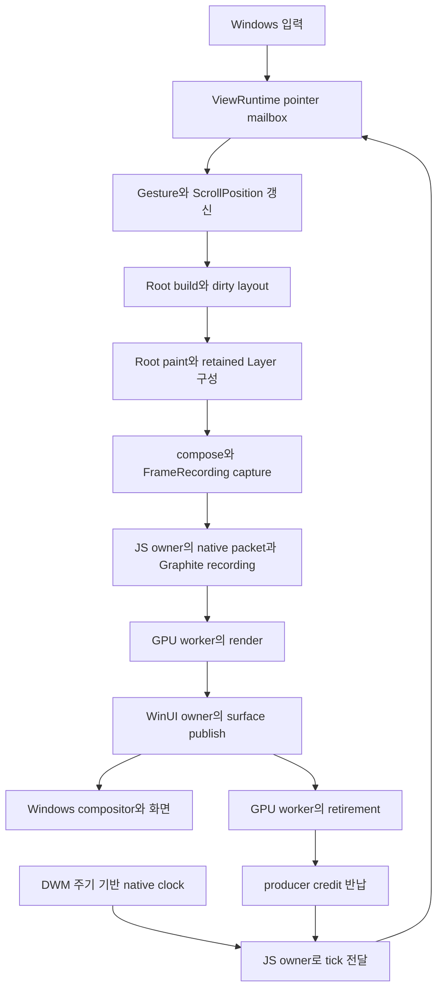

# 스크롤 잔끊김 개선 — Flutter 소스 비교와 렌더링·엔진 작업계획

작성: **2026-10-30 KST** · 상태: **PARTIAL — eager 혼합 페이지·3플랫폼 제품 검증 완료 / bytecode 비교 후 P2/P3 후보 철회 / 성능 미수락**

## 1. 목표와 판단

목표는 스크롤을 시작할 때, 연속 이동할 때, 새 섹션이 들어올 때, 버튼·텍스트필드 위에 포인터가 있을 때 발생하는 짧은 끊김을 줄이는 것이다. 평균 FPS보다 **입력 이후 화면이 움직이기까지의 지연, 프레임 간격의 흔들림, p99·최대 긴 프레임**을 우선한다.

**이 문서의 이후 실행·성능 검토는 Hermes bytecode / optimized / Release만 사용한다.** 사용자가 Static AOT의 빌드 시간이 길고 바이트코드와의 성능 차이를 크게 느끼지 않았다고 판단해 검증 범위를 변경했다. Static AOT 준비·빌드·실행·성능 비교·전용 검사는 이번 작업 범위에서 제외하며 완료 조건으로 요구하지 않는다. 기존 AOT 수치·중단 기록은 과거 근거로 보존한다.

**권고는 기존 TypeScript UI Runtime과 Skia/Graphite를 유지하면서, Flutter가 사용하는 변경 경계별 paint 처리와 프레임 생산·소비 계약을 엔진에 완성하는 것이다.** Nelyx에는 이미 Widget/Element/RenderObject, sliver, RepaintBoundary, retained Layer/Picture, 제한된 프레임 제출이 있다. 이를 처음부터 다시 만들거나 렌더러만 교체하는 계획으로 잡지 않는다.

소스에서 확인한 주요 차이는 다음과 같다. 이것들은 개선 후보의 근거이며, 현재 사용자가 느낀 끊김의 원인을 확정한 측정 결과는 아니다.

1. Flutter는 dirty repaint boundary를 모아 paint하고 layer 속성 변경을 따로 처리한다. Nelyx는 하위 recording을 재사용하지만 Root에서 매 요청마다 `recordPaint → compose → capture`를 시작한다.
2. Flutter는 프레임 생산 슬롯과 vsync 시작·목표 시간을 연결한다. Nelyx의 Windows 경로는 제출 상한과 clock을 갖췄지만 **worker가 깨어난 시각과 JS dispatch 시각만 전달**한다. 선택 작업에 필요한 deadline은 전달하지 않는다.
3. 현재 Gallery는 이미 lazy list다. 그러나 lazy child 하나가 큰 데모 섹션 전체이므로, 처음 들어오는 child의 동기 build/layout/텍스트·Picture 생성 비용이 한 프레임에 몰릴 수 있다.
4. native GPU worker가 이미 있어도 **JS owner에서 수행하는 packet 구성·검증·Graphite recording** 비용까지 자동으로 사라지지는 않는다. 이 경계를 실제 Hermes bytecode native 실행에서 계측해야 한다.

진행 순서는 **P0 기준 측정 → P1 clock·생산 여유 계약 → P2 dirty paint 파이프라인 → P3 cold 생성 단위 개선 → P4 입력·보조 작업 → 필요할 때 P5 전송/P6 GPU 개선 → P7 제품 검증**으로 둔다. 기존 리사이즈 계획의 단계 번호와 별개인 새 스크롤 계획이다.

## 2. 검토 범위와 증거 수준

### 2.1 이번 검토 기준

- Nelyx 저장소 기준 HEAD: `44f34da836536a949cb7bc5ea780bb6e7e72e6b5`. 시작 시 변경은 빈 untracked `work.md` 하나였다.
- 실제 비교 대상은 로컬 [`reference/flutter-master`](reference/flutter-master)의 프레임워크·엔진 소스다. 이 폴더는 Git 추적 제외 대상이며 `.git`이 없고 Flutter 본체의 확정 revision/version을 확인하지 못했다. 폴더명 `master`나 `flutter_packages.version`의 의존성 revision을 Flutter 본체 버전으로 해석하지 않는다.
- 따라서 아래 결론은 **검토한 로컬 snapshot 기준**이다. 최신 Flutter stable과의 완전한 일치·Flutter와 Nelyx의 실행 성능 우열을 주장하지 않는다. 공식 upstream 소스와 문서는 §9에 별도로 연결했다.
- 현재 요청에서 화면·입력 장치가 특정되지 않았으므로, 최신 기록의 **최대화 All Components 두 열 + 트랙패드 + 버튼/텍스트필드 hover**를 첫 대표 장면으로 삼고 ListView·Cupertino를 함께 확인한다. P0에서 실제 재현 장면과 다르면 그 장면을 우선한다.
- 계획 작성 당시에는 소스·기존 기록만 검토했다. 이후의 구현·앱 실행·계측 범위는 §10에 별도로 갱신한다.

검토한 Flutter 핵심 파일의 SHA-256은 다음과 같다. 로컬 reference를 교체한 뒤에는 같은 snapshot이라고 가정하지 않는다.

| 로컬 Flutter 파일 | SHA-256 |
| --- | --- |
| [`packages/flutter/lib/src/rendering/object.dart`](reference/flutter-master/packages/flutter/lib/src/rendering/object.dart) | `19206a10d5d0b71689aad2ad6f5a855d6a10504596e752d9028840af54234f14` |
| [`packages/flutter/lib/src/rendering/binding.dart`](reference/flutter-master/packages/flutter/lib/src/rendering/binding.dart) | `a428a2423a54a11ecdab6969abf3df5c8870dccf88b1c43441f40d71b2e89d33` |
| [`engine/src/flutter/shell/common/animator.cc`](reference/flutter-master/engine/src/flutter/shell/common/animator.cc) | `8454701fbc99fb3ac4d34a7774c54b14faebc9d16a515e6d83eb141c7460f7f0` |
| [`engine/src/flutter/shell/common/pipeline.h`](reference/flutter-master/engine/src/flutter/shell/common/pipeline.h) | `c6e9e9c44f52351e079e7fd3591b84f266c361bdb9f7c09cf2dc0d996a0a7152` |
| [`engine/src/flutter/shell/platform/windows/flutter_windows_engine.cc`](reference/flutter-master/engine/src/flutter/shell/platform/windows/flutter_windows_engine.cc) | `a38935d750fd0a86f318a3d956f0d089678db2f62f9e0528b906b11a39e85718` |

### 2.2 기존 결과를 해석하는 기준

아래는 [`history/26/10/30/work-summary.md`](history/26/10/30/work-summary.md)에 보관된 **이전 실행 결과**다. 이번 checkout의 새 측정값으로 사용하지 않는다.

| 이전 관찰 | 이번 계획에 주는 의미 |
| --- | --- |
| ListView 트랙패드 시작·연속·재접촉 사용자 확인 PASS-scoped | 입력 정지 회귀를 막는 기준이다. 모든 장면의 부드러움을 수락한 결과가 아니다. |
| All Components가 직전 빌드보다 부드럽다는 사용자 확인, 잔끊김은 PARTIAL | 기존 개선은 보존하되 새 긴 프레임과 간격 분포를 측정한다. |
| native 진단 CPU p95: no-hover 23.21→15.95ms, field-hover 22.97→19.18ms | CPU 여유가 작았다는 단서다. 서로 다른 빌드의 단일 전후 진단을 현재 성능이나 FPS로 환산하지 않는다. |
| hit test p95 1.220→1.001ms, p99 3.64→4.65ms, cold 최대 245.87ms | 평균·p95 개선만으로 잔끊김이 사라지지 않는다. cold와 tail을 분리한다. |
| Static AOT resize 약 19~20 geometry/s, CPU p95 약 22~27ms | 기존 `resizePerformanceAccepted=false`는 유지한다. resize 동기화 제거를 스크롤 개선으로 묶지 않는다. |
| 10월 30일 포맷·소스 정리 후 native/AOT 제품 재검증 없음 | 재개 시 Hermes bytecode로 전환하고 현재 소스·설치본·실행 제품의 일치부터 확인한다. AOT 재검증은 제외한다. |

기존 `performanceAccepted=false`, 표시·scanout `notVerified`도 이번 문서 작성으로 바꾸지 않는다.

## 3. 실제 경로 비교

### 3.1 Nelyx 현재 경로



이는 책임의 흐름이다. GPU render·UI publish·retirement는 단계별로 오가며, 모든 프레임이 그림처럼 순차 완료된다는 뜻은 아니다.

- [`ViewRuntime.queuePointer/flushPointerInput/schedulePump`](Nelyx/src/hosting/runtime.ts): move·hover·wheel·panZoomUpdate를 최대 256개 보관하고 owned tick 전에 순서대로 dispatch한다. 시작/종료 등은 앞선 입력을 flush한다. 같은 frame request의 중복 예약도 이미 줄이고 있다.
- [`Root.build`](Nelyx/src/framework/widgets/root.ts): scheduler callback, build, layout, 선택 작업, paint/compose, 입력 geometry, semantics, capture, post-frame을 담당한다. `flushBuild/flushLayout` 호출이 존재한다고 매번 전체 트리를 rebuild/layout한다는 뜻은 아니다.
- [`PipelineOwner`](Nelyx/src/framework/rendering/object.ts): dirty layout·layout callback과 hidden paint retirement 큐가 있다. Flutter의 독립 `flushCompositingBits/flushPaint`에 해당하는 공개 단계는 현재 없다.
- [`RenderRepaintBoundary`](Nelyx/src/framework/rendering/repaint-boundary.ts), [`PaintingContext.compose`](Nelyx/src/framework/painting/context.ts), [`Layer`](Nelyx/src/framework/rendering/layer.ts), [`LayerRecording.drawNative`](Nelyx/src/ui/scene.ts): 하위 recording과 native Picture를 이미 재사용한다. 전체 primitive가 매번 모두 재생성·전송된다고 해석하면 안 된다.
- [`GraphiteFrameRenderer.submit`](Nelyx/skia/packages/native/src/renderer.ts): native reserve 뒤 JS owner에서 recording을 만들고 제출한다. accepted·GPU-retired는 관찰하지만 `present: 'unobserved'`다.
- [`RNSkWindowsWindowSurface`](Nelyx/skia/packages/rn/native/windows/RNSkWindowsWindowSurface.h): GPU worker에서 render·retire하고 WinUI owner에서 publish한다. [`WindowsFrameWorker`](Nelyx/skia/native/host/windows/WindowsFrameWorker.h)의 128-job 제한은 작업 큐의 상한이며 화면 프레임 128개를 쌓는다는 뜻이 아니다. renderer의 2-recording 제한과 구분한다.

### 3.2 Flutter와 대응표

아래 Flutter 경로는 모두 `reference/flutter-master/` 아래다. 함수명은 검토 지점이며 동일한 파일명을 도입하자는 제안은 아니다.

| 책임 | Flutter 소스에서 확인한 구조 | Nelyx 현재 구조와 검토 결론 |
| --- | --- | --- |
| vsync와 프레임 생산 | [`animator.cc`](reference/flutter-master/engine/src/flutter/shell/common/animator.cc) `BeginFrame/RequestFrame`, [`vsync_waiter.cc`](reference/flutter-master/engine/src/flutter/shell/common/vsync_waiter.cc) `FireCallback`: 중복 요청을 합치고 시작·목표 시각을 전달한다. pipeline이 가득 차면 생산을 미룬다. | [`CompositorFrameClock`](Nelyx/skia/native/host/windows/CompositorFrameClock.h), [`frame-clock.ts`](Nelyx/sdk/src/platforms/windows/frame-clock.ts), [`ViewRuntime`](Nelyx/src/hosting/runtime.ts): pacing·backpressure는 존재하지만 target/deadline·생산 여유 계약을 완성해야 한다. |
| 생산자·소비자 분리 | [`pipeline.h`](reference/flutter-master/engine/src/flutter/shell/common/pipeline.h)의 producer continuation과 [`rasterizer.cc`](reference/flutter-master/engine/src/flutter/shell/common/rasterizer.cc)의 consume 경계 | native worker는 이미 존재한다. UI/JS packet·recording 비용과 GPU 실행 비용을 나누고, 추가 thread보다 기존 소유권 경계를 먼저 정리한다. snapshot의 Flutter queue depth도 구성에 따라 1/2다. |
| layout·paint 단계 | [`rendering/binding.dart`](reference/flutter-master/packages/flutter/lib/src/rendering/binding.dart) `drawFrame`, [`rendering/object.dart`](reference/flutter-master/packages/flutter/lib/src/rendering/object.dart) `flushPaint`: dirty 경계를 깊이 순으로 처리하고 layer 속성 갱신을 구분한다. | Nelyx는 dirty layout이 있지만 Root paint 진입 뒤 boundary가 스스로 재사용을 판정한다. dirty boundary 중심 paint와 composition-only 갱신이 가장 직접적인 엔진 구조 개선 후보다. |
| retained scene | [`rendering/layer.dart`](reference/flutter-master/packages/flutter/lib/src/rendering/layer.dart) `addRetained`, [`display_list_layer.cc`](reference/flutter-master/engine/src/flutter/flow/layers/display_list_layer.cc) `Preroll/Paint` | Nelyx에도 EngineLayer와 native Picture 캐시가 있다. 차이는 유지되는 데이터의 범위와 매 프레임 남는 검증·조합·캡처 비용이다. native scene 전달을 전면 재작성하기 전에 비용을 확인한다. |
| 목록 가상화 | [`scroll_delegate.dart`](reference/flutter-master/packages/flutter/lib/src/widgets/scroll_delegate.dart)의 lazy builder·RepaintBoundary·선택적 keep-alive, [`sliver_multi_box_adaptor.dart`](reference/flutter-master/packages/flutter/lib/src/rendering/sliver_multi_box_adaptor.dart)의 child 수명 | [`scroll-delegate.ts`](Nelyx/src/framework/widgets/scroll-delegate.ts)도 기본 boundary를 제공한다. Gallery는 bounded retention이 이미 있다. 추가할 것은 일괄 keep-alive가 아니라 비싼 child의 생성 단위와 준비 예산이다. |
| 스크롤 위치와 layout | [`scroll_position_with_single_context.dart`](reference/flutter-master/packages/flutter/lib/src/widgets/scroll_position_with_single_context.dart), [`viewport.dart`](reference/flutter-master/packages/flutter/lib/src/rendering/viewport.dart) | Nelyx도 offset 변경으로 viewport layout을 요청한다. Flutter의 일반 스크롤도 UI layout과 paint/composition을 거친다. 모든 스크롤이 native transform만으로 끝난다는 전제는 채택하지 않는다. |
| 입력·hover | [`pointer_data_dispatcher.cc`](reference/flutter-master/engine/src/flutter/shell/common/pointer_data_dispatcher.cc)의 선택 가능한 dispatcher, [`gestures/binding.dart`](reference/flutter-master/packages/flutter/lib/src/gestures/binding.dart)의 resampler, rendering binding의 post-frame mouse 갱신 | Nelyx도 mailbox와 post-frame mouse 갱신을 사용한다. 이 Flutter snapshot의 resampling 기본은 false이고 resampler는 touch에 적용한다. Windows trackpad/wheel에 같은 보간을 그대로 적용하지 않는다. |
| raster 캐시 | [`flow/raster_cache.cc`](reference/flutter-master/engine/src/flutter/flow/raster_cache.cc), `DisplayListLayer::Paint`의 조건부 cache 사용 | Nelyx의 SkPicture 재사용은 명령 recording 재사용이다. raster 결과 texture 재사용과 구분한다. 실제 GPU 병목일 때만 P6에서 검토한다. Flutter도 backend·build 조건에 따라 cache 경로가 달라진다. |

## 4. 병목 후보와 확인 방법

### A. Root paint 시작 비용과 dirty 경계 갱신 — 구조 차이 확인, 영향도 미측정

현재 [`Root.build`](Nelyx/src/framework/widgets/root.ts)는 새 PaintingContext를 만들고 `recordPaint`를 호출한다. boundary 안의 static recording은 재사용되지만, 그곳까지 가는 paint 진입·버전 전파·composition 확인·frame command/resource 캡처는 남는다. [`RenderObject.invalidatePaint`](Nelyx/src/framework/rendering/object.ts)는 내용 변경과 상위 경계의 변화 버전을 구분하며 이미 일부 전파를 합친다. 이를 무시하고 같은 최적화를 중복 도입하지 않는다.

확인할 값은 **실제 repaint 경계 수, paint에 진입한 RenderObject 수, 재기록한 Picture 수, composition-only 갱신 수, frame command 수·bytes**다. 동작 중인 TextField나 버튼 하나 때문에 정적인 형제까지 방문하는지 조사한다. 기존 retained Picture hit가 높아도 composition 방문 비용은 별도로 남을 수 있다.

### B. clock과 생산 여유의 불완전한 연결 — 소스로 확인

현재 Windows clock은 DWM timing에서 다음 주기를 계산해 고해상도 timer로 기다린다. [`RNSkWindowsHost`](Nelyx/skia/packages/rn/native/windows/RNSkWindowsHost.h)는 깨어난 뒤의 monotonic 시각을 `nativeTick`으로 기록한다. SDK가 QPC/JS epoch를 보정하지만 목표 시각·refresh interval은 받지 않는다. **현재 tick은 실제 vblank나 표시 완료 시각이 아니다.**

[`FrameTiming.observedDeadline`](Nelyx/src/foundation/clock.ts)은 선택 속성이고, [`ViewWorkBudget.runOptional`](Nelyx/src/framework/widgets/view-work-budget.ts)은 유효한 deadline이 없으면 실행하지 않는다. Gallery도 [`preparation: 'disabled'`](sample/nelyx-testbed-app-2/src/gallery.ts)다. 설정을 `observed-budget`으로 바꾸는 것만으로 Windows 사전 준비가 켜지지 않는다.

`ViewRuntime.buildPending`의 gate는 **이미 pending CPU frame이 있을 때** renderer 여유를 확인하는 힌트다. GPU가 바쁠 때 최대 한 장을 미리 만드는 정책은 의도된 동작이다. Flutter식 producer continuation과 비교해, 그 한 장이 오래된 상태로 남는 시간·불필요한 재캡처·credit 복귀 지연을 계측하고 실제 예약 계약이 필요한 범위를 결정한다.

### C. cold 섹션의 큰 동기 생성 — 이전 긴 프레임 단서, 현재 원인 미확정

[`gallery.ts`](sample/nelyx-testbed-app-2/src/gallery.ts)의 item 하나는 `GallerySection(ListenableBuilder(...group...))`다. 목록 전체는 lazy지만 section 내부의 여러 control·paragraph·layout·초기 Picture compile은 함께 발생할 수 있다. [`gallery-section.ts`](sample/nelyx-testbed-app-2/src/gallery-section.ts)는 editor section만 keep-alive한다.

이전 cold 최대 245.87ms의 정확한 현재 기여율은 모른다. **mount/build, layout·intrinsic query, paragraph shape/layout, Picture compile, GC**로 나눠 가장 긴 섹션부터 찾는다. atomic build 하나가 예산보다 길면 deadline 유무와 관계없이 멈출 수 없으므로 생성 단위를 줄이는 것이 먼저다.

### D. 입력 burst와 hover·IME geometry·semantics — 일부 개선됨, tail 확인 필요

mailbox는 입력을 보존하지만 한 tick에서 최대 256개를 모두 처리할 수 있다. 각 입력은 gesture/hit-test/ScrollPosition 알림을 발생시킬 수 있다. 반대로 단순 delta 합산은 두 열 사이 target 변경·중첩 스크롤·방향 전환·extent 경계·알림 의미를 바꿀 수 있다.

semantics는 현재 Gallery에서 **300ms 및 정지 후 100ms quiet 갱신**, focus·값·action은 즉시 처리한다. 입력 geometry와 post-frame MouseTracker도 이미 별도 경로가 있다. hover를 끄거나 semantics 간격을 늘려 얻는 결과는 제품 해결로 수락하지 않는다. hover 유무, editor focus 유무, semantics 실사용 유무를 같은 소스·같은 제품에서 비교하고 실제 긴 frame의 동반 작업을 찾는다.

### E. JS/native packet·recording 할당 — 작업 존재 확인, 병목 여부 미측정

[`FrameRecording.capture`](Nelyx/src/ui/frame.ts)는 owned command도 frame admission·resource 수집을 수행한다. [`ScenePacket`](Nelyx/skia/packages/native/src/scene.ts)은 Float64Array와 handle table을 만들고 유효 범위를 `ArrayBuffer.slice`로 넘긴다. [`JsiDisplayList.h`](Nelyx/skia/native/adapters/jsi/cpp/api/JsiDisplayList.h)는 입력을 native 메모리로 복사해 검증한 뒤 명령을 실행한다. 이 경로는 JSI 호출 시점의 동기 작업이다.

다만 [`LayerRecording.drawNative`](Nelyx/src/ui/scene.ts)는 retained recording을 native Picture로 재사용하므로 항상 모든 leaf primitive를 다루는 것은 아니다. GC·packet·validation·Picture compile·Graphite recording 시간을 구분한다. native 복사는 handle getter가 원본 buffer를 변경하는 경우를 막는 역할도 있어, 단순 제거해서는 안 된다.

### F. GPU·presentation 간격 — 추가 증거 필요

그림자·clip·opacity·큰 surface의 replay, upload, allocator miss, publish 지연이 원인일 가능성도 있다. 기존 warm allocator 진단이 좋았다는 기록은 현재 Hermes bytecode·최대화·cold 장면의 GPU 통과 증거가 아니다. `GPU producer → surface publish → retirement`를 frame identity로 연결한다. CPU와 GPU가 겹치므로 각 p95를 더해 frame latency라고 계산하지 않는다.

**현재 소스만으로 GC, GPU, DirectManipulation, RNW 중 하나를 단독 원인으로 확정하지 않는다.**

## 5. 목표 엔진 구성과 유지할 계약

Flutter에서 가져올 것은 **변경된 작업을 정해진 owner와 단계에서 수행하는 계약**이다. 물리 thread 수나 Dart VM·Impeller의 구현 전체를 복제하는 것이 아니다.

| 계층 | 맡을 책임 | 다음 계층에 넘길 것 |
| --- | --- | --- |
| Windows host | 입력 timestamp·view identity, refresh pacing, WinUI surface 수명 | 입력 packet, clock source·start/target/interval·불확실성 |
| UI Runtime | gesture·ScrollPosition·physics, Widget/Element, dirty layout, text/editor 논리 상태 | 현재 layout과 변경된 paint boundary |
| 공통 렌더 엔진 | dirty boundary paint, layer 속성 갱신, immutable scene/frame capture, resource accounting | owner/generation이 검증된 recording과 제한된 생산 슬롯 |
| native 렌더 경계 | 검증된 scene/handle 해석, native Picture/Graphite recording, 제출 | JSI에 의존하지 않는 native recording·resource hold |
| GPU worker·WinUI publish | GPU 실행·copy·fence retirement, 현재 세대의 surface publish | submitted/updated/retired 관찰과 credit 복귀 |

구현 시 지켜야 할 조건:

- JS/TS 객체·callback·mutable canvas·JSI handle을 GPU worker로 넘기지 않는다. 새로운 native snapshot을 도입한다면 JS owner에서 해석·검증하고 worker가 소유할 native 값과 독립 resource hold로 변환한다. Graphite context/recorder의 thread affinity도 함께 검증한다.
- UI layout과 hit-test의 기준 scroll offset은 하나다. 일반 스크롤을 native에서만 별도로 움직이는 이중 offset 체계를 이번 1차 범위에 넣지 않는다.
- `contents dirty`, `layer properties dirty`, `semantics configuration dirty`, `geometry dirty`를 구분하되 외부 subclass/custom hook은 보수 경로로 처리한다.
- 한 view의 미제출 CPU frame은 최대 1개, native recording admission은 현재 2개 상한을 출발점으로 삼는다. **front recording·consumer·retirement의 슬롯 의미를 확인한 뒤** credit을 정하며 큐 크기를 키워 FPS를 가리지 않는다.
- stale frame은 제출 전에 폐기할 수 있지만 이미 승인된 GPU 작업의 upload·retirement·resource 해제는 끝낸다. owner/view/viewport/renderer/native context/surface 세대를 보존한다.
- Picture 캐시와 raster texture 캐시는 별도다. 기존 Picture **64-entry / 32MiB**, optional child **16개 / Element 2,048개**, Gallery capacity 2를 우선 유지한다. keep-alive 등 mandatory resident 비용도 별도로 집계한다.
- explicit redraw·forced geometry·persistent animation·caret blink는 계속 동작해야 한다. `accepted`, 같은 paint epoch, `present='unobserved'`만으로 다음 요청 제출을 생략하지 않는다. 이전 두 번째 제출 누락 회귀를 재도입하지 않는다.
- 매 프레임 입력 geometry의 최신 transform·clip·visibility와 TSF/IME 정합성을 유지한다. semantics를 더 늦추거나 hover를 없애는 방식은 해결 조건이 아니다.
- resize의 이전 front 보존·exact generation commit·native synchronization은 유지한다. 변경이 필요하면 resize 정합성과 성능을 별도 검증한다.

## 6. 작업 단계

**기존 Static AOT의 producer gate는 surface tail 악화로 철회한 상태를 유지한다.** 이번 재개에서는 Hermes bytecode 네 장면 × 기준 3회와 source-stage 1회를 완료했고 clock/deadline·P2~P4 구현 및 공통·제품 회귀를 진행했다(§10.3). 추가 요청한 eager 혼합 스크롤 페이지도 구현했다(§10.4). RNW 전체 단계 연결·물리 입력·표시 수락은 PARTIAL/notVerified다. 각 단계는 비용 감소와 동작 보존을 함께 확인하며, 성능 근거가 없는 최적화는 채택하지 않는다.

### P0. 현재 제품에서 끊기는 프레임 찾기

대상: [`runtime.ts`](Nelyx/src/hosting/runtime.ts), [`root.ts`](Nelyx/src/framework/widgets/root.ts), [`WindowsFrameTrace.h`](Nelyx/skia/packages/rn/native/windows/WindowsFrameTrace.h), [`windows-scroll-observer.ps1`](Nelyx/eng/windows-scroll-observer.ps1), 기존 native 측정 runner.

- [x] 이전 Static AOT 검증에서 사용자가 사용하는 일반 명령으로 변경 전 제품을 먼저 실행했다. 저장된 Hermes / Static AOT / optimized / Release를 유지했고 최대화 두 열·자동 OS scroll·정상 닫기를 확인했다. 모니터별 주사율은 별도로 확인했으며 물리 입력은 `notVerified`다(§10).
- [x] 이전 Static AOT 검증에서 변경 전 소스→dist/설치 패키지→빌드 acknowledgement→실행 EXE/AOT 연결을 확인했다. 이 식별은 당시 제품에만 적용한다.
- [x] §8의 명시적 build로 Hermes bytecode / optimized / Release로 전환하고 일반 명령으로 실행한다. 현재 소스→dist/설치 패키지→SDK acknowledgement·package manifest→실행 EXE·bytecode 식별을 확인한다. 변경 후 제품도 다시 식별하며 과거 SHA·PID를 재사용하지 않는다.
- [ ] idle/시작·재접촉, warm 왕복 no-hover, warm 버튼·TextField hover/focus, cold 첫 섹션 진입을 분리한다. 두 열은 왼쪽/오른쪽 및 pointer 이동을 포함하고 ListView·Cupertino를 회귀 장면으로 둔다.
- [ ] 기존 trace를 확장해 input→dispatch, build, layout, paint, compose, capture, geometry, semantics, post-frame hit-test, packet/validation/Picture compile/Graphite recording, GPU·publish·retirement를 동일 frame identity로 연결한다. host가 기록하지 않는 단계는 먼저 작은 계측을 추가한다.
- [ ] 시간뿐 아니라 dirty node 수, boundary 방문·재기록 수, command/packet bytes, mailbox 깊이·입력 나이, pending frame 나이, native credit, paragraph/Picture 생성·cache miss·GC를 기록한다. GC pause를 관찰할 수 없는 실행은 `unobserved`로 둔다.
- [ ] 기본은 저비용 bounded RAM 표본, 느린 프레임에서만 상세 수집이다. source 내부 함수 monkey patch 진단의 오버헤드를 구분하고 최종 판정은 계측을 끈 동일 제품에서 한다.

완료 조건: Hermes bytecode에서 주 재현 장면별 기준 trial 3회로 어느 구간이 긴 frame 또는 제출 공백과 함께 발생했는지 설명할 수 있다. 이 기준 실행은 P7의 변경 전후 비교에 재사용하며 같은 조건을 불필요하게 다시 측정하지 않는다. 기존 Static AOT 수치를 bytecode 기준값으로 승계하거나 AOT 비교를 다시 실행하지 않는다. 모든 원인을 한 수치로 뭉치지 않는다. [`profile-gallery-scroll.mjs`](Nelyx/eng/profile-gallery-scroll.mjs)는 실제 sample Widget을 쓰는 **Node/CanvasKit CPU 진단**이므로 코드 기여 분석에만 사용하고 Hermes native 성능 수락으로 쓰지 않는다.

### P1. clock·deadline·생산 여유를 하나의 계약으로 연결

의존: P0. 대상: [`CompositorFrameClock.h`](Nelyx/skia/native/host/windows/CompositorFrameClock.h), [`RNSkWindowsHost.h`](Nelyx/skia/packages/rn/native/windows/RNSkWindowsHost.h), [`frame-clock.ts`](Nelyx/sdk/src/platforms/windows/frame-clock.ts), [`clock.ts`](Nelyx/src/foundation/clock.ts), [`runtime.ts`](Nelyx/src/hosting/runtime.ts), [`renderer.ts`](Nelyx/skia/packages/native/src/renderer.ts).

- [x] native에서 계산한 frame start/target·refresh interval·timer wake/dispatch를 구분해 전달한다. DWM 예측, fallback, clock uncertainty와 monitor/DPI 변경 시 재보정을 포함한다. 예측 target은 실제 표시 receipt가 아니다.
- [x] `observedDeadline`의 의미를 host-advertised 작업 한계로 명시하고, 부정확하거나 이미 지난 값에서는 선택 작업을 금지한다. Core에서 `tick + 16.67ms`로 만들어 넣지 않는다. wire/API 확장 시 SDK·native 버전과 공급 검사도 함께 갱신한다.
- [ ] 현재 한 장 CPU 선행 정책을 계측한 뒤, 필요하면 producer credit 예약·취소·반납을 추가한다. hint 조회와 실제 `nelyxReserve`의 경합을 구분하고, JS build 동안 GPU lock이나 WinUI 대기를 잡지 않는다.
- [ ] busy 상태에서도 입력 dispatch·필요한 forced geometry는 진행한다. 최신 dirty 상태로 미제출 frame을 교체하되 old lease는 새 capture 성공까지 유지한다. retirement/credit 알림 뒤 재시도와 숨김·복원·종료를 처리한다.
- [ ] animation/scroll의 다음 요청, explicit redraw, 여러 view의 공정성, clock callback 도중 재진입을 회귀 검증한다. 불필요한 polling이 크면 completion wake를 사용하되 정지 후 재개 누락이 없어야 한다.

완료 조건: deadline 없는 호스트는 기존 필수 경로로 동작하고 선택 작업은 비활성이다. busy 중 무한 CPU 재기록·credit 누수·입력 starvation·닫기 hang이 없고, 입력→dispatch/submit tail이 기준보다 악화되지 않는다.

### P2. dirty repaint boundary 중심의 공통 paint 파이프라인

**판정: 후보 구현·구조 검사 후 native 전후 비교에서 묶음의 tail이 악화돼 철회했다(§10.5).** 아래 최종 채택 항목은 완료로 바꾸지 않는다.

의존: P0·P1. 대상: [`object.ts`](Nelyx/src/framework/rendering/object.ts), [`repaint-boundary.ts`](Nelyx/src/framework/rendering/repaint-boundary.ts), [`context.ts`](Nelyx/src/framework/painting/context.ts), [`layer.ts`](Nelyx/src/framework/rendering/layer.ts), [`root.ts`](Nelyx/src/framework/widgets/root.ts), [`scene.ts`](Nelyx/src/ui/scene.ts).

- [ ] dirty boundary와 layer 속성 변경을 소유하는 PipelineOwner 단계를 설계한다. 기존 layout·paint version·hidden retirement·nested boundary 캐시를 연결하고 같은 역할의 별도 트리를 만들지 않는다.
- [ ] 내용 변경은 해당 boundary의 recording을 갱신하고, offset/transform/opacity 등 내용이 같은 변경은 검증된 layer 속성만 갱신한다. compositing 필요 여부가 바뀌는 shape/clip/effect도 반영한다.
- [ ] attach·초기 frame·boundary 생성/제거·부모 변경·detached/hidden·custom paint의 안전한 fallback을 유지한다. dirty collection 순서와 부모/자식 중복 처리는 Flutter의 deepest-first 원칙을 참고해 수명 계약에 맞게 정한다.
- [ ] Root는 dirty layout/paint 수렴 후 scene을 compose·capture한다. 실제 요청 frame의 capture·submit과 post-frame 동작은 유지한다. 재사용하는 것은 검증된 recording이며 요청 자체를 취소하지 않는다.
- [ ] paint 도중 다시 무효화된 version을 clean으로 확정하지 않는다. 현재 refresh가 paint 이전 version을 잡는 규칙을 보존하고 다음 frame으로 남긴다.

완료 조건: 같은 화면에서 버튼·caret 하나의 animation이 정적인 형제 recording을 다시 만들지 않는다. 구조 fixture에서 방문·재기록 수로 입증하고 Hermes bytecode native 실행에서 paint/compose/capture 및 frame CPU p99가 개선돼야 한다. 실측 이득 없이 복잡성만 늘어나면 해당 경로를 채택하지 않는다.

### P3. cold child의 동기 작업량을 줄이는 sliver 구성

**판정: Gallery 네 child 분할 후보는 P2와 함께 철회했다(§10.5).** 추가 요청의 eager 혼합 페이지는 §10.4의 별도 기능이며 P3 lazy 최적화의 완료로 계산하지 않는다.

의존: P0, 선택적 준비는 P1 완료 후. 대상: [`sliver.ts`](Nelyx/src/framework/widgets/sliver.ts), [`sliver-multi-box-adaptor.ts`](Nelyx/src/framework/rendering/sliver-multi-box-adaptor.ts), [`sliver-list.ts`](Nelyx/src/framework/rendering/sliver-list.ts), [`view-work-budget.ts`](Nelyx/src/framework/widgets/view-work-budget.ts), [`gallery.ts`](sample/nelyx-testbed-app-2/src/gallery.ts), [`gallery-section.ts`](sample/nelyx-testbed-app-2/src/gallery-section.ts).

- [ ] P0에서 가장 비싼 section을 작은 lazy child 단위로 나눈다. 우선 header/control group 등 의미 있는 단위로 분할하고 샘플의 일회성 memo만으로 공통 엔진 문제를 덮지 않는다.
- [ ] 공통 delegate가 분할된 항목의 stable key·측정 extent·index lookup을 지원하도록 정리한다. 한 열↔두 열·filter·theme·font/DPI 변경에서 extent cache를 무효화하고 scroll anchor를 보존한다.
- [ ] controller·Form·selection/focus·IME 수명은 child 생성 단위와 분리한다. editor keep-alive를 유지하며 모든 section을 영구 보관하지 않는다.
- [ ] 비용이 충분히 작은 이웃 child만 선택적으로 준비하는 실험을 한다. 기존 1 child/tick·예상 2ms 이하·4ms reserve와 View 예산을 출발점으로 삼고 paint/submit tail까지 고려한다. 남은 시간이 없거나 새 입력·방향 전환·메모리 압력이 있으면 취소한다.
- [ ] 준비 작업의 p99·과소 추정·overrun을 측정한다. 동기 child 생성은 중간 취소할 수 없으므로 큰 작업을 잘게 나누기 전에는 자동 준비를 기본값으로 켜지 않는다.

완료 조건: 첫 진입의 긴 frame과 되돌아올 때의 재생성 비용이 함께 감소하고, producer/paragraph·Element·native bytes가 예산 안에 있다. cold 결과를 warm 평균에 섞지 않는다. ListView의 `dormant` 정책과 Gallery의 `bounded` 정책을 구분해 검증한다.

### P4. 입력·hover·semantics·IME의 중복 계산 정리

의존: P0 및 변경된 layout/paint 경계. 대상: [`runtime.ts`](Nelyx/src/hosting/runtime.ts), [`root.ts`](Nelyx/src/framework/widgets/root.ts), [`mouse-tracker.ts`](Nelyx/src/framework/rendering/mouse-tracker.ts), [`scroll-position-with-single-context.ts`](Nelyx/src/framework/widgets/scroll-position-with-single-context.ts), [`semantics-pipeline.ts`](Nelyx/src/framework/rendering/semantics-pipeline.ts).

- [ ] mailbox burst의 dispatch·hit-test·알림 수를 측정한다. 우선 allocation·변환 snapshot·dirty 전파의 중복을 줄인다. delta를 합치려면 동일 view/device/gesture/viewport/target·transform 범위를 증명해야 하고, 경계 clamp·반전·listener side effect가 있으면 원순서를 유지한다.
- [x] down/up/cancel·panZoom start/end·focus 전환과 key 입력의 선후 관계를 유지한다. coalescing을 도입해도 원본 sequence/timestamp와 진단 연결을 보존한다.
- [x] layout 후의 hover 재검사는 유지한다. 포인터가 정지해 있어도 content가 움직여 target이 바뀔 수 있다. scene/hit-test revision이 같은 경우만 재사용하고 enter/exit·cursor 변화는 빠뜨리지 않는다.
- [ ] semantics의 configuration 변경과 위치 변경을 기존 큐에서 구분한다. 300ms/quiet 정책을 더 늘리지 않고 계산·transport 중복을 줄인다. value/focus/action과 지연 action의 revision 재검증은 유지한다.
- [ ] text shaping/selection local geometry는 재사용하되 매 frame의 부모 transform·clip·TSF/caret 화면 좌표를 적용한다. 스크롤 후 재클릭 없이 입력·선택·조합이 계속돼야 한다.

완료 조건: hover/focus 장면 p99가 개선되고 입력 누락·중복/지연, nested scroll·두 열 target 오류, accessibility/IME 회귀가 없다. 보간·가속도·마찰 계수 조정은 이 단계의 CPU 개선과 분리한다.

### P5. 남는 frame packet·native recording 비용 축소 — 조건부

진입 조건: P0~P4 이후에도 packet/validation/Graphite recording이 deadline 초과의 주요 기여로 관찰됨. 대상: [`frame.ts`](Nelyx/src/ui/frame.ts), [`scene.ts`](Nelyx/src/ui/scene.ts), [`scene.ts(native)`](Nelyx/skia/packages/native/src/scene.ts), [`pictures.ts`](Nelyx/skia/packages/native/src/pictures.ts), [`JsiDisplayList.h`](Nelyx/skia/native/adapters/jsi/cpp/api/JsiDisplayList.h).

- [ ] 먼저 현재 retained Picture hit/miss와 바뀐 frame command 수를 확인한다. 이미 한 번 compile한 recording을 다시 캐시하는 계층을 추가하지 않는다.
- [ ] 내부에서 검증·소유한 immutable 명령은 admission metadata·resource hold를 재사용할 수 있는지 검토한다. 외부 mutable/frozen 배열·getter·custom hook에는 기존 검증을 유지한다.
- [ ] packet의 frame-local buffer 재사용 또는 native immutable scene handle을 작은 범위에서 비교한다. 기존 동기 replay와 수명·세대·오류 복구가 같아야 한다. JS buffer 공유·무검증 zero-copy는 채택하지 않는다.
- [ ] native scene/recording을 worker로 옮기는 경우 typed native resource와 generation 검증을 먼저 설계한다. 같은 Graphite recorder를 여러 thread에서 사용하거나 JSI 객체를 worker에 보관하지 않는다.

완료 조건: 실제 Hermes bytecode native 실행에서 command bytes·할당/복사·recording 시간과 전체 p99가 함께 줄고 memory/retirement가 악화되지 않는다. 이득이 작으면 기존 경로를 유지하고 조건부 미진입 사유를 기록한다.

### P6. GPU replay·effect·raster 캐시 검토 — 조건부

진입 조건: CPU 프레임이 예산에 들어온 뒤에도 GPU producer/publish가 주요 지연으로 남음. 대상: 기존 native Picture backend, [`CompositionSurface.h`](Nelyx/skia/packages/rn/native/windows/CompositionSurface.h), Vulkan/Graphite 실행과 effect 경로.

- [ ] GPU 구간·upload·할당·fence 대기와 WinUI publish를 분리하고 shadow/clip/opacity/backdrop·surface 크기와의 관계를 본다.
- [ ] 먼저 재생 불필요한 scene 방문·불필요한 offscreen pass를 줄인다. 화면 효과·그림자 품질을 임의로 제거하지 않는다.
- [ ] 반복 replay가 비싼 정적 boundary에 한해 raster texture cache를 실험한다. 생성 비용, reuse 횟수, DPR·scale·transform·clip·context loss·fractional scroll의 cache key와 해제를 정의한다. blur·backdrop처럼 배경 의존 효과를 정적으로 캐시하지 않는다.
- [ ] Picture 한도와 별도의 GPU bytes·eviction 예산을 명시하고 warm/cold·GPU memory를 함께 비교한다. 기존 48 bytes/physical pixel 등의 allocator 설정은 병목 증거 없이 확대하지 않는다.

완료 조건: GPU 시간과 실제 surface update 간격이 함께 개선되고, 소수점 위치의 글자·그림자·clip 정합성과 device/context 수명이 유지된다. Impeller 도입·Skia 교체는 이번 1차 계획의 기본 항목이 아니다.

### P7. 일반 실행 제품에서 통합 검증·정리

의존: P1~P4, P5/P6는 진입 여부와 판단 기록. 대상: 실제 Testbed, 기존 tests·SDK 공급·README·현재 문서.

- [x] 변경한 공통 경로에 맞는 회귀 검사·타입 검사와 Hermes bytecode 실행에 필요한 native supplier rebuild/reinstall을 완료한다. 실제 bytecode package·실행 제품을 식별하며 Static AOT 검증은 완료 조건에 넣지 않는다. 철회 후 최종 제품은 §10.6에 기록했다.
- [x] 같은 화면·배율·장치·제품 구성의 변경 전후 paired trial을 최소 3쌍 수행한다. 주요 네 장면 기준 24회 이내를 기본으로 하고 기존 검증과 중복되는 반복을 늘리지 않는다. 후보 비교와 철회 판단은 §10.5이며 최종 소스의 성능 수락이 아니다.
- [ ] 물리 트랙패드 시작·연속·반전·재접촉, 두 열 사이 pointer 이동, Button hover/press, 편집 중 스크롤 후 입력·한국어 IME, minimize/restore·close를 확인한다. 자동 OS wheel은 물리 트랙패드 확인과 별도로 기록한다.
- [x] 공통 Core 변경은 Web/Android에도 layout·입력·수명 smoke를 적용한다. 이번 Windows 결과를 다른 플랫폼 성능 수락으로 확장하지 않는다.
- [ ] 계측을 끈 일반 명령에서 사용자 체감을 확인하고, 남은 문제는 장면·입력·단계별로 PARTIAL/notVerified를 유지한다. 사용 방법이 바뀐 경우에만 기존 한/영 README를 갱신한다.
- [x] 실행별 임시 파일·생성 runner·staging·profile은 성공/실패/중단 모두 finally에서 정리한다. 현재 dist/제품만 유지하고 이 문서에 짧은 결과·잔여 작업을 남긴다. 이번 실행이 만든 임시 산출물의 정리 범위는 §10.6과 같다.

## 7. 측정·수락 기준

### 7.1 비교 방법

P0에서 **Hermes / bytecode / optimized / Release**와 native inputs·실행 제품, 화면·창·DPI·모니터·주사율, semantics 설정, 입력 패턴과 cold/warm 조건을 고정한다. 변경 전후 성능은 같은 bytecode 조건에서 비교하며, 사용자의 일반 명령에서 문제를 재현하고 마지막에 같은 명령으로 확인하는 절차도 유지한다.

primary 장면은 **All Components 두 열의 warm no-hover / Button hover / TextField hover·focus / cold 첫 탐색**이다. 한 trial은 정지→시작→10초 이상 연속→왕복·반전→손을 뗀 뒤 재접촉을 포함한다. cold는 재시작한 프로세스의 첫 진입만 측정하며 font/asset·driver cache 상태도 적는다. frame 표본이 적으면 p99를 안정된 값으로 제시하지 않고 n·max와 함께 남긴다.

### 7.2 제안 목표

아래 수치는 **새 작업의 제안 목표이며 아직 통과하지 않았다.** P0 직후 같은 조건의 기준값과 함께 확정한다. 실제 cadence를 얻지 못한 실행에서는 deadline miss를 계산하지 않는다.

`R = 해당 실행에서 선택한 목표 frame cadence`, `B = 1000 / R ms`로 정의한다. 먼저 60Hz 조건을 맞추고, 현재 주 모니터의 고주사율을 별도 조건으로 확인한다. 실제 165Hz로 구동하면서 결과를 60Hz 예산으로 통과시키지 않는다. 명시적 frame cap이 있으면 실제 cap과 표시 주사율을 모두 적는다.

| 항목 | 1차 목표 | 60Hz 예시 |
| --- | --- | --- |
| warm UI frame CPU | p95 ≤ 0.6B, p99 ≤ B | 10ms / 16.67ms |
| GPU producer의 독립 실행 시간 | p95 ≤ 0.6B, p99 ≤ B. publish 지연은 별도 집계 | 10ms / 16.67ms |
| host target까지 ready/publish | 유효한 target이 있는 표본의 miss ≤ 1%, 원인별 집계 | 실측 target 기준 |
| 연속 이동의 native surface update 간격 | p95 ≤ 1.5B, p99 ≤ 2B, warm 중 설명되지 않은 50ms 초과 정지 0회 | 25ms / 33.33ms |
| 입력→해당 입력을 반영한 surface update | p95 ≤ 3B. input sequence 연결 가능한 표본만 사용 | 50ms |
| cold 첫 진입 | 대표 section의 CPU max ≤ 3B를 1차 목표로 하고 초과 section을 명시 | 50ms |
| 입력·제출·수명 | 입력 누락·중복, stale publish, resource leak, shutdown failure 0 | 정합성 필수 |
| 메모리 | 기존 child/Picture 예산 유지, 같은 이동·복귀 후 live resource 증가 누적 없음 | peak와 복귀 후 resident 함께 확인 |

native surface update·GPU retirement는 scanout/FPS 증명이 아니다. 물리 입력 체감은 별도 PASS-scoped로 기록하고, source frame→desktop/display 연결이 없으면 표시 성능 수락은 `notVerified`로 둔다. 정지 frame·관찰 표본 누락을 연속 이동 frame gap에 섞지 않는다.

구조 변경은 관련 단계의 비용과 warm/cold p99가 함께 줄고 정확성·memory·다른 주 장면이 악화되지 않을 때 채택한다. 평균 개선과 max 악화가 같이 나오면 느린 frame을 분석하고 자동 수락하지 않는다. 기존 resize 목표·수락 상태는 이 표로 대체하지 않는다.

## 8. 실행 명령과 검증 경계

재개 시 먼저 Hermes bytecode / optimized / Release package를 명시적으로 빌드한 뒤 일반 명령으로 실행한다. `run:windows`는 마지막 package 설정을 유지하므로 저장된 Static AOT 설정에 의존해 바로 재개하지 않는다.

```powershell
npm.cmd --prefix sample/nelyx-testbed-app-2/windows/runner run build -- --engine hermes --hermes-mode bytecode --hermes-profile optimized --configuration Release
npm.cmd run run:windows --workspace @nelyx/testbed-2
```

전환 뒤에는 일반 명령을 계속 사용한다. 실제 package manifest의 `cohort.engine=hermes`, `hermesExecutionMode=bytecode`, optimized/Release 설정과 실행 EXE·bytecode 식별을 확인한다. `test:windows-continuous-scroll`은 `.nelyx/windows/last-package.json`의 제품을 사용하므로 이 locator가 최신 bytecode package를 가리키는지도 먼저 확인한다.

직접 native 진단도 bytecode 모드를 명시한다. P0 기준 CPU 3회는 이후 비교에 재사용하고 stages·GC는 필요한 원인 분석에만 선택한다.

```powershell
node Nelyx/eng/run-native-scroll.mjs --hermes-mode bytecode --viewport maximized --scroll-scenes --scope cpu --repeat 3
node Nelyx/eng/run-native-scroll.mjs --hermes-mode bytecode --viewport maximized --scroll-scenes --scope stages
node Nelyx/eng/run-native-scroll.mjs --hermes-mode bytecode --viewport maximized --scroll-scenes --scope gc
```

구현 뒤에는 변경 범위에 맞춰 다음 공통 회귀·타입·공급 검사를 선택한다. Static AOT 전용 검사나 AOT 실행을 추가하지 않는다. 실제 실행 결과는 §10에 기록한다. 각 테스트 timeout은 저장소 지침대로 20분을 유지한다.

```powershell
# clock·backpressure·입력 수명
npm.cmd run test:windows-animation
npm.cmd run test:native-paint-replay
npm.cmd run test:scroll-engine

# dirty paint·retained layer·geometry·반복 redraw
npm.cmd run test:paint-recording

# 실제 Windows 연속 OS wheel과 닫기 회귀
npm.cmd run test:windows-continuous-scroll

# 공통 Core 변경의 타입·공급 확인
npm.cmd run check:types
npm.cmd run test:runner-supply
git diff --check
```

특히 [`frame-visual-commit.test.mjs`](Nelyx/eng/tests/frame-visual-commit.test.mjs)의 unobserved admission 이후 explicit redraw, [`frame-backpressure.test.mjs`](Nelyx/eng/tests/frame-backpressure.test.mjs)의 forced/deferred 요청과 lease·busy 경합, [`repaint-isolation.test.mjs`](Nelyx/eng/tests/repaint-isolation.test.mjs)의 nested repaint, [`optional-sliver-work.test.mjs`](Nelyx/eng/tests/optional-sliver-work.test.mjs)의 deadline·선택 작업을 변경 계약에 맞게 보강한다. GPU/shadow를 바꾸면 `test:native-shadows`, native 공급·ABI를 바꾸면 해당 공급 검사도 추가한다. source test·빌드 통과를 물리 입력·표시 성능 PASS로 바꾸지 않는다.

[`copilot-instructions.md`](.github/copilot-instructions.md)의 임시 산출물·검증 로그·독립 설치본 누적 금지를 따른다. `Nelyx/docs/plans/`, `Nelyx/docs/migrations/`를 만들지 않으며 과거 archive를 새 checkpoint 저장소로 사용하지 않는다. baseline도 제품 전체 사본을 계속 쌓는 방식 대신 실행 중 비교 후 필요한 요약만 남긴다.

## 9. Flutter 공식 참고자료

아래 GitHub `master` 링크는 이동하는 upstream 참고 링크다. 상세 비교·함수 위치의 기준은 §2의 로컬 snapshot이며 두 소스의 byte 일치를 주장하지 않는다.

- [Flutter architecture](https://docs.flutter.dev/resources/architectural-overview): framework·engine·embedder와 rendering 책임의 전체 맥락.
- [Animator 소스](https://github.com/flutter/flutter/blob/master/engine/src/flutter/shell/common/animator.cc), [Pipeline 소스](https://github.com/flutter/flutter/blob/master/engine/src/flutter/shell/common/pipeline.h): frame 생산과 bounded consumer 경계.
- [Rendering binding](https://github.com/flutter/flutter/blob/master/packages/flutter/lib/src/rendering/binding.dart), [RenderObject/PipelineOwner](https://github.com/flutter/flutter/blob/master/packages/flutter/lib/src/rendering/object.dart): frame 단계와 dirty repaint boundary 처리.
- [Windows engine](https://github.com/flutter/flutter/blob/master/engine/src/flutter/shell/platform/windows/flutter_windows_engine.cc): Windows refresh interval·vsync target 구성.
- [Performance profiling](https://docs.flutter.dev/perf/ui-performance): 실제 실행 조건에서 UI·raster 시간을 나눠 분석하는 기준.
- [Performance best practices](https://docs.flutter.dev/perf/best-practices): build 범위, lazy 목록, intrinsic layout·offscreen layer 비용을 검토할 때의 보조 기준.

## 10. 현재 진행 상태

| 항목 | 상태 |
| --- | --- |
| 현재 Nelyx·로컬 Flutter 소스 및 기존 기록 검토 | DONE |
| 원인 후보·목표 책임·단계·수락 기준 작성 | DONE |
| P0 현재 제품 계측 | PARTIAL: bytecode 네 장면 × 기준 3회와 source-stage 1회 완료; RNW 전체 단계 연결·물리 입력/표시는 미완료 |
| P1 clock·생산 정책 | clock version 2 구현·C++/SDK/RNW 회귀 및 실제 6.06ms DWM prediction 전달 확인; 기존 한 장 선행 유지 |
| P2 dirty paint / P3 Gallery 분할 | NOT_ADOPTED: 후보 구현·검사 후 bytecode 3회 비교에서 전체 tail 악화; 소스 철회 (§10.5) |
| P4 입력 보조 작업 | 동일 annotation 집합의 Map 복제·차이 계산 감소 유지; hit-test/순서/geometry/semantics 정책 유지. 체감 수락은 미완료 |
| P5/P6 추가 엔진·GPU 개선 | packet 전송 재설계·GPU cache 미진입. cold recording-finish 긴 frame의 추가 원인 분석은 OPEN |
| P7 bytecode 제품·물리 입력·표시 검증 | 철회 후 최종 제품 재공급·RNW/OS wheel·Web/Android smoke 완료 (§10.6). 물리 입력·표시는 notVerified |
| 스크롤 성능 최종 수락 | `performanceAccepted=false` 유지 |
| resize 성능 수락 | `resizePerformanceAccepted=false` 유지 |

### 10.1 2026-10-30 실행 중간 상태

- 시작 HEAD `470a9f359d7a64b6633c864497d4e60e9c8ffa47`, 시작 작업 트리는 clean이었다. §2의 `44f34da…`는 계획을 작성할 때의 기준으로 보존한다.
- 일반 명령에서 CLI 템플릿의 Android `.gradle` 생성 캐시가 SDK 식별·공급 대상에 포함돼 재설치가 실패했다. 템플릿 복사·SDK 식별·npm pack에서 같은 생성 디렉터리를 제외했고 실제 npm pack 목록을 검사하는 회귀 검사를 추가했다. 확인용 refresh를 동시에 시작했던 경합은 종료 후 순차 실행으로 해소했다.
- 기존 Static Hermes 공급본이 현재 producer/runtime patch 식별과 달라 현재 디렉터리에서 정식 재준비했다. 이후 일반 명령은 저장된 **Hermes / Static AOT / optimized / Release**를 유지해 빌드·실행됐다. 계측 추가 전 기준 실행 EXE SHA-256 `f1919b03b34aed07e37006a8ec2922aa684dd284140e556b97c4881e1b39e5ac`; 최대화 All Components 두 열·ListView의 자동 OS scroll·정상 닫기 exit 0을 확인했다. 이는 물리 트랙패드 또는 잔끊김 해소 수락이 아니다.
- [`FrameDiagnostics`](Nelyx/src/ui/frame-diagnostics.ts)를 추가했다. 기본 비활성, 제한된 RAM ring, overwrite/invalid 공개, view/owner/viewport/renderer/context/surface/frame/input 숫자 식별을 사용한다. Root build/layout/paint/compose/geometry/semantics/post-frame/capture, View pending·submit, native packet 구성·동기 replay·recording finish를 구분한다. scene/resource/lease는 보관하지 않는다. `paint-visits`는 `PaintingContext.paintChild` 호출과 root 진입의 합이며 모든 custom paint 호출 수라는 뜻은 아니다. `dirty-layout`도 초기 큐 크기이며 전체 layout 방문 수는 아니다.
- native replay span은 buffer copy·validation·Graphite replay를 포함한 **동기 호출 전체**다. 독립 GPU 시간으로 해석하지 않는다. GC pause·native validation 내부의 개별 비용은 관찰하지 못한 경우 `unobserved`다.
- 기존 native runner에 `--scope stages`와 `--scroll-scenes`를 추가했다. 후자는 실제 최대화 Gallery 두 열에서 cold 첫 이동, warm no-hover, Button hover, TextField focus를 각각 측정한다. hover는 framework 합성 입력이며 물리·OS wheel 증거가 아니다. 연속 이동 구간을 명시하고 정지·재접촉 간격은 surface update cadence에서 제외한다. `--repeat 3 --scope cpu`는 같은 package의 새 프로세스 3개를 사용하고 임시 package는 기존 finally에서 제거한다.
- 보조 Node/CanvasKit 진단에서 cold 텍스트 섹션 frame max 131.47ms / 해당 layout 103.82ms / text layout 합계 51.25ms가 관찰됐다. inspector·함수 계측이 포함된 단일 진단이므로 AOT 원인 확정·성능 기준으로 사용하지 않는다.
- 타입 검사와 paint-recording 150/150, native-paint-replay 68/68, runner-supply 6/6 통과. scroll-engine은 280/281 통과 후, 기존 진단 hook을 포맷 전 단일 행으로 찾던 검사 실패를 확인했다. 실제 TS AST의 선언·대입을 추출하도록 고친 뒤 해당 2/2가 통과했다. 관련 나머지 검사는 반복하지 않았다.
- 직접 Hermes supplier도 IDE가 만든 Android 출력 305개 때문에 원본 소스 식별이 달랐다. pinned archive에 소스가 없는 정확한 네 디렉터리(`android/.gradle`, `android/build`, `android/build-logic/.gradle`, `android/build-logic/build`)만 식별에서 제외했다. 기존 clean-source digest는 유지하고 그 밖의 추가·삭제·수정은 계속 거부한다. 정식 prepare가 archive+patch를 다시 확인한 뒤 native VM build는 `no work to do`였다. 현재 캐시를 삭제하지 않고 해결했다.
- Static AOT 직접 호스트에서 `--scope cpu --scroll-scenes --repeat 3`을 완료했다(네 장면 × 새 프로세스 3개, 전부 정상 닫기 exit 0). host source `621c3fcd808234f96fdbd01bfd6d8a8e86eff20b405bab285ffaf4d79d415c1d`, diagnostic bundle `9b4098f022896ea40dbe3c6b4653df3a2fac8766896f50d5747f60f6758950e0`. 최대화 client 2560×1459 physical / 1280×729.5 logical, DPI 192, scale 2, native view가 보고한 모니터 165Hz, AMD Vulkan이다. DWM clock의 실제 목표 cadence는 아직 wire에서 관찰하지 못했으므로 60Hz 예산·deadline miss·FPS로 환산하지 않는다.
- 첫 source-stage 실행은 lazy extent가 바뀐 뒤 최초 요청 target과만 비교하는 진단 assertion에서 실패했다. 현재 extent에 clamp한 target 도달을 검증하도록 고쳤고, 실패한 실행의 중간 수치는 기준 trial에 포함하지 않았다. 원래 요청·현재 extent·실제 offset을 함께 남겨 임의의 미도달을 통과시키지 않는다.

#### 기존 Static AOT의 P0 직접 native 기준값 — 변경 전 3회

각 칸은 trial 1 / 2 / 3이며 단위는 ms다. CPU는 owned frame callback wall이고 뒤따르는 microtask checkpoint·입력 dispatch와 별개다. surface는 **연속 이동 구간 안의 copy 완료 갱신 간격**이며 display/scanout receipt가 아니다. font/driver/system cache를 지우지 않은 새 프로세스의 첫 탐색이며 재부팅 cold가 아니다.

| 장면 | CPU 표본 수 | CPU p95 | CPU p99 | CPU max | surface 간격 p99 |
| --- | --- | --- | --- | --- | --- |
| cold 두 열 첫 탐색 | 1033 / 1048 / 1044 | 8.34 / 8.32 / 9.13 | 21.64 / 18.75 / 18.15 | 110.06 / 89.62 / 103.48 | 41.34 / 37.16 / 33.49 |
| warm no-hover | 1207 / 1206 / 1205 | 7.95 / 8.12 / 7.76 | 12.08 / 11.67 / 11.66 | 21.37 / 27.10 / 24.71 | 23.69 / 24.47 / 24.08 |
| warm Button hover | 1266 / 1268 / 1271 | 9.61 / 9.49 / 9.75 | 14.55 / 14.98 / 13.70 | 70.60 / 23.95 / 25.87 | 24.88 / 24.85 / 24.59 |
| warm TextField hover/focus | 969 / 972 / 986 | 16.84 / 16.42 / 16.02 | 21.18 / 21.87 / 22.63 | 32.66 / 37.63 / 39.37 | 32.40 / 30.39 / 30.43 |

두 열은 함께 움직인다. warm은 이미 방문한 96 logical px 경로의 5초 왕복 후 정지·0.5초 재접촉 왕복이며 cold는 10초 첫 이동이다. Button/field 포인터는 framework 합성 입력이고 OS pointer는 진단 호스트가 안전한 위치에 두었다. warm의 `focus=true`는 focus manager에 primary node가 있다는 뜻만 가지므로 editor focus와 혼동하지 않는다. 다음 source-stage 실행은 실제 `field-filled`의 FocusNode가 primary인지 별도로 검증한다.

이 결과는 당시 Static AOT의 cold tail과 focus 장면의 CPU·dispatch queue 증가를 반복 관찰한 근거다. 새 Hermes bytecode 기준이나 RNW 일반 제품·물리 트랙패드의 동일 수치로 승계하지 않는다.

#### 기존 Static AOT의 P0 source-stage 1회와 P1 비교 범위

- 같은 native source의 source-stage bundle `601ab347de7c535e564aa9308022de6ccbfb06ab0a4239fb29d4b874fdbcee57`도 네 장면·정상 닫기 exit 0을 완료했다. ring overwrite/invalid는 없었고 실제 `field-filled` FocusNode는 field 장면에서만 primary였다. 이 계측 실행을 최소 CPU 기준 3회에 섞지 않는다.
- cold의 가장 긴 callback 109.23ms 중 native `recording-finish`가 101.96ms였고, 다른 101.12ms frame에는 layout 54.50ms·paint 23.15ms가 함께 있었다. Button 첫 hover의 68.87ms frame도 recording-finish 63.70ms였다. 따라서 긴 frame을 text layout 하나로 단정하지 않는다. recording finish 내부의 driver/Graphite 기여와 GC pause는 아직 개별 관찰하지 못했다.
- warm no-hover는 paint p95 3.56ms·compose 1.30ms·layout 0.65ms이고, 가장 긴 callback에는 semantics 11.94ms가 함께 있었다. field 장면은 paint p95 4.56ms·compose 3.36ms·input geometry 1.59ms·geometry publish 2.06ms였다. 이 값들은 서로 다른 frame의 percentile이므로 더해서 latency를 만들지 않는다.
- no-hover에서 CPU build 1,209회 / native reserve 성공 620회 / busy 거절 595회, cold에서도 1,031 / 529 / 504였다. 현재 한 장 선행 정책이 busy에 만든 CPU recording을 최신 상태로 다시 capture하는 비용이 실제 존재했다. 한편 no-hover boundary 방문 15,779회 중 재기록 4,804회·재사용 10,975회였으므로 static leaf 전체가 매번 다시 recording된다는 해석도 틀리다.
- P1 실험은 `canBuildFrame()`이 false일 때 pending 유무와 관계없이 **일반** CPU build를 미루는 작은 변경이다. 입력 dispatch·deferred callback은 먼저 실행하고 강제 geometry build는 허용한다. hint는 예약이 아니므로 실제 submit의 native reserve와 busy 재시도, 최대 한 장 pending·기존 lease의 capture 성공 전 보존, explicit redraw·animation·hide/restore·close 규칙을 유지한다. 새 큐·GPU lock·native credit 예약은 추가하지 않았다.
- 변경된 정책·기존 pending 수명 회귀 40/40과 전체 workspace 타입 검사가 통과했다. 기존 native 검사 49 pass / 1 fail / 3 skip 중 실패는 이전 native input locator가 새 supplier digest를 가리키지 않았기 때문이다. 정식 `prepare --host native-hermes` 후 그 1/1을 재실행해 통과했다(서로 다른 실행을 합쳐 전체 suite를 다시 실행한 것으로 표기하지 않는다).
- 최신 CLI/Core를 순차 재공급하고 **변경 후 같은 4장면 × 3회** 비교도 정상 종료했다. clock/deadline·dirty paint·cold 분할·입력 통합 변경을 함께 섞지 않았다. 시험 bundle `9f0f2b4a03e81d392cdf90933abe133a4a87fcf9660522c574ea9ac50c1c9b8b`; 같은 native host/화면/배율/입력 경로를 썼고 모든 target 및 실제 editor focus를 검증했다.

| gate 실험 장면 | CPU callback 수: 기존 → gate (trial 1 / 2 / 3) | gate CPU p99 (ms) | gate surface 간격 p99 (ms) |
| --- | --- | --- | --- |
| cold | 1033/1048/1044 → 513/529/531 | 30.37 / 23.17 / 23.87 | 52.92 / 36.58 / 36.66 |
| warm no-hover | 1207/1206/1205 → 607/606/608 | 12.70 / 12.48 / 13.37 | 24.88 / 26.33 / 25.39 |
| warm Button hover | 1266/1268/1271 → 639/641/644 | 18.46 / 16.57 / 16.27 | 25.51 / 25.52 / 29.54 |
| warm TextField hover/focus | 969/972/986 → 500/505/505 | 23.13 / 23.11 / 22.43 | 35.47 / 35.54 / 36.77 |

**판정: REJECTED / 구현 롤백.** built callback 총 wall의 trial 중앙값은 약 40~43% 줄었지만, 이는 전체 프로세스 CPU가 아니며 idle callback·GPU 비용을 포함하지 않는다. 실제 surface 간격 p99의 trial 중앙값은 no-hover 24.08→25.39ms, Button 24.85→25.52ms, field 30.43→35.54ms로 악화됐다. CPU 절약과 motion 개선이 같지 않았다. 한 장 선행을 없애 CPU/GPU 중첩 여유를 줄인 영향이 의심되지만 추가 단계별 추적 전 단독 원인으로 확정하지 않는다.

`buildPending`의 기존 한 장 선행 gate와 회귀 기대값을 복구했고 40/40 및 native-paint-replay 68/68을 재확인했다. 최종 변경에는 계측·진단 runner·공급 경로 수정만 남긴다. 기본 4장면 × 변경 전후 3쌍 = 24회와 별도 source-stage 4장면을 수행했으며, 같은 실험을 더 반복하지 않는다. gate 실험 상태에서 scroll-engine 281/281·workspace 타입 검사가 통과했고, 복구 후에는 영향받는 위 검사만 다시 실행했다. 변경 소스 27개의 format/lint와 `git diff --check`도 통과했다.

#### 20:55 KST 사용자 요청에 따른 중단·재개 지점

- 사용자가 외출을 위해 중간 종료를 요청해 **PAUSED**로 둔다. commit·배포는 하지 않았다. 시작 HEAD는 그대로이며 현재 working tree는 위 구현·검사·README·이 문서의 변경을 포함한다.
- 중단한 실행 소유의 Node/clang 프로세스가 모두 종료됐고, AOT 임시 `.nelyx-sh-VPdcWZ` 디렉터리가 finally에서 제거된 것을 확인했다. 실행 중인 Testbed 프로세스도 없다.
- 복구한 Core와 최신 CLI는 Windows runner에 재공급됐다. 일반 명령 `npm.cmd run run:windows --workspace @nelyx/testbed-2`의 RNW 호스트 컴파일·링크와 AOT frontend(97.92초)는 통과했으나, **앱 C unit 컴파일 도중 중단했다.** typed/PAL unit은 cache hit였다. 최신 AOT package 완성·실행·화면·입력·닫기 검증은 하지 않았으며, §10.1의 EXE SHA를 최신 제품으로 해석하지 않는다.
- source/dist/설치본 확인과 제품 실행 완료는 별개다. 재개 시에는 §8의 명령으로 **Hermes / bytecode / optimized / Release**로 전환하고 새 SDK acknowledgement·package manifest·실행 EXE·bytecode identity를 확인한다. 중단한 AOT 컴파일은 재개하지 않으며 기존 정상 package를 최신 소스 검증으로 승계하지 않는다.
- 이어서 실제 RNW 최대화 All Components·ListView·Cupertino의 OS 입력 smoke와 물리 트랙패드/편집·한국어 IME 재현 범위를 확인한다. 직접 native 결과만으로 P0 전체 또는 성능 수락을 완료하지 않는다. P1 clock start/target/refresh/deadline wire는 아직 미구현이며 P2~P4는 미진입이다. P5/P6도 조건부 미진입이다.
- GC 누적 통계의 별도 수집을 위해 `--scroll-scenes --scope gc`를 허용하고 한/영 README에 명령·해석 한계를 추가했다. 옵션/보고 검사 6/6은 통과했지만 해당 실제 GC 실행은 하지 않았다. 현재 AOT frame별 GC pause는 계속 `unobserved`다.
- 최종 사용자 입력 확인이나 추가 빌드는 중단 요청 이후 시작하지 않는다. `performanceAccepted=false`, `resizePerformanceAccepted=false`, 물리 입력·표시 `notVerified`를 유지한다.

### 10.2 2026-10-30 검증 범위 변경 — Hermes bytecode 전용

- 사용자 요청에 따라 이후 P0~P7의 실행·성능 검토를 Hermes bytecode / optimized / Release로 통일했다. Static AOT의 긴 빌드 시간과 성능 차이가 크지 않았다는 사용자 관찰이 변경 이유이며, 두 모드의 정량적 동등성을 새로 검증한 결과는 아니다.
- Static AOT 준비·빌드·실행·전용 검사·성능 재비교는 수행하지 않는다. §10.1의 기존 AOT 측정값과 미완료 package 기록은 보존하며 bytecode 검증 결과로 바꾸지 않는다.
- 다음 재개 지점은 §8의 명시적 bytecode build와 일반 실행, 현재 제품 식별, 후속 비교에 사용할 bytecode 기준 측정이다. 이후 같은 bytecode 조건으로 변경 전후를 비교한다.
- 이번 변경은 `work.md` 수정만 수행했다. 빌드·앱 실행·성능 측정은 시작하지 않았으며 PAUSED와 기존 미수락 상태를 유지한다.

### 10.3 2026-10-30 bytecode 작업 재개

- 재개 HEAD `6f2e920322e6c8447115a2d5a8edee70d4bc50ac`, 시작 작업 트리는 clean이었다. 기존 producer gate 롤백을 유지한다. Static AOT 준비·빌드·실행·전용 검사는 시작하지 않았다.
- §8의 명시적 bytecode build가 통과했다. RNW EXE SHA-256 `67a6029081f2f49db86ab673a4e8702ff7165ce649c32dbdb63d7139a4ca2ff1`, bytecode `d030e4ff0ef1c8ad8e86b4a7987702008726ab0285e0ebb885cde7c5956cb5b8`; SDK package와 build acknowledgement의 digest는 모두 `1984c48fe42e89b673eea655915cac08cb7064e07cea825897478dcc7d0ca2cd`다. 제품 구성은 Hermes / bytecode / optimized / Release다.
- 변경 전 직접 native bytecode CPU 기준을 네 장면 × 새 프로세스 3회로 완료했다. source `621c3fcd808234f96fdbd01bfd6d8a8e86eff20b405bab285ffaf4d79d415c1d`, host EXE `4904b2e9b1854ef0c0b0401499ae8aeb92542387d4c13606c90d84615933fb82`, bundle `8814207067d3858c0af5556c08b506e71bdf8690db7e052cebcee6de3d02b36b`, VM `de31402961ea5c2f2d7da367b81f0f219786ffab98c24ba3bad6e34d07fe5696`다. 세 프로세스 모두 네 장면과 정상 닫기 exit 0을 완료했다. 임시 진단 제품은 finally에서 삭제했다.
- 화면은 2560×1459 physical / 1280×729.5 logical, DPI 192, view가 보고한 모니터 165Hz다. 변경 전 wire는 실제 목표 cadence를 전달하지 않아 deadline miss를 계산하지 않는다. 첫 탐색은 font/driver cache를 지우지 않은 새 프로세스 기준이다. 프로그램 스크롤과 framework hover/focus를 사용했으므로 OS wheel·물리 입력 수락이 아니다.

| 변경 전 bytecode 장면 | CPU n (trial 1 / 2 / 3) | CPU p95 ms | CPU p99 ms | CPU max ms | 연속 surface 간격 p99 ms |
| --- | --- | --- | --- | --- | --- |
| cold 두 열 | 804 / 805 / 814 | 11.55 / 10.37 / 10.17 | 28.99 / 23.14 / 23.53 | 112.38 / 113.15 / 121.31 | 49.44 / 30.37 / 31.83 |
| warm no-hover | 933 / 941 / 931 | 12.02 / 9.97 / 9.82 | 15.92 / 16.30 / 16.16 | 21.08 / 23.02 / 47.77 | 27.65 / 24.35 / 23.59 |
| warm Button hover | 976 / 1016 / 994 | 14.33 / 10.92 / 10.30 | 22.02 / 17.37 / 19.89 | 62.67 / 22.52 / 26.85 | 27.48 / 24.56 / 24.52 |
| warm TextField focus | 890 / 891 / 893 | 19.39 / 19.55 / 19.67 | 26.32 / 25.71 / 25.66 | 36.27 / 33.00 / 37.29 | 25.49 / 26.34 / 25.61 |

- bytecode의 Hermes 누적 GC 통계가 CPU 실행에서도 관찰됐다. focus 장면의 11초 이동·정지·재접촉 구간에 약 1.00GB allocation, 267~268 collections, young GC 누적 842~901ms가 있었다. 개별 frame의 GC pause와 GPU 독립 시간은 계속 `unobserved`다. 계측 단계별 실행을 CPU 기준 세 trial에 섞지 않는다.
- P1 native clock2 prediction wire·SDK 검증/재보정, P2 owner의 dirty boundary 처리, P3 편집 section 분할, P4 동일 mouse annotation 집합의 임시 Map 복제 감소를 후보로 구현했다. 아래 구현 검사는 철회 전 기록이며, P2/P3의 최종 미채택 판단은 §10.5에 있다.

#### 변경 전 bytecode source-stage 진단 1회

- 네 장면 모두 정상 종료했다. 위 CPU 3회와 별도인 계측 실행이다. source는 같은 `621c3fcd…`, 진단 bundle은 `3423d87384a245650595a256e58659336ad6edaa58b2d4eb3e4f2a88f8c92329`다. 변경 전 Gallery 소스를 메모리에 보관·복원하는 한 실행의 임시 script를 사용했고, finally에서 복원·삭제했다.
- cold callback 최대 111.64ms인 frame은 layout 69.53ms, paint 10.40ms, compose 4.85ms, semantics 14.24ms였다. 별도의 98.52ms frame은 recording-finish 92.84ms였다. cold tail을 텍스트 shaping 한 원인으로 단정하지 않는다.
- TextField focus callback p95/p99/max는 23.44/29.04/50.45ms, paint p95 7.41ms, compose 3.67ms, input geometry 2.13ms, geometry 전달 2.61ms, semantics 6.09ms였다. packet p95/p99는 0.181/0.229ms, native replay p95 1.76ms였다. packet의 단발 최대 25.83ms는 있었으나 통상 비용만으로 P5 대규모 전송 재설계에 진입하지 않는다.
- 변경 전 clock에는 target이 없어 deadline eligible 표본은 0이다. miss 0을 성공으로 해석하지 않는다. GPU 독립 시간·frame별 GC pause는 관찰하지 못했다.

#### 철회 전 공통 후보 변경과 당시 제품 회귀

이 절의 제품 식별과 P2/P3 검사는 철회 전 후보의 기록이다. 철회 후 최종 소스·제품은 §10.5~10.6을 기준으로 한다.

- P1은 wake·dispatch와 DWM 예측 start/target/interval·uncertainty·revision을 구분한다. SDK는 주기적으로 QPC/JS epoch를 재보정하고, fallback·불확실·dispatch 때 이미 지난 target에서는 optional deadline을 내주지 않는다. wire version은 2이며 재빌드한 공급본을 요구한다. 기존 한 장 CPU 선행 정책과 producer gate 철회는 유지한다.
- P2는 owner가 dirty 경계를 깊이순으로 모으되, Root가 실제로 도달한 재사용 boundary 안에서만 하위를 갱신한다. 초기 paint·custom ancestor·숨김·실패는 기존 재귀 경로를 유지한다. compose/capture/submit·post-frame을 생략하지 않는다. 구조 검사에서 8중 boundary의 단일 leaf 변경은 방문 2회·재기록 1회이며 정적 형제 recording은 유지됐다. 최종 paint 회귀 152/152 통과.
- P3는 기존 공통 `SliverChildGroupedDelegate`를 사용해 TextField section을 filled/outlined/controls/Form의 네 lazy child로 나눴다. controller와 editor keep-alive를 유지하고 실제 child ID로 extent/anchor를 추적한다. 한 열·두 열에서 하나의 Card 모양을 유지한다. 선택적 preparation은 아직 `disabled`다.
- P4는 매 layout 후 hit-test와 최신 transform·cursor 갱신을 유지하면서 같은 annotation 집합의 Map 복제·enter/exit 비교를 줄였다. 입력 delta·순서, semantics의 기존 quiet 정책, IME geometry의 매 frame 좌표 적용은 바꾸지 않았다.
- scroll-engine 282/282 통과 후 custom paint visibility 보강을 추가했고, 최종 소스로 paint 전체 152/152를 다시 통과했다. clock/native application/optional work 18/18, native frame metrics 11/11, native replay·scene·engine 26/26, runner supply 6/6을 통과했다. 최종 workspace type check와 변경 JS/TS lint·format도 통과했다. workspace type check에 기존 static-aot type project가 포함되지만 AOT 준비·빌드·실행·전용 검사는 수행하지 않았다.
- 현재 RNW 일반 명령 `npm.cmd run run:windows --workspace @nelyx/testbed-2`에서 stale SDK 자동 재빌드·공급·설치 후 실행했다. Hermes bytecode/optimized/Release, EXE `cdff88a0204314cb01404232ec6d7af09c7ea5b54e0fd89921229384e39ee918`, bytecode `0ad74c104b548ed7b99c7de8a069267333edbd1f49b1ee79794b5b2f0d13d7f9`, SDK manifest/ack `62d150cf679fa246af58c29ee15b4e82b9f725b2179cb8d431f4825c0ea345be`, native inputs `6f1f9658bd0a4916395f6635d435b36cde66bbf03625ccff1be7c3e633f32360`다. 최대화 두 열·분할 Card·편집 중 OS scroll 후 재클릭 없는 추가 입력·Form 오류 표시·정상 닫기 exit 0을 확인했다. 변경 전 RNW 화면 확인은 명시적 build 뒤 `--package`로 당시 package를 고정한 실행이므로 no-args 명령과 구별한다.
- 현재 RNW package의 `test:windows-continuous-scroll`은 Material/ListView/Cupertino 모두 OS wheel 중 desktop pixel 변화와 정상 close·GPU/input drain을 통과했다. Material minimize/restore·크기 변경·pointer motion도 포함한다. 각 방향 최대 관찰 gap은 56.98~276.07ms였다. 이 검사는 입력 정지·수명 회귀 통과이며 부드러움 수락이 아니다.
- Web 현재 build bundle `3c8dc28034270f114e9b50bc6c34b462c5d88748f27c7245cd889a3fd4f56d56`에서 실제 Chrome catalog smoke가 통과했다. Material 29개·Cupertino 20개 선언, 대표 컨트롤·named route·design 복귀 상태 보존, page/console error 0을 확인했다. 임시 Playwright 설치와 browser/server는 finally에서 삭제·종료됐다.
- Android는 현재 Core/SDK를 기존 runner에 공급·재설치하고 process-local Temurin 21.0.11로 Release/x86_64 build를 통과했다. APK `18462ac41703092f9206e40a4d046b9e7bb69e2398cc8185e072486107271cfd`, Android의 기존 compiler policy는 `-Og`이며 Windows optimized 비교에 섞지 않는다. Android 30 x86_64 Vulkan 에뮬레이터 1920×1200/density 240에서 OS 입력, 스크롤, Form 오류·저장·초기화, Material↔Cupertino 복귀 시 편집 내용 보존, background/resume 동일 PID, Back에 의한 Activity 종료를 확인했다. remote UI dump는 매번 finally에서 삭제했고 검증용 에뮬레이터도 종료했다. 물리 Android·한국어 IME·성능 수락은 검증하지 않았다.

추가 구현과 수치는 현재 작업에서 실제 확인한 범위만 이 문서에 갱신한다. `performanceAccepted=false`, `resizePerformanceAccepted=false`, 물리 입력·scanout `notVerified`를 유지한다.

### 10.4 실행 중 추가 요청 — lazy 생성 없는 혼합 스크롤 페이지

- 사용자 요청에 따라 Material Gallery의 `Scroll view`로 여는 `/mixed-scroll` route를 추가했다. 하나의 `Column`을 단일 scrollable box에 넣어 TextField 12개·버튼 36개를 첫 진입에 모두 build/layout한다. builder/delegate에 의한 항목 지연 생성·해제는 없다. 24개 시도는 기존 256 paragraph producer 예산을 넘었으므로 예산을 유지하고 12개로 구성했다.
- filled/outlined, 한 줄/여러 줄 편집기를 섞고 항목별 전송·누른 횟수·초기화, 처음·끝 이동과 Gallery 복귀를 제공한다. controller는 각 row State가 소유하고 route가 닫힐 때 해제한다.
- 구조·동작 검사에서 첫 스크롤 전 offscreen editor까지 12개가 모두 mounted였고, 끝 이동·복귀·폭 변경 후에도 동일 controller를 유지했다. 두 끝의 전송·횟수·초기화와 route 종료 후 전체 controller 해제를 확인했다. sample 전체 31 pass / 1 diagnostic profile skip, 이후 결과 live region 보강 후 focused 검사 1/1, type check·lint·format 통과.
- 분할 후보에서는 Form을 실제 scroll로 드러내고 motion-only 검사를 warm 44px 왕복으로 분리했었다. P3 철회 시 **기존 Form 검사와 원래 176px semantics 왕복 검사를 함께 복원했고 모두 통과했다.** 새 페이지의 eager 수명 검사는 유지한다.
- 변경 후 CPU 비교 첫 시도는 RNW 진단 host 컴파일과 겹친 trial 1을 성능 비교에서 제외했다. 추가 페이지 요청을 반영하기 위해 trial 2의 측정 시작 전에 창을 정상 닫았으며, CLI가 불완전 실행을 실패로 보고하고 finally에서 임시 package를 삭제했다. 다음 비교에는 다른 build/test를 겹치지 않는다.
- bytecode RNW animation 전체 27/27 통과: native clock, Material progress/scroll, Cupertino activity/route, 정상 close와 drain을 확인했다. 이 실행은 새 페이지 추가 전 bundle의 진단이며 새 페이지 검증으로 승계하지 않는다.
- 실제 Android 검사에서 Card 내부의 결과 문구가 접근성 트리에 빠지는 것을 발견해 결과 상태를 별도 live region으로 노출했다. 최종 소스로 Web/RNW/Android 모두 결과 전달을 확인했다. Android의 static text `resource-id` 전달을 가정하지 않고 실제 접근성 label을 확인했다.
- 철회 전 새 페이지 검증 RNW는 §8의 명시적 bytecode build 뒤 일반 no-args 명령으로 실행했다. EXE/SDK/native inputs는 §10.3 제품과 같고 bytecode는 `173a5c11735804891ea71619002f8bab11c51b9c42fd557a30449c806887ac52`다. 실제 창에서 새 route·입력·전송·버튼 횟수·처음/끝 왕복과 값 보존을 확인했고, live region의 빈 메시지 결과·정상 close exit 0도 확인했다.
- 철회 전 Web bundle `706e302c9c02935e2036e819ef10474fe07044c936ffeed040acf8cf45e935e5`에서 catalog 전체와 새 route의 전송 결과 접근성·횟수 상태·마지막 편집기 위치·처음 복귀·back smoke를 통과했다. page/console error 0이며 browser/server/임시 설치는 finally에서 정리했다.
- 철회 전 Android APK `fea4ed9a9acc8bd8be8e814b093f5c17978f6cab2c0cc0a80e481a275e62ff14`에서 첫 편집기의 OS 입력·전송 결과 live region·횟수, 마지막 편집기 입력·처음 복귀 값/횟수 보존·초기화·Gallery 복귀가 통과했다. 20분 timeout을 둔 한 실행의 임시 smoke script·remote XML과 검증용 에뮬레이터는 finally에서 삭제·종료했다. 이 검사는 Android 30 x86_64 Vulkan 에뮬레이터에 한정한다. 철회 후 세 플랫폼의 최종 제품에서도 §10.6의 검사를 수행했다.

### 10.5 bytecode 전후 비교와 후보 철회

- 같은 2560×1459 / DPI 192 / 모니터 165Hz, bytecode/optimized/Release에서 기준 3회와 후보 3회를 완료했다. 아래는 **각 trial 통계의 중앙값**이며 frame을 합친 통계가 아니다. 기준 3회 후 후보 3회를 실행했으며 font/driver cache와 thermal 상태를 초기화하거나 A/B를 교차 실행하지 않았다. 표시 FPS·물리 입력 수락으로 사용하지 않는다.
- 후보 source `3b3ad5da830f9ba068d583121c4ca57bec4ca78b606778d291f1b0a71fac96ef`, host `bdcb8795174d8c7565de6c6e6ca43e512e287c62519eb4b3f668cb4c4659b45e`, CPU bundle `6351f2b4d824e7112d5d297c04f145d11d0c1ba673207834881a099adef355bd`; VM은 기준과 같은 `de314029…`다. 세 유효 CPU 프로세스와 별도 source-stage 프로세스 모두 정상 exit 0이다.
- 후보의 처음 2회 이후 세 번째 프로세스는 OS 입력 189건이 있는 상태에서 실패했다. 해당 불완전 실행은 제외하고, 사용자가 입력을 멈춘 구간에 남은 CPU 1회와 source-stage 1회를 완료했다. 그보다 앞서 RNW host 컴파일과 겹친 시도도 제외했다. 기본 전후 비교는 네 장면 × 3쌍 = 24개 유효 phase이며 source-stage는 별도다.

| 장면 | 후보 CPU n (1 / 2 / 3) | CPU p95 기준→후보 ms | CPU p99 기준→후보 ms | trial max 중앙값 기준→후보 ms | surface 간격 p99 기준→후보 ms |
| --- | --- | --- | --- | --- | --- |
| cold 두 열 | 789 / 806 / 784 | 10.37→11.05 | 23.53→29.22 | 113.15→94.24 | 31.83→38.64 |
| warm no-hover | 911 / 917 / 917 | 9.97→10.33 | 16.16→13.73 | 23.02→23.19 | 24.35→24.67 |
| warm Button hover | 960 / 970 / 967 | 10.92→11.35 | 19.89→19.83 | 26.85→73.08 | 24.56→30.01 |
| warm TextField focus | 829 / 840 / 826 | 19.55→21.30 | 25.71→26.66 | 36.27→39.71 | 25.61→35.53 |

- 후보의 field source-stage는 CPU p95/p99 21.35/26.82ms, paint p95 6.94ms, compose 4.92ms, input geometry 1.87ms, geometry 전달 2.36ms, semantics 5.82ms였다. 기준 단계 진단의 compose 3.67ms보다 커졌다. 일부 paint·geometry 비용 감소와 no-hover p99 감소만으로 cold/hover/focus와 surface tail 악화를 수락하지 않는다. **P2 owner dirty paint와 P3 Gallery 네 child 분할을 묶어 철회했다.** 각 변경의 단독 기여를 분리해 확정한 결과는 아니다.
- 현재 `object.ts`, `repaint-boundary.ts`, `root.ts`, `gallery-section.ts`는 시작 HEAD의 경로로 복원됐다. Gallery는 기존 하나의 TextField section과 extent/delegate 구성을 사용한다. 후보 전용 traversal 검사·extent 검사·index 호환 분기도 제거했다. 요청된 새 `/mixed-scroll` 페이지와 그 eager 수명·상태·접근성 검사는 유지한다.
- source-stage bundle `694a135eedf36ff2477bf4f8323c22f3245f8ae82f9c65207ce696b4457514b2`에서 DWM interval은 약 6.0605ms였다. cold의 eligible 765 중 ready miss 629, matching copy 674 중 surface miss 674였고 missing copy 91은 별도다. field는 built 818 중 eligible 635, dispatch 때 이미 지난 prediction 등 제외 183, ready miss 635/635, matching surface miss 597/597, missing copy 38이었다. **prediction 전달 검증이며 목표 통과가 아니다.** expired receipt에 deadline이 빠지는 실제 사례도 확인했다.
- 이 165Hz 조건의 작은 여유로 자동 child 준비를 켜지 않는다. 기존 `disabled`를 유지한다. 실제 60Hz 조건의 별도 trial은 없으며 60Hz 예산으로 통과시킨 결과도 없다.
- field packet p95/p99는 0.139/0.174ms로 전송 전면 재설계의 근거가 부족하다. 반면 cold 최대 115.03ms frame에는 recording-finish 106.87ms가 있었고, field에는 compose 최대 15.59ms·recording-finish 최대 23.44ms가 있었다. GC·driver compilation·GPU fence 등의 세부 원인은 아직 분리하지 못했다. P5의 cold native recording 분석은 잔여 작업이며 임의의 zero-copy·thread 이동·P6 raster cache로 덮지 않는다.
- 철회 후 현재 소스로 Core build, scroll-engine **281/281**, paint **150/150**, sample **31 pass / 1 diagnostic profile skip**, 전체 workspace type check가 통과했다. 현재 제품의 추가 검증과 식별은 다음 절에 기록한다. 철회 후 성능 3쌍을 새로 측정한 결과는 없으며 위 후보 수치를 최종 소스의 성능으로 승계하지 않는다.

### 10.6 철회 후 최종 제품과 남은 작업

- 최종 소스에는 P1 clock2·선택 작업 deadline 계약, P4 동일 mouse annotation 집합의 임시 할당 감소, 계측과 새 `/mixed-scroll` 페이지를 유지한다. P2/P3 후보는 포함하지 않는다. Core를 다시 빌드해 기존 Windows/Web/Android runner에 순차 공급·설치했으며, 복원한 paint 경로와 유지한 mouse/frame 경로의 dist·설치본 SHA-256이 세 플랫폼에서 일치했다.
- 최종 공통 검사는 scroll-engine 281/281, paint-recording 150/150, sample 31 pass / 1 선택적 진단 skip, 전체 타입 검사와 변경 JS/TS 21개 lint·format, `git diff --check`가 통과했다. 실행 검사는 모두 20분 timeout을 사용했다. AOT 준비·빌드·실행·전용 검사는 추가하지 않았다.
- Windows는 Hermes bytecode / optimized / Release로 다시 빌드했다. EXE `ce3b0f5ae02bbab34e2052bac938c9ce35afd31a372e72c2d654acbdc64bb5bd`, bundle `8742fc1bf2fe215a87aa05e885d609767664c42d5f27844bf824a4d652d2e66e`, SDK manifest/ack `faee7844e241f3dbe948018d0edd904de4704829ae4a65a5d3c5aeb7e0f1eb97`, native inputs `6f1f9658bd0a4916395f6635d435b36cde66bbf03625ccff1be7c3e633f32360`다.
- 해당 최종 Windows 제품의 `test:windows-continuous-scroll`이 통과했다. Material/ListView/Cupertino의 양방향 OS wheel과 정상 close exit 0, `views=0 consumers=0 gpuDrained=1 inputRetired=1`을 확인했다. Material 창 전환·pointer 이동도 포함한다. 최대 관찰 gap은 약 240ms여서 부드러움 수락으로 해석하지 않는다. 이후 정확한 일반 명령 `npm.cmd run run:windows --workspace @nelyx/testbed-2`으로 같은 Release 제품을 실행했고, Gallery → `Scroll view`의 새 페이지를 최대화해 열어 두었다.
- Web bundle `fbabe4b74675d35625a2f9cd9ed4fc89adfb597651a84a086122868e07b1ba5d`의 실제 Chrome catalog smoke가 통과했다. 49개 선언·대표 컨트롤·route/상태 보존, 새 페이지의 빈 전송 결과 접근성·횟수·끝 이동/마지막 편집기 위치·처음 복귀·back을 확인했고 page/console error는 0이었다.
- Android의 실제 검사 APK는 `sample/nelyx-testbed-app-2/android/app/build/outputs/apk/release/app-release.apk`, SHA-256 `82150f3a0513c6684c5846e7e5184df0350cd2b1f3dedf286f25added008e9c6`다. process-local Temurin 21.0.11로 Release/x86_64를 빌드했으며 기존 Android compiler policy `-Og`를 유지했다. Android 30 x86_64 Vulkan 에뮬레이터에서 새 페이지의 첫/마지막 편집기 OS 입력, 전송 live region·횟수, 처음 복귀 후 값 보존·초기화·Gallery 복귀가 통과했다. 예전 `.nelyx/android/packages` APK와 구별한다.
- 이번 검증의 scroll fixture·supply 임시 디렉터리, Web browser/server/설치·profile, Android 임시 script/remote XML·에뮬레이터는 finally에서 삭제·종료했다. 현재 Windows 교체 staging은 없고 Release 제품 하나를 사용한다. 작업 시작 전 존재하던 출력과 임시 디렉터리를 이번 실행의 산출물로 간주해 일괄 삭제하지 않았다.
- **잔여 작업:** cold native recording-finish 106.87ms의 내부 원인 분리, 최종 소스의 추가 성능 개선과 재측정, RNW 전체 단계의 동일 frame 연결, 실제 60Hz 조건, 물리 트랙패드·한국어 IME·scanout 확인이 남았다. 새 페이지 기능·제품 검증 완료와 스크롤 성능 수락을 구별하며 `performanceAccepted=false`, `resizePerformanceAccepted=false`, 물리 입력·표시 `notVerified`를 유지한다.
- 이후 명칭 변경 요청에 따라 Gallery 진입 버튼과 페이지 제목을 **입력·버튼 스크롤**로 통일했다. 위 제품 검증 당시 이름은 `Scroll view`이며, 이름 변경의 공통 소스·Web 검사 selector·한/영 사용 안내를 함께 갱신했다. 해당 페이지 회귀 1/1, 변경 코드 lint·format과 diff 검사를 통과했다. 이름 변경 후 플랫폼 제품 재빌드·실행은 하지 않았다.

### 10.7 일반 Windows 실행의 앱 변경 감지 수정

- 사용자와 같은 `npm run run:windows --workspace @nelyx/testbed-2`를 실제 실행해, 소스는 **입력·버튼 스크롤**인데 화면은 예전 `Scroll view`인 상태를 재현했다. 실행 준비가 SDK 입력만 비교하고 앱 입력을 기록·비교하지 않는 것이 원인이었다.
- 공통 CLI의 Windows build/run에 `appInputsSha256`을 추가했다. 앱 소스·에셋·Windows 설정의 내용과 파일 목록을 비교하며 timestamp에 의존하지 않는다. 기존 입력 기록이 없는 제품도 재빌드한다. build acknowledgement·패키지 manifest·실행 전 검사를 연결했고, starter와 기존 Testbed runner를 함께 갱신했다.
- 빌드 출력·캐시·생성 설정·autolink 파일은 앱 입력에서 제외한다. 첫 실제 빌드에서 native project의 `Bundle` 출력이 입력으로 잡힌 것을 발견해 제외 범위를 보강했고, 해당 실행은 변경 중인 입력 검사에서 중단돼 제품을 실행하지 않았다. 빌드 실패·빌드 중 실제 입력 변경 시 이전 제품 실행을 막는다.
- 기존 엔진·실행 모드·compiler profile·Debug/Release 구성과 명시적 `--package`의 고정 패키지 실행을 유지한다. 관련 회귀 **16/16**, 변경 코드 lint·format·diff 검사가 통과했다. CLI와 Testbed의 기존 한/영 사용 안내도 갱신했다.
- 실제 일반 명령으로 CLI 갱신·재빌드·실행을 완료했다. 한 실행에서 제목에 임시 확인 문구를 넣었다가 정상 닫기 exit 0 후 finally에서 원본 바이트로 복원했다. **SDK 해시가 같은 상태에서 앱 해시만 달라진 다음 실행도 자동 재빌드했고**, 실제 Gallery 버튼과 페이지 제목이 모두 **입력·버튼 스크롤**인 것을 확인했다. 이 실행도 정상 닫기 exit 0이었다.
- 최종 Windows는 Hermes bytecode / optimized / Release다. EXE `403c57c783a4a95994f8e38da2351b2cb101cf847ecebd5105fad72dc99955d0`, bundle `67d5f272220b2b5fee5ca75442ac23d93ab23a66d3ce79e8e9a61b99fdb306e6`, 앱 입력 `f9272fda9daaf87a29993063155d796addcaa24105c36bb9b49abb367aca3b67`, SDK 입력 `72d4eb6d85519c5283c05adf7c969d651be1a227c1cb44c23fe34d51815b0225`다. SDK가 같은 앱 수정 전후에 EXE는 같고 bundle은 달라졌다.
- 변경 없이 동일 명령을 다시 실행했을 때 공급·재빌드 없이 같은 제품을 시작했다. `last-build.json`과 package manifest의 수정 시각도 동일했다. 이 제품의 새 페이지를 열어 두었으며, 임시 확인 문구와 검증용 임시 디렉터리는 남기지 않았다.

### 10.8 2026-10-31 입력·버튼 페이지의 터치패드 끊김과 가장자리 버튼 조사

- 사용자 재현은 Windows 앱의 물리 터치패드이며, 가장자리에 걸친 버튼의 배경·테두리가 사라진다는 추가 증상을 포함한다. 시작 HEAD `c776b40`, clean tree에서 일반 명령 `npm.cmd run run:windows --workspace @nelyx/testbed-2`로 기존 제품을 실행했다. Hermes bytecode / optimized / Release만 사용하며 AOT 실행은 추가하지 않는다.
- 새 `--mixed-scroll-scenes` 진단은 실제 `/mixed-scroll` route의 모든 TextField 12개가 처음부터 mounted인지와 이동 후 같은 Element인지 확인한다. 이동, no-hover 왕복, Button hover, 첫 편집기 실제 framework focus의 네 장면을 분리한다. `--scroll-scenes`·catalog와 혼합하지 않는다. 프로파일·로그·이전 package를 파일로 누적하지 않는다.
- 수정 전 source-stage 진단의 유효한 1회는 네 장면·exit 0을 완료했다. 이동 callback p50/p95/p99 `16.28/23.49/37.28ms`, focus `18.99/30.34/40.58ms`였다. 같은 장면의 연속 surface 간격 p99는 `45.01/45.43ms`이며 scanout 수치가 아니다. 이동 input-geometry·geometry-publish p50 `3.51/3.63ms`, focus `3.53/4.16ms`였다. 앞선 시도는 desktop pointer 이동으로 중단됐으므로 완료 실행에 합치지 않는다.
- 후보 수정은 화면과 조상 clip의 교차 면적이 0인 편집기의 native geometry를 철회해 불필요한 caret/selection 투영·전달을 줄인다. 부분 교차는 계속 좌표를 갱신하며, controller·State·편집 연결과 eager Column을 유지한다. `EditableTextState`의 중복 `isDisplayed` 조회는 같은 입력 read가 수행하는 검증으로 통합했다.
- 기존 입력·semantics·편집·delivered native shadow 회귀 90/90, 신규 eager 입력 영역/기존 입력/진단 옵션 12/12, sample 기존 31 pass/1 선택적 진단 skip, 새 부분 버튼 픽셀 1/1과 workspace 타입 검사가 통과했다. 초기 신규 검사 1개는 테스트 stub의 미확인 native replace 및 null/undefined 기대를 바로잡은 뒤 통과했다.
- 현재 일반 명령의 새 RNW 제품에서 첫 편집기 OS 입력·전송 결과를 확인했고 위쪽 경계에 걸친 버튼 배경·테두리가 보였다. 첫 재빌드는 sample 검증 파일 변경과 겹쳐 입력 안정성 검사로 중단됐으며, 파일을 고정한 재실행이 정상 제품을 시작했다. 수정 전 단순 native clip과 CPU 픽셀 비교에서는 버튼 소실을 재현하지 못했으므로 소실 원인을 확정하지 않는다.
- Column 전체 RepaintBoundary 후보도 비교했지만 철회했다. 이동 callback p50은 `16.28→9.13ms`였으나 surface 간격 p50이 `17.40→31.32ms`로 나빠졌고 focus surface p99도 `45.43→47.97ms`였다. 해당 후보의 CPU 개선을 스크롤 개선으로 해석하지 않는다. 현재 sample은 원래 단일 Column 구조이며 그 cache 후보는 남기지 않는다.
- 사용자가 이후 검증을 에이전트가 직접 수행하도록 요청했다. 추가 사용자 체감 승인을 완료 조건으로 요청하지 않고, 일반 Windows 앱의 직접 OS 입력·양쪽 경계·편집·닫기와 성능 진단을 별도로 확인한다. 물리 터치패드를 합성 wheel/pan 검사로 확인한 것으로 바꾸지 않는다.
- 좌표 최적화만 적용한 후보도 surface 간격 p50이 약 35~36ms로 악화되어 수락하지 않았다. 계측으로 `ScrollMetricsNotification`이 매 이동 뒤 microtask에서 `_RenderScrollSemantics.markNeedsPaint()`를 호출해 이미 완성한 프레임의 paint revision을 무효화하는 것을 확인했다. 이 알림은 `markNeedsSemanticsUpdate()`로 바꿔 접근성 갱신을 유지한다.
- native credit을 기다리는 CPU 프레임이 여전히 현재 paint/build/layout·입력·viewport와 일치할 때 다음 애니메이션·대기 motion 처리 전에 제출한다. 숨김 route의 보류 build/layout은 보존하면서 현재 화면의 대기 작업과 구분한다. 실제 변경·이미 전달된 입력·contact 경계·강제 geometry·알 수 없는 custom owner는 기존 교체 경로를 유지하며 새 redraw·animation을 생략하지 않는다.
- 그래픽 수정 전 결합 후보의 source-stage 진단 1회(같은 direct Hermes host/VM, bytecode/optimized/Release, 2560×1459, DPI192, 165Hz 보고)는 네 장면·exit 0을 완료했다. 이동 callback p50/p95/p99 `12.96/19.27/28.35ms`, focus `14.89/26.76/37.36ms`; surface 간격 p50/p99는 이동 `14.15/30.27ms`, focus `17.17/39.20ms`였다. 수정 전 이동 `17.40/45.01ms`, focus `19.85/45.43ms`보다 개선됐지만 focus 단발 최대는 `60.93ms`로 남았다. 이는 OS 물리 입력이나 scanout 측정이 아니며, 뒤이은 native 그림 변경 후 다시 비교한다.
- 수정 뒤 Column 전체 RepaintBoundary도 다시 비교했지만 이동 surface p50 `24.12ms`로 결합 후보보다 나빠 철회했다. 최종 sample은 처음부터 12개 편집기를 보유하는 기존 단일 Column이며, lazy 전환이나 전체 본문 cache는 없다. 원인 분석용 prototype 계측은 제거했다.
- 최종 source의 scroll-engine `282/282`, visual/scroll/semantics 관련 `70/70`, sample `32 pass/1 선택적 진단 skip`, workspace 타입·변경 코드 lint·format·diff 검사가 통과했다. 앞선 paint-recording `152/152`와 입력·native shadow 검사도 통과했으며, 뒤늦은 metrics notification이 paint를 무효화하지 않으면서 semantics를 예약하는 회귀를 추가했다.
- 후속 일반 RNW 제품(EXE `44aeaf10e8d84ac89571abbafeb31a6e5a0b980233631d7b422d2b7078042a3e`)의 아래 경계에서 정지 후 Filled 배경·Outlined 테두리 소실을 직접 재현했고 정상 닫기 exit 0을 확인했다. 실제 페이지 native GPU 픽셀 비교도 전송 `3454/3645`, 초기화 `107/4320` 불일치로 실패했다. 같은 그림을 원본 명령으로 풀거나 유한한 기록 범위로 다시 만들면 세 버튼 모두 불일치 0이었다.
- native 무한 범위 기록은 R-tree의 경계 계산 및 그림 전체 cull에서 오버플로를 일으킬 수 있다. 범위를 잘라내지 않고 안전한 integer clip 범위를 넘는 그림은 공간 인덱스 없이 기록하고 직접 재생하며, parent recording 안에서도 이 경로를 유지한다. 단순 도형 검사에 `drawPaint`·작고 큰 nested picture·DPI·surface 경계를 추가해 기존 delivered library의 소실을 재현했다. 폭·높이의 finite 여부만 보는 첫 보강은 C++ 검사를 통과했지만 실제 페이지 아래쪽 검사는 여전히 실패했으므로 최종 통과로 쓰지 않는다.
- `--mixed-scroll-pixels`는 성능 측정과 분리된 실제 페이지의 위·아래 × 세 버튼 native GPU 픽셀 검사다. 누락·중복·불일치 결과도 reader가 거부한다. CanvasKit 부분 픽셀 검사에도 metrics microtask 이후의 프레임을 추가했다. 현재 그림 경로를 반영한 RNW/native SDK를 재공급하고 있으며, native-paint-replay 회귀 `68/68`은 통과했다.
- **본 요청의 구현·직접 검사 완료:** 스크롤 비용·제출 정책과 버튼 소실을 수정하고 실제 페이지 native GPU 픽셀, 성능 진단, 일반 Windows 앱의 OS 스크롤/양쪽 경계/편집/닫기를 확인했다. 전체 W18의 `performanceAccepted=false`, `resizePerformanceAccepted=false`, 물리 입력·scanout `notVerified`는 유지한다.
- 최종 native 공급본(`d2314d…`, core·JSI recorder 동시 보강)의 실제 페이지 위·아래 × 세 버튼 검사는 총 `28,325`개 비교 픽셀에서 불일치 `0`이며 exit 0이었다. source `a0306e354859a669b961af645496f4bb534fe1351b00b8f5fa543597327b21b3`, host `d7f866ebffc711a099bd06a73dffde6c015bbd7e1461c41c3fac7bbdc39feb99`, VM `de31402961ea5c2f2d7da367b81f0f219786ffab98c24ba3bad6e34d07fe5696`, pixel bundle `78b66078c709e2e59144f4be4b7f645a814b87c30b984b9dfba60417862cd58a`를 확인했다. 동일 delivered library의 확장 native-shadow 검사도 exit 0이었다.
- 그래픽 수정 후 최종 stages 1회는 같은 VM·화면·DPI·주사율 조건, 새 native source/host와 bundle `6f3626ba8939b3b654ac513acecad6c1816df32a3d9fbdeccbf4b4f17f601d8b`로 네 장면·exit 0을 완료했다. 이동 callback p50/p95/p99 `13.15/19.50/28.91ms`, focus `16.00/25.47/34.81ms`; surface 간격 p50/p99는 이동 `14.32/26.07ms`, focus `17.04/36.67ms`로 수정 전 `17.40/45.01`, `19.85/45.43ms`보다 개선됐다. no-hover·hover surface p99는 `32.78/29.88ms`; focus 단발 최대 `62.84ms`, hover callback 최대 `80.73ms`는 남아 있으므로 지연 완전 제거나 전체 성능 수락으로 해석하지 않는다. 픽셀 검사는 이 timed run과 분리했다.
- 최종 일반 명령 `npm.cmd run run:windows --workspace @nelyx/testbed-2`로 Hermes bytecode/optimized/Release 제품을 재빌드·실행했다. delivered EXE `a8dee98aab8a4e592100fee80bbd301b55483942426e2f57f77bcb50e9fec746`, bundle `3f7ba4e2e32970321fcfec68b20e4c219fd51f18d60fb0604c701f5ea24aaeaf`, native 입력 `d2314d023057537333289e9d81b296117dab97a43ed862350609b51ebe8f187e`, SDK 입력 `9ef60f4a8610b2e526a56460ca68ddb63fa9185f244e8841c18da73cb925ccbe`, 앱 입력 `27776b019a5c6ff4509eecd5593ab6e629c0536384abbea7c6c549b83066303d`, package manifest `925ee1386e097a19cc6126bb6696761ad121a79f71dc93db507c0e02363d82ad`를 현재 기록·실제 package 바이트와 대조했다.
- 이 제품에서 OS wheel로 같은 아래쪽 경계 재현 위치와 위쪽 경계를 확인해 정지 후에도 세 버튼 배경·테두리가 유지됐다. 실제 OS 텍스트 `Scroll verified` 입력·전송 결과·횟수 1 증가, 두 차례 긴 하향 이동·끝으로·긴 역방향 이동 후 값 보존, 초기화와 갤러리 복귀를 직접 확인했고 정상 닫기 exit 0이었다. 이는 물리 터치패드 입력·주사선 관측을 대체하지 않는다. 사용자에게 체감 승인을 다시 요청하지 않았다.
- 소스 변경 없이 같은 일반 명령으로 재실행했을 때 공급·재빌드 없이 동일 package를 시작했고, last-build/last-package 수정 시각도 유지됐다. 재실행한 최종 제품의 입력·버튼 스크롤 페이지를 열어 두었다. 최종 workspace 타입 검사, 변경 코드 lint·format, diff whitespace 검사가 통과했으며 진단용 임시 스크립트·공급 staging은 남기지 않았다. 위에 명시한 자동 승인 거부의 중간 native 캐시만 보존됐다.
- 이 작업에서 만든 중간 native 입력 캐시 `sample/nelyx-testbed-app-2/.nelyx/windows-native/19ea2af268e04b80ea566fdb71d75ac266c6b296a51975619bb85e8ef74ce296`를 현재 입력과 분리·확인한 뒤 삭제하려 했으나 자동 승인 검토가 실행 전에 `blocked by policy`로 거부했다. 우회 삭제하지 않았으며 이 중간 폴더는 남아 있다. 현재 입력은 `d2314d023057537333289e9d81b296117dab97a43ed862350609b51ebe8f187e`다.
