# Windows 창 크기 조절 FPS 개선 계획

- 작성일: 2026-10-27
- 상태: **PAUSED / PARTIAL — 사용자 외출 요청으로 중간 정리. 창 입력·종료 수정과 Release 빌드 완료, 최종 실행·일반 스크롤 지연 재확인 미완료**
- 대상: `sample/nelyx-testbed-app-2` 및 공통 Windows 리사이즈·프레임 처리 경로
- 계획 기준 커밋: `708d9edffa5dab673e15e142c833286eeb4a6b72` / 구현 시작: `dd98826b25b19c158258d6df24ffc99d8c19af52`
- 성능 수락: **`resizePerformanceAccepted=false`**

## 1. 목표와 선행 수정의 경계

사용자가 확인한 남은 문제는 Skia가 창 크기를 뒤늦게 따라오는 현상보다 **창의 실제 크기가 변하는 FPS 자체가 낮은 것**이다. 이전 동기화 수정을 유지하면서, 드래그 입력부터 실제 창 크기 변경과 콘텐츠 표시까지 걸리는 시간을 줄인다.

선행 수정의 프레임 사전 준비, 실제 크기 확인 후 적용, 최상위 HWND 직접 합성, 입력 전달과 종료 처리는 유지한다. 이번 작업은 이 경로의 처리량과 지연을 개선하는 후속 작업이다. 과거 엔진·컴파일러 작업 문서를 재개하지 않는다.

2026-10-27 사용자의 전체 작업 요청으로 구현을 시작했다. 2026-10-28 기반 전반 검토 요청에 따라 공통 Core의 paint·제출·무효화 계약도 개선했다. 최신 단계별 결과는 §8에 갱신한다.

## 2. 기준 상태와 아직 증명하지 않은 것

아래 실행 결과는 **앞선 작업에서 얻은 기록**이며 이번 계획 작성 중 다시 실행한 측정이 아니다.

| 항목 | 선행 기록 | 해석 |
| --- | --- | --- |
| 실행 구성 | Windows x64 Release, Hermes bytecode / optimized | 우선 비교할 실행 구성 |
| 실행 파일 SHA-256 | `99422cc8a9920dd9069059091d85a3f8d779ac5fdb4ee2b5f1ea1ce0b5573d1f` | 현재 빌드 manifest에서도 확인한 비교 식별자 |
| native inputs SHA-256 | `2bbc534572a81996b56325345cf190631c3399e35ea13e6fe3b31a957d38ea2e` | 현재 manifest의 공급 입력 식별자 |
| 화면 정합성 | Material·ListView·Cupertino × 우하단·좌상단, 총 6조합 / 304개 캡처 샘플 | 배경 노출·글자 크기 변화·표시 경계 불일치·준비 timeout 0건 |
| 실제 geometry 관찰 | 조합당 약 1초에 16~18회 | 낮은 갱신 빈도의 단서이며 정식 FPS 측정값은 아님 |
| JS 프레임 CPU p95 | 약 26~32ms | `Frame.cpu` 콜백 전체 비용이며 build/layout만의 비용은 아님 |
| 요청→surface update p95 | 약 58~83ms | 포인터 입력→geometry 또는 실제 표시 지연과 구분해야 함 |
| surface update 최대 간격 | 약 67~86ms | HWND 크기 변경 간격이나 scanout 간격으로 대체 해석하지 않음 |
| 일반 앱 확인 | 클릭·테마·휠·최대화·복원·종료 코드 0 | 연속 리사이즈 FPS 수락 근거는 아님 |

기존 입력 fixture는 기본 35ms 간격으로 24회 이동하며, 주기 허용 범위도 35~120ms다. 따라서 입력 발생 자체가 약 28.6Hz 이하로 제한되고, 이 검사로 60fps 개선을 입증할 수 없다. 기존의 최소 4회 갱신 조건은 멈춤 감지 조건으로만 유지한다.

새 작업의 시작 시 커밋, dirty 상태, 실행 구성, 공급 입력과 설치된 native header 바이트, 실제 실행 파일을 다시 확인한다. 버전 문자열이나 이전 실행 파일의 존재만으로 기준 일치를 인정하지 않는다.

## 3. 현재 코드에서 확인한 경로와 병목 후보

| 구간 | 주요 파일 | 확인할 비용 |
| --- | --- | --- |
| 제안 크기·실제 HWND 크기 처리 | `Nelyx/sdk/native/windows/WindowsAppHost.h` | `WM_SIZING`, `arrangeExtent`, `WM_WINDOWPOSCHANGED`, 중복 Arrange |
| UI 소유 작업·세대별 준비 대기 | `Nelyx/skia/packages/rn/native/windows/WindowsResizeCoordinator.h` | mailbox 도착, 실제 대기 시간, ready 판정, 취소된 제안 |
| Windows 프레임 예약 | `Nelyx/sdk/src/platforms/windows/frame-clock.ts` | native tick→JS dispatch, 다음 프레임까지의 예약 지연 |
| Core 프레임 처리 | `Nelyx/src/hosting/runtime.ts` | `updateMetrics`, pointer flush, pending 교체, frame 예약·admission |
| Widget·layout·paint·semantics | `Nelyx/src/framework/widgets/root.ts`, `Nelyx/src/framework/widgets/framework.ts`, `Nelyx/src/framework/rendering/semantics-pipeline.ts` | 크기 변경으로 발생하는 실제 재작업과 할당 |
| raster·copy·retirement | `Nelyx/skia/packages/rn/native/windows/RNSkWindowsWindowSurface.h`, `CompositionSurface.h` | worker 큐, GPU 처리·복사, fence, prepared frame 완료 |
| 합성·OS 대기 | `WindowsAppHost.h`, `Nelyx/skia/packages/rn/native/windows/CompositionDevice.h` | WinUI commit, native commit/`WaitForCommitCompletion`, `DwmFlush` |
| 계측·재현 | `Nelyx/skia/packages/rn/native/windows/WindowsFrameTrace.h`, `Nelyx/eng/tests/windows-animation.cpp`, `windows-animation.tsx`, `windows-resize-pixels.h` | 입력·geometry·표시 변화의 독립된 빈도와 지연 |

현재 `prepareSizing`은 최대 100ms의 프레임 준비 rendezvous 뒤 합성 클록을 최대 32ms 기다린다. 실제 크기가 확정되면 WinUI commit, native commit 처리 완료 대기, `DwmFlush`를 수행한다. **100ms와 32ms는 항상 소비하는 시간이 아니라 상한**이며, 실제 소비 시간과 겹치는 대기를 측정해야 한다. OS commit/flush 호출의 대기까지 이 상한으로 제한된다고 보지 않는다.

유력한 가설은 다음과 같다. 아직 원인 확정이나 제거할 대기의 목록으로 취급하지 않는다.

1. JS 프레임 예약, 준비 후 합성 클록, commit/flush가 여러 표시 주기를 직렬로 소비한다.
2. 크기 변경의 build/layout/paint/semantics 또는 프레임 직렬화 비용이 한 표시 주기의 예산을 넘는다.
3. 불필요한 native status, Arrange, pending frame 교체나 stale 작업 때문에 최신 크기의 준비가 늦어진다.
4. raster/copy/retirement의 admission 제약으로 CPU와 GPU가 겹쳐 일할 기회를 잃는다.

Doroti의 사전 준비·합성 클록 정렬·실제 geometry 직후 적용 방식은 참고하되, Nelyx의 D3D11 drawing surface와 JS 프레임 소유권에 필요한 대기를 별도로 증명한다. Doroti의 DXGI 표시 통계와 Nelyx의 commit 완료를 같은 완료 신호로 취급하지 않는다.

## 4. 유지해야 할 조건

- 배경 선행 칠하기, 오래된 이미지 확대·축소, padding·crop으로 미완성 영역을 숨기는 방식으로 FPS를 올리지 않는다.
- 실제 extent와 일치하는 prepared frame을 적용하고 owner/view/viewport/surface generation을 검증한다. A→B→A도 같은 세대로 간주하지 않는다.
- fence retirement, 취소·실패·닫기 완료와 native 객체의 UI/JS/GPU 소유권을 유지한다.
- resize 대기 중 일반 Win32/RNW 메시지를 재진입 처리하거나 UI 스레드에서 JS·raster를 실행하지 않는다.
- 입력, focus, IME, 접근성 action과 pointer capture를 성능용으로 끄거나 버리지 않는다. 크기만 바뀐 semantics geometry의 기존 지연 정책과 실제 action 처리를 구분한다.
- 같은 장면을 정확하게 더 빨리 처리하는 것을 우선한다. 엔진 전환, compiler 재설계나 샘플의 기능·위젯 수 감소를 기본 해법으로 삼지 않는다.
- 새로운 보관·재사용이 필요하면 owner, 보관 이익, 무효화·해제 시점, pressure/failure 동작을 명시한다. 임의의 전역 MB·cache 개수 상한으로 정당화하지 않는다.

## 5. 작업 단계

### S0 — FPS 재현과 비교 기준 확정

- [x] 현재 Release 앱과 선행 정합성 검사를 짧게 재확인하고 기준 식별자를 갱신한다.
- [x] 고해상도 단조 시계와 경과 시간 기반 궤적으로 입력 fixture를 확장한다. 60Hz를 첫 비교 입력으로 사용하고, 필요하면 대표 조합에서 120Hz를 추가한다.
- [x] 요청한 입력 빈도와 실제 주입·처리 빈도를 모두 보고한다. OS의 mouse move 병합을 앱이 처리한 입력으로 세지 않는다.
- [x] 같은 크기를 반복 통지한 횟수를 제외하고 실제 HWND/client rect 변화 시각과 XYWH를 기록한다. 왕복 궤적의 재등장 크기도 새로운 변화로 센다.
- [x] 모니터/DPI/주사율, GPU, 엔진·compiler profile, 접근성 설정, warm-up, 측정 구간과 입력 속도를 고정한다.
- [x] Material·ListView·Cupertino의 우하단/좌상단을 기준 조합으로 하고, 높은 빈도의 장시간 측정은 대표 조합부터 시작한다.

**완료 조건:** 입력 빈도, geometry FPS, surface update 빈도, 캡처에서 관찰한 표시 변화 빈도가 분리된 기준 표가 있어야 한다. 기존 35ms fixture의 수치를 60fps 성능 기준으로 재사용하지 않는다.

### S1 — 한 resize transaction의 시간 분해

- [ ] 입력 수신, `WM_SIZING` 진입/종료, metrics 송신·JS 수신, 프레임 예약/실행, build/layout/paint/semantics, 기록·제출을 구분한다.
- [ ] native admission, worker 대기, raster, copy, fence retirement, ready, stage 13 클록 대기, actual geometry, 각 commit/flush의 시작·종료를 연결한다.
- [x] frame·surface·viewport·transaction 식별자와 clock domain을 보존한다. 서로 보정하지 않은 JS·QPC·capture 시각을 빼서 지연을 만들지 않는다.
- [x] critical path와 중첩 구간을 그린다. CPU 전체 비용을 단순히 Core build 비용으로 부르거나 겹치는 시간을 중복 합산하지 않는다.
- [ ] 계측 켜기/끄기의 비용을 대표 사례에서 비교한다. bitmap readback과 고밀도 JS 래핑이 붙은 진단 실행은 최종 성능 수락에서 제외한다.

**완료 조건:** 낮은 FPS를 설명하는 주된 구간과 지불하지 않아도 될 것으로 의심되는 대기가 수치로 특정되어야 한다. 아래 단계는 확인된 병목의 순서대로 진행하며 불필요한 단계의 코드를 바꾸지 않는다.

### S2 — 프레임 예약과 직렬 대기 개선

- [ ] resize 준비 요청이 이미 프레임 tick에 정렬됐는데 다시 다음 tick을 기다리는지 확인한다.
- [ ] 필요한 경우 현재 프레임 scheduler·owner/admission 계약 안에서 resize 준비의 우선순위나 예약 방식을 개선한다. 기존 forced frame 경로를 무조건 우회 호출하지 않는다.
- [ ] 같은 extent·scale의 중복 Arrange/status와 아직 제출하지 않은 오래된 metrics 작업을 줄인다. 입력 순서와 이미 제출된 recording의 upload/retirement는 보존한다.
- [x] pre-geometry clock, WinUI/native commit, 완료 대기, `DwmFlush` 각각의 역할을 검증한다. 측정 근거가 있는 중복 대기만 한 항목씩 줄이거나 합친다.
- [ ] 취소·실제 크기 불일치·DPI 변경·최소화·종료 시 즉시 기존 안전 경로로 수렴하게 한다.

**완료 조건:** 동일 입력에서 geometry 간격이 개선되고 기존 정합성 검사가 유지된다. timeout을 늘리거나 창이 콘텐츠보다 먼저 커지도록 바꾸는 것으로 완료하지 않는다.

### S3 — 크기 변경의 Core CPU 비용 절감

- [ ] S1에서 큰 것으로 확인한 build/layout/paint/semantics·직렬화 구간부터 최적화한다.
- [x] viewport 크기 변경과 environment/theme/DPI·renderer 교체의 invalidation 범위를 구분한다. 크기에 의존하는 위젯은 반드시 다시 계산한다.
- [ ] 불필요한 전체 subtree 재빌드, 반복 paragraph/layout 계산, 동일한 불변 데이터 생성과 semantics geometry 재작업을 확인한다.
- [ ] 기존 semantics 지연만으로 CPU를 숨기지 않는다. action·focus·텍스트 입력 geometry의 즉시성과 접근성 켜짐 상태를 유지한다.
- [x] 재사용을 도입하면 dependency·generation·해제 규칙을 함께 구현하고, 가변 label/callback/스타일이 오래된 값으로 남지 않는 회귀 검사를 붙인다.

**완료 조건:** 프레임 CPU의 실제 감소와 geometry FPS 개선이 함께 나타나야 한다. 빈 RAF나 idle 구간을 섞어서 평균만 낮추지 않는다.

### S4 — GPU·복사·준비 처리량 개선

- [x] S1에서 GPU나 admission 직렬화가 남은 병목일 때 진행한다. 현재는 CPU가 우선이므로 GPU 구조 변경을 진행하지 않는다.
- [ ] 현재 준비 프레임과 아직 제출하지 않은 최신 CPU 작업이 안전하게 겹칠 수 있는지 검토한다. 오래된 제안을 쌓는 queue를 만들지 않는다.
- [ ] surface/texture 생성, GPU copy, fence/commit 대기 비용을 분리하고 필요한 재사용만 적용한다.
- [ ] 늦게 끝난 프레임은 실제 크기·세대에 맞을 때만 표시한다. superseded 작업도 upload/retirement와 자원 해제를 끝낸다.
- [ ] 버퍼·bridge capacity 변경 시 Window/device owner의 보관·해제 정책과 실패 동작을 검증한다.

**완료 조건:** GPU/critical path 지연이 감소하고 취소·닫기 후 자원과 consumer가 남지 않는다. 근거 없이 swap chain이나 전체 renderer를 교체하지 않는다.

### S5 — 통합 수락·배포 출력·정리

- [x] 낮은/높은 입력 빈도, 양방향 왕복, 네 변과 모서리의 대표 사례, 창 이동을 동반하는 좌상단 변경을 확인한다.
- [ ] 고정 typography 구간은 기존 glyph·marker 검사를 유지한다. 반응형 breakpoint를 넘는 별도 사례는 정상적인 글꼴·layout 전환의 예상값을 사용한다.
- [ ] 실제 OS 입력으로 클릭·휠·capture loss·드래그 유지, 최대화/복원, 취소, 종료를 확인한다. 물리 IME·터치패드 미검증은 별도 표기한다.
- [x] 변경한 영역의 회귀 검사·typecheck, Release 빌드, 설치 header 바이트와 실행/패키지 SHA 일치를 확인한다.
- [ ] 대표 사용자 드래그에서 창 자체의 부드러움과 콘텐츠 정합성을 함께 확인한다. 자동 캡처 결과로 사용자의 체감이나 전체 scanout을 대신 수락하지 않는다.
- [x] 최신 결과·미달 항목·다음 시작점만 이 문서에 남기고, 제품 실행 방법은 기존 README에 반영한다.

## 6. 성능과 화면 품질의 수락 기준

아래 수치는 **개선 목표이며 아직 달성한 결과가 아니다.** 첫 성능 목표는 60Hz에 상응하는 연속 크기 변경이다. 실제 주사율과 입력 한계를 기록하고, 60Hz보다 낮은 환경은 도달 가능한 주기에 정규화한다. 제품에 60fps 고정 제한을 추가하는 뜻이 아니다.

`R = min(실제 표시 주사율, 60)`, `B = 1000/R ms`로 첫 목표를 정의한다. 입력 주입이 최소 `R`을 충족하고 계측 overhead가 통제된 구간에서 판정한다.

| 지표 | 목표 |
| --- | --- |
| 실제 geometry 변화 FPS | 각 기준 조합에서 `0.85 × R` 이상 — 60Hz 기준 51회/초 이상 |
| geometry 변화 간격 | 중앙값 `1.2B` 이하, p95 `2B` 이하, 최대 `4B` 이하 |
| 입력→일치하는 actual geometry 적용 | p95 `3B` 이하; 좌표·시계 연결이 유효한 표본만 사용 |
| metrics 수신→prepared copy ready | p95 `B` 이내를 목표로 critical path 단축 |
| CPU | 큰 CPU 구간을 별도 예산화하고, 프레임 CPU p95는 `0.6B` 이내를 목표로 함 |
| 표시 변화 빈도 | 같은 desktop frame의 caption/client 경계 변화로 별도 보고; capture 누락 시 수락 보류 |
| 기존 화면 품질 | 배경 노출·글자 늘어남·잘못된 세대 표시·marker X/Y 경계 불일치 0건 |
| 수명·입력 | cancel/close/focus/capture 회귀 없음, 정상 종료 시 GPU·입력 owner 정리 |

FPS는 측정 구간의 연속적인 rect 변화로 구한다. 전체 구간에서 서로 다른 width의 개수, `WM_SIZING` 호출 수, surface update 수를 표시 FPS로 대체하지 않는다. p95는 전체 유효 분포를 사용하고 시작·종료와 responsive reflow 비용을 따로 보고하되 숨기지 않는다.

목표에 미달하면 개선 전후 수치와 남은 critical path를 적고 **`PARTIAL` / `resizePerformanceAccepted=false`**로 남긴다. 단순한 배율 개선, 빌드 통과, 기존 정합성 검사 통과만으로 성능 수락을 완료하지 않는다.

## 7. 검증 운영

- 모든 테스트는 20분 timeout을 사용한다. 예: `node --test --test-timeout=1200000 <변경 영역의 test.mjs>`.
- 기준 측정→주요 병목별 대표 사례→전체 수락 조합 순서로 진행한다. 일반 검증은 30회 이내로 제한하고 같은 바이너리를 이유 없이 반복 실행하지 않는다.
- 동일 장면·궤적·설정으로 비교하고, 한 번에 원인이 다른 최적화를 섞지 않는다. 개선되지 않거나 화면 품질을 깨뜨린 변경은 제거한다.
- 드래그 시작 전 실제 OS move 입력으로 커서를 테두리에 옮기고 hover/포인터 피드백을 정리한다. 안정된 resting 캡처로 기준을 잡되 드래그 중 불리한 프레임은 버리지 않는다.
- 측정은 앱이 소유한 영역으로 제한한다. 원본 캡처·긴 trace·과거 실행 receipt·consumer 설치본·profile을 누적하지 않는다.
- 한 실행에 필요한 임시 디렉터리만 쓰고 `finally`에서 성공·실패·중단 모두 정리한다. 현재 실행 안에서는 가능하면 증분 native 빌드를 사용하되, 설치된 header의 내용 변경을 timestamp나 버전 문자열만으로 놓치지 않는다.
- 패키지는 현재 dist만 남기고 staging/이전 출력은 정리한다. `Nelyx/docs/plans/`, `Nelyx/docs/migrations/` 또는 새 history 보관 경로를 만들지 않는다.

## 8. 현재 결과와 남은 작업

- 최신 확인: **2026-10-28 / PARTIAL / `resizePerformanceAccepted=false`**. 아래 구현·회귀·공급 검사는 수행했지만 S1 세부 시간 분해와 S3 CPU 목표, S5 성능·물리 표시 수락은 완료하지 못했다.

| 단계 | 상태 | 결과와 남은 범위 |
| --- | --- | --- |
| S0 FPS 기준 | DONE-scoped | QPC·시간 기반 왕복 입력, 실제 주입/WM_SIZING 처리/연속 HWND rect/surface/desktop frame 변화 구분 |
| S1 시간 분해 | PARTIAL | UI 대기·CPU 메서드·worker/import/producer wait/retirement 분해; metrics JS 수신과 예약을 transaction에 연결하는 span·계측 overhead 수락은 남음 |
| S2 예약·대기 | PARTIAL | pre-clock·native commit 완료·DwmFlush 유지. 대기 제거는 확장 화면 검사 실패로 철회. 100ms 제안 거절과 늦은 세대 표시 금지 구현. scheduler 추가 우선순위는 미변경 |
| S3 Core CPU | PARTIAL | Root paint 재사용·제출 생략은 스크롤/애니메이션 중단 회귀로 철회. 요청 프레임의 paint·제출 복원, repaint boundary의 paint 중 무효화 보존은 유지 |
| S4 GPU·처리량 | CONDITIONAL | 현재 width 변경의 CPU가 우선 병목. GPU buffer/admission/renderer 구조 변경 없음 |
| S5 통합 수락 | PARTIAL | 수정 Core 220회귀·20회 실제 pixel redraw·실제 Static Hermes 앱 OS 스크롤 12묶음·공급 검증 통과. 이전 marker/timeout 실패 보존. FPS·큰 창 전환·physical/scanout 미수락 |

### 구현·비교 조건

- 시작점은 `dd98826b25b19c158258d6df24ffc99d8c19af52`, dirty 없음. 원계획의 `708d9ed...` 이후 트랙패드 수정은 유지했다. 시작 실행 파일은 §9의 Static Hermes `9f52c765...`와 실제 SHA가 일치했다. FPS 비교는 **Hermes bytecode / optimized / x64 Release** fixture이고, 현재 사용 패키지는 **Static Hermes / optimized / x64 Release**이다. 두 엔진 모드의 FPS를 합치지 않는다.
- 환경: 주 모니터 2560×1600 / 165Hz / DPI 192, AMD Radeon 780M. 초기 입력 2초 왕복, 공통 Core 후속 비교는 4초 왕복이다. 외곽 약 500 logical px, 준비 500ms와 캡처 시 hover 300ms, 접근성 켜짐·기존 semantics 간격 50ms 유지. 고빈도 입력은 별도 thread의 경과 시간 궤적으로 주입해 readback 비용이 입력 clock이 되지 않는다. 느린 capture callback에서도 입력이 진행되는 native 회귀가 통과했다.
- 기준 Material 우하단/좌상단은 16.44/16.28 geometry 변화/s, Cupertino 좌상단 단독 기준은 16.93/s였다. 같은 단독 조건에서 DwmFlush 생략은 18.91/s였다. 최종 검사는 실제 주입이 60Hz 이상이도록 61Hz를 요청하고, 세로 변화도 관찰하도록 캡처 ROI를 창의 전체 경계까지 확장했다. ROI·입력 조건이 다른 최종 값 전체를 원인 하나의 개선율로 계산하지 않는다.
- GPU copy retirement → pre-geometry clock → 실제 geometry → WinUI/native commit 완료를 유지한다. native commit 완료 대기 제거는 대표 실행에서 빨라졌으나 후속 Material 좌상단에서 marker 불일치 1건/11px이 검출돼 철회했다. DwmFlush 생략도 초기 6조합에서는 통과했으나, 공통 Core 후속 4초 확장 캡처에서 변/timeout의 경계 불일치가 나와 **철회하고 복원**했다. 최초 기준 Cupertino 좌상단의 1건/8px 실패도 과거 실패로 유지한다. pre-clock 제거와 초기 Core 소규모 변경은 채택하지 않았다.
- 준비가 100ms를 넘으면 `WM_SIZING` 제안을 실제 기존 rect로 되돌리고 canonical metrics를 복원한다. view별 취소 세대 fence가 늦은 producer의 표시를 막으며 upload/retirement는 완료한다. fence는 view unbind 때 해제되고 장면·GPU 객체나 과거 제안 queue를 보관하지 않는다. 제한 시간을 늘리거나 오래된 이미지를 확대·crop하지 않는다.

### 공통 Core 개선 전 6조합

`WM_SIZING/s`는 앱의 크기 제안 처리 빈도이며 raw mouse-message 처리 횟수가 아니다. 모든 시각은 native QPC 영역이고 표시 변화는 같은 monitor frame의 caption/client 경계로 별도 관찰했다. 초기 resting rect·같은 rect 반복은 제외하고 A→B→A는 새 변화로 센다.

| 장면 / 모서리 | 실제 주입Hz | WM_SIZING/s | geometry/s | surface/s | 캡처 표시 변화/s | geometry 간격 p95 | 입력→geometry p95 |
| --- | --- | --- | --- | --- | --- | --- | --- |
| material / bottom-right | 60.97 | 17.74 | 17.74 | 17.74 | 17.26 | 66.66ms | 71.69ms |
| material / top-left | 60.98 | 17.67 | 17.67 | 17.67 | 17.19 | 72.78ms | 75.29ms |
| list / bottom-right | 60.96 | 19.33 | 19.33 | 19.33 | 18.86 | 60.59ms | 83.43ms |
| list / top-left | 60.97 | 19.24 | 19.24 | 19.24 | 19.24 | 60.81ms | 67.22ms |
| cupertino / bottom-right | 60.97 | 18.97 | 18.97 | 18.97 | 18.50 | 60.95ms | 76.57ms |
| cupertino / top-left | 60.98 | 19.00 | 19.00 | 19.00 | 18.53 | 66.02ms | 83.06ms |

- 위 6조합의 배경 노출·glyph 변화·marker 불일치·geometry/generation 불일치·준비 timeout은 **0건**이다. 각 입력 지연은 주입 tag와 제안/실제 rect가 모두 일치한 표본만 사용한다. 캡처 표본은 monitor compositor 관찰이며 실제 전체 scanout 수락이 아니다.
- 네 변 대표 사례는 좌/우 18.40/18.03, 위/아래 31.37/32.00 geometry 변화/s, 화면 오류·timeout 0건이었다. height-only resize CPU p95는 10.49~11.05ms이나 width/모서리 resize CPU p95는 **33.60~46.34ms**로 목표 10ms를 넘는다. idle RAF는 이 분포에 섞지 않았다.
- 120ms CPU 지연을 한 번 강제로 넣은 검사에서 제안 2회 거절, 늦은 프레임 오표시·geometry 불일치·화면 오류 0건, 정상 취소·종료가 통과했다. 폭 600 logical px breakpoint 왕복에서는 제안 1회 거절, geometry 불일치 0건이나 resize CPU p95 85.44ms / geometry 15.39/s였다. 이 breakpoint 실행은 캡처를 끄므로 typography·표시 정합성은 별도 **notVerified**다.
- 기준 시간 분해는 Arrange p95 약 0.5ms, 준비 후 나머지 대기 47~50ms, pre-clock 약 6ms, resolve/WinUI 약 0.5ms, native commit 완료 약 9ms, DwmFlush 약 8ms였다. 최종 prepare-after-Arrange p95 44.84~56.70ms, producer+queue 5.86~7.03ms, copy+retirement 1.93~3.75ms다. 각 p95를 더해 transaction p95로 부르지 않으며 합성 GPU 구간을 순수 GPU 실행 시간으로 부르지 않는다.
- CPU 귀속 진단에서 recording/retained child 생성, Flex/Padding 등 layout, semantics geometry/assembly가 컸다. 고밀도 래핑의 CPU 수치는 최종 수락에 쓰지 않는다. identity 명령 생략도 화면 검사는 통과했으나 trace 실행의 resize CPU p95가 44.16ms였고 geometry는 16.91/s에 그쳤다. source alias가 다른 진단과의 작은 차이를 개선율로 인정하지 않고 해당 Core 변경과 실험 전용 회귀를 제거했다.

### 공통 Core 개선 전 설치본 입력 빈도·계측 비교

아래는 같은 native header·개선 전 설치 Core를 사용한 Material 실행이다. JS trace는 고밀도 진단과 구분한다. 20Hz 입력은 60Hz 성능 목표의 수락 입력을 충족하지 않는다.

| 설정 / 모서리 | 실제 주입Hz | geometry/s | 캡처 표시 변화/s | geometry 간격 p95 | resize CPU p95 | 결과 |
| --- | --- | --- | --- | --- | --- | --- |
| 20Hz, capture on, trace off / bottom-right | 19.99 | 18.15 | 17.67 | 61.13ms | 35.88ms | 화면 오류·timeout 0 |
| 20Hz, capture on, trace off / top-left | 19.99 | 18.46 | 17.51 | 60.69ms | 34.63ms | 화면 오류·timeout 0 |
| 120Hz, capture on, trace off / bottom-right | 119.92 | 18.14 | 17.66 | 60.76ms | 37.16ms | 화면 오류·timeout 0 |
| 120Hz, capture on, trace off / top-left | 119.93 | 18.76 | 18.29 | 60.54ms | 34.54ms | 화면 오류·timeout 0 |
| 61Hz, capture off, trace off / bottom-right | 60.95 | 14.98 | notObserved | 78.74ms | 50.47ms | 준비 timeout/제안 거절 2건; quality gate **FAIL** |
| 61Hz, capture on, trace on / bottom-right | 60.98 | 18.02 | 17.55 | 66.73ms | 37.16ms | 화면 오류·timeout 0 |

설치본 묶음 명령의 최종 종료 코드는 **1**이었다. 실패한 최소 계측 실행을 버리거나 성공한 다음 실행으로 대체하지 않는다. 이 실행의 실제 geometry/generation 불일치는 0건이고 종료 drain은 통과했으나, 캡처가 없으므로 화면 오류 0건을 관찰했다고 주장하지 않는다. capture/trace 비용의 일관된 차이를 이 표로 수락하지 않는다.

### Critical path와 추가 native 진단

```mermaid
flowchart LR
  proposal[WM_SIZING 제안] --> arrange[canonical metrics와 Arrange]
  arrange --> js[JS 수신과 compositor tick 예약]
  js --> cpu[build와 layout과 paint와 semantics]
  cpu --> producer[GPU worker와 producer 완료]
  producer --> copy[UI copy와 worker retirement]
  copy --> ready[exact prepared frame ready]
  ready --> clock[pre-geometry clock]
  clock --> actual[실제 HWND geometry]
  actual --> commit[WinUI와 native commit 완료]
  commit --> desktop[DwmFlush 경계]
```

- 한 제안이 표시되기 위한 의존 순서다. JS의 다음 callback과 이미 제출된 native packet의 worker/retirement는 겹칠 수 있다. `producerAndQueue`, `copyAndRetirement`에는 queue·dispatch도 포함되며 순수 GPU 시간으로 취급하지 않는다. JS span과 QPC transaction의 미연결 구간은 이 그림으로 채워졌다고 보지 않는다.
- 설치본 Material 우하단, 61Hz/capture off/JS trace와 native overlay on의 별도 진단은 geometry 16.49/s, 준비 timeout 0건, 정상 종료였다. `Runtime.updateMetrics` p95 0.09ms, layout 9.77ms, recordPaint 19.76ms, compose 8.25ms, flushSemantics 9.41ms, resize callback 전체 CPU 39.25ms였다. 서로 중첩되는 메서드나 각 p95를 합산하지 않는다. 이 실행은 **최소 계측 성능 수락이 아니다**.
- 같은 진단의 native p95: prepare 0.50ms, worker render 6.22ms, publish/copy 제출 1.03ms, worker retirement 3.06ms. 내부 import 2.34ms, recording 삽입 1.81ms, producer wait 1.00ms, Graphite retirement 0.11ms, 전체 native frame 함수 4.50ms였다. GPU cache 전체 purge는 0건이다. 이 수치로 GPU admission/buffer 구조 변경을 우선할 근거는 없으며 S4는 보류한다.
- 진단 overlay의 현재 `publish(..., defer)`·`wheelPoint` 시그니처 불일치도 수정했다. native 계측을 요청한 resize 실행은 실제 native span의 존재·유효 수치·cache purge 부재를 검사한다. 제품의 고밀도 timing callback·파일 로그는 도입하지 않았다. `commitTail`은 마지막 trace 경계까지의 시간이다. 생략 실행의 tail을 DwmFlush 비용으로 부르지 않으며, 현재 복원한 경로의 tail에는 DwmFlush가 포함된다.

### 공통 Core 개선 전 공급·실행 검증

- 최종 회귀 **184/184 PASS**, workspace typecheck PASS. Core 실험 제거·재빌드 뒤 paint capture/batching·retained scene 검사까지 포함해 확인했다. 모든 Node/native 테스트 timeout은 20분이다. 실제 OS resize 12조합(6개 기준+네 변+강제 timeout+breakpoint)과 설치본 실행의 normal close에서 `views=0 consumers=0 gpuDrained=1 inputRetired=1`을 확인했다. native pointer/capture-loss·DirectManipulation·frame/close/semantics 회귀는 각 검사의 범위를 유지한다.
- SDK·Skia를 재공급·설치했다. 원본/설치 Windows header **45개**와 Core dist **2,488개**가 byte 일치한다. header 집계 SHA-256은 `aab59f6dcd7985dcb7d777530eb0fafc0bf02166d85f7a9d159a916143f181df`다. 증분 MSBuild가 실제 `NelyxRNHost.cpp`를 재컴파일했으며 vendor/SDK 전체를 복제하지 않았다.
- 당시 실행/패키지 exe SHA-256: `2f953a1d1049060638b96a47b2e3617f44a7db729a9084c6ff91f236e2e20f5e`; manifest SHA-256: `7393a77dcf7955ff66b954b1b4f08c0443bcdc910aed891f3f5c13fbe6fdf737`; native inputs: `9fa53dc1f48284aa645f3efbb63a8d7d1a03d18df227e986c8357273596bc13b`. 실행/빌드/패키지 SHA와 1,773개 패키지 file inventory·Static Hermes runtime 검증이 통과했다.
- 당시 SDK archive: `13db05bb571f1d6728f0badaa8d43e110818641a2f8749a838d5602287c11c95`; Skia RN archive: `3bbc8445eed0ff0143371b5518277d3311defffc69eac2a0d1763124957576b5`. 파일명 digest와 실제 archive SHA가 일치한다.
- 패키지 실행은 `Responding=True`, OS 최대화·최소화·복원, 원래 rect 복귀, 정상 종료 코드 0과 입력/GPU drain이 통과했다. 다만 큰 최대화/복원에서 `actual-frame`/`actual-commit` timeout이 각각 2회 관찰됐다. 이후 정상 정착/종료가 됐다는 결과를 그 전환의 화면·FPS 통과로 바꾸지 않는다. 앱은 검사 후 닫았다.
- 현재 실행은 저장소 루트의 `npm run run:windows --workspace @nelyx/testbed-2`, 재현 검사는 `npm run test:windows-resize`다. 사용 방법은 한·영 Testbed README에 반영했다. 예전 dist/staging/별도 소비자·profile·로그·receipt·checkpoint/history는 누적하지 않는다.
- API 경계 참고: [native commit 처리 완료](https://learn.microsoft.com/en-us/windows/win32/api/dcomp/nf-dcomp-idcompositiondevice-waitforcommitcompletion), [DwmFlush 범위](https://learn.microsoft.com/en-us/windows/win32/api/dwmapi/nf-dwmapi-dwmflush), [capture QPC 시각](https://learn.microsoft.com/en-us/uwp/api/windows.graphics.capture.direct3d11captureframe.systemrelativetime). 서로 다른 완료 신호를 같은 표시 receipt로 간주하지 않는다.

### 초기 공통 Core 개선 — 후속 렌더링 중단 회귀로 fast path 철회

아래 시도와 당시 측정은 후속 내부 렌더링 중단을 발견하기 전의 기록이다. Root paint 재사용·visual epoch 기반 제출 생략은 현재 코드에서 제거했으며, 최신 조치는 아래 렌더링 중단 수정 항목을 따른다.

- 기존 변경을 유지한 상태에서 `FrameworkRoot`·`PaintingContext`·`RenderRepaintBoundary`·`ViewRuntime`의 프레임 수명과 무효화를 함께 검토했다. 실행 모드·compiler·GPU admission 구조를 바꾸지 않았다.
- `FrameworkRoot`는 같은 render paint version·transform·layer body·picture provider·배경·paint geometry/환경일 때 View가 이미 소유한 **CPU layer tree**를 재합성한다. 접근성·입력 geometry·composition callback은 계속 완료한다. 신규 전역 raster cache나 과거 크기의 이미지를 보관하지 않으며 추가 보관은 View별 의존 metadata다. geometry·DPI·context/renderer·환경 변경, 실패·숨김·닫기에서는 paint를 무효화한다. geometry가 같은 viewport/backing 세대 변경은 CPU paint를 재사용해도 새 세대 프레임을 반드시 제출한다.
- **빌드한 그림과 renderer가 실제 수락한 그림을 구분**한다. 같은 visual revision이 이미 수락됐을 때만 native 재제출을 생략한다. busy·거절·강제 build·첫 프레임 지연은 수락으로 인정하지 않는다. 각 CPU recording은 독립 resource hold를 가지며 pending 교체·retirement 계약을 유지한다.
- `RenderRepaintBoundary.refresh`가 paint 완료 뒤의 version을 저장하던 결함을 수정했다. paint 진입 시 version을 저장해 painter/recording callback이 요청한 다음 프레임을 이미 그린 것으로 오판하지 않는다. post-frame command 변경은 retained baseline으로 인정하지 않고 실패 후에는 재기록한다.
- 실제 AppSession/ViewRuntime 회귀 9개와 독립 picture lease/callback 회귀 1개를 추가했다. 정지·semantics-only·busy·forced·첫 프레임 지연·paint 중 invalidation·layer-only transform·viewport/DPI/backing/renderer/show·동일 geometry의 세대 A→B→A·post-frame 변경·실패 후 재시도를 확인했다. 관련 통합 회귀 **219/219 PASS**, 전체 workspace typecheck **PASS**, 테스트 timeout 20분이다. Core 한·영 README에 사용자 정의 paint 무효화와 낮은 수준의 제출 수락 계약을 반영했다.
- 설치본을 사용하는 동일 Material 우하단·61Hz·4초 왕복·capture/trace off의 한 쌍 비교에서 geometry **17.10→19.51/s**, geometry 간격 p95 **72.97→60.41ms**, resize CPU p95 **42.17→34.19ms**, stable CPU p95 **20.80→15.09ms**였다. 실제 입력은 양쪽 약 60.99Hz, timeout·제안 거절·geometry 불일치 0건, 종료 drain 통과다. 이는 제한된 한 실행 비교이며 표시 정합성·전체 성능 수락 근거로 확대하지 않는다. 초기 행렬·identity 생략 실험은 계속 제거된 상태다.
- 위 비교와 첫 확장 캡처는 DwmFlush 생략 상태였다. 기본 6조합은 오류 0건이지만 왼쪽 변 marker **1건/6px**, 강제 timeout marker **1건/4px**로 확장 quality gate가 실패했다. 저속 입력 묶음은 resize 전에 전경 창/포인터 표적 확보에 실패했다. 모든 실행은 정상 close/drain을 마쳤으며 실패 기록을 보존한다. 전경 확보는 기존 own-caption activation을 이용하는 3회 제한 확인으로 보완하고 DwmFlush를 복원했다. 위 19.51/s를 복원 후 최종 제품의 FPS로 부르지 않는다.
- 대기를 복원한 중간 Core(`638a6e17...`)의 4초 검사도 Cupertino 좌상단에서 marker **1건/6px**로 묶음 종료 코드 **1**이었다. 14개 resize 사례 중 나머지 13개는 통과했고, 저속 입력·네 변·강제 timeout 취소·최소 계측은 통과했다. 복원 자체가 일시적 화면 불일치를 해결했다고 주장하지 않는다. 그 뒤 동일 geometry의 viewport/backing epoch와 paint 입력을 분리한 최종 Core(`21264020...`)로 아래 검사를 수행했다.

최종 설치본의 4초 왕복·bytecode/optimized·capture on·trace off 결과다. 마지막 최소 계측 행은 capture off다. 입력·geometry·표시 관찰의 정의는 위 표와 같고, **9사례 quality gate 종료 코드 0**이다.

| 장면 / 모서리 | 실제 입력Hz | geometry/s | 캡처 변화/s | geometry 간격 p95 | resize CPU p95 |
| --- | --- | --- | --- | --- | --- |
| Material / bottom-right | 60.99 | 16.83 | 16.59 | 66.76ms | 35.85ms |
| Material / top-left | 60.98 | 16.46 | 16.21 | 67.24ms | 40.25ms |
| ListView / bottom-right | 61.00 | 17.90 | 17.66 | 66.64ms | 32.66ms |
| ListView / top-left | 60.99 | 17.80 | 17.56 | 66.25ms | 32.11ms |
| Cupertino / bottom-right | 60.98 | 17.56 | 17.32 | 66.76ms | 35.93ms |
| Cupertino / top-left | 60.99 | 17.11 | 16.87 | 66.78ms | 37.86ms |
| Material / left | 60.99 | 14.53 | 14.29 | 79.28ms | 41.22ms |
| Material / bottom-right (120ms 지연) | 60.99 | 15.55 | 15.30 | 66.83ms | 35.51ms |
| Material / 최소 계측 | 60.98 | 15.53 | notObserved | 73.04ms | 39.38ms |

- 캡처 1,761개에서 배경 노출·glyph 변화·marker 불일치 0건, 실제 geometry/generation 불일치 0건이다. 강제 지연의 제안 거절/timeout은 **각 2건**이고 실제 크기는 안전하게 유지됐다. 나머지 8사례의 timeout/제안 거절은 0건이다. 4개 앱 실행 모두 정상 close/drain을 확인했다. 최소 계측 행의 화면을 관찰했다고 주장하지 않는다.
- 기본 6조합의 Root paint 기록/재합성은 **865/24회**, 왼쪽 변은 **76/238회**였다. 재사용이 유효한 일부 프레임의 재기록을 줄였지만, 실제 크기 변경은 아직 많은 layout·paint를 요구한다. geometry 51/s·간격 p95 33.33ms·resize CPU p95 10ms 목표는 미달이다. 이번 9사례 통과로 앞선 1프레임 실패의 원인이 증명되거나 전체 표시 수락이 끝났다고 보지 않는다.

### 렌더링 중단 수정 전 공급·Release 실행

- 최종 설치 Core source **622개**·dist **2,488개**, SDK/Skia Windows header **45개**가 원본과 byte 일치한다. Core archive SHA-256은 `212640209ebb7e28808baeb8646af719df98f0fbf3663fa031b8227d475eacbc`, SDK는 `22ee6106c7fd83eb78f0d120ffa0fdba3bbf39f0d5ba8ceb2b1736e1cd7ac066`, Skia RN은 `3bbc8445eed0ff0143371b5518277d3311defffc69eac2a0d1763124957576b5`이며 파일명 digest와 일치한다.
- `npm run build:windows:static-aot --workspace @nelyx/testbed-2` **PASS**. `NelyxRNHost.cpp`와 전체 앱 AOT image를 다시 컴파일했다. 생성 번들에 최종 paint scope·제출 상태·repaint boundary entry-version 코드가 포함된다. 최종 패키지의 1,773개 file inventory·Static Hermes runtime 검증, build/package/locator SHA 일치가 **PASS-scoped**다. 패키지의 제품 수락 표시는 계속 `qualification=notVerified`다.
- 최종 실행/패키지 exe SHA-256: `700d515e8427439bbc0d1c4437e52d9e4307e82c778b0f7e2a10dcd73a7510d9`; `NelyxApp.aot.dll`: `a3536ceaa874e66036564222783cf8c8f88fecc23d2ca65123a9aa95398c06aa`; package manifest: `11682c19bcebe79eae01c3246b94d906d974b8894ac11e6f974ca63e8dfeccb8`; native supplier inputs: `9fa53dc1f48284aa645f3efbb63a8d7d1a03d18df227e986c8357273596bc13b`.
- 실제 패키지에서 visible·`Responding=True`, 최대화→일반 창→최소화→복원, 원래 rect 복귀, 정상 종료 코드 **0**, `views=0 consumers=0 gpuDrained=1 inputRetired=1`을 확인했다. 큰 최대화/일반 창 전환의 `actual-frame`·`actual-commit` timeout은 **각 2회**로 여전히 남는다. 이 전환의 화면·FPS는 미수락이다. 최초 smoke 스크립트는 최대화→최소화→복원이 최대화 상태로 돌아오는 동작에 일반 rect를 기대해 잘못 실패했다. 일반 창 복원을 명시한 뒤 상태·rect·종료 검사가 통과했다.
- 앱은 검사 후 닫았다. 검증용 native fixture·AOT 임시 디렉터리·이전 dist/staging·로그·receipt·checkpoint/history 출력은 남기지 않았다. 한·영 Core/Testbed README와 이 문서의 local link **64개**, code fence, `git diff --check`도 통과했다. 문서 검사는 제품 수락과 구분한다.

### 스크롤·애니메이션 중 내부 렌더링 중단 수정

- 사용자 보고는 창 크기 조절에 한정되지 않고 스크롤 같은 일반 동작 중에도 내부 렌더링이 간헐적으로 멈추는 회귀다. 따라서 FPS 최적화보다 요청된 내부 프레임의 실행·제출 복원을 우선한다.
- 직전 Core에서 **명시적 redraw의 두 번째 제출 누락**, **persistent frame callback이 변경한 색의 두 번째 제출 누락**을 각각 재현했다. 수정 전 두 회귀가 모두 `1 !== 2`로 실패했다. `paintVersion`·동일 geometry만으로 프레임의 paint 결과를 고정하고, `present=unobserved`인 renderer의 admission을 표시 완료처럼 사용한 fast path가 원인이다.
- `FrameworkRoot`의 paint cache·visual/submitted epoch·제출 생략을 철회해 기존 `recordPaint → compose → capture → submit` 경로를 복원했다. 추가 `PaintingContext.recompose` API와 전용 진단도 제거했다. 첫 프레임 지연·busy의 최신 pending 교체·독립 자원 수명과 기존 repaint boundary/layer 내부 재사용은 유지한다. `RenderRepaintBoundary.refresh`의 paint 진입 version 보존 수정은 유지한다.
- 수정 후 관련 회귀 **220/220 PASS**, 전체 workspace typecheck **PASS**. 요청된 정지/접근성 프레임, 지속 콜백 8프레임, busy/forced, 새 viewport/backing, post-frame 명령, 실패 후 재시도와 자원 수명을 확인했다. 앞선 219개 통과만으로 일반 동작의 liveness가 증명되지 않았음을 반영했다.
- 실제 OS 휠 12묶음과 idle redraw 8회를 같은 surface generation에서 실행하고, 매번 서로 다른 색의 실제 desktop pixel 및 native frame 증가를 확인하는 `test:windows-render-liveness`를 추가했다. 설치 Core·Hermes bytecode/optimized 실행에서 **20/20 pixel receipt·176 native frame·최대 redraw 39.27ms**, 정상 close/drain으로 **PASS**했다. 단순 JS offset이나 마지막 프레임 한 번의 완료만으로 통과시키지 않는다.
- 설치 Core source **622개**·dist **2,488개**가 원본과 byte 일치한다. Core archive는 `f341c8dbaa53fe28ea02db24fd7501d6f2b5be944b72e479a84c1d2e75c44de0`이다. 새 AOT 입력 번들에서 철회한 `samePaintInputs`·`submittedPaintEpoch` 코드가 없고 repaint boundary entry-version 수정이 포함됨을 확인했다.
- Static Hermes/optimized/x64 Release 전체 앱을 다시 컴파일했다. 최종 1,773개 file inventory·runtime·build/package/locator SHA 검증 **PASS-scoped**. exe는 native 변경이 없어 `700d515e8427439bbc0d1c4437e52d9e4307e82c778b0f7e2a10dcd73a7510d9`이며, 수정된 **AOT DLL은 `28f9dd38ed4808f33c93b4107bf132e12eb361f4013f7b6218a96321663b6bc9`**, manifest는 `74879dd8a3ad2fa568f74d4c79dfac0f038c6cb9e74863fdae669d23684175df`다. SDK·Skia RN·native supplier 입력은 위 기록과 같다.
- 실제 수정 Release 앱에서 UIA로 ListView를 열고 실제 OS 휠을 **12묶음 왕복**했다. 모든 묶음에서 visible row가 **996↔991**로 바뀌고, 창 내부 본문을 실제 desktop에서 읽은 pixel hash가 함께 바뀌었다(**12/12 PASS**). `Responding=True`, 종료 코드 **0**, 입력/GPU drain을 확인했다. JS offset이나 UIA 정보만의 변화로 표시를 수락하지 않았다.
- 별도 실앱 수명 검사에서 최대화→일반 창→최소화→복원, 원래 rect 복귀·응답성·종료/drain **PASS**. 큰 창 전환의 `actual-frame`·`actual-commit` timeout은 여전히 **각 2회**로 남는다. 이번 수정의 일반 스크롤/프레임 연속성 확인을 창 전환 FPS나 전체 scanout 수락으로 확대하지 않는다. 검사 앱은 닫았으며 임시 fixture/AOT/staging·별도 소비자·로그/receipt/history 출력은 남기지 않았다.

### 공통 Windows 창 입력·종료 재검토 (2026-10-28)

- 사용자는 실제 `npm run run:windows --workspace @nelyx/testbed-2`에서 여러 화면·활성 창에서도 스크롤 중 갱신이 멈추고 손을 뗀 약 1초 뒤 갱신되며, 닫기도 늦다고 재보고했다. 앞선 짧은 휠 묶음·마지막 픽셀 확인을 이 재현의 해결로 인정하지 않는다.
- 이번 시작의 실제 패키지는 Static Hermes/optimized/Release였다. exe SHA-256은 `595e5e7aef8fe8c2cec6161469d01b51b575982e2c8d2668a194eed4e3a2ec92`, AOT DLL은 `7ca02bb6e5a1f186438b95a081c1f3d5607bd4854a57193a84b2fd9477c7aa37`, locator manifest는 `d8e76c580fb78adeadba3786f6adef1189d89640eb6ba348ad722e44e3dc756c`로, 앞선 기록의 hash와 달랐다. 현재 디스크를 기준선으로 읽고 설치 Core의 철회한 fast path가 없음을 확인했다.
- 창 입력 결함을 독립 native 검사에서 재현했다. `WM_MOUSEWHEEL` 한 개를 자식 HWND에 보내면 이미 관찰한 휠을 `DefSubclassProc`가 부모 HWND로 다시 전파해 **2회** 전달했다. 기존 검사는 마지막 delta만 검사해 중복을 놓쳤다. 처리한 수직·수평 휠에서 0을 반환해 전파를 끝내고, 자식/부모 각각 정확한 횟수를 검증한다. 수정 전 `One child wheel packet produced 2 deliveries through the window chain` 실패, 수정 후 PASS다.
- 종료 직후 실제 앱에서 `Windows UI requires its active JS platform` 오류를 관찰했다. `WindowsAppHost`는 닫기를 수락하면 native 입력·가시성을 먼저 차단하고 창을 숨긴다. 이미 허가된 GPU 작업·native owner는 기존 ACK/drain 뒤 파괴한다. `SkiaView.bindIfReady`는 세션이 active인 동안만 신규 binding을 허가한다. 강제 종료·GPU wait 생략으로 정상 종료를 가장하지 않는다.
- 관련 native 입력·DirectManipulation·resize mailbox·Core backpressure/close 회귀 **34/34 PASS**, timeout 20분. 한 번의 짧은 입력 뒤 기다리는 대신, 독립 thread의 연속 OS 휠과 연속 desktop 본문 픽셀 변화, 입력 직후 닫기를 검사하는 `test:windows-continuous-scroll`을 추가 중이다. UIA는 초기 화면 선택에만 사용하고 입력을 프레임별로 기다리지 않는다. 창 숨김·파괴와 프로세스 종료 시간을 구분하고 오류 로그도 실패 처리한다.
- 수정 전 자동 실행의 작은 delta 연속 입력에서는 1초 갱신 정지가 동일하게 재현되지 않았다. 큰 delta Material 검사의 약 1초 무변화는 입력 끝점/내용 경계를 분리하지 못한 실패 기록이며 원인 증거로 확정하지 않는다. 창 파괴는 약 **120~221ms**, 일부 프로세스 종료는 약 **2.2~2.3초**였다. 이 둘을 같은 창 응답 지연으로 부르지 않는다.
- 첫 수정 빌드(`b117e589...`)의 Material 연속 반전 입력에서는 최대 픽셀 변화 간격 **217.89ms**, 닫기 뒤 숨김 **2.10ms**, 파괴 **1,816ms**·프로세스 종료 **1,886ms**, 오류 0건·정상 drain을 관찰했다. 초기 검사의 별도 파괴 1.5초 제한은 **FAIL**이며, 이를 빠른 자원 정리 통과로 바꾸지 않는다. 사용자 응답인 창 숨김과 실제 자원 정리는 다른 단계이므로 최종 검사는 숨김 350ms와 독립된 15초 내 정상 파괴/종료/drain을 확인하고 두 실측 시간을 모두 출력한다.
- GPU producer를 실제 진행 중인 채 닫는 native 통합 검사 **PASS**: `admitted=1 before=active after=closing`, `views=0 consumers=0 gpuDrained=1 inputRetired=1`. 범위는 Hermes bytecode의 해당 수명 경로이며 전체 TSF/UIA/IME 수락이 아니다.
- 물리 입력에서의 1초 정지를 아직 자동화가 동일하게 재현하지 못했으므로 `NELYX_WINDOWS_FRAME_DIAGNOSTICS=1`의 현재 실행 진단을 추가한다. 100ms 이상 clock wait·JS 예약 대기/프레임 실행·native UI 큐/작업·GPU producer/retirement와 JS/binding/RNW 종료 단계를 구분한다. 기본 실행은 출력하지 않으며 파일 로그·scene·callback을 추가 보관하지 않는다.
- 진단과 component 생성/실제 GPU binding의 admission 분리를 포함한 최종 SDK·Skia RN의 재공급·설치·Static Hermes/optimized/x64 Release 빌드는 **PASS-scoped**다. 최종 native 창 코드가 다시 컴파일됐고 JS의 typed/app/RNW PAL unit은 내용이 일치해 모두 cache hit였다. 진단의 clock worker는 독립된 공유 atomic 숫자만 관찰하며 JS/GPU owner를 강하게 소유하지 않는다.
- 최종 설치 Windows header **43개**(SDK 29 + Skia RN 14)가 원본과 byte 일치한다. SDK archive SHA-256은 `e7facda71b17e847ff019666cf255f41ffde748201c310e4262dd711d443822f`, Skia RN은 `6d5b6075730db5c7013fb84c207fb5e3cc5ad6ec86e01ecd8e8f5c105eea1175`이며 archive 파일명 digest와 일치한다. Core는 앞선 `f341c8db...` 공급을 유지한다. 최종 exe는 `d14cb237b976f99caef7e689e84f643167c352ad4585347315ed0a56bdb9ed88`, AOT DLL은 `c6b63d60d9eda09c436e7fb14267cb3ca377f7fff346a2d03b48f44779823ea6`, package manifest는 `483f589a24c7c34e8e63500e3f4b5775db0754ebffdc88e2e9ae55902159ed04`다. build/package exe 및 locator/manifest digest 일치, inventory 1,773개를 확인했다. `qualification=notVerified`다.

### 중간 정리 — PAUSED (2026-10-28)

- 사용자 요청: **“일단 나 외출해야하니 마무리해줘”**. 추가 구현과 비용이 큰 native 검증을 중단했다. 최종 진단본의 `windows-input-surface` 실행은 **INTERRUPTED / notVerified**이며 앞선 수정본의 PASS를 최종본의 실행 PASS로 옮기지 않는다. 최종 세 화면 `test:windows-continuous-scroll` 및 물리 마우스/트랙패드의 약 1초 정지 재현도 **미완료**다. 이전 34개 회귀·held producer 종료 통과, 중간 Material 검사 실패/실측과 원래 resize FPS·scanout 미수락 경계를 유지한다.
- 실행 중인 이 작업의 검증 process tree를 종료했고 `InputSurface`·`NelyxRNHost`·compiler/MSBuild 잔류 프로세스는 없다. 임시 runner 진입 파일 `nelyx-input-surface-36988.tsx`는 제거했다. Git 수정과 현재 패키지는 유지하며 commit은 만들지 않았다.
- **정리 제한:** 최종 검증의 임시 폴더 `C:\Users\parti\AppData\Local\Temp\nelyx-windows-input-surface-DkFyS3`는 남아 있다. 절대 경로·일반 directory·해당 검증 소유를 확인했지만 자동 승인 검토가 PowerShell 삭제를 세부 사유 없이 **`blocked by policy`**로 거부했다. 삭제 성공으로 기록하지 않는다. 폴더에는 해당 중단 실행의 project/generated/obj/out만 있으며 재시작 시 먼저 승인 가능한 정리 경로를 확인한다. 별도 archive·receipt·history로 옮기지 않았다.
- 재개: 임시 폴더 정리 → 현재 공급/패키지 hash 확인 → 최종 held producer 종료 검사(`NELYX_WINDOWS_INPUT_CLOSE_ONLY=1`, timeout 20분) → `npm run test:windows-continuous-scroll` → 실제 사용자 입력의 frame 진단 순서다. 세 화면 자동 검사에서 숨김·파괴·process exit/drain 시간을 구분하고 `REACT_ERROR`를 무시하지 않는다. `npm run run:windows --workspace '@nelyx/testbed-2'`는 현재 최종 패키지를 연다. 진단 실행 방법은 Testbed 한·영 README에 있다.

### 다음 시작점과 미수락 범위

1. 사용자가 보고한 활성 창·여러 화면의 약 1초 일반 스크롤 정지를 최우선으로 재확인한다. 최종 설치 패키지와 `NELYX_WINDOWS_FRAME_DIAGNOSTICS=1`의 clock/JS/UI/GPU 지연 및 실제 픽셀 변화 구간을 연결한다. 자동 입력 통과만으로 물리 입력 재현을 닫지 않는다.
2. S1/S2/S5의 일시적 marker 불일치를 특정한다. capture 시각·실제 rect·정확한 source frame/viewport/surface·composition commit을 연결해 CPU 장면의 크기와 desktop 경계의 어느 시점이 어긋나는지 구분한다. DwmFlush 복원과 단일 최종 통과만으로 원인 해결을 선언하지 않으며, 허용 오차 확대·실패 표본 제외·반복 성공 선별로 통과시키지 않는다.
3. S3의 width 변경 CPU를 줄이되, 요청 프레임의 paint·제출과 paint 중 invalidation 보존을 유지한다. 철회한 Root 재사용·admission 기반 제출 생략을 다시 도입하지 않는다. `root.ts`의 layout/recordPaint, `painting/context.ts`의 `_recordChildLayer`/retained recording, `semantics-pipeline.ts`의 geometry/assembly와 metrics JS 수신/예약을 측정한다. CPU 감소 뒤 남은 critical path에 한정해 S2 scheduler 또는 S4를 진행하며 GPU owner/admission·버퍼 수명은 유지한다.
4. 큰 최대화/복원과 breakpoint typography의 실제 표시, 물리 DPI 전환·IME·트랙패드·사용자 드래그 체감 및 전체 scanout은 **notVerified / 미수락**이다. 51 geometry 변화/s, p95 33.33ms 등 §6 목표에 미달했으므로 전체 계획을 완료로 바꾸지 않는다.

## 9. 별도 수정 — Windows 트랙패드 반복 스크롤 중단 (2026-10-27)

- 상태: **수정·실행 패키지 반영·사용자 실제 트랙패드 재확인 완료**. 사용자가 수정본에서 반복 스크롤·ListView 왕복 후 현재 정상 동작을 확인했다. 첫 제스처 상태 수정만으로는 재발했으나 중복 입력 소유자 수정 후 이 재현 구간이 통과했다. 이 기록 작성 당시 리사이즈 FPS 작업의 S0~S5는 `NOT_STARTED`였으며, 이후 최신 상태는 §8을 따른다.
- 실행에서 확인한 원인: 같은 Skia 화면의 부팅 중 DirectManipulation 객체가 **17개** 생성됐고 스크롤 중에도 추가 생성됐다. `TextInputSkiaSurface::resolve`가 서비스·접근성 요소의 좌표 매핑 요청마다 트랙패드 viewport까지 등록하고, 화면은 마지막 객체만 약한 참조로 관찰했다. 좌표 독자의 생성·해제가 실제 입력 소유자를 교체하는 구조였다.
- 수정: 실제 `WindowsSkiaViewState`가 입력 객체 하나를 소유한다. 좌표 매핑의 생성·해제는 이 객체를 교체하지 않는다. 입력 객체는 자신의 화면 매퍼를 유지하고, 매퍼는 화면을 약하게 참조한다. 화면 binding 종료 시 contact·viewport·clock과 매퍼를 함께 정리한다.
- 선행 제스처 수정: 접촉의 `BEGIN`/`END`와 초기화 중에도 compositor tick을 유지하고, 갱신 후 실제 `READY` 상태로 초기화 완료를 판정한다. 관성 없는 종료도 transform을 초기화하고 취소 시 native contact를 종료한다. 이 수정의 자동 검사 통과가 실제 재발 해결을 의미하지 않았음을 사용자 재현으로 확인했다.
- 회귀: `windows-precision`, `windows-window-pointer`, `windows-pointer-timing` **3/3 PASS**. 제어된 콜백의 12회 반복, 이동 전 대기, 관성 없는 종료 4회, 관성 중 재접촉, 취소 후 재입력을 검사했다. 추가 `windows-input-surface` 통합 검사 **PASS**: 실제 Fabric 화면에서 좌표 매핑 12회 생성·해제 후 입력 객체 동일성 유지, admitted producer 종료 중 입력·GPU drain 및 `views=0 consumers=0 gpuDrained=1 inputRetired=1` 확인. 추가 실행은 `NELYX_WINDOWS_INPUT_CLOSE_ONLY=1` 범위이며 전체 TSF/UIA/IME 수락이 아니다. 테스트 timeout은 모두 20분이다.
- 공급·빌드: 현재 SDK·Skia 패키지를 다시 공급·설치하고 설치 header와 원본의 SHA-256 일치를 확인했다. 기존 증분 native 입력을 재사용했다. **Static Hermes / optimized / x64 Release 빌드 PASS**. 현재 실행에서 트랙패드 초기화 객체 **1개**, `Responding=True`를 확인했다.
- 진단: `NELYX_TRACKPAD_DIAGNOSTICS=1`이면 native 상태·오류·JS 전달 및 host 오류를 현재 실행의 콘솔에 출력한다. 파일·이전 실행 로그는 누적하지 않는다. 일반 실행에서는 출력하지 않는다.
- 식별자: 실행 파일 SHA-256 `9f52c765b57e5d5ec2efeef71dc69988475478de9bad46957cbdf28c32d6406a`; native inputs SHA-256 `9fa53dc1f48284aa645f3efbb63a8d7d1a03d18df227e986c8357273596bc13b`.
- 실제 재확인: 사용자 반복 스크롤·ListView 왕복 중 초기화 객체와 입력 pointer가 **1개**로 유지됐고 native 시작·종료가 JS에 전달됐다. 수집한 진단 구간의 오류는 0건이었다. 사용자가 계속 조작 중인 수정 앱은 켜두었다. 다음 실행도 기존 `run:windows` 명령을 사용한다.
- 범위: 창 전환·리사이즈 후 물리 재입력과 다른 트랙패드 장치의 장시간 사용은 별도 **`notVerified`**이며, 리사이즈 FPS 성능 수락과 전체 TSF/UIA/IME 수락으로 확대하지 않는다.
