# Windows 창 크기 조절 FPS 개선 계획

- 작성일: 2026-10-27
- 상태: **PAUSED / PARTIAL — 2026-10-28 사용자 요청으로 중간 마무리. picture 재사용의 native·실제 Release 검증 완료, deadline 수정은 source·bytecode native 확인 및 설치 완료 / 실제 AOT 미반영. 51 geometry 변화/s·CPU p95 10ms는 미달**
- 대상: `sample/nelyx-testbed-app-2` 및 공통 Windows 리사이즈·프레임 처리 경로
- 계획 기준 커밋: `708d9edffa5dab673e15e142c833286eeb4a6b72` / 구현 시작: `dd98826b25b19c158258d6df24ffc99d8c19af52`
- 성능 수락: **`resizePerformanceAccepted=false`**

## 1. 목표와 선행 수정의 경계

사용자가 확인한 남은 문제는 Skia가 창 크기를 뒤늦게 따라오는 현상보다 **창의 실제 크기가 변하는 FPS 자체가 낮은 것**이다. 이전 동기화 수정을 유지하면서, 드래그 입력부터 실제 창 크기 변경과 콘텐츠 표시까지 걸리는 시간을 줄인다.

선행 수정의 프레임 사전 준비, 실제 크기 확인 후 적용, 최상위 HWND 직접 합성, 입력 전달과 종료 처리는 유지한다. 이번 작업은 이 경로의 처리량과 지연을 개선하는 후속 작업이다. 과거 엔진·컴파일러 작업 문서를 재개하지 않는다.

2026-10-27 사용자의 전체 작업 요청으로 구현을 시작했다. 2026-10-28 기반 전반 검토 요청에 따라 공통 Core의 paint·제출·무효화 계약도 개선했다. 최신 단계별 결과는 §8에 갱신한다.

## 2. 기준 상태와 아직 증명하지 않은 것

아래 실행 결과는 **앞선 작업에서 얻은 기록**이며 이번 계획 작성 중 다시 실행한 측정이 아니다.

| 항목 | 선행 기록 | 해석 |
| --- | --- | --- |
| 실행 구성 | Windows x64 Release, Hermes bytecode / optimized | 우선 비교할 실행 구성 |
| 실행 파일 SHA-256 | `99422cc8a9920dd9069059091d85a3f8d779ac5fdb4ee2b5f1ea1ce0b5573d1f` | 현재 빌드 manifest에서도 확인한 비교 식별자 |
| native inputs SHA-256 | `2bbc534572a81996b56325345cf190631c3399e35ea13e6fe3b31a957d38ea2e` | 현재 manifest의 공급 입력 식별자 |
| 화면 정합성 | Material·ListView·Cupertino × 우하단·좌상단, 총 6조합 / 304개 캡처 샘플 | 배경 노출·글자 크기 변화·표시 경계 불일치·준비 timeout 0건 |
| 실제 geometry 관찰 | 조합당 약 1초에 16~18회 | 낮은 갱신 빈도의 단서이며 정식 FPS 측정값은 아님 |
| JS 프레임 CPU p95 | 약 26~32ms | `Frame.cpu` 콜백 전체 비용이며 build/layout만의 비용은 아님 |
| 요청→surface update p95 | 약 58~83ms | 포인터 입력→geometry 또는 실제 표시 지연과 구분해야 함 |
| surface update 최대 간격 | 약 67~86ms | HWND 크기 변경 간격이나 scanout 간격으로 대체 해석하지 않음 |
| 일반 앱 확인 | 클릭·테마·휠·최대화·복원·종료 코드 0 | 연속 리사이즈 FPS 수락 근거는 아님 |

기존 입력 fixture는 기본 35ms 간격으로 24회 이동하며, 주기 허용 범위도 35~120ms다. 따라서 입력 발생 자체가 약 28.6Hz 이하로 제한되고, 이 검사로 60fps 개선을 입증할 수 없다. 기존의 최소 4회 갱신 조건은 멈춤 감지 조건으로만 유지한다.

새 작업의 시작 시 커밋, dirty 상태, 실행 구성, 공급 입력과 설치된 native header 바이트, 실제 실행 파일을 다시 확인한다. 버전 문자열이나 이전 실행 파일의 존재만으로 기준 일치를 인정하지 않는다.

## 3. 현재 코드에서 확인한 경로와 병목 후보

| 구간 | 주요 파일 | 확인할 비용 |
| --- | --- | --- |
| 제안 크기·실제 HWND 크기 처리 | `Nelyx/sdk/native/windows/WindowsAppHost.h` | `WM_SIZING`, `arrangeExtent`, `WM_WINDOWPOSCHANGED`, 중복 Arrange |
| UI 소유 작업·세대별 준비 대기 | `Nelyx/skia/packages/rn/native/windows/WindowsResizeCoordinator.h` | mailbox 도착, 실제 대기 시간, ready 판정, 취소된 제안 |
| Windows 프레임 예약 | `Nelyx/sdk/src/platforms/windows/frame-clock.ts` | native tick→JS dispatch, 다음 프레임까지의 예약 지연 |
| Core 프레임 처리 | `Nelyx/src/hosting/runtime.ts` | `updateMetrics`, pointer flush, pending 교체, frame 예약·admission |
| Widget·layout·paint·semantics | `Nelyx/src/framework/widgets/root.ts`, `Nelyx/src/framework/widgets/framework.ts`, `Nelyx/src/framework/rendering/semantics-pipeline.ts` | 크기 변경으로 발생하는 실제 재작업과 할당 |
| raster·copy·retirement | `Nelyx/skia/packages/rn/native/windows/RNSkWindowsWindowSurface.h`, `CompositionSurface.h` | worker 큐, GPU 처리·복사, fence, prepared frame 완료 |
| 합성·OS 대기 | `WindowsAppHost.h`, `Nelyx/skia/packages/rn/native/windows/CompositionDevice.h` | WinUI commit, native commit/`WaitForCommitCompletion`, `DwmFlush` |
| 계측·재현 | `Nelyx/skia/packages/rn/native/windows/WindowsFrameTrace.h`, `Nelyx/eng/tests/windows-animation.cpp`, `windows-animation.tsx`, `windows-resize-pixels.h` | 입력·geometry·표시 변화의 독립된 빈도와 지연 |

현재 `prepareSizing`은 최대 100ms의 프레임 준비 rendezvous 뒤 합성 클록을 최대 32ms 기다린다. 실제 크기가 확정되면 WinUI commit, native commit 처리 완료 대기, `DwmFlush`를 수행한다. **100ms와 32ms는 항상 소비하는 시간이 아니라 상한**이며, 실제 소비 시간과 겹치는 대기를 측정해야 한다. OS commit/flush 호출의 대기까지 이 상한으로 제한된다고 보지 않는다.

유력한 가설은 다음과 같다. 아직 원인 확정이나 제거할 대기의 목록으로 취급하지 않는다.

1. JS 프레임 예약, 준비 후 합성 클록, commit/flush가 여러 표시 주기를 직렬로 소비한다.
2. 크기 변경의 build/layout/paint/semantics 또는 프레임 직렬화 비용이 한 표시 주기의 예산을 넘는다.
3. 불필요한 native status, Arrange, pending frame 교체나 stale 작업 때문에 최신 크기의 준비가 늦어진다.
4. raster/copy/retirement의 admission 제약으로 CPU와 GPU가 겹쳐 일할 기회를 잃는다.

Doroti의 사전 준비·합성 클록 정렬·실제 geometry 직후 적용 방식은 참고하되, Nelyx의 D3D11 drawing surface와 JS 프레임 소유권에 필요한 대기를 별도로 증명한다. Doroti의 DXGI 표시 통계와 Nelyx의 commit 완료를 같은 완료 신호로 취급하지 않는다.

## 4. 유지해야 할 조건

- 배경 선행 칠하기, 오래된 이미지 확대·축소, padding·crop으로 미완성 영역을 숨기는 방식으로 FPS를 올리지 않는다.
- 실제 extent와 일치하는 prepared frame을 적용하고 owner/view/viewport/surface generation을 검증한다. A→B→A도 같은 세대로 간주하지 않는다.
- fence retirement, 취소·실패·닫기 완료와 native 객체의 UI/JS/GPU 소유권을 유지한다.
- resize 대기 중 일반 Win32/RNW 메시지를 재진입 처리하거나 UI 스레드에서 JS·raster를 실행하지 않는다.
- 입력, focus, IME, 접근성 action과 pointer capture를 성능용으로 끄거나 버리지 않는다. 크기만 바뀐 semantics geometry의 기존 지연 정책과 실제 action 처리를 구분한다.
- 같은 장면을 정확하게 더 빨리 처리하는 것을 우선한다. 엔진 전환, compiler 재설계나 샘플의 기능·위젯 수 감소를 기본 해법으로 삼지 않는다.
- 새로운 보관·재사용이 필요하면 owner, 보관 이익, 무효화·해제 시점, pressure/failure 동작을 명시한다. 임의의 전역 MB·cache 개수 상한으로 정당화하지 않는다.

## 5. 작업 단계

### S0 — FPS 재현과 비교 기준 확정

- [x] 현재 Release 앱과 선행 정합성 검사를 짧게 재확인하고 기준 식별자를 갱신한다.
- [x] 고해상도 단조 시계와 경과 시간 기반 궤적으로 입력 fixture를 확장한다. 60Hz를 첫 비교 입력으로 사용하고, 필요하면 대표 조합에서 120Hz를 추가한다.
- [x] 요청한 입력 빈도와 실제 주입·처리 빈도를 모두 보고한다. OS의 mouse move 병합을 앱이 처리한 입력으로 세지 않는다.
- [x] 같은 크기를 반복 통지한 횟수를 제외하고 실제 HWND/client rect 변화 시각과 XYWH를 기록한다. 왕복 궤적의 재등장 크기도 새로운 변화로 센다.
- [x] 모니터/DPI/주사율, GPU, 엔진·compiler profile, 접근성 설정, warm-up, 측정 구간과 입력 속도를 고정한다.
- [x] Material·ListView·Cupertino의 우하단/좌상단을 기준 조합으로 하고, 높은 빈도의 장시간 측정은 대표 조합부터 시작한다.

**완료 조건:** 입력 빈도, geometry FPS, surface update 빈도, 캡처에서 관찰한 표시 변화 빈도가 분리된 기준 표가 있어야 한다. 기존 35ms fixture의 수치를 60fps 성능 기준으로 재사용하지 않는다.

### S1 — 한 resize transaction의 시간 분해

- [ ] 입력 수신, `WM_SIZING` 진입/종료, metrics 송신·JS 수신, 프레임 예약/실행, build/layout/paint/semantics, 기록·제출을 구분한다.
- [ ] native admission, worker 대기, raster, copy, fence retirement, ready, stage 13 클록 대기, actual geometry, 각 commit/flush의 시작·종료를 연결한다.
- [x] frame·surface·viewport·transaction 식별자와 clock domain을 보존한다. 서로 보정하지 않은 JS·QPC·capture 시각을 빼서 지연을 만들지 않는다.
- [x] critical path와 중첩 구간을 그린다. CPU 전체 비용을 단순히 Core build 비용으로 부르거나 겹치는 시간을 중복 합산하지 않는다.
- [x] 계측 켜기/끄기의 비용을 대표 사례에서 비교한다. bitmap readback과 고밀도 JS 래핑이 붙은 진단 실행은 최종 성능 수락에서 제외한다.

**완료 조건:** 낮은 FPS를 설명하는 주된 구간과 지불하지 않아도 될 것으로 의심되는 대기가 수치로 특정되어야 한다. 아래 단계는 확인된 병목의 순서대로 진행하며 불필요한 단계의 코드를 바꾸지 않는다.

### S2 — 프레임 예약과 직렬 대기 개선

- [x] resize 준비 요청이 이미 프레임 tick에 정렬됐는데 다시 다음 tick을 기다리는지 확인한다.
- [ ] 필요한 경우 현재 프레임 scheduler·owner/admission 계약 안에서 resize 준비의 우선순위나 예약 방식을 개선한다. 기존 forced frame 경로를 무조건 우회 호출하지 않는다.
- [ ] 같은 extent·scale의 중복 Arrange/status와 아직 제출하지 않은 오래된 metrics 작업을 줄인다. 입력 순서와 이미 제출된 recording의 upload/retirement는 보존한다.
- [x] pre-geometry clock, WinUI/native commit, 완료 대기, `DwmFlush` 각각의 역할을 검증한다. 측정 근거가 있는 중복 대기만 한 항목씩 줄이거나 합친다.
- [ ] 취소·실제 크기 불일치·DPI 변경·최소화·종료 시 즉시 기존 안전 경로로 수렴하게 한다.

**완료 조건:** 동일 입력에서 geometry 간격이 개선되고 기존 정합성 검사가 유지된다. timeout을 늘리거나 창이 콘텐츠보다 먼저 커지도록 바꾸는 것으로 완료하지 않는다.

### S3 — 크기 변경의 Core CPU 비용 절감

- [ ] S1에서 큰 것으로 확인한 build/layout/paint/semantics·직렬화 구간부터 최적화한다.
- [x] viewport 크기 변경과 environment/theme/DPI·renderer 교체의 invalidation 범위를 구분한다. 크기에 의존하는 위젯은 반드시 다시 계산한다.
- [ ] 불필요한 전체 subtree 재빌드, 반복 paragraph/layout 계산, 동일한 불변 데이터 생성과 semantics geometry 재작업을 확인한다.
- [ ] 기존 semantics 지연만으로 CPU를 숨기지 않는다. action·focus·텍스트 입력 geometry의 즉시성과 접근성 켜짐 상태를 유지한다.
- [x] 재사용을 도입하면 dependency·generation·해제 규칙을 함께 구현하고, 가변 label/callback/스타일이 오래된 값으로 남지 않는 회귀 검사를 붙인다.

**완료 조건:** 프레임 CPU의 실제 감소와 geometry FPS 개선이 함께 나타나야 한다. 빈 RAF나 idle 구간을 섞어서 평균만 낮추지 않는다.

### S4 — GPU·복사·준비 처리량 개선

- [x] S1에서 GPU나 admission 직렬화가 남은 병목일 때 진행한다. 현재는 CPU가 우선이므로 GPU 구조 변경을 진행하지 않는다.
- [ ] 현재 준비 프레임과 아직 제출하지 않은 최신 CPU 작업이 안전하게 겹칠 수 있는지 검토한다. 오래된 제안을 쌓는 queue를 만들지 않는다.
- [ ] surface/texture 생성, GPU copy, fence/commit 대기 비용을 분리하고 필요한 재사용만 적용한다.
- [ ] 늦게 끝난 프레임은 실제 크기·세대에 맞을 때만 표시한다. superseded 작업도 upload/retirement와 자원 해제를 끝낸다.
- [ ] 버퍼·bridge capacity 변경 시 Window/device owner의 보관·해제 정책과 실패 동작을 검증한다.

**완료 조건:** GPU/critical path 지연이 감소하고 취소·닫기 후 자원과 consumer가 남지 않는다. 근거 없이 swap chain이나 전체 renderer를 교체하지 않는다.

### S5 — 통합 수락·배포 출력·정리

- [x] 낮은/높은 입력 빈도, 양방향 왕복, 네 변과 모서리의 대표 사례, 창 이동을 동반하는 좌상단 변경을 확인한다.
- [x] 고정 typography 구간은 기존 glyph·marker 검사를 유지한다. 반응형 breakpoint를 넘는 별도 사례는 정상적인 글꼴·layout 전환의 예상값을 사용한다. 현재 short header 18px·padding 16↔28 범위이며 높이 600 이상 28/36px 제목은 별도 notVerified다.
- [ ] 실제 OS 입력으로 클릭·휠·capture loss·드래그 유지, 최대화/복원, 취소, 종료를 확인한다. 물리 IME·터치패드 미검증은 별도 표기한다.
- [ ] 변경한 영역의 회귀 검사·typecheck, Release 빌드, 설치 header 바이트와 실행/패키지 SHA 일치를 확인한다. picture 재사용 단계는 완료했으며 후속 deadline 수정의 실제 AOT 반영·검증은 남았다.
- [ ] 대표 사용자 드래그에서 창 자체의 부드러움과 콘텐츠 정합성을 함께 확인한다. 자동 캡처 결과로 사용자의 체감이나 전체 scanout을 대신 수락하지 않는다.
- [x] 최신 결과·미달 항목·다음 시작점만 이 문서에 남기고, 제품 실행 방법은 기존 README에 반영한다.

## 6. 성능과 화면 품질의 수락 기준

아래 수치는 **개선 목표이며 아직 달성한 결과가 아니다.** 첫 성능 목표는 60Hz에 상응하는 연속 크기 변경이다. 실제 주사율과 입력 한계를 기록하고, 60Hz보다 낮은 환경은 도달 가능한 주기에 정규화한다. 제품에 60fps 고정 제한을 추가하는 뜻이 아니다.

`R = min(실제 표시 주사율, 60)`, `B = 1000/R ms`로 첫 목표를 정의한다. 입력 주입이 최소 `R`을 충족하고 계측 overhead가 통제된 구간에서 판정한다.

| 지표 | 목표 |
| --- | --- |
| 실제 geometry 변화 FPS | 각 기준 조합에서 `0.85 × R` 이상 — 60Hz 기준 51회/초 이상 |
| geometry 변화 간격 | 중앙값 `1.2B` 이하, p95 `2B` 이하, 최대 `4B` 이하 |
| 입력→일치하는 actual geometry 적용 | p95 `3B` 이하; 좌표·시계 연결이 유효한 표본만 사용 |
| metrics 수신→prepared copy ready | p95 `B` 이내를 목표로 critical path 단축 |
| CPU | 큰 CPU 구간을 별도 예산화하고, 프레임 CPU p95는 `0.6B` 이내를 목표로 함 |
| 표시 변화 빈도 | 같은 desktop frame의 caption/client 경계 변화로 별도 보고; capture 누락 시 수락 보류 |
| 기존 화면 품질 | 배경 노출·글자 늘어남·잘못된 세대 표시·marker X/Y 경계 불일치 0건 |
| 수명·입력 | cancel/close/focus/capture 회귀 없음, 정상 종료 시 GPU·입력 owner 정리 |

FPS는 측정 구간의 연속적인 rect 변화로 구한다. 전체 구간에서 서로 다른 width의 개수, `WM_SIZING` 호출 수, surface update 수를 표시 FPS로 대체하지 않는다. p95는 전체 유효 분포를 사용하고 시작·종료와 responsive reflow 비용을 따로 보고하되 숨기지 않는다.

목표에 미달하면 개선 전후 수치와 남은 critical path를 적고 **`PARTIAL` / `resizePerformanceAccepted=false`**로 남긴다. 단순한 배율 개선, 빌드 통과, 기존 정합성 검사 통과만으로 성능 수락을 완료하지 않는다.

## 7. 검증 운영

- 모든 테스트는 20분 timeout을 사용한다. 예: `node --test --test-timeout=1200000 <변경 영역의 test.mjs>`.
- 기준 측정→주요 병목별 대표 사례→전체 수락 조합 순서로 진행한다. 일반 검증은 30회 이내로 제한하고 같은 바이너리를 이유 없이 반복 실행하지 않는다.
- 동일 장면·궤적·설정으로 비교하고, 한 번에 원인이 다른 최적화를 섞지 않는다. 개선되지 않거나 화면 품질을 깨뜨린 변경은 제거한다.
- 드래그 시작 전 실제 OS move 입력으로 커서를 테두리에 옮기고 hover/포인터 피드백을 정리한다. 안정된 resting 캡처로 기준을 잡되 드래그 중 불리한 프레임은 버리지 않는다.
- 측정은 앱이 소유한 영역으로 제한한다. 원본 캡처·긴 trace·과거 실행 receipt·consumer 설치본·profile을 누적하지 않는다.
- 한 실행에 필요한 임시 디렉터리만 쓰고 `finally`에서 성공·실패·중단 모두 정리한다. 현재 실행 안에서는 가능하면 증분 native 빌드를 사용하되, 설치된 header의 내용 변경을 timestamp나 버전 문자열만으로 놓치지 않는다.
- 패키지는 현재 dist만 남기고 staging/이전 출력은 정리한다. `Nelyx/docs/plans/`, `Nelyx/docs/migrations/` 또는 새 history 보관 경로를 만들지 않는다.

## 8. 현재 결과와 남은 작업

- 최신 확인: **2026-10-28 / PAUSED / PARTIAL / `resizePerformanceAccepted=false`**. 사용자 “일단 중간 마무리 하자” 요청으로 구현·고비용 검증을 중단했다. 일반 스크롤 정지는 자동 검사와 사용자 확인을 통과했다. 창 크기 조절의 화면·수명 검사는 통과했지만 **51 geometry 변화/s·CPU p95 10ms 목표는 미달**이다.
- 이번 재개 시작점은 `491ea1d`, 당시 dirty 없음이었다. 현재 수정은 commit하지 않았으며 재개 때 diff를 먼저 확인한다. 작업 소유 앱·test·compiler 프로세스는 남아 있지 않다. 과거 엔진·컴파일러 계획은 재개하지 않았다.

| 단계 | 상태 | 현재 결과와 남은 범위 |
| --- | --- | --- |
| S0 FPS 기준 | DONE-scoped | QPC·시간 기반 왕복 입력, 주입/WM_SIZING/연속 HWND rect/surface/desktop 변화 구분 |
| S1 시간 분해 | PARTIAL | Core metrics·예약·layout/paint/semantics/capture와 native frame을 QPC로 연결. 세부 native 구간·transaction 전체 연결과 지속적인 overhead 수락은 남음 |
| S2 예약·대기 | PARTIAL | width 68/68·height 101/101 metrics가 기존 예약 재사용. metrics→build p95 3.99/4.37ms. height의 native 대기도 분리했으나 동기화 변경은 없음 |
| S3 Core CPU | PARTIAL | 동일 primitive picture·불변 상태값·변경 batch의 하위 scope 재사용 검증. deadline 대기의 조기 Root 실행은 source에서 제거했지만 native FPS 개선·추가 build 감소는 입증하지 못함 |
| S4 GPU·처리량 | CONDITIONAL | 현재 CPU가 우선. GPU buffer/admission/renderer 구조와 자원 소유권 변경 없음 |
| S5 통합 수락 | PARTIAL | picture 재사용 Core의 10 resize 사례·실제 Release 스크롤 통과. 뒤이은 deadline 수정은 아직 실제 AOT에 미반영. 과거 실패·큰 창 전환 timeout·물리 표시 수락 경계 유지 |

### 구현과 보관·해제 계약

- 실제 extent·owner/view/viewport/surface 세대를 맞춘 prepared frame만 적용한다. 100ms 준비 deadline을 넘으면 USER32 제안을 실제 기존 rect로 되돌리고 canonical metrics를 복원한다. view별 취소 세대 fence가 늦은 producer의 표시를 막지만 upload/retirement는 완료한다. view unbind 때 fence를 해제한다. 과거 제안 queue나 장면·GPU 객체를 보관하지 않는다.
- GPU copy retirement → pre-geometry clock → 실제 geometry → WinUI/native commit 완료 → DwmFlush를 유지한다. 대기 제거 실험은 확장 화면 검사 실패로 철회했다. 배경 선행 칠하기·과거 이미지 확대·crop으로 정합성을 숨기지 않는다.
- Root paint 재사용·visual/submitted epoch·admission 기반 제출 생략은 명시적 redraw와 persistent callback의 두 번째 제출 누락(`1 !== 2`)으로 철회했다. `FrameworkRoot`는 요청 프레임마다 recordPaint → compose → capture → submit한다. repaint boundary의 paint 진입 version 보존은 유지한다.
- 새 수정은 **깊이 검증된 immutable primitive 명령과 resource owner가 같은 batch**에 한정한다. viewport bounds만 바뀌면 기존 PictureLayer의 bounds metadata를 현재 값으로 갱신하고 같은 picture producer를 이동한다. Picture는 CPU 명령의 소유자이며 이전 크기의 raster 이미지가 아니다. 독립 Scene/제출 프레임은 각자의 자원 hold를 유지한다. 명령·스타일·resource owner/generation 변경과 실패는 기존 재기록·해제 경로를 따른다. layer 퇴역 때 producer를 해제하며 전역 cache·임의 MB/capacity 제한을 추가하지 않는다.
- 수정 전 같은 primitive batch의 viewport 변경에서 컴파일 수 **`4 !== 2`** 실패를 재현했다. 수정 후 root/child layer 양쪽의 A→B→A, 현재 bounds, 바뀐 색, annotation 좌표, 이전 제출 프레임의 독립 수명과 정상 해제를 확인했다. 실제 CanvasKit 픽셀에서도 옛 bounds 밖의 내용이 새 viewport에서 정확히 드러나고 다시 가려지는 것을 확인했다.
- built-in Canvas/PaintingContext는 자원이 없는 save/restore 명령과 Core가 캡처한 불변 행렬의 transform 명령을 공유한다. 행렬의 finite SkScalar 검증은 유지한다. 임의의 frozen 외부 배열·stateful iterator는 새로 캡처·검증하며, custom recording hook에는 매번 독립적인 가변 인자를 준다. 행렬→명령과 명령→검증된 composition metadata는 WeakMap/WeakSet이므로 render/scene/recording이 놓은 값을 전역 cache가 붙들지 않는다. 캡처된 ResourceId 바인딩은 재바인딩할 수 없으므로 owner 비교 결과도 같은 수명을 따른다.
- 처음에는 기존의 큰 batch를 유지한다. 이후 명령 수와 op 순서가 맞는 직전 batch에서만 값·자원 owner를 비교하고, 바뀐 내용 주변의 state를 현재 composition program으로 옮겨 불변의 균형 잡힌 하위 scope를 분리·재사용한다. 연속 draw를 하나씩 분할하지 않는다. 분할 경계는 같은 내용의 다음 프레임에도 유지하고, 구조 변경은 전체 batch로 복귀한다. 보관 범위는 현재 body의 명령·part 수이며 검색 history·새 임의 capacity는 없다. body/Layer 퇴역 때 producer와 상태 hold를 해제하고, 기존 native picture LRU·frame budget·실패 rollback을 유지한다. 이전 제출 프레임은 독립 hold로 살아 있다.
- 실제 샘플의 **source recipe 진단**에서는 width 변경 때 backend compile에 넘긴 명령이 워밍업 뒤 **856→6개/frame**, source fixture의 FramePictureService 항목은 **32개**였다. 이 진단의 backend는 CPU fixture이며 실제 native compile 시간·GPU 수락이 아니다. 같은 V8 sampled-allocation 진단 24프레임에서 paint 표본은 **27.06→24.16MB**, 전체는 **66.00→63.24MB**, composition metadata 함수의 paint당 표본은 약 **120→38KB**였다. 이를 Hermes 메모리·FPS 개선율로 옮기지 않는다.
- 크기 변경 한 번 뒤 기존 semantics 간격 50ms를 기다리는 source 재현에서 Root가 **9회** 깨어났다. 새 `requestFrameAt`은 View의 같은 owner clock에서 deadline을 기다리며, 그 전 tick에는 Root를 build하지 않는다. due callback과 redraw는 같은 tick에 합쳐지고 일반·forced·action 요청은 먼저 실행될 수 있다. View/Root/scheduler 종료·숨김·실패 때 callback을 해제하며 다른 View의 예약을 취소하지 않는다. 시간 배율은 시스템 시각의 기존 deadline을 늦추지 않는다. 실제 요청 프레임은 계속 paint/capture/submit한다. source와 bytecode native 검사를 통과했지만 native의 추가 Root 실행과 FPS는 이전과 비슷하므로 주된 병목으로 확정하지 않는다.
- 후속 수명 검사에서 native 실패 통지 뒤 deferred callback이 owner 종료까지 남는 **`1 !== 0`**을 재현했다. 실패 통지·불확실 제출·제출 예외에서 callback을 즉시 놓도록 보완했고, 관련 **131/131** source 회귀를 다시 통과했다. 이 마지막 보완은 아래 bytecode 성능 측정 뒤 추가했으며 아직 실제 AOT에는 반영하지 않았다.
- 창의 수직·수평 휠을 이미 처리했으면 0을 반환해 자식 HWND의 동일 휠이 부모에서 재전달되지 않게 한다. 닫기를 수락하면 입력·가시성을 먼저 차단하고 창을 숨긴 뒤 기존 ACK/GPU drain으로 owner를 파괴한다. 신규 Skia binding은 active 세션에만 허가한다. 이 native 수정은 재개 전 최종 공급본을 유지한다.

### 동일 조건 비교와 최신 resize 결과

- 환경은 주 모니터 **2560×1600 / 165Hz / DPI 192**, AMD Radeon 780M이다. 비교 fixture는 **Hermes bytecode / optimized / x64 Release**, 실제 사용 패키지는 **Static Hermes / optimized / x64 Release**다. 두 모드의 성능을 합치지 않는다. 접근성 켜짐·semantics 간격 50ms, 준비 500ms, 캡처 hover 정리 300ms, 왕복 입력 4초를 사용했다.
- 초기 bounds 수정의 같은 설치 경로·Material 우하단·61Hz·capture on/trace off 한 쌍은 geometry **15.83→16.83/s**, desktop 변화 **15.59→16.58/s**, geometry 간격 p95 **72.86→66.72ms**, resize CPU p95 **40.93→32.20ms**였다. 화면 오류·timeout·제안 거절 0건, 취소·종료 drain PASS다. 이후 baseline 확장의 CPU는 **36.50~40.75ms**였다. 한 쌍의 32.20ms를 일관된 최종 성능으로 부르지 않는다.
- 고밀도 진단의 native picture compile은 **418/121→383/129 frame**, 즉 frame당 약 **3.45→2.97회**였다. 동일 primitive의 재컴파일 절감은 확인했지만 고밀도 진단의 CPU와 작은 실행 간 차이는 최종 FPS 수락에 쓰지 않는다.

아래는 deadline 수정 Core `18c6eaac04110daaea777ac29714283429ceab10b29d7bb3d0a85abbfa0ffe20`의 기본 6조합이며 capture on·trace off다. 입력·geometry·surface·desktop 변화의 정의는 §6을 따른다. 직전 picture 재사용 Core는 geometry **17.44~18.43/s**, resize CPU p95 **30.39~37.03ms**였다. 뚜렷한 추가 FPS 개선은 입증하지 못했으며 두 실행을 반복 분포나 최종 성능 수락으로 확대하지 않는다.

| 장면 / 모서리 | 실제 입력Hz | geometry/s | desktop 변화/s | geometry 간격 p95 | resize CPU p95 |
| --- | --- | --- | --- | --- | --- |
| Material / bottom-right | 60.98 | 17.91 | 17.66 | 66.57ms | 34.69ms |
| Material / top-left | 60.98 | 18.13 | 17.89 | 60.79ms | 30.08ms |
| ListView / bottom-right | 60.99 | 17.86 | 17.61 | 66.69ms | 34.56ms |
| ListView / top-left | 60.98 | 17.98 | 17.73 | 61.04ms | 34.12ms |
| Cupertino / bottom-right | 60.99 | 17.76 | 17.51 | 66.71ms | 37.51ms |
| Cupertino / top-left | 60.99 | 17.72 | 17.72 | 66.67ms | 34.35ms |

- deadline Core의 **10 resize 사례**(기본 6·최소 계측·width/height QPC·breakpoint)는 **종료 코드 0**이다. capture on 7사례의 **1,538개**에서 배경·glyph 크기·우측 marker·예상 origin·실제 geometry/generation 오류 0건이다. capture off 3사례는 화면 `notObserved`다. **5개 앱** 모두 정상 close/drain이다. 최소 계측 Material 우하단은 **17.27 geometry/s**, CPU p95 **37.77ms**로 여전히 목표 미달이다. 직전 picture 재사용 Core의 10사례·1,540캡처 통과와 구분한다.
- metadata 재사용 직전의 같은 scope 분할본에서도 13사례를 통과했다. 120ms 강제 지연은 timeout·제안 거절 **각 2건** 뒤 실제 기존 크기로 복귀했다. 120Hz 입력의 geometry는 **17.93/s**, height-only 위/아래는 **26.45/26.74/s**, CPU p95 **12.40/13.18ms**였다. 이전 bounds-only 16사례/3,016캡처·두 추가 진단도 통과했으나 현재 Core의 전체 네 변·20Hz 재실행으로 대체하지 않는다. 이전 왼쪽/오른쪽 **16.24/16.08/s**, 20/120Hz 실제 입력 **20.00/119.98Hz** 기록도 그 당시 범위다.
- 최신 600 logical px breakpoint는 **16.03 geometry/s**, CPU p95 **91.38ms**, timeout·제안 거절 **각 4건**이다. 캡처 219개에서 source-defined origin 두 전환과 최대 오차 **0px**를 확인했다. 제목은 short header의 **18px 고정**이며 padding **16↔28 logical px**만 변한다. 앞선 별도 진단의 **1208px에서 x=59 / 1190px에서 x=35**, 217캡처·CPU p95 103.97ms·각 4 timeout/거절 기록도 같은 구분을 뒷받침한다. 첫 일반 origin 검사의 35→59px는 정상 padding 전환이었다. 높이 600 logical px 이상 제목 **28/36px** 전환은 별도 `notVerified`다.

### QPC 진단의 범위

```mermaid
flowchart LR
  proposal[WM_SIZING 제안] --> arrange[Arrange와 native layout 요청]
  arrange --> metrics[Core metrics 수신]
  metrics --> scheduled[기존 예약과 Core build]
  scheduled --> cpu[layout와 paint와 semantics와 capture]
  cpu --> submit[같은 frame의 native 제출]
  submit --> gpu[producer와 UI copy와 retirement]
  gpu --> ready[prepared copy]
  ready --> clock[pre-geometry clock]
  clock --> actual[실제 HWND geometry]
  actual --> commit[WinUI와 native commit과 DwmFlush]
  cpu -. 다음 프레임 예약 .-> scheduled
```

한 프레임의 의존 순서다. 다음 JS callback과 이미 제출한 native packet의 worker/retirement는 겹칠 수 있다. 이를 구간별 p95 합계로 해석하지 않는다.

- opt-in trace에서 JS Core metrics 수신·기존 예약 유무·새 예약·Root 실행·layout·recordPaint·compose·semantics·capture의 시작/끝을 **native QPC 직접 호출**로 기록한다. JS performance 시각과 보정하지 않은 뺄셈을 하지 않는다. View/owner/viewport/surface/context/frame 식별자를 유지하고 관찰은 실행별 숫자 배열 4,096개 이내이며 장면·callback·파일 로그를 보관하지 않는다.
- 최신 width 진단은 **2,022 event·invalid 0**, metrics **68/68회** 기존 예약 재사용, 첫 build **68/68개**가 정확한 native prepared copy에 대응했다. 총 build는 **139개**다. native layout 요청→Core metrics 수신 p95 **3.67ms**, metrics→build **3.99ms**, metrics→prepared copy retirement **47.78ms**다. 이 cohort의 p95는 Root build **34.87ms**, recordPaint **17.50ms**, compose **6.90ms**, capture **0.25ms**, build 종료→native 제출 **1.69ms**다. layout은 136 flush / p95 **11.92ms**, semantics는 3 flush / p95 **10.96ms**다. 직전 138 build / 67 metrics와 비슷하며 여전히 paint/layout 비용이 크다.
- 최신 height 진단은 **3,003 event·invalid 0**, metrics **101/101회** 기존 예약 재사용, 첫 build **101/101개**가 prepared copy에 대응하며 총 build는 **207개**다. 해당 Root build의 중앙값/p95는 **7.51/17.11ms**, recordPaint **1.85/5.97ms**, compose **1.05/2.13ms**다. metrics→build p95 **4.37ms**, metrics→prepared copy retirement p95 **29.79ms**인데 geometry는 **25.02/s**다. UI 측 prepare-after-arrange 중앙값은 **18.51ms**이며, 그 뒤 pre-geometry clock **3.05ms**, WinUI commit **0.38ms**, native commit 완료 **7.27ms**, DwmFlush tail **5.00ms**의 각 중앙값을 관찰했다. 직전 212 build / 103 metrics와 비슷하다. 준비와 native 동기화 양쪽을 계속 줄여야 하며 이 구간들의 p95를 합하지 않는다.
- 전체 활성 프레임의 Root build/layout/paint/semantics/capture는 중첩된다. 전체 활성 프레임의 제출 대기를 resize 준비의 critical path로 대체하지 않는다. native prepared copy는 실제 표시 receipt가 아니며, GPU producer/queue와 copy/retirement도 순수 GPU 실행 시간이 아니다. 첫 진단의 63/63 기존 예약 재사용과 같은 결과이므로 별도의 double-tick 낭비는 관찰하지 못했다.
- 이전 capture off의 trace off/on은 geometry **15.59/15.40/s**, CPU p95 **39.61/43.89ms**였다. 최신 같은 비교는 **17.27/16.60/s**, **37.77/36.43ms**다. 작은 실행 간 분산 때문에 overhead의 크기나 방향을 고정하지 않는다. 최종 성능 기준은 최소 계측 실행이며 지속적인 overhead 수락은 남는다.

### 회귀·공급·Release 패키지

- 마지막 native 실패 취소 보완 전, paint/scene/semantics/liveness·bounds와 분할의 실제 픽셀·resource 세대·root metrics·backpressure/close·frame terminal·QPC·responsive glyph·native scene와 접근성 회귀 **275/275 PASS**, 전체 workspace typecheck **PASS**였다. 당시 deadline 전용 8검사는 조기 build·취소·숨김·다중 View·action·scheduler 종료 경계를 확인했다. 후속 보완 뒤 131/131 targeted 회귀와 typecheck를 다시 통과했으며 두 검사 수를 합산하지 않는다. 테스트 timeout은 모두 **20분**이다. 분할의 픽셀 비교는 clip·affine/perspective/singular matrix·offscreen/backdrop filter 등 9 recipe의 A→B→A, 총 27회다. 외부 값·custom recording hook·이전 프레임의 자원 수명과 실패 rollback도 유지한다.
- picture 재사용 단계의 설치 Core source **623개**·dist **2,492개**, Windows header **50개**(SDK 29 + Skia RN 14 + 공통 host 7)가 원본과 byte 일치했다. 당시 Core archive는 `4786402144b0781fa37236b6552b979eb0ca145c0e9f3b64981e22faabf89787`다. SDK `e7facda71b17e847ff019666cf255f41ffde748201c310e4262dd711d443822f`, Skia RN `6d5b6075730db5c7013fb84c207fb5e3cc5ad6ec86e01ecd8e8f5c105eea1175`와 native supplier `9fa53dc1f48284aa645f3efbb63a8d7d1a03d18df227e986c8357273596bc13b`는 유지한다. archive 파일명 digest와 실제 SHA가 일치한다.
- 아래 **Static Hermes / optimized / x64 Release 전체 앱 빌드 PASS**는 picture 재사용 Core `4786402144b0781fa37236b6552b979eb0ca145c0e9f3b64981e22faabf89787`를 포함한다. 1,774파일 inventory·runtime·build/package/locator digest 검사 PASS-scoped다. deadline와 마지막 실패 취소 보완은 아직 이 AOT에 미반영이다. **현재 공급·설치 Core는 `9c2a4bd08e5548ce0e5b2c1130b178e6364d9e376579288ac439687bd35b9804`**이며 source 623개·dist 2,492개가 원본과 byte 일치한다. 최신 targeted source 회귀 131/131과 전체 typecheck는 PASS다. `qualification=notVerified`는 유지한다.

| 실제 Release 출력 — picture 재사용 반영 / deadline 수정 전 | SHA-256 |
| --- | --- |
| exe | `d14cb237b976f99caef7e689e84f643167c352ad4585347315ed0a56bdb9ed88` |
| AOT DLL | `3a2ee95ec6ee5088a6569a7ad935be5d23d5948c478ee4d74c4dd28bbe0fba39` |
| package manifest | `a432f27b96300c3cd7d0166d82bf1fd516603d7cf1c83211bd9f6117677ee9d6` |

### 일반 스크롤·입력·닫기

- 재개 직후 최종 native header의 held-producer 종료 검사(`NELYX_WINDOWS_INPUT_CLOSE_ONLY=1`) **PASS**. `admitted=1 before=active after=closing`, 좌표 매핑 12회 동안 입력 객체 동일성, `views=0 consumers=0 gpuDrained=1 inputRetired=1`을 확인했다. 당시 Core는 이전 공급본이며 이 검사를 새 Core 전체 TSF/UIA/IME 수락으로 옮기지 않는다.
- 사용자는 재개 전 최종 수정 패키지의 물리 마우스/트랙패드 정지 재현 질문에 **“현재는 정상 동작함”**이라고 확인했다. 일반 스크롤 정지의 해당 재현 구간은 해결 확인으로 기록한다. 다른 장치·장시간 입력과 새 Core의 물리 표시 수락은 별도다.
- 새 Core가 포함된 위 실제 Release 패키지의 `test:windows-continuous-scroll`도 **PASS**. 세 화면에서 방향을 반전하는 3초 연속 OS 휠을 2회씩, 입력 직후 닫기를 실행했다. Material은 최대화·복원과 포인터 이동도 포함했다. UIA는 초기 화면 선택에만 사용했고 JS offset이나 UIA 변화로 표시를 대신 수락하지 않았다.

| 화면 | 입력 중 최대 픽셀 변화 간격 | 숨김 | HWND 파괴 | 프로세스 종료 |
| --- | --- | --- | --- | --- |
| Material | 218.38ms | 2.07ms | 662.41ms | 706.82ms |
| ListView | 168.05ms | 2.03ms | 1,823.55ms | 1,896.37ms |
| Cupertino | 194.02ms | 1.96ms | 1,776.22ms | 1,838.71ms |

- 세 실행 모두 exit **0**, `REACT_ERROR` 등 오류 **0**, 정상 입력/GPU drain이다. Material 최대화/복원의 `actual-frame`·`actual-commit` timeout은 여전히 **각 2회**다. 새 연속 스크롤 통과를 큰 창 전환의 화면/FPS 통과로 확대하지 않는다.
- 앞선 두 전체 실행은 Cupertino 휠 시작 전 `Own caption is occluded`로 종료됐다. 고정 좌표 대신 해당 앱 HWND·DPI·실제 HTCAPTION을 확인하는 활성화로 검사를 보강했다. 전체 세 화면 통과 뒤 `-CaptionActivation`으로 fallback을 직접 실행했고, owned caption 클릭·Cupertino 연속 휠·exit 0·drain까지 통과했다. 이 harness 실패를 renderer 정지로 기록하지 않는다.

### 실패·정리·다음 시작점

- 과거 native commit 완료 대기 제거의 **11px**, DwmFlush 제거 확장 검사의 변/timeout **6/4px**, 복원 후 Cupertino 좌상단의 **6px**, 최초 기준의 **8px** 일시적 marker 실패는 과거 실패로 유지한다. 과거 최소 계측의 준비 timeout 2건도 보존한다. 이번 성공한 행렬로 그 원인이 증명되거나 전체 scanout 수락이 끝났다고 보지 않는다.
- 이전 중단 폴더 `C:\Users\parti\AppData\Local\Temp\nelyx-windows-input-surface-DkFyS3`는 남아 있다. 검증한 절대 경로에 대한 PowerShell 삭제가 재개 때도 자동 승인 검토에서 **`blocked by policy`**로 거부됐다. 우회 삭제나 archive 이동은 하지 않는다. 새 native fixture·공급 임시 디렉터리·AOT staging은 실행의 `finally`에서 정리하고 이전 dist·archive·receipt·consumer·profile·history를 누적하지 않는다.
- 현재 실행은 저장소 루트의 `npm run run:windows --workspace @nelyx/testbed-2`다. 검사·진단 사용법은 Testbed 한·영 README에 둔다.
- **재개 시작점:** 먼저 diff·위 supply/package SHA와 설치 바이트를 확인한다. `windows-animation.tsx`에 추가한 scheduler 단계별 `resizeRequestSources`(횟수·단계당 1개/1,800자 stack)는 아직 native 실행 검증 전이다. 이 계측을 검토한 뒤 **`NELYX_ANIMATION_HERMES_MODE=static-aot`**, live-resize / optimized / semantics 50ms / 61Hz / 4초의 같은 기본 6조합·최소 계측·width/height QPC·600px breakpoint를 실행한다. Static AOT 비교 시도는 결과를 확보하지 못했고 중간 마무리 확인 때 관련 프로세스·임시 폴더가 없었다. 이를 AOT 성능 검사 통과로 세지 않는다.
- 그 다음 필요 변경을 source·native에서 검증하고 **`npm run build:windows:static-aot --workspace @nelyx/testbed-2`**의 전체 종료 코드 0을 기다린 뒤 package inventory·runtime·locator/hash와 실제 연속 스크롤을 확인한다. 현재 실행은 위 표의 picture 재사용 AOT이며 최신 deadline 소스와 같지 않다. width **139 build/68 metrics**·height **207 build/101 metrics**의 추가 요청 원인과 width layout/paint·height native 동기화가 남았다. 접근성 간격·action/focus/input geometry 즉시성, 모든 실제 요청의 paint/capture/submit과 paint 중 무효화를 보존한다. 철회한 Root 재사용·admission 기반 제출 생략을 재도입하지 않는다. native 대기를 바꾸기 전 source frame·desktop frame·composition commit의 관계를 더 연결한다.
- 일시적 marker 실패의 source frame·viewport·desktop frame·composition commit 연결, 큰 최대화/복원, 비-short typography, 물리 DPI 전환·IME·장시간 트랙패드·사용자 resize 체감·전체 scanout은 **notVerified / 미수락**이다. §6 목표가 미달하므로 전체 계획을 완료로 바꾸지 않는다.
- 중간 마무리 확인: 현재 exe·AOT DLL·package manifest SHA와 last-package locator가 위 표와 일치한다. 새 fixture·공급 임시 폴더와 staging은 남지 않았고 현재 dist·각 패키지의 최신 공급 archive만 유지한다. 작업 소유 실행 프로세스 0개, commit 없음이다. work·한/영 README 3문서의 local link 22개·anchor·fence·공백과 `git diff --check`가 통과했다. 이는 문서·출력 확인이며 추가 native·AOT 성능 수락이 아니다.

## 9. 별도 수정 — Windows 트랙패드 반복 스크롤 중단 (2026-10-27)

- 상태: **수정·실행 패키지 반영·사용자 실제 트랙패드 재확인 완료**. 사용자가 수정본에서 반복 스크롤·ListView 왕복 후 현재 정상 동작을 확인했다. 첫 제스처 상태 수정만으로는 재발했으나 중복 입력 소유자 수정 후 이 재현 구간이 통과했다. 이 기록 작성 당시 리사이즈 FPS 작업의 S0~S5는 `NOT_STARTED`였으며, 이후 최신 상태는 §8을 따른다.
- 실행에서 확인한 원인: 같은 Skia 화면의 부팅 중 DirectManipulation 객체가 **17개** 생성됐고 스크롤 중에도 추가 생성됐다. `TextInputSkiaSurface::resolve`가 서비스·접근성 요소의 좌표 매핑 요청마다 트랙패드 viewport까지 등록하고, 화면은 마지막 객체만 약한 참조로 관찰했다. 좌표 독자의 생성·해제가 실제 입력 소유자를 교체하는 구조였다.
- 수정: 실제 `WindowsSkiaViewState`가 입력 객체 하나를 소유한다. 좌표 매핑의 생성·해제는 이 객체를 교체하지 않는다. 입력 객체는 자신의 화면 매퍼를 유지하고, 매퍼는 화면을 약하게 참조한다. 화면 binding 종료 시 contact·viewport·clock과 매퍼를 함께 정리한다.
- 선행 제스처 수정: 접촉의 `BEGIN`/`END`와 초기화 중에도 compositor tick을 유지하고, 갱신 후 실제 `READY` 상태로 초기화 완료를 판정한다. 관성 없는 종료도 transform을 초기화하고 취소 시 native contact를 종료한다. 이 수정의 자동 검사 통과가 실제 재발 해결을 의미하지 않았음을 사용자 재현으로 확인했다.
- 회귀: `windows-precision`, `windows-window-pointer`, `windows-pointer-timing` **3/3 PASS**. 제어된 콜백의 12회 반복, 이동 전 대기, 관성 없는 종료 4회, 관성 중 재접촉, 취소 후 재입력을 검사했다. 추가 `windows-input-surface` 통합 검사 **PASS**: 실제 Fabric 화면에서 좌표 매핑 12회 생성·해제 후 입력 객체 동일성 유지, admitted producer 종료 중 입력·GPU drain 및 `views=0 consumers=0 gpuDrained=1 inputRetired=1` 확인. 추가 실행은 `NELYX_WINDOWS_INPUT_CLOSE_ONLY=1` 범위이며 전체 TSF/UIA/IME 수락이 아니다. 테스트 timeout은 모두 20분이다.
- 공급·빌드: 현재 SDK·Skia 패키지를 다시 공급·설치하고 설치 header와 원본의 SHA-256 일치를 확인했다. 기존 증분 native 입력을 재사용했다. **Static Hermes / optimized / x64 Release 빌드 PASS**. 현재 실행에서 트랙패드 초기화 객체 **1개**, `Responding=True`를 확인했다.
- 진단: `NELYX_TRACKPAD_DIAGNOSTICS=1`이면 native 상태·오류·JS 전달 및 host 오류를 현재 실행의 콘솔에 출력한다. 파일·이전 실행 로그는 누적하지 않는다. 일반 실행에서는 출력하지 않는다.
- 식별자: 실행 파일 SHA-256 `9f52c765b57e5d5ec2efeef71dc69988475478de9bad46957cbdf28c32d6406a`; native inputs SHA-256 `9fa53dc1f48284aa645f3efbb63a8d7d1a03d18df227e986c8357273596bc13b`.
- 실제 재확인: 사용자 반복 스크롤·ListView 왕복 중 초기화 객체와 입력 pointer가 **1개**로 유지됐고 native 시작·종료가 JS에 전달됐다. 수집한 진단 구간의 오류는 0건이었다. 사용자가 계속 조작 중인 수정 앱은 켜두었다. 다음 실행도 기존 `run:windows` 명령을 사용한다.
- 범위: 창 전환·리사이즈 후 물리 재입력과 다른 트랙패드 장치의 장시간 사용은 별도 **`notVerified`**이며, 리사이즈 FPS 성능 수락과 전체 TSF/UIA/IME 수락으로 확대하지 않는다.
