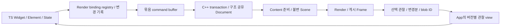

# work10 — 변경분 전달·데이터 공유 중심의 엔진 v2 개편

작성·갱신: **2026-11-11 KST** · 문서 상태: **OPEN / Windows 후속은 work10-a1** · work10 구현: **PARTIAL / 현재 인계는 §24** · 제품 전체: **PARTIAL**

사용자 요청에 따라 `work9.md`, `work9-1.md`, `work9-2.md`, `work9-3.md`, `work9-4.md`, `work9-5.md`, `work9-a.md`, `work9-b.md`, `work9-c.md`를 **CLOSED / work10 이관**으로 종료한다. 이 문서가 이후의 실행 계약이다. 이전 문서의 구현·검증 기록과 체크박스는 당시 근거로 보존하며, 문서 종료를 미완료 기능·호환·성능·제품 전환의 완료로 해석하지 않는다. 남은 의무는 §8에 대응시킨다.

최초 작성은 **현재 소스·공급 메타데이터 검토와 계획 작성**까지였다. 이후 사용자 요청으로 제품 코드·공급·앱 검증을 진행했다. §11–23은 이전 차수의 기록이며, **현재 Windows 실행 계획은 [work10-a1.md](work10-a1.md), 인계는 §24다.** 코드에서 원인을 찾아 수정한 다음 PowerShell로 Windows를 조작·확인한다. 이 문서의 기본 소유권·데이터 공유 계약과 §8 의무는 유지한다. 아래 §2.1의 최초 공급과 과거 문서의 결과를 현재 공급의 검증으로 확대하지 않는다.

## 1. 목표와 설계 결정

**JSI를 유지하고, TS의 변경 기록으로 C++의 기존 retained scene을 갱신한다.** 전체 중간 트리 생성·전체 비교, 연속 패킷 복사, 동일 데이터의 반복 디코딩을 줄인다. 이미 존재하는 Document/Scene/Frame과 App/Content/Render 소유권을 발전시키며 새 장면 엔진을 병렬로 만들지 않는다.

우선 해결할 사용자 흐름은 일반 Windows Demo의 날짜 선택기다. 새 월 진입·빠른 다중 월 이동·과거 월 연속 스와이프에서 준비 지연과 끊김이 남아 있다. 마지막 사용자 확인은 **“종료없이 계속 이동은 되는데 여전히 준비하는데 너무 오래걸림”**이다. 해당 입력 구간에서 종료가 재발하지 않았다는 확인과 성능 미수락을 구분한다. 근거는 [problem.md §22](problem.md#22-2026-11-10-과거-월-연속-스와이프의-잉크-참조-오류)다.

| 검토한 선택지 | 결정과 이유 |
| --- | --- |
| JSI를 FFI로 전면 교체 | 이번 개편에서 채택하지 않는다. 트리 구성·복사·디코딩은 호출 인터페이스만 바꿔도 남는다. |
| 노드마다 HostObject를 만들고 속성을 개별 호출 | 주 전달 경로로 채택하지 않는다. 수천 번의 경계 호출·락·수명 추적을 추가한다. JS 콜백·객체는 App owner에 둔다. |
| 전체 트리에 해시를 계산하고 같으면 건너뛰기 | 주 변경 감지로 채택하지 않는다. 해시 계산의 전체 방문과 외부 참조 무효화가 남는다. 해시는 불변 blob의 후보 조회에만 사용한다. |
| 영속 핸들·변경 기록·묶음 commit | **채택.** 변경 시점을 기록하고 바뀐 노드·연결·의존성만 전달한다. |
| 불변 native snapshot의 구조 공유 | **채택.** 기존 스냅샷은 읽기 전용으로 보존하고 수정한 page/node/child list만 새로 만든다. |
| 버전이 있는 관찰 결과·불변 blob ID | **채택.** 필요한 상태와 변경분만 보내고 같은 데이터는 한 번 검증·해석한다. |
| 모든 플랫폼을 SharedArrayBuffer 하나로 통일 | 채택하지 않는다. 동일한 논리 계약 아래 Windows native backing, Web transferable, Wasm 경계의 메모리 소유권을 각각 구현한다. |

**개발 우선 대상:** Windows App SDK와 Web single-worker/threaded. Android는 공통 wire 변경의 영향·지원 상태를 기록하고 해당 차수에서 공급을 갱신한다. Linux·iOS/macOS는 후속 범위다. Windows의 독립 HWND host를 복원하지 않는다.

**유지할 제품 계약:** 원래 Widget/Element/State·BuildContext/Key·Material/Cupertino의 TS 정책, controller/callback 순서, 원래 공개 API 기준, C++의 최종 layout/geometry/hit-test/gesture/편집 권위, 현재 App 로컬 paragraph 질의, 플랫폼별 실제 upstream 소스 수정 이식 의무. DatePicker의 원본 변환·생성 소유권도 유지한다. 임의 사용자 Widget callback을 C++로 옮기는 작업은 이 계획의 전제가 아니다.

## 2. 현재 소스에서 확인한 비용과 재사용 기반

| 구간·소스 | 이미 있는 기능 | 이번 개편의 대상 |
| --- | --- | --- |
| [capture.ts](Nelyx/runtime/app/capture.ts) `RenderSceneCapture` | WeakMap 설정 캐시, local/ancestor dirty, 동적 의존성, 정적 subtree 재사용 | 변경된 조상 경로의 SceneNode/자식 배열 재구성, dynamic 재캡처를 변경 기록으로 대체 |
| [scene.ts](Nelyx/runtime/engine-client/scene.ts) `records`·`diff` | 세대 핸들, accepted record/config 재사용, transaction 재확인 | 매번 allocate/visit·Map/Set·자식 배열·accepted 비교, mutable 설정 snapshot 복제 |
| [document.hpp](Nelyx/engine/core/scene/document.hpp)·[transaction.cpp](Nelyx/engine/core/protocol/transaction.cpp) | 불변 Node의 shared_ptr, 원자적 설치, 변경 노드 복사 | `Document(*current)`의 전체 slot/children 컨테이너 복사, 같은 노드의 명령별 복사, 전체 children 재구축·검증·형제 검색 |
| [client.ts](Nelyx/runtime/engine-client/client.ts)·[message-port.ts](Nelyx/runtime/engine-client/message-port.ts) | request/owner 검증, pending quota, async 요청 보호 | client의 `bytes.slice()`와 port의 추가 `slice()`를 명시적 버퍼 소유권으로 대체 |
| [host.cpp](Nelyx/engine/platform/windows/host.cpp) enqueue/응답 | App·Content·Render owner, bounded mailbox·ExternalLease | JS buffer→vector 복사, 응답 vector→새 JS ArrayBuffer memcpy |
| [codec.ts](Nelyx/runtime/engine-client/codec.ts)·[observation-cache.ts](Nelyx/runtime/engine-client/observation-cache.ts) | lazy observation row, 검증된 불변 blob 캐시·정확한 byte 비교 | lazy row를 위한 패킷 복사, 동일 bytes 재전송·비교, 반복 row/container 생성 |
| [scene.ts](Nelyx/runtime/engine-client/scene.ts) `observeScene` | 이벤트 polling 분리, 관찰 coalescing, 선택된 layout observer 질의 | 매번 observer 목록 검색, 별도 semantics/layout 왕복, publication마다 객체/인덱스 재구성 |
| [state.hpp](Nelyx/engine/core/state.hpp)·[scheduler.cpp](Nelyx/engine/core/scheduler/scheduler.cpp) | Document/LayoutOutput/Scene/Frame 공유, accepted·준비·게시 구분 | 공유 구조를 재사용하면서 변경 의존성·준비 취소·관찰 수명을 정교화 |

C++ Node가 이미 공유된다는 사실만으로 commit이 변경량에 비례한다고 볼 수 없다. 현재 `Document`는 최대 노드 수에 맞춘 slot 배열과 children 벡터들을 복사하고, transaction 검증은 children을 다시 만들며 여러 전역 검사를 수행한다. **TS 전체 순회를 제거한 뒤 C++에서 다시 전체 작업을 하는 경로까지 검토한다.** 다만 이 비용의 현재 실행 비중은 W10-00에서 따로 측정해야 한다.

### 2.1 문서 작성 시 기준점

| 항목 | 확인 내용·범위 |
| --- | --- |
| Core source identity | `sourceIdentity()` 재산출: `dea64e1fb0ab7a415de1659aaf31a132f76ca2263bc8c2d73b7cee9aee001cc3` |
| 현재 engine manifest | [engine-manifest.json](Nelyx/engine/dist/engine-manifest.json)의 sourceSha256 일치, ABI **2**, schema **2570296319**, **356 files**, `windows-app-sdk`·`threaded`·`single-worker` |
| 확인 한계 | 이번에는 전체 공급 파일 hash·설치본·App 번들을 다시 검증하지 않았다. 위 source identity는 모든 TS/App 입력의 검증을 대신하지 않는다. |
| 이전 기능 근거 | Range/editor·Curve/취소, Ink parking, date scroll·관찰·capture 및 Windows/Web 부분 확인은 [work9-c](work9-c.md)와 [problem.md](problem.md)의 해당 공급 기록에 한정 |
| 현재 제품 판정 | **compatible=false**, **performanceAccepted=false**, **resizePerformanceAccepted=false**, 전체 물리/display/scanout 수락 **notVerified** |
| 후속 플랫폼 | Android **stale/notVerified**, Linux·iOS/macOS **DEFERRED** |

예전 CPU profile·합성 decode 비교·마지막 frame timing은 원인 후보를 고르는 자료다. 새 구조의 FPS·표시 수락이나 현재 공급의 성능 기준값으로 복사하지 않는다.

## 3. 목표 데이터 흐름과 소유권



| 데이터 | 소유자·수명 |
| --- | --- |
| Widget/Element/State, 원래 theme·controller·callback | TS App. callback/function을 native 공유 메모리로 보내지 않음 |
| RenderObject와 native projection의 연결 | App registry. `(Source identity, partKey)`별 binding을 유지. 하나의 RenderObject가 여러 native 노드를 만드는 경우 포함 |
| accepted Document·layout·paint·hit-test·편집 상태 | 기존 C++ Core. 새 transaction은 별도 작업본에서 검증 후 원자 설치 |
| 게시 Scene/Frame | C++ 불변 snapshot. Content·Render·input·관찰 reader의 lease가 끝날 때 회수 |
| command·응답 저장소 | transport별 소유권 token/lease. 제출·사용·반환 상태를 명시하고 byte quota에 포함 |
| 관찰 결과의 JS facade | App. 내부 최신 view와 공개 API의 특정 시점 snapshot을 구분 |
| OS 입력·surface·clock·IME/UIA | 각 host. 입력 수신 경로가 장면 준비·큰 packet의 완료를 기다리지 않도록 유지 |

새 타입·모듈 이름은 아래의 **계획상 명칭**이다. 구현 완료 API로 간주하지 않는다. 가능한 기존 client/scene/state 소유자에 기능을 넣고, 책임 분리가 필요한 경우에만 파일을 만든다.

### 3.1 Render binding과 변경 기록

- `RenderBindingRegistry`가 기존 SceneReference/세대 핸들을 이어받는다. Source 객체와 native 노드가 항상 일대일이라고 가정하지 않는다. partKey는 렌더 결과 배열의 일시적 순서 대신 모듈이 정한 안정적인 역할을 사용한다.
- 모듈의 생성·설정 변경·parent data·adopt/drop/reparent·dispose 지점에서 변경을 기록한다. 최초 mount와 명시적 재동기화에는 전체 구축을 허용하고 정상 update에서는 변경 queue를 drain한다.
- `children/layout/paint/semantics/interaction/resource` revision을 분리한다. ancestor 제약·intrinsic·상속 theme/font·DPR·viewport 의존성은 영향 범위에 전파한다. 색상 변경이 자식 연결 재검사나 paragraph 재측정을 일으키지 않도록 한다.
- Ink·layer leader/follower·paint placement·inline paragraph child·tooltip target 등 **비트리 참조의 역방향 의존성**을 관리한다. 참조 대상의 generation·표시/parking 정책이 바뀌면 사용하는 설정도 무효화한다. hash/객체 identity만으로 생략하지 않는다.
- State가 살아 있는 parked page의 native 노드는 해제될 수 있다. 재표시 시 새 handle을 연결하고 참조를 재해석한다. 최근 Ink 수정의 `paintsChild`·살아 있는 feature의 표시 의존성·미장착 참조 거부를 보존한다.
- callback 교체는 가능한 JS registry 갱신으로 처리한다. Core가 관찰하는 control/gesture 정책이 달라지면 해당 revision도 전달한다. callbacks를 매번 설정 객체에 복제하지 않는다.
- 변경 기록은 payload를 기록 시점에 소유한다. 외부 mutable 배열·typed array를 그대로 붙잡아 두고 나중에 다른 값으로 encode하지 않는다. immutable 내부 값 또는 변경 시 한 번 캡처한 정규화 값으로 snapshot 의미를 지킨다.

**비용 목표:** 정상 변경 비용은 변경 노드 + 실제 의존성 + 바뀐 부모의 자식 목록에 비례한다. 전역 theme/font, 큰 reparent, 최초 mount처럼 넓은 무효화가 필요한 경우는 별도 집계한다. 모든 연산의 O(1)을 약속하지 않는다.

### 3.2 묶음 commit과 접수 상태

- `accepted`, `inFlight`, `nextDirty`를 구분한다. 전송 중 발생한 수정은 다음 묶음에 남기며 ACK 때 덮어쓰지 않는다. JS 객체의 현재 값과 accepted snapshot을 동일 객체의 제자리 변경으로 표현하지 않는다.
- 동일 transaction 안의 덮어쓰기 가능한 속성은 최종 값으로 합친다. create/delete/reparent, callback·편집·focus·명령 terminal·입력 이벤트의 순서는 보존한다. 일회성 명령을 속성처럼 합치거나 유실시키지 않는다.
- owner `{session, app, view, generation}`, node `{slot, generation}`, transaction ID와 base document revision을 검증한다. stale/rejected transaction은 부분 설치하지 않는다.
- provisional handle·resource는 거부/취소 시 회수한다. ACK 유실/timeout은 거부와 구분하고 기존 transaction 조회·멱등성 계약으로 terminal을 확정한다. 불확정인 요청의 slot/bytes를 재사용하지 않는다.
- credit 부족 시 bounded pending 상태와 재개 알림을 사용한다. 무제한 queue·즉시 재시도 루프를 만들지 않는다. 원래 입력·편집 명령에 필요한 처리 여유를 유지한다.

### 3.3 C++ Document와 검증의 구조 공유

- slot table을 page 단위 불변 저장소로 분리하고, 바뀐 page와 경로만 복사한다. page directory까지 매번 전체 deep copy하지 않는 구조를 사용한다. page 크기·간접 참조 비용은 W10-02의 실제 노드 규모에서 결정한다.
- child list는 부모별 불변 블록으로 공유한다. attach/detach/reorder는 해당 부모와 실제 영향 형제만 갱신한다. scene 전체 검색으로 형제를 찾거나 children 전체를 재생성하지 않는다.
- transaction의 edit table에서 같은 노드는 한 번 mutable copy를 만든다. 여러 설정 명령과 layoutRevision 갱신이 같은 Node를 반복 복제하지 않게 한다. rollback은 작업본을 버리는 것으로 끝나야 한다.
- semantic/editor 수·깊이·참조·자원·paint owner 등 파생 상태와 역방향 인덱스를 변경분으로 유지한다. 전역 의미를 가진 검사는 정확한 영향 폐쇄를 먼저 정의한다.
- **wire 범위·길이·유한수·generation·quota·cycle·참조·그래프 검증을 생략하지 않는다.** 기존 전체 검증기를 비교 기준으로 삼아 증분 검증과 결과/거부 동등성을 확인한다. 안전성이 입증되지 않은 복잡한 변경에는 명시적 전체 검증 경로를 남기고 호출 수·비용을 계측한다.
- 초기 구축·복구의 전체 검증과 작은 속성 변경의 검증을 구분한다. 검증 일부를 없애서 빠르게 만든 결과는 이 챕터의 완료가 아니다.

### 3.4 관찰 구독·delta·snapshot

- `onLayout`·focus·editing·semantics 등의 관심 핸들/필드를 등록·해제 시점에 유지한다. 매 publication마다 accepted 전체에서 observer 목록을 다시 찾지 않는다.
- 응답에 `baseVersion`, `nextVersion`, owner/generation과 **accepted document / active preparation / published document·metrics·device / property·font revision**을 구분해 담는다. 서로 다른 시점의 layout과 semantics를 단일 epoch라고 간주하지 않는다.
- 변경 row·삭제 tombstone·추가 blob만 전송한다. 변화 없는 필드와 고정 topology를 반복 전송하지 않는다. gap·eviction·generation 교체에는 명시적인 bounded full resync를 제공한다.
- layout/semantics는 같은 일관성 범위에서 묶어 요청할 수 있게 한다. 활성 준비용 질의와 게시 화면용 질의는 다른 역할로 식별한다. 큰 semantics 결과 때문에 작은 layout·입력 응답이 막히지 않게 응답 한도와 우선순위를 둔다.
- 내부 facade는 한 packet의 메타데이터와 row를 함께 교체해 일관되게 읽는다. 공개된 이전 snapshot을 뒤에서 바꾸지 않는다. 공개 동기 geometry·callback 시점 의미는 별도 호환 의무로 유지한다.
- lazy view가 대형 응답 전체를 장기 보유하는 경우를 계측한다. 필요한 작은 값의 명시적 복사와 snapshot lease를 선택해 retained bytes를 제한한다. JS 객체 freeze만으로 backing buffer가 읽기 전용이 된다고 가정하지 않는다.
- input/terminal 이벤트는 관찰 delta와 독립된 순서·ACK를 유지한다. coalescing으로 callback·편집·focus 이벤트를 버리지 않는다. UIA/ARIA/reader가 필요한 전체 semantics를 App 관찰 축소와 함께 삭제하지 않는다.

### 3.5 버퍼 소유권과 플랫폼별 경계

논리 상태는 `Writable → Sealed → InFlight → Retired → Reusable`로 둔다. Retired와 실제 재사용 가능 시점을 구분하고 reader·replay·runtime 참조가 모두 끝나야 재사용한다.

| 경계 | 개편 방식·필수 조건 |
| --- | --- |
| Windows native 응답→JS | 응답 vector 저장소를 `jsi::MutableBuffer` holder로 이동해 새 JS buffer로의 memcpy 제거. 넘긴 저장소를 Core/host가 다시 수정·재사용하지 않음 |
| Windows JS 요청→native | 내부 command arena에 직접 기록. submit 뒤 쓰기 접근을 확실히 종료할 수 있는 경로만 공유. pinned Hermes에서 detach/접근 차단을 보장하지 못하는 경계는 **한 번의 소유권 확보 복사**를 유지하고 나머지 중복 복사 제거 |
| Web App↔Worker | 소유한 ArrayBuffer를 transfer. 전송 전에 검증·retry에 필요한 작은 메타데이터를 별도 저장. detach된 DataView/bytes를 응답 처리에서 다시 읽지 않음 |
| JS↔Wasm | packet을 linear memory에 넣거나 결과를 분리하는 필요한 복사는 실제로 계수. Wasm heap 전체를 transfer하지 않음. memory grow 후 view 재생성·lease·세대 계약 유지 |
| Web threaded | 현재 shared memory와 owner 동기화를 유지. 별도 공유 ring은 이점과 bounded slot/Atomics 계약이 입증될 때만 채택하며 single-worker의 필수 조건으로 만들지 않음 |

현재 [JSI MutableBuffer 계약](https://github.com/microsoft/hermes-windows/blob/94aa5e1d40a4ce99df79d951cbe45310ec40680c/API/jsi/jsi/jsi.h)은 저장소 주소·크기의 안정성과 내용 접근의 동기화를 요구한다. 생성자 지원만으로 worker가 JSI Runtime/Value를 사용할 수 있는 것은 아니다. worker에는 native 저장소 holder만 넘긴다. finalizer는 임의의 Core/VM 객체를 재진입하지 않으며 session 종료 이후에도 안전한 ledger/allocator 수명을 가져야 한다.

[ArrayBuffer transfer](https://developer.mozilla.org/en-US/docs/Web/API/Web_Workers_API/Transferable_objects)는 송신 측 소유권을 분리한다. 따라서 현재 client의 전송 후 header 조회와 불확정 transaction 재확인까지 함께 고쳐야 한다. replay를 위해 변경 기록이나 봉인된 저장소를 bounded하게 보유하며, 복구 때만 필요한 재인코딩은 정상 전송 비용과 구분한다. [Wasm memory growth](https://developer.mozilla.org/en-US/docs/WebAssembly/Reference/JavaScript_interface/Memory/grow)는 non-shared buffer를 detach하고 shared view의 기존 길이를 확장하지 않으므로, 오래된 view를 재사용해서는 안 된다.

소유권 최적화는 내부 transport 경로부터 적용한다. 외부 caller가 가진 mutable bytes를 받는 기존 API에는 snapshot/복사 의미를 유지한다. 응답 buffer를 C++ Document/Node 저장소의 쓰기 가능한 alias로 노출하지 않는다. timeout만으로 native 작업이 종료되었다고 보고 credit/lease를 돌려주지 않는다. pool 포화·GC 지연·느린 reader에는 backpressure를 적용하고, 외부 buffer bytes도 memory ledger에 포함한다.

### 3.6 불변 blob과 반복 디코딩 제거

- 텍스트·paragraph/style·semantics label·paint/config 중 실제 반복 비용이 큰 블록부터 `{owner, blobId, generation, revision, kind}`로 등록한다. node handle과 blob ID 공간을 구분한다.
- byte 입력은 최초 등록 시 끝까지 검증해 정규화된 불변 표현으로 저장한다. 다음 commit/관찰에서는 ID를 참조한다. hash는 검색 후보를 좁히는 용도이고 충돌은 길이·정확한 내용 비교로 해결한다.
- font cohort·locale·scale·shape 등 결과에 영향을 주는 의존성을 key/revision에 포함한다. 캐시를 찾았다는 이유로 다른 owner/schema의 데이터를 수락하지 않는다.
- evict/reload/resync 후 미등록 ID는 명시적으로 복구하거나 거부한다. ID를 조용히 다른 내용에 재사용하지 않는다. accepted·준비·published·JS 관찰 reader가 가진 참조가 끝나야 회수한다.
- 캐시 한도는 entry 수와 bytes로 제한한다. 매 월 새 label이 생기는 흐름에서도 과거 월 수만큼 증가하지 않아야 한다. 기존 decode cache는 전환 중 비교/복구 경로로 사용하고 마지막 소비자 종료 후 정리한다.

### 3.7 새 월 준비와 렌더 진행

브리지 비용을 줄여도 새 Widget/Element 생성·테마 계산·paragraph 준비는 남는다. W10-06에서 build/capture/commit/prepare를 분리해 남은 비용을 해결한다.

- visible/현재 요구 월을 우선하고 예측 준비 범위·메모리를 제한한다. 이미 준비한 인접 월의 작업을 매 입력마다 취소·재시작하지 않는다. 오래된 준비의 결과는 generation/revision으로 차단한다.
- 반복 요청은 아직 실행하지 않은 중복 준비만 병합한다. 사용자 입력 delta·명령 terminal·페이지 변경 callback의 원래 순서를 보존한다.
- Content의 resumable 작업은 실제 예산에서 yield하고 취소·재개 상태를 유지한다. Render는 이전의 유효한 게시 snapshot으로 계속 진행하며 준비 완료를 동기 대기하지 않는다.
- Source build는 불필요한 rebuild 범위·반복 설정 생성부터 줄인다. 동기 사용자 callback이나 mount 도중 임의 await를 넣지 않는다. 부분 build를 공개하려면 별도 일관성 계약과 검증이 필요하다.
- 아직 준비되지 않은 새 월은 latency에 그대로 포함한다. 빈 공간을 오래 보이게 하거나 페이지 이동을 숨겨서 끊김이 사라졌다고 판정하지 않는다. 기존 Flutter 변환 컴포넌트의 동작·접근성·선택 상태를 보존한다.

## 4. 구현 챕터와 의존성

**실행 순서: W10-00 → 01 → 02 → 03 → 04 → 05 → 06 → 07.** W10-00의 측정이 다른 주병목을 확인하면 관련 챕터의 우선순위를 근거와 함께 갱신하되 소유권·수명 선행 조건은 생략하지 않는다. 각 챕터는 전체 구현·실제 소비자 연결을 모은 뒤 §5의 통합 검증을 적용한다.

| 챕터 | 구현 묶음·주요 수정 범위 | 챕터 종료 조건 |
| --- | --- | --- |
| **W10-00 기준선·계약** | 현재 diff/공급/App 입력 확인, request→App build→capture→commit→Content→게시 인과 계측. dirty/visited/복사 bytes/디코딩/GC/queue/lease 카운터와 §3 계약 구체화 | 동일 입력의 초기·재방문·빠른 월 이동 기준선, copy map·owner 상태도·프로토콜 변경 목록. 소스 추론과 실행 측정 구분 |
| **W10-01 TS 변경 기록** | capture/host/native-node/controls와 모듈 설정, SceneWriter registry·dirty journal·의존성·묶음 commit. 처음에는 현재 wire를 사용 | 정상 update에서 전체 SceneNode 구축/records 순회를 대체. GlobalKey·parking·Ink·callbacks·ACK 중 변경 보존, 실제 Demo 연결 |
| **W10-02 Core transaction 공유** | Document slot/child page, transaction edit table, 참조·파생 인덱스, 증분 검증·무효화 | 전체 복사·재구축 감소를 counters로 확인. 원자성·malformed 거부·기존 전체 검증 결과 동등성, 동일 노드 반복 clone 제거 |
| **W10-03 관찰 delta** | schema/codec/client/SceneWriter·Core snapshot 생성·App geometry/focus/semantics 소비. 구독·version·tombstone·resync | 미변경 데이터 재전송/객체화 제거, observer 전체 검색 제거. active/published 혼합·stale 결과 차단, 입력/접근성 보존 |
| **W10-04 버퍼 소유권** | Windows 응답 holder부터 적용, client/port lease·요청 arena·Web transfer·Wasm 경계·ledger | 실제 복사 bytes 감소, transfer 후 접근 0, 미확정 요청의 조기 재사용 0, timeout/GC/close/포화 검증. 필요한 복사는 명시 |
| **W10-05 불변 데이터 등록** | blob 등록/참조·네이티브 정규화·JS decode ID cache·budget/eviction. schema와 관련 공급 갱신 | 같은 revision의 반복 전송/디코딩 제거, collision·ID 재사용·font/owner 변경·복구 정확성 및 메모리 상한 |
| **W10-06 준비·Source build** | scheduler/layout/list/paragraph·builder 왕복·App rebuild 범위·달력 인접 월 준비. 기존 resume/coverage 보호 유지 | 빠른 왕복에서 불필요한 준비 재시작·큐 누적 제거, 오래된 결과 차단, 미방문 월 latency와 frame 진행을 함께 개선 |
| **W10-07 통합·성능·전환 정리** | 같은 공급의 설치 소비·Windows/Web 앱·물리 트랙패드·메모리·복구, 마지막 구 중간 경로 소비자 제거 | §6–7 결과와 실패/미실행을 명시. 자동 기능 PASS와 사용자 체감·표시 수락 분리. work9 후속 의무는 §8에 존속 |

전환 중 기존 전체 경로는 초기 구축·명시적 resync 또는 검증 비교에 한정한다. 운영 화면에서 신·구 장면을 매 프레임 동시에 만들어 비교하지 않는다. 혼합 실행이 필요하면 노드/owner의 권위와 사용 이유를 명시하고 W10-07에서 마지막 소비자를 확인한다. 제품 오류를 구 렌더러로 자동 fallback해 숨기지 않는다.

공통 wire 변경은 [protocol.json](Nelyx/engine/schema/protocol.json)을 기준으로 생성된 TS/C++ 상수를 함께 갱신한다. capability·schema/ABI 판정을 명시하고 미공급 조합은 시작 시 실패한다. Windows/Web은 같은 논리 의미를 사용하며 Android 구 공급이 새 protocol과 호환된다고 표시하지 않는다.

## 5. 챕터별 통합 검증 방식

1. 현재 diff·소비자 graph와 해당 챕터의 범위를 확정하고 구현·연결을 한 번에 모은다. 다음 구현을 막는 타입·문법·국소 compile·schema 문제만 중간 확인한다.
2. 챕터 구현 후 필요한 package/engine/App 공급을 한 번 갱신하고, 같은 공급으로 정적 검사·설치 소비·Windows/Web의 관련 흐름을 확인한다.
3. 독립적으로 확인 가능한 실패를 모아 원인별로 일괄 수정한다. 수정한 공급·실패 흐름·직접 영향 회귀를 다시 확인한다.
4. 구현 완료와 통합 확인 전 상태를 **구현 완료 / 검증 대기 / notVerified**로 구분한다. 완료 체크는 구현과 해당 검증을 모두 충족한 뒤 한다.
5. 이후 챕터는 이미 유효한 동일 입력의 PASS를 반복하지 않는다. wire·자원 수명·공급 입력 변경은 관련 target/profile로 확인 범위를 넓힌다.

| 변경 영역 | 필수 확인 |
| --- | --- |
| registry/journal | 무변경·단일 속성·children reorder·GlobalKey reparent·dispose/recreate·park/unpark·Ink/follower/paragraph 참조·전송 중 새 수정 |
| transaction | 여러 명령이 같은 node 수정·NACK/rollback·ACK 유실·budget·cycle·깊이·malformed·잘못된 generation·자원 참조·전체 검증 비교 |
| observation | 최초/full·delta·삭제·gap/resync·owner 교체·active≠published·metrics/font 변경·old snapshot 보존·layout listener·focus/IME/UIA/ARIA |
| buffer/blob | retained caller mutation·늦은 응답·double return·transfer/detach·memory grow·pool 포화·GC 지연·close/reload·collision·eviction·quota |
| 준비/달력 | 최초 표시·선택/입력/확인/취소·재개방·새 월·과거 연속·빠른 방향 반전·원래 월 복귀·hover/Ink·resize·bounded retention |
| 공통 회귀 | 목록 재방문·관성/종료·메뉴/overlay·Range/curved editor·controlled refusal·theme/route/image·입력 중 hide/close·복구 |
| 공급/설치 | source/manifest 전체 hash·ABI/schema·App 입력·font cohort·설치 package만 사용하는 선언/실행·Windows App SDK·Web 두 profile |

기존 [check-incremental-capture.mjs](Nelyx/eng/check-incremental-capture.mjs), [check-ink-parking.mjs](Nelyx/eng/check-ink-parking.mjs), [check-app-observations.mjs](Nelyx/eng/check-app-observations.mjs), [check-date-scroll-web.mjs](Nelyx/eng/check-date-scroll-web.mjs), [check-frame-reuse.mjs](Nelyx/eng/check-frame-reuse.mjs)를 현재 계약에 맞게 재사용한다. 검증의 목적은 객체 모양이 구현과 같은지 확인하는 것이 아니라 실제 의미·수명·작업량을 확인하는 것이다. 이미 폐기한 대규모 audit/fixture 체계를 복원하지 않는다.

## 6. 계측과 구조적 완료 조건

W10-00부터 선택적인 bounded 집계/표본을 사용하고, 계측 on/off 차이도 확인한다. 모든 frame의 상세 console 출력·무제한 로그는 만들지 않는다. 단계 시간은 중첩 여부와 clock domain을 표시하며 서로 다른 thread의 시간을 단순 합산하지 않는다.

| 지표 | 구분할 내용 |
| --- | --- |
| App | callback·Widget build·변경 수집·encode·관찰 적용 시간, 생성 객체/bytes·GC pause, 입력 callback queue age |
| transaction | 방문/dirty/의존 노드 수, clone한 Node/page/child list 수, validation 전체/증분 횟수·시간, accepted latency |
| transport | 경계별 copied bytes·transfer bytes·외부 backing bytes, queue/in-flight/replay/retired bytes·최고 age |
| decode | blob 신규/재사용/퇴거·전송 bytes·해석 횟수, row wrapper 수, retained snapshot bytes |
| Content | 준비 wall/CPU·builder wait·왕복·재시작/취소 이유, paragraph 신규/재사용, coverage 진행·최초 새 월 ready 시간 |
| Render·표시 | input 소비·frame CPU·lock wait/hold·GPU acquire/submit/present 대기·게시/표시 interval·deadline miss·최장 정지 |

**구조적 gate:**

- 무변경 상태에서 장면 설정의 전체 캡처·records 방문·transaction은 0이다. 필요한 입력·관성·animation/property·표시 처리는 별도로 진행한다.
- 동일한 작은 변경을 서로 다른 전체 노드 수에서 실행해 방문·할당·복사량이 무관한 노드 수에 따라 증가하지 않는지 확인한다. 최초 구축·전역 무효화·안전한 전체 검증 경로는 별도 계수한다.
- paint만 바뀐 노드가 children 전체 재생성·무관한 paragraph decode/measure를 일으키지 않는다. 동일 transaction에서 동일 node의 mutable clone은 한 번이다.
- Windows 응답의 vector→JS 추가 memcpy는 제거한다. client/port의 중복 복사는 owned 경로에서 제거하고, 요청 보호·Wasm 등 남는 복사에는 이유와 실제 bytes를 기록한다.
- 동일 owner/blob revision은 최초 등록·명시적 resync/eviction 복구 외에 재전송·재해석하지 않는다. 관찰 변화가 없으면 row 목록을 다시 만들지 않는다.
- 월을 계속 이동해도 node/blob/page/pool/JS wrapper/lease가 한도 내에서 안정된다. 사용자 timeout 후에도 작업 중인 holder는 정상 보유로 추적하고 terminal 뒤 회수한다.
- 정상 종료 시 worker/GPU/native reader와 JS/runtime holder를 정해진 순서로 drain한 뒤 owned lease·예약 bytes가 회수된다. 아직 살아 있는 reader를 무시하고 0으로 보고하지 않는다.

## 7. 성능 목표와 사용자 수락

아래 수치는 **측정 결과가 아닌 초기 목표**이며 [problem.md의 수락 목표](problem.md#73-제안하는-수락-목표)를 이어받는다. `T`는 확인한 표시 장치의 refresh interval이다. W10-00에서 하드웨어·창 크기/DPR·앱 데이터·입력 패턴·폰트 상태·cold/warm 조건을 고정한다.

- warm-resident scroll의 불필요한 builder/paragraph 재준비 0, input→Core 소비 및 App callback p95 ≤ T, 시간이 흐르며 queue age가 증가하지 않음.
- warm frame CPU p95 ≤ 0.5T를 지향한다. 표시를 관측한 경우 frame interval p95 ≤ 1.25T, p99 ≤ 2T, 입력→첫 반응 표시 p95 ≤ 2T를 목표로 한다. 최장 정지와 T/2T 초과 횟수도 별도 기록한다.
- 첫 방문·인접 월·메모리 퇴거 후 재방문을 구분한다. font/asset 준비가 끝난 새 월은 입력→유효 그리드 게시 p95 **100ms 이내를 초기 목표**로 두고, 준비 중 기존 화면의 입력/렌더 진행도 확인한다. 미달 시 build/전달/Content/표시 중 원인과 남은 작업을 기록한다.
- 정상 입력의 유실·중복 callback·잘못된 hit·잘못된 날짜 선택·stale 참조·크래시·white flash는 0이어야 한다. 준비 범위를 무한히 늘려 latency를 줄이는 방식은 메모리 gate를 통과하지 못한다.
- 자동 입력은 동일 경로 비교용이다. 물리 트랙패드의 손을 뗀 뒤 관성·빠른 방향 전환·과거 월 연속 이동과 사용자의 체감을 따로 확인한다.

`accepted`, `activated`, `published`, GPU `submitted/present` API 완료, compositor 관측, 실제 scanout은 다른 근거다. 마지막 timing 한 개나 마지막 256/1024개 ring만으로 전체 percentile을 만들지 않는다. 표본 수·기간·누락/덮어쓰기 여부를 기록한다. 표시를 측정하지 못했으면 표시/FPS 수락은 **notVerified**로 남긴다.

Windows의 사용자 재현 명령은 다음과 같다. 기능·공급이 준비된 뒤 해당 창에서 같은 입력으로 확인한다.

```powershell
node .\Nelyx\sdk\tooling\cli\src\main.mjs run --engine v2 --app .\sample\nelyx-demo-app\engine-v2 --target windows
```

구조적 gate와 기능 PASS만으로 `performanceAccepted`·`resizePerformanceAccepted`를 true로 올리지 않는다. scroll과 resize도 각각 판정한다. 앱 전체 호환·기본값 전환은 §8의 나머지 조건까지 충족해야 한다.

## 8. work9 종료와 잔여 의무 이관

이 절은 W10-00–07 뒤의 **남은 실행 backlog**다. 앞선 성능 개편의 한 챕터에 전체 API·OS 이식·모든 플랫폼 완료를 요구하지 않는다. 반대로 성능 개편 완료를 아래 항목의 완료로 확대하지 않는다. W9-00–14·W9A/W9B/W9C의 원래 의무는 아래 대응과 종료 문서의 상세 목록으로 보존한다.

| 새 ID | 이전 범위 | 남은 의무·완료 기준 |
| --- | --- | --- |
| **W10-R01 Core·공개 실행 계약** | W9C-01, [work9-c §3.2](work9-c.md#32-w9c-0102--core디자인접근성-잔여-계약) | 설정/invalidation/parent data의 모듈 소유, 동기 constraints/needsLayout/게시 전 geometry, custom delegate·relayout·paint/hit-test·rasterizer·PlatformView·snapshot singular transform, scroll/sliver/pan-zoom·editor custom physics/behavior·TapRegion 동기 재진입 의미. 마지막 TS 실행 소비자와 중앙 분기 정리 |
| **W10-R02 디자인·접근성·입력** | W9C-02, [work9-2](work9-2.md) | 원래 theme/painter·InkSparkle/shader·gradient/shadow/decoration·custom shape/border·controls/form/route/localization/assets·전체 catalog, controlled value/callback, 임의 semantics key/delegate·역할/병합·custom action·focus/range listener·OS feature ingress, UIA/실제 reader·국제 key/dead key/IME/Offstage·focus 재진입. 현재 날짜 선택기 생성 출처 보존 |
| **W10-R03 OS 소스·SDK·수명** | W9C-03, [native-api-ports](Nelyx/engine/platform/native-api-ports.md) | RNW 입력/capture/focus/IME/UIA/환경·서비스 등 실제 수정 이식과 소비자 교체. font/image/asset/network/service/VM·session/view·visibility/loss/reload/close·미확정 ACK/GPU holder. VM 언어 의미·공개 SDK AppDefinition/React/Renderer 주입 API 대응 |
| **W10-R04 CLI·설정·공급** | W9C-04, [work9-c §3.3](work9-c.md#33-w9c-0304--플랫폼-api서비스sdk도구) | `nelyx.app/1`·target descriptor·config/template 통합, 구 config·VM/renderer 옵션의 명시 실패, App/client ambient 의존성 분리, 설치본 create/doctor/build/run/dev/pack, Metro/compiler/asset 중립 helper 분리·출처/notice 보존 |
| **W10-R05 전체 앱 소비자** | W9C-05, [work9-c §3.4](work9-c.md#34-w9c-05--실제-앱의-남은-연결) | Testbed/Demo 전체 catalog·상세·drawer/navigation·form/modal·theme/font/image, Data Testbed/list/navigation/graphics·`/v2` 디자인·구 runner의 실제 이관, Android sample 잔여 화면·서비스 |
| **W10-R06 전체 기술 gate** | W9C-06·W9-13, [work9-3](work9-3.md) | 원래 **4 packages / 834 subpaths**·서명 의무를 분모 변경 없이 대응. 설치본 strict 선언·실제 graph/native run·복구/종료·Windows 및 Web 두 profile의 전체 관련 흐름. 명시 계약 변경과 미지원은 별도 판정 |
| **W10-R07 제품 전환·삭제** | W9C-07·W9-14, [work9-c §6](work9-c.md#6-w9c-0708-전환과-제거할-마지막-소비자) | target별 기술/API·설치/복구·물리/표시/성능 수락 뒤 일반 CLI/sample/template 기본값 전환. 별도 Widget/State tree·축소 `/v2` 디자인·구 TS/RN renderer·SDK/backend/runner·불필요 export/dependency의 마지막 소비자 종료 후 삭제 |
| **W10-R08 후속 플랫폼·전역 종료** | W9C-08, [work9-4](work9-4.md)·[work9-5](work9-5.md) | Android RN·Linux RNL·iOS RN·macOS RNM 소스 수정 이식·대체 host/입력/접근성/배포, Android 두 ABI 최신 공급·설치/run, 각 target 기술/제품 gate. 지원 범위 결정 또는 대체 완료 뒤 전역 legacy·생성 recipe·ownership·license·README/help 정합성 정리 |

플랫폼 API는 `upstream 고정 원본 → 이식 파일/함수 → Nelyx 수정 → 실제 소비자 교체 → 앱 동작`으로 추적한다. 기능 참고나 자체 구현만으로 이식 완료를 선언하지 않는다. Windows는 App SDK 단일 host, Web은 두 profile, 후속 개발 차수는 Android/Linux → iOS/macOS다. 과거 Android 선행 부분 구현은 유지하되 새 공통 공급의 확인으로 간주하지 않는다.

기존 Range/editor·Curve 완료 범위는 회귀 기반으로 이어받는다. W9C-00을 미착수로 되돌리지 않는다. 반대로 현재 공급과 다른 과거 PASS를 새 구조의 확인으로 복사하지 않는다. [work9-c §3.1](work9-c.md#31-w9c-00--첫-재개-구현-묶음)의 간헐 오류·장면 진행·budget 실패 추적과 [problem.md](problem.md)의 입력/표시 병목도 남은 원인 조사로 유지한다.

## 9. 실행 명령·공급·정리 규칙

아래는 **변경 범위에 맞춰 선택할 명령**이다. 최초 계획 작성에서는 실행하지 않았다. 현재 Windows 후속은 [work10-a1.md](work10-a1.md)의 코드 분석·수정 후 PowerShell 확인 순서를 따른다. 아래 Web 명령을 Windows 후속의 필수 선행 검사로 실행하지 않는다. Core 선언이 다음 구현을 막을 때만 먼저 공급하고, 전체 build/install/run은 챕터 끝에 모은다.

```powershell
# Core 소스·선언이 바뀐 경우
npm.cmd run build:core
# 디자인/SDK 및 최종 소비 공급이 필요한 경우; build:sdk는 Core 빌드를 포함
npm.cmd run build:sdk
# C++·wire·host·provider 등 engine 공급 입력이 바뀐 경우
npm.cmd run build:engine-v2
# 챕터의 정적 검사와 생성 schema 정합성
npm.cmd run check:types
npm.cmd run lint
npm.cmd run format:check
node .\Nelyx\engine\tools\generate-schema.mjs --check
git diff --check
# 갱신된 Web 앱 공급이 준비된 뒤의 관련 회귀
node .\Nelyx\eng\check-date-scroll-web.mjs --precision --burst --past-only --both
```

`build:sdk`와 별도 `build:core`를 같은 입력으로 연속 반복하지 않는다. engine build만으로 App 번들이 갱신된 것으로 간주하지 않는다. 각 run 전에 실제 사용하는 package·engine·App manifest를 확인한다. 설치 소비 검증은 현재 공급으로 최소 한 소비자를 구성하고 repository alias가 누락을 가리지 않게 한다.

- [저장소 지침](.github/copilot-instructions.md)에 따라 테스트별 **20분 timeout**, 보통 **30회 이내** 반복을 적용한다. 30회를 채우는 것이 목표가 아니다. 소규모 고정 seed의 변경/실패 시나리오로 정확성을 확인한다.
- 로그·profile·receipt/history JSON·이전 dist/staging/archive·독립 설치본·browser profile을 누적하지 않는다. 새 임시 자료와 실행 owner는 성공/실패/중단 모두 `finally`에서 회수한다.
- 현재 dist·실제 supplier/build cache·생성 원본/소유권 자료는 보존한다. 삭제 전 경로·workspace 소유 범위·process handle을 확인하고 사용자 변경을 덮어쓰지 않는다.
- 기존 정리 차단은 [work9-c §7.4–7.8](work9-c.md#74-이전-정리-미완료의-별도-인계)와 [problem.md](problem.md)의 `.nelyx/date-picker-port` 기록을 이어받는다. 과거 PID·경로의 현재 소유를 추정하지 않는다. 이번에는 확인/삭제를 재시도하지 않았으며 자동 승인 검토가 거부한 작업을 우회하지 않는다. 이 잔여물을 이번 개편의 빌드 선행 조건으로 확대하지 않는다.
- 기록은 이 문서의 현재 상태·챕터 결과·정확한 재개점으로 유지한다. 공급 identity·검증 범위·미실행·남은 문제를 짧게 남기고 과거 실행 수치를 새 결과로 덮어쓰지 않는다.

## 10. 완료 체크리스트와 정확한 시작점

- [x] 현재 소스의 전체 순회·C++ 복사·버퍼 소유권·관찰 경로를 검토하고 개편 구조를 선택했다.
- [x] work9 계열 9개 문서를 종료하고 미완료 의무·수락 경계를 work10으로 이관했다.
- [ ] W10-00 기준선·소유권/프로토콜 계약·계측을 현재 공급에서 확정했다.
- [x] W10-01 지원 중인 Source owner의 변경 기록·역방향 의존성·묶음 commit을 실제 frontend에 연결했다. 임의 live delegate의 명시적 재캡처는 유지한다.
- [x] W10-02 C++ transaction의 page/Node/child 공유와 안전한 설정 증분 검증을 연결하고 전체 oracle와 비교했다. topology·그래픽 참조는 계측되는 전체 검증 경로를 유지한다.
- [x] W10-03 구독/delta/tombstone/resync·불변 snapshot과 일반 설정·geometry·semantics·layout의 변경 후보 생성을 증분화했다. font/metrics/device 전역 변경·입증된 base gap은 명시적 full 경로를 유지한다. Frame의 기존 생산 순회와 관찰 자체의 추가 순회를 구분한다.
- [x] W10-04 Windows holder·Web transfer·Wasm 복사 카운터·timeout/늦은 terminal/quota·실제 종료 수명을 확인했다. 모든 장기 GC·reload·물리 입력의 수락을 뜻하지 않는다.
- [x] W10-05 command/관찰 blob 등록·정규화·ID 참조·충돌·rollback·retirement·한도를 구현하고 실제 Source host에 연결했다.
- [ ] W10-06 새 월 준비·Widget build의 잔여 병목과 빠른 입력 중 진행을 개선했다.
- [ ] W10-07 같은 공급의 설치/기능/복구/종료와 실제 물리/표시/체감 결과를 각각 판정했다.
- [ ] W10-R01–R08의 남은 의무를 각 대상 범위에서 완료하거나 명시적인 지원 계약으로 확정했다.

**현재 Windows 후속은 [work10-a1.md](work10-a1.md) / READY이며 work10 전체는 PARTIAL이다.** 사용자는 재빌드·실행 후에도 트랙패드 스크롤에 주기적인 약1초 멈춤을 보고했다. 코드 분석·수정 우선, PowerShell 조작 확인을 적용한다. Content/Render delta·메모리 수명 수정과 Source 후속 실험 철회는 유지한다. Windows 표시 오류와 과거 DPR2 `Native scroll failed (27=stale)`의 해결을 새 보고로 간주하지 않는다. Source 신규 월/callback 준비·실제 물리/표시 성능 수락과 §8의 잔여 의무를 구분한다.

**후속 작업 기준:** `work10-a1.md W10A1-00에서 현재 코드의 입력·Source/Content·Render/GPU 정체 경계를 먼저 분석하고 관련 수정을 묶어 구현한다. 그 뒤 Windows만 PowerShell로 조작·확인하며 Computer Use를 사용하지 않는다. JSI·원본 DatePicker·controller/callback 순서와 준비/게시 fence를 보존한다.`

**최초 문서 확인 기록:** 당시 work10의 40개 링크 중 로컬 경로·앵커의 존재, code fence, 구현 챕터 8개·잔여 의무 8개 묶음, 종료 문서 9개의 이관 안내와 Core source identity 불변을 확인했다. 당시에는 제품 테스트·빌드·실행을 포함하지 않았다. 이후 제품 변경은 §11의 새 공급으로 구분한다.

**현재 판정:** durable registry·구조 공유·설정 증분 검증·delta 구독·ID blob·버퍼 소유권을 구현하고 소비자를 연결했다. 남은 구조적·성능 조건 때문에 work10 전체와 제품은 **PARTIAL**이다. `compatible=false`, `performanceAccepted=false`, `resizePerformanceAccepted=false`를 유지한다.

## 11. 2026-11-10 첫 구현 차수의 기록 — 현재 상태는 §13

### 11.1 실제 소비자에 연결한 변경

| 챕터 | 구현·연결 | 아직 완료하지 않은 조건 |
| --- | --- | --- |
| W10-00 | App 표본의 through/overwritten, registry 방문·변경 수, client/port 복사·transfer·pending/retired bytes, accepted document별 transaction clone/page/검증/형제 방문 counters 추가. Core state schema에 비용을 노출하고 source/현재 공급/앱을 대조 | 동일 물리 입력의 cold/warm/evicted 새 월 인과 표본, GC·Content·표시 구간의 완전한 계측 및 on/off 비교. 초기 실패 원인의 확정 |
| W10-01 | `OriginalWidgetHost`의 `retainedScene` 경로에 accepted registry 위의 transaction별 `RecordPatch` 연결. 정적 subtree 생략, 변경 record·영향 부모만 diff/adopt, allocation rollback journal, ACK 뒤 변경 반영, observer/resource 등록 유지. capture가 소유한 정적 paint/inline projection도 재사용 대상으로 등록 | 동적 owner의 매 pass 등록/재캡처 제거, 모듈별 children/layout/paint 등 revision 분리, 비트리 참조의 역방향 변경 기록. 현재 동적 참조는 생략하지 않고 live encode하여 정확성을 보존 |
| W10-02 | [paged_storage.hpp](Nelyx/engine/core/scene/paged_storage.hpp)의 64-slot page·16-page directory 공유, 부모별 불변 child block, 명시적 write COW. transaction edit table로 Node를 한 번 복제. attach/detach는 해당 부모·형제만 방문. paint/motion은 이미 검증된 graph를 유지 | 나머지 설정과 참조·semantics/editor 파생 인덱스의 증분 검증. **paint/motion 외에는 전체 검증을 유지**하고 횟수/방문을 기록. 전체 validator는 topology scratch를 재구축하되 같은 child block은 교체하지 않음 |
| W10-03 | layout observer를 ACK/adopt 시 등록·해제하고 poll마다 전체 accepted 검색 제거. callback 교체 시 문서가 그대로여도 최신 관찰을 요청. 내부 owned observation은 packet 추가 복사 없이 독점 backing을 보유하며 공개 `response()`는 보호 복사 유지 | wire의 base/next version·delta·tombstone·gap/resync, 일관된 복합 구독과 row/container 재생성 제거. **현재 응답은 full snapshot** |
| W10-04 | Windows response vector와 기존 ExternalLease를 JSI `MutableBuffer` holder에 이동. native가 다시 쓰거나 pool로 반환하지 않음. pinned Hermes의 외부 block이 heap external credit에 포함되지 않는 소스를 확인하고 holder lease를 최종 GC까지 유지. client의 fresh packet owned 경로와 port의 실제 transfer 연결. request metadata는 detach 전에 추출. timeout은 늦은 terminal/close 전까지 port credit을 반환하지 않음 | native GC 지연·포화·reload의 장기 수명 계측, 모든 실제 경계의 copy ledger 완성. Windows 요청 보호 복사·replay 보호 복사·Wasm 입출력 복사는 유지. 재사용 pool/ring은 도입하지 않음 |
| W10-05 | 기존 정확한 bytes 비교 decode cache 유지 | **ID 등록/참조 protocol 미착수**. 동일 blob 재전송은 아직 제거하지 않음 |
| W10-06 | 기존 moving builder/coverage/parking·원본 DatePicker 동작을 회귀 확인. resize 시 늦은 App page가 Core의 새 앵커를 덮어쓰지 않도록 수정하고 명시적 App page 요청의 rescale은 유지 | **준비·Widget build 추가 최적화 미완료**. 변경분 기반 비용 감소를 월 준비 latency 해결로 해석하지 않음 |
| W10-07 | 현재 Core/SDK·engine·Demo Windows/Web 공급 갱신과 관련 기능/종료 검증 진행 | 아래 최종 검증 결과와 물리/표시·장시간 성능 검증을 구분. 전체 catalog·4 packages/834 subpaths·후속 OS 및 전환은 §8 그대로 존속 |

`RecordPatch`는 accepted registry의 transaction 작업본이다. 새 Widget/State tree나 C++ 장면 엔진을 추가하지 않았다. 공개 mutable producer는 보호 snapshot/일반 records 경로를 유지하고 내부 Source의 명시적인 retained configuration만 subtree 생략을 사용한다. callback·입력 terminal은 commit 속성 병합 대상이 아니다.

### 11.2 공급과 프로토콜

- engine source/현재 manifest sourceSha256: `15cb546c0248b8b3360eb832af7677bc05fd6d53dc30a2674e2fbe06313c966d`, **356 files** 전체 hash 확인. ABI **2**, schema **3099007069**, `windows-app-sdk`·`threaded`·`single-worker` 재빌드.
- wire 변경은 state 뒤에 8개 transaction 비용 필드를 추가한 것이다. 해당 값은 **현재 accepted document의 마지막 transaction 비용**이며 반복 poll 값을 더해 누적 비용으로 보고하지 않는다. wire ID 기반 blob·관찰 delta가 구현됐다는 뜻이 아니다.
- `build:sdk` 후 변경된 Core 입력은 `build:core`로 갱신했다. Core/SDK/Material/Cupertino의 현재 source map 입력 대조를 확인했다. Windows/Web Demo 앱도 다시 빌드했다. Android는 새 schema를 공급하지 않은 **stale/notVerified**, Linux·iOS/macOS는 **DEFERRED**다.
- 최종 Web `application/app.js`: `9f5016a325bd9da601b034b6caa5abe78a8771e488be549cff96c427429279d5`. Windows JS: `c8bfb699b198cafbd18f1fe9fc0b7562a63ce2f681b99f0894d0520c8b4b4692`, HBC: `5246b914d600266aa4d4138253939b4a3297c8435ed07abe7fbc675d1a1970b2`. 두 target의 manifest·전 파일 hash/ABI/schema 및 공급 연결을 검증했다.
- 빌드 도중 발견한 삭제 순서 호환 수정으로 한 engine 후보가 source identity gate에서 폐기됐다. 이를 공급 PASS로 사용하지 않고 입력 고정 뒤 새 전체 공급을 빌드했다. 기존 현재 dist는 성공한 교체 시점까지 유지했다.

### 11.3 검증한 구조적 의미

- [check-incremental-capture.mjs](Nelyx/eng/check-incremental-capture.mjs): 동적 효과·local dirty·reparent·context·실패·budget과 retained registry 확인. 무관한 subtree가 **8개/96개**일 때 단일 paint 변경은 모두 **record visit 2 / allocation visit 3 / command 1**이었다. 무변경 transaction 0, 전송 중 새 수정 보존, 중복 참조 거부, 제거 후 새 native generation을 확인했다. 이 표본을 모든 동적 설정의 변경량 비례 증명으로 확대하지 않는다.
- `fullRecordBuilds`는 공개 mutable producer의 전체 registry 구축 경로 횟수다. retained 경로의 최초 mount 방문도 `recordVisits`에 포함되므로 그 초기 방문을 0으로 해석하지 않는다. 종료 시 observer/image-count/provisional registry와 subtree cache를 명시적으로 비우고 observer callback 등록 해제를 확인했다.
- [check-transaction-sharing.cpp](Nelyx/eng/check-transaction-sharing.cpp)를 `check-frame-reuse.mjs`에 연결했다. 무관한 노드 **64개/2048개**에서 같은 node에 paint 세 번은 **Node clone 1 / slot-page copy 1 / directory copy 1 / child-block copy 0 / incremental validation 1 / validation visit 0**. 이전 snapshot·무관한 node/child block의 공유와 불변성을 확인했다.
- 같은 transaction의 전체 validator 비교, malformed/generation 거부 동등성, cycle/rollback·lease 회수, 부모를 먼저 파괴하는 기존 wire 순서, 영향 형제만의 reorder를 확인했다. 나머지 그래프 변경은 전체 validator가 계속 검증한다.
- [check-packet-ownership.mjs](Nelyx/eng/check-packet-ownership.mjs): 실제 structured-clone detach, caller mutation 보호, detach 후 요청 metadata 사용, subarray 보호, timeout/늦은 응답/중복 응답, **4 × packetBytes 포화와 timeout 후 credit 유지**, close 확인.
- `check-ink-parking.mjs`를 retained registry로 실행해 live Ink의 park/unpark·참조 해제·generation 재연결 확인. `check-event-notifications.mjs`에서 구독 교체/해제, 오래된 관찰의 input fence 되감기 방지, poll 중 geometry 지연과 입력 진행을 확인했다.
- [check-page-observation.mjs](Nelyx/eng/check-page-observation.mjs): 실제 NativePosition/PageController로 늦은 App 위치와 새 Core geometry를 재생했다. 이전 resize 되쓰기 조건은 **1 !== 0 명령**으로 실패하고 수정 후 native 앵커 보존 및 pending `jumpToPage` rescale이 PASS. Web 검사도 App build·관찰 작업과 layout property/metrics/preparation fence가 일치할 때까지 기다린다.
- 새 Core로 App observations·1 MiB 초과 full response·선택 query bounds/flag 거부, frame semantics 전체 비교, moving/reversing list·지연 builder·coverage·page spring·부분 RTL 달력·semantics budget·종료 lease 검사를 통과했다.
- 전체 `check:types`, `format:check`, generated schema check와 변경 파일 lint를 확인했다. 전체 lint는 **기존 생성 DatePicker 파일의 미사용 매개변수 4개**(`input_date_picker_form_field.generated.ts` 1개, `calendar_date_picker.generated.ts` 3개) 때문에 실패했다. 생성 원본/변환 소유권을 변경하거나 경고를 숨기지 않았다.

### 11.4 실행 관측과 수락 경계

초기 공급 `dea64e1f…`의 Web `--burst --past-only --both`에서는 isolated 6회/12회 구간이 1677/1665ms였고 이후 idle 30초 timeout으로 중단됐다. 당시 close reservedBytes=0/workersStopped=true였다. 이는 첫 방문 1회 latency나 표시 p95가 아니다. 새 공급의 중간 검증에서는 두 profile의 과거 월 24회·resize·close를 통과했고 node/Element/builder가 bounded였다. 병렬 빌드·앱 실행 조건도 달랐으므로 두 실행의 elapsed를 성능 개선율로 비교하지 않는다.

Windows 일반 CLI에서 App SDK/Hermes·RTX 4060 Laptop GPU의 app-ready, `appGeometryNodes=0`·`rejectedFallbacks=0`, 날짜 선택기 열기→이전 월→날짜 선택→확인과 결과 `Selected date: 2026-10-15`를 확인했다. 이 실행의 close는 status0/reservedBytes0/memoryTotal0/workersJoined=true였다. 마지막 TS 보강의 최종 앱 검증은 아래 후속 결과로 구분한다.

**최종 소비 검증:**

- 현재 Core를 한 임시 소비자에 tarball로 실제 설치하고 repository symlink 없이 `--strict --skipLibCheck` 선언 사용·public v2 WidgetHost/command 실행·C++ shared transaction·close를 확인했다([check-installed-journal.mjs](Nelyx/eng/check-installed-journal.mjs)). 전체 선언 라이브러리 검사 또는 4 packages/834 subpaths 완료로 확대하지 않는다. 임시 archive/node_modules는 finally에서 삭제한다.
- 최종 Web `--precision --burst --past-only --both`: 두 profile 각 24회·resize의 월 유지·close PASS. isolated 월 이동 시 nodes2190–2231, plain2204–2242, builders7. resize 후 node2322/2362는 새 창 geometry 범위이며 월 이동 누적과 구분한다. 두 close reservedBytes0/workersStopped=true. port copiedBytes0·timeouts0·retiredBytes0, 전체 표본87/92로 overwritten0을 기록했다. **120ms update/60ms builder 지연 주입** 검사이므로 elapsed를 실제 월 준비 성능으로 사용하지 않는다.
- 최종 Web `check-event-web.mjs --extended`: 두 profile의 warm scroll layout/measurement 불변, 날짜 선택·월/년·입력 검증·확인/취소/재개방, theme/route/image/editor·close PASS. 첫 accessible grid 838/832ms는 해당 실행의 cold 모달 관측이며 warm 새 월 p95가 아니다.
- 중간 지연 주입의 single-worker resize에서 header가 December 2025→November 2025로 바뀐 실패를 기록하고 App observation 완료 경계와 위 resize 되쓰기 경로를 수정했다. 최종 검사는 같은 월 유지 assertion을 삭제하지 않고 통과했다. 간헐 원인 전체가 영구 제거됐다는 판정은 하지 않는다.
- 최종 Windows 일반 CLI 앱의 app-ready/appGeometryNodes0/rejectedFallbacks0, responseBacking copiedResponseBytes0 및 holder 수명, pending/retired0과 status0/reservedBytes0/memoryTotal0/workersJoined=true/exitCode0 확인. 앞선 Windows UI 날짜 선택 흐름은 위에 구분하여 기록했다. 자동 종료한 테스트 창과 최종 앱 프로세스는 회수했다.

실제 물리 트랙패드, compositor/scanout, refresh 조건별 FPS·입력→표시 percentile, 새 월 ready p95 100ms, resize 체감은 **notVerified**다. 새 월 준비가 여전히 느리다는 사용자 판정은 철회하지 않는다. W10-00–07 전체 및 §8을 완료 체크하지 않는다.

### 11.5 다음 구현의 정확한 위치

1. 위 bounded 계측을 사용해 동일 입력의 App build/capture/records/diff/transport/Content/publish를 연결한다. final ring의 일부만으로 전체 p95를 만들지 않는다. W10-00의 초기 idle timeout·실제 월 준비의 지배 비용을 확정한다.
2. `capture.ts`의 dynamic owner가 매 pass 수행하는 등록/자원/참조 갱신을 모듈 수명·dirty queue로 옮기고, 실제 참조 역방향 의존성과 revision 종류를 구현한다. 정적 subtree 생략만으로 W10-01 전체 완료를 체크하지 않는다.
3. `transaction.cpp`의 비 paint/motion 변경에 대해 정확한 영향 폐쇄·파생 인덱스를 정의하고 전체 validator와 비교한다. 그 뒤 W10-03의 version/delta/resync와 W10-05의 blob 등록을 공통 protocol로 구현한다.
4. W10-06의 실제 새 월 Source build·Content 준비·왕복을 줄이고 같은 공급으로 Windows/Web의 최종 검증을 한다. §8의 잔여 의무와 제품 수락을 별도 유지한다.

## 12. 2026-11-10 전체 작업 요청 후의 추가 구현·통합 기록 — 현재 상태는 §13

이 절이 §11의 현재 상태·미착수 목록을 대체한다. JSI, 기존 C++ Document/Scene/Frame, TS Widget/Element/State와 App paragraph 질의 권위, 원본 DatePicker 생성 출처를 유지했다. 작업 중 기존 generated DatePicker를 직접 수정하지 않았다.

### 12.1 실제 경로에 연결한 구현

| 영역 | 구현과 소비자 |
| --- | --- |
| Source registry | `RenderSceneCapture`가 활성 owner·연결·자원 등록과 `children/layout/paint/semantics/interaction/resource` revision을 보유한다. unchanged subtree를 다시 등록하지 않고 연결이 바뀐 경로만 투영한다. 실패 시 마지막 활성 projection에서 복구한다. |
| 비트리 의존성 | Ink의 현재 reference와 조상, follower/leader, paint placement·inline paragraph·tooltip·IndexedSemantics·TapRegion의 역방향 의존성을 등록한다. park/unpark·reparent·generation 변경은 소비자를 무효화한다. accepted 및 retained layer snapshot이 가진 owner link는 마지막 reader가 끝날 때 해제한다. |
| 자원 수명 | builder/sliver/image/font/layer/tap 등록을 매 capture마다 비우지 않는다. 현재 capture의 font revision별 lease와 이미지 scene lease를 ACK/불확정 transaction/게시 reader에 맞춰 유지한다. 일반 paint·Ink·tap 등록의 무조건 dynamic 재캡처를 제거하고, 임의 live delegate/editor 등은 명시적인 안전 경로를 유지한다. |
| Source configuration | canonical `EdgeInsets`·`Alignment`를 소유한 숫자 record로 정규화한다. 실제 RenderPadding을 포함한 무관한 subtree 8/96개에서 단일 paint의 records 방문은 모두 2다. 같은 자식을 반환하는 LayoutBuilder도 완료 revision/constraints를 무효화하여 Core에 전달한다. 이 처리가 빠졌던 startup의 `already-answered` 준비 중단을 수정했다. |
| Core transaction | page·directory·child block 공유와 Node clone-once를 유지한다. text/paragraph/font/editor/semantics/control/gesture/clip/image/list/builder/coverage의 graph 불변 설정은 수정 node의 local/content 검증과 semantic count 갱신으로 처리한다. topology·geometry·graphics reference 및 native paint는 전체 validator를 oracle/안전 경로로 유지한다. |
| 관찰 protocol | layout/semantics owner별 base/next version, tombstone·order·full resync, accepted/active/published의 document/metrics/device/font/preparation/property/publication fence를 구현했다. 입력·callback terminal은 별도 stream이다. signature가 같으면 native row 생성 0, JS nodes 배열 재생성 0이다. |
| 관찰 저장소 | native row/blob cache는 Frame/Document/provider reader를 붙잡지 않으며 role별 4 MiB 한도를 적용한다. JS는 변하지 않은 행 객체와 old snapshot 값을 유지한다. 소수의 생존 행이 큰 이전 응답 전체를 잡으면 필요한 360-byte 행만 재배치하고 실제 복사 bytes를 기록한다. 공개 blob 변경이 private dictionary를 오염시키지 않는다. |
| 불변 등록 | command 39/40/41의 register/use/release와 관찰 blob 35/36/37의 envelope/reference/registration을 공급했다. paragraph options·semantics·native paint의 큰 command를 한 번 검증/정규화한 뒤 ID로 바인딩한다. hash 충돌은 정확한 bytes 비교로 처리한다. owner·node/blob generation·retired ID·quota를 검증하고 NACK은 provisional 등록을 채택하지 않는다. 기존 Node/Document reader는 dictionary release 뒤에도 정규화 값을 공유한다. |
| 버퍼/GC | Windows vector·ExternalLease를 JSI holder로 이동하고 공개 JSI external-memory-pressure API로 Hermes에 GC 압력을 알린다. advisory credit은 unified App heap에서 한 번만 제외하며 stats가 어긋나면 보수적으로 계수한다. Web은 owned packet을 실제 transfer/detach한다. Wasm heap 입력/출력의 필수 소유 복사와 private registration/행 압축 복사는 별도 bytes로 남긴다. |
| 월 이동 소비자 | `NativePosition.send`의 coverage 질의를 전체 `layoutSnapshot()`에서 목록과 부모 viewport의 선택된 관찰로 교체했다. callback/명령 순서·stale retry·coverage/resize fence는 유지했다. 새로운 TS layout 실행이나 동기 callback의 임의 await는 추가하지 않았다. |

paint-only native 관찰의 추가 증분 경로는 Frame의 기존 생성 방문에서 geometry/전체 compositor property·focus/caret·font/metrics 불변을 검증한다. 그 증명이 바로 전 게시와 cache cohort에 맞을 때만 해당 paint 행을 생성·검사·전송한다. 다른 설정/geometry 또는 fence 변화에는 전체 후보 생성 경로를 사용한다. 전체 경로와 새 경로를 운영 화면에서 동시에 만들지 않는다.

### 12.2 프로토콜·공급·복사 계약

- ABI **2**, schema **2848090431**, state **832 bytes**, observation envelope **176 bytes**. schema 생성물 TS/C++를 함께 갱신했다. 구 schema Android를 새 공급으로 표시하지 않는다.
- command blob은 owner 내부의 node handle 공간과 별도 ID/generation 공간을 사용하며 **4096 entries / 4 MiB**로 제한한다. 관찰 ID는 view generation 내부에서 단조 증가하며, 지워진 ID를 다른 내용으로 재사용하지 않는다.
- 요청 수명: `caller borrowed → client owned copy` 또는 `fresh exclusive packet → transport owned → native/Wasm → terminal`. timeout은 terminal이 아니며 늦은 결과/close 전에 포화 credit을 되돌리지 않는다.
- Windows 응답 수명: `Core vector + ExternalLease → JSI MutableBuffer → ArrayBuffer reader → GC finalizer`. vector→새 JS buffer 추가 memcpy는 0이다. GC advice가 lease 회수나 실제 reader 종료를 대신하지 않는다.
- Web port는 owned path의 copiedBytes 0이며 실제 detach를 확인했다. Wasm 입출력은 heap 성장·출력 release 뒤의 수명을 위해 복사한다. 공개 blob 보호 복사·최초 dictionary 등록·필요한 행 압축도 유지하므로 전체 경계가 zero-copy라는 판정은 하지 않는다.
- **최종 source/manifest/App identity와 마지막 native 증분 검증은 아래 통합 기록으로 확정한다.** 중간 공급 `0040565361e640d52b3ef6d6b8ecbe008f70553f8af7b8349acbe6491dbc6dc8`은 Windows/Web 양 profile 및 Android arm64-v8a/x86_64를 같은 source로 빌드한 뒤 실제 앱을 확인했다. 그 결과를 후속 C++ paint 관찰 수정의 공급 확인으로 복사하지 않는다.

### 12.3 통합 검증과 수락 경계

- `check-incremental-capture`, `check-ink-parking`, `check-event-notifications`, `check-page-observation`: owner resource/dependency·abort·reparent·parking 새 generation, 전송 중 변경과 ACK, unchanged builder 완료, 실제 Padding의 크기 독립 방문, 선택된 scroll coverage와 Core resize 앵커 PASS.
- `check-observation-delta`: full oracle·불변 old snapshot·unchanged 배열 재사용·accepted≠active≠published·cohort별 font/metrics·lost response/gap resync·tombstone·owner close PASS. private dictionary/public wire mutation 격리·행 재배치·resync 시 같은 등록의 추가 복사 0·4 MiB journal 포화 rollback도 확인했다. 비교 시 lazy getter의 scalar 값도 materialize하며 객체의 own property만 비교하지 않는다.
- 추가 포화 검사는 유효하게 게시한 512개의 큰 semantics label과 30개 editor의 live text를 사용한다. 결합 응답이 4 MiB를 초과할 때 budgetExceeded를 받으며 native/JS base가 유지된다. 값을 줄인 다음 full resync 없이 delta로 복구한다. 수정 전에는 거부 응답에 543행 tombstone이 붙어 두 cache가 비워지는 실패를 재현했다. Native는 성공 응답에만 delta를 만들고, JS도 실패 상태의 delta를 subscription에 적용하기 전에 거부한다.
- 등록 해석 뒤 응답의 후반 검증이 실패한 경우도 보호한다. decode cache의 ID 문자열만으로 다음 등록을 신뢰하지 않고, 이미 검증한 동일 private immutable backing일 때만 즉시 재사용한다. 다른 backing은 정확한 bytes를 비교한다. 폐기된 pending 등록의 `abandoned` 값이 이후 `restored` 등록을 오염시키던 실패를 재현하고 수정했으며, 정상 등록의 반복 해석 0과 공개 caller buffer 보호를 유지했다.
- `check-packet-ownership`: borrowed caller mutation·실제 transfer/detach·subarray 보호·timeout/late/double reply·4×packetBytes 포화·close PASS. `check-app-observations`의 1 MiB 초과 full 응답과 선택 query bounds/flag 거부, C++ frame/semantics/list/page/continuation/lease 검사는 해당 native 공급별로 구분한다.
- 중간 공급의 설치 소비자는 tarball 실제 설치·repository alias 없는 strict 선언 사용·public WidgetHost/command 실행·close PASS. archive/node_modules는 finally에서 회수했다. 4 packages/834 subpaths 전체 완료를 뜻하지 않는다.
- 중간 공급의 Web `check-event-web --extended`는 두 profile의 실제 mouse click→wheel, warm scroll layout/measurement 불변, 원본 날짜 월/년/일·입력 검증·확인/취소/재개방 및 theme/route/image/editor·close PASS. `--precision --burst --past-only --both`는 각 24회 과거 월 이동과 resize/close PASS. 이 검사는 120ms update/60ms builder 지연을 주입하므로 elapsed를 성능 결과로 사용하지 않는다.
- 중간 공급의 Windows 일반 CLI App SDK 창에서 이전 월→October 15 선택→OK와 `Selected date: 2026-10-15`를 확인했다. `appGeometryNodes=0`, `rejectedFallbacks=0`, queued=0, copiedResponseBytes=0, gcAccountingSkews=0. 종료는 status0/reservedBytes0/memoryTotal0/workersJoined=true/exitCode0이었다. 물리 trackpad는 admitted0이므로 확인되지 않았다.
- 중간 `004056…` 공급 당시 Android는 HotSpot JDK 21로 x86_64 APK를 빌드하고 owned read-only Pixel_5(Android 33)에서 설치·C++ 명령 285개·rejectedFallbacks0·동일 source의 첫 frame을 확인했다. arm64-v8a는 공급 compile 근거다. 당시 Back 뒤 정상 drain 영수증은 얻지 못했다. 이후 development 제어의 정상 drain은 §12.5–12.6에서 별도로 확인했으며 IME/물리 입력/scanout은 계속 notVerified다. owned emulator의 qemu PID/parent/명령을 확인하고 종료했다.
- 전체 `check:types` 및 변경 파일 lint·schema 생성 정합성을 확인했다. 전체 lint는 이전 차수와 같은 생성 DatePicker 미사용 매개변수 4개 때문에 실패하며 이를 숨기지 않았다.

### 12.4 새 월 시간과 남은 작업

측정 도구는 [check-month-latency.mjs](Nelyx/eng/check-month-latency.mjs)다. 960×720, DPR1, headless, font/assets 준비 완료, 지연 주입 없이 한 번에 한 앱을 측정했다. browser performance clock의 **programmatic semantics click**→게시 header와 날짜 1/15/말일의 input 가능 시점을 MutationObserver로 관측한다. OS pointer/물리 trackpad 지연의 측정은 아니다. Source의 원래 **200ms 페이지 애니메이션을 유지**하므로 이 수치를 순수 build/prepare 시간으로 해석하지 않는다. 정상적인 bounded 인접 월 준비를 포함하며 warm-resident/완전히 미준비/퇴거 후 재방문을 분리한 기준선은 아직 아니다. App·Content 시간은 각 owner clock이며 겹치는 합계를 end-to-end 시간에 더하지 않는다. drain한 bounded 표본의 누락을 검사한다.

중간 공급 `004056…`에서 선택 coverage 수정 후 두 profile의 표본은 각각 **6개**다. threaded p50 **718.2ms / p95=max 801.2ms**, single-worker p50 **580.4ms / p95=max 702.6ms**였다. 같은 공급이라도 앞선 App 번들/순회 조건과 다르므로 두 실행의 p95 차이를 개선율로 선언하지 않는다. 월당 records 방문은 약 **2351–2705**, App build 합계 약 **22–43ms**, capture **17–26ms**, scene **114–158ms**였다. 월별로 게시된 Content 준비가 3번 관측됐고, 각각의 provider 기록은 threaded 약 **42–92ms**, single-worker 약 **16–33ms**였다. 단계와 대기·애니메이션은 겹치며 표본 수가 적다. 종료는 두 profile 모두 reservedBytes0/workersStopped=true였다.

**남은 필수 조건:**

1. scalar paint 이외의 native changed-cohort에서 안전한 영향 폐쇄를 확장해야 한다. 현재 full 후보 생성은 정확성을 위한 계측되는 fallback이며 모든 설정의 변경량 비례 완료를 선언하지 않는다.
2. provider preparation snapshot/recording과 publication을 기다리는 연속 App passes를 줄여야 한다. 기존 builder continuation·coverage·입력 진행·원본 callback을 보존하고 visible 월 준비와 bounded 인접 준비를 구분한다. 지금의 구조 개선을 새 월 지연 해결로 선언하지 않는다.
3. 최종 공급의 물리 trackpad·resize·GC 지연/reload·compositor/scanout과 사용자 체감을 별도로 확인한다. **새 월 p95 100ms 목표와 제품 성능은 수락되지 않았다.**
4. §8 R01–R08의 전체 API/도구/catalog/4 packages/834 subpaths와 후속 OS 의무는 그대로 존속한다. Android 공통 공급 갱신을 전체 Android 제품 완료로 확대하지 않는다.

제품 및 work10 전체는 **PARTIAL**, `compatible=false`, `performanceAccepted=false`, `resizePerformanceAccepted=false`다. 이번에 만든 검증용 디렉터리·browser context·테스트 창/프로세스·emulator를 회수하며, 과거 `.nelyx/date-picker-port` 정리 차단은 재시도하지 않았다.

### 12.5 관찰 포화·decode 보강 공급의 기록 — 최종 공급은 §12.6

- 이 차수의 source/Windows·Web·Android manifest: **`18038c2ae101670b1b95bdb20b2a9905c19e4f4b50c394c9a802d70b3d9a3632`**, ABI 2 / schema 2848090431. Windows/Web 공급 356 files와 Android 42 files의 전체 hash, Core/SDK/Material/Cupertino source inputs를 대조했다. JS decode-cache 보강도 Core와 각 App을 별도로 빌드하고 manifest·전체 file hash로 검증했다.
- 이 공급의 `check-observation-delta`, `check-app-observations`, `check-packet-ownership`, `check-event-notifications` PASS. native paint의 **64/2048 노드에서 rowVisits [1,1]**, 전체 scalar/blob oracle 동등성, geometry 및 상속 opacity animation의 전체 경로 복귀, 4 MiB 포화 거부/복구를 확인했다.
- C++ frame/semantics/transaction/list/precision/page/continuation·lease 묶음은 바로 앞 `5d4c177b…`에서 PASS. 마지막 변경은 관찰 응답 거부의 cache 채택 조건과 JS 방어이며 해당 실패/복구를 위 최종 공급에서 재검증했다. 같은 PASS를 무관한 성능 증명으로 확대하지 않는다.
- `5d4c177b…`의 설치 tarball 소비자 strict 선언/실행/close PASS. Web 양 profile의 extended 원본 DatePicker·theme/route/image/editor 및 12회 방향 반전 burst/resize/close PASS. 양 profile의 resize 후 nodes2330/builders7, port copiedBytes0/timeouts0/pending·retired0, diagnostics overwritten0이었다.
- `5d4c177b…` Windows 일반 CLI는 app-ready, accepted=active=published8, queued/preparing/pending0, appGeometryNodes0/rejectedFallbacks0, response copiedBytes0/gcAccountingSkews0 및 close status0/reservedBytes0/memoryTotal0/workersJoined=true/exitCode0 PASS.
- `5d4c177b…` Android development APK는 별도 owned read-only `19_12T` Android33 x86_64에서 C++ commands285·동일 source 첫 frame·fallback 거부0 PASS. ticket/host가 일치하는 실제 close는 **closed=true/status0/reservedBytes0/memoryTotal0/workersJoined=true/appDisposed=true/failed=false**. 사용자가 새로 실행한 Pixel_5/5554는 건드리지 않고 owned 5556만 종료했다. 같은 AVD의 두 번째 실행이 거부된 시도는 실행 PASS로 사용하지 않는다.
- 최종 설치 소비자 tarball의 strict 선언/실행/close PASS. 최종 Web 두 profile의 `check-event-web --extended`와 `--precision --burst --past-only --both` **각 24회**·resize/close PASS. port copiedBytes0/timeouts0/pending·retired0, 표본 overwritten0, 두 close reservedBytes0/workersStopped=true였다. cold 모달 grid 885/852ms는 warm 월 p95와 구분한다. 기능 검사는 병렬로 실행했으므로 elapsed를 성능 비교로 사용하지 않는다.
- 최종 Windows 일반 CLI는 app-ready/commands1362, accepted=active=published8, queued/preparing/pending0, appGeometryNodes0/rejectedFallbacks0, response copiedBytes0/gcAccountingSkews0 및 close status0/reservedBytes0/memoryTotal0/workersJoined=true/exitCode0 PASS.
- 최종 Android x86_64 development APK도 owned read-only `19_12T`/5556에서 동일 source의 첫 frame·commands285/rejectedFallbacks0 및 ticket/host가 일치하는 실제 drain **status0/reservedBytes0/memoryTotal0/workersJoined=true/appDisposed=true/failed=false** PASS. 이 owned instance만 종료했으며 사용자 Pixel_5/5554는 유지했다. arm64-v8a는 compile 검증 범위다.
- 현재 Web `application/app.js`: `c12c5ce1e637525e15e7c2d421e879cfcc5c0cd7addd966a10498567c15ccd3a`. Windows JS: `700e16316de399e73ccbb31be9ba80566ad550b3a9538210b24ef6e752b77721`, HBC: `0d4dcb7561e4879da400baa79bac2b3f41e116584e98ecfa99013c9221b7c598`. Android HBC: `78551809b394a1f4b05c7b373c1c1c8db0a3f452e75bcc5dd0c76f74016afea4`.
- 최종 공급의 추가 시간 확인은 두 profile **각 2개**만 관측했다. 다른 owned 검증 앱/빌드 종료 후 실행했으며 사용자 Pixel_5는 실행 중이었다. threaded **827.6 / 722.9ms**, single-worker **627.7 / 560.8ms**였다. 이 2개로 최종 p95를 주장하지 않는다. 각 월에서 Content 게시 준비 3번과 App 4–5 passes가 남았고, 종료 reservedBytes0/workersStopped=true였다. §12.4의 6개 percentile도 최종 공급 성능 수락으로 복사하지 않는다.
- 전체 types·변경 파일 lint·format·schema·diff 검사 PASS. 전체 lint의 기존 generated DatePicker 경고 4개는 여전히 FAIL이다. 테스트 디렉터리·archive·browser context·owned Windows 창/Android instance는 회수했으며 현재 dist와 실제 build cache만 보존했다.

### 12.6 발급 전 frame 응답 거부의 수명 보강과 최종 공급

큰 semantics 설정으로 유효한 Scene을 만든 뒤 `takeFrame`의 전체 응답이 4 MiB를 초과하면, 이전 코드는 실패 응답을 반환하면서도 아직 전달하지 않은 frame hold 1개를 남겼다. 회귀 검사에서 **holds 1 ≠ 0**을 재현했다. Core lock 안에서 응답 발급이 거부된 해당 frame만 회수하고 다음 수정/재시도를 위해 dirty 상태를 유지한다. 이미 전달된 provider/GPU reader의 hold는 이 경로에서 건드리지 않는다. Windows/Android/Web owner는 정상적인 notFound/contentUnavailable/busy와 tick→takeFrame 사이 정상 종료의 closed 외의 frame 오류를 기존 오류 채널에 전달하여 조용히 반복하지 않는다.

- 최종 engine source/manifest는 **`270e12efb5aeecb24b9e751d44f20ac888d6a8aa41b97bf92736b8854c451be8`**, ABI 2 / schema 2848090431이다. Windows App SDK·Web threaded/single-worker, Android arm64-v8a/x86_64를 갱신했다. Windows/Web 공급 356 files와 Android 42 files의 전체 hash, 세 App manifest·전체 파일, Core/SDK/Material/Cupertino source inputs를 대조했다. wire/Node ABI는 이전 차수와 같으며 새 독립 renderer는 없다.
- 이 공급의 `check-observation-delta`는 **실패한 frame 응답의 holds0와 reader 없는 정상 close**, 4 MiB 관찰 base 보존/축소 후 delta 복구, [1,1] paint 후보 방문·geometry/상속 opacity 안전 경로·full scalar/blob oracle·immutable old reader·등록 rollback/포화를 PASS했다. `check-app-observations`와 `check-packet-ownership`도 PASS했다.
- 최종 설치 tarball 소비자의 repository alias 없는 strict 선언·공개 WidgetHost/command·공유 transaction·정상 close PASS. 임시 설치본과 archive는 finally에서 회수했다.
- 최종 Windows 일반 CLI App SDK 창은 app-ready/commands1362, appGeometryNodes0/rejectedFallbacks0, copiedResponseBytes0/gcAccountingSkews0, close status0/reservedBytes0/memoryTotal0/workersJoined=true/exitCode0 PASS. response movedBytes598696/liveBytes463032/holders19였으며 GC advisory credit과 holder lease를 혼동하지 않는다.
- 최종 Android x86_64 development APK는 별도 owned read-only `19_12T`/5556에서 commands285·동일 source의 첫 frame·rejectedFallbacks0, 상관 ticket/host의 정상 drain **closed=true/status0/reservedBytes0/memoryTotal0/workersJoined=true/appDisposed=true/failed=false** PASS. owned instance만 종료했고 사용자 Pixel_5/5554는 유지했다. arm64-v8a는 compile 범위다.
- 최종 Web JS는 `c12c5ce1e637525e15e7c2d421e879cfcc5c0cd7addd966a10498567c15ccd3a`, Windows JS는 `700e16316de399e73ccbb31be9ba80566ad550b3a9538210b24ef6e752b77721`로 이전 차수와 같다. 새 bundle identity의 Windows HBC는 `6bcf70c616d37451dd156a141b9b6055973c995ebd79d79ef60d99e98692e0c1`, Android HBC는 `3b7475a71796afca16a708f4f082c461efbc24c6f016157a615bb3a758421d04`다.
- 전체 types·format·schema·diff 검사 PASS. 전체 lint는 생성 DatePicker의 기존 미사용 매개변수 4개 때문에 FAIL이며 생성 원본을 임의 수정하거나 경고를 숨기지 않았다.
- 직전 §12.5의 burst/resize·시간 표본은 해당 공급의 기록이다. 새 성능 percentile·물리/표시 수락을 주장하지 않는다. 최종 Web extended 최초 실행은 threaded의 전체 흐름·정상 close PASS였으나 single-worker에서 연도/15일 선택→OK 뒤 선택값 갱신 후 dialog 제거를 15초 안에 확인하지 못했다. 당시 accepted=published216, preparation/pending/queued0, errors[]였다. 실패를 이전 공급의 PASS로 덮지 않으며 후속 진단 실행과 구분한다.
- 이어진 `check-event-web --extended --diagnose` **두 실행**은 모두 두 profile의 실제 mouse click→wheel·warm 무추가 layout/measurement, 원본 DatePicker 월/년/일·확인/취소/재개방·윤년 입력 검증과 theme/route/image/editor, 정상 close reservedBytes0/workersStopped=true PASS였다. 재현되지 않았다는 결과이며 최초 실패의 원인이 수정됐다는 뜻은 아니다. 실패 진단에 마지막 App 표본 8개와 scheduler의 phase/visible/scheduled/transient/post-frame, retained dialog를 추가했다. 다음 확인점은 **single-worker의 year→day→OK 직후 Source route/scheduler·accepted 장면·게시/ARIA가 어느 단계에서 갈라지는지**다. 무작정 timeout을 늘리거나 dialog를 강제로 삭제하지 않았다.
- 검증용 설치 디렉터리·archive·browser context·Windows 창·owned Android instance는 finally에서 회수했다. 제품 및 work10은 **OPEN / PARTIAL**, `compatible=false`, `performanceAccepted=false`, `resizePerformanceAccepted=false`를 유지한다.

## 13. 2026-11-11 새 월 준비·일반 관찰·Web 모달 수정

이 절이 §12의 현재 공급·남은 원인 목록을 대체한다. 이번 요청의 세 경로를 함께 수정했다. JSI와 원본 DatePicker 생성 코드, controller/callback 순서, 200ms 페이지 애니메이션, bounded 인접 월 준비를 유지한다.

### 13.1 일반 관찰의 변경 후보 생성

- [observation_state.hpp](Nelyx/engine/core/protocol/observation_state.hpp)에 role별 slot 변경 journal·중복 방지·generation별 행 매핑과 order/full 무효화를 연결했다. activation/publication과 scroll·focus·hover·editing·caret의 실제 변경 owner가 후보를 기록한다. 여러 게시를 건너뛰어도 성공한 관찰 응답까지 후보를 보존한다.
- [frame.cpp](Nelyx/engine/core/scene/frame.cpp)의 기존 draw-item 생산과 route 게시 순회에서 geometry·설정·파생 semantics·추가/삭제를 비교한다. 관찰용 semantic 비교를 위해 별도의 장면 전체 순회를 추가하지 않았다. **Frame 자체의 기존 생산 순회를 없앴다는 뜻은 아니다.** 일반 관찰 요청은 journal의 변경 후보만 직렬화한다.
- full-layout delta 구독과 명시적인 선택 layout 구독을 분리했다. 빈 선택과 전체 역할을 혼동하지 않는다. ABI 2 / schema 2848090431, observation envelope 176 bytes와 node 360 bytes의 wire 배치는 유지한다. font/metrics/device 전역 변경과 입증된 base gap은 명시적인 full invalidation/resync 경로다.
- 삭제 tombstone·재사용 slot의 새 generation·순서 변경을 지원한다. 신규 row/index credit과 응답을 먼저 준비한 뒤 cache에 채택하므로 quota/NACK은 native·JS base와 old reader를 바꾸지 않는다. cache는 Frame/Document/provider reader를 보유하지 않는다.
- [check-observation-delta.mjs](Nelyx/eng/check-observation-delta.mjs)는 무관한 노드 **64/2048개**에서 paint 후보 방문 **[1,1]**, geometry·semantics·full-layout의 국소 변경 **2개 이하**, 건너뛴 게시의 누적 후보 **3개 이하**와 full scalar/blob oracle 일치를 확인했다. 제거·generation 재사용, 전체 하위 트리가 바뀌는 상속 opacity, 4 MiB 거부 후 base 보존·축소 후 복구, 정상 close도 PASS했다.

### 13.2 Web 모달의 완료 경계 알림 누락

원인은 마지막 작업의 반복 조건을 검사한 뒤 owner promise의 `finally`가 해제되기 전 새 무효화/게시가 도착할 수 있는 틈이었다. 이때 owner가 실행 중이므로 `rerun`/`observationPending`만 설정되고, 기존 작업은 그대로 종료되어 다음 무관한 입력까지 마지막 변경이 남을 수 있었다.

- [host.ts](Nelyx/runtime/app/host.ts)와 [scene.ts](Nelyx/runtime/engine-client/scene.ts)의 완료 경계에서 성공한 flush/drain의 잔여 작업을 같은 반환 promise에 이어서 처리한다. 오류는 기존 채널로 전파하며 close 가드와 입력/terminal 순서를 유지한다. dialog 강제 삭제나 timeout 연장으로 우회하지 않는다.
- [check-event-notifications.mjs](Nelyx/eng/check-event-notifications.mjs)에 마지막 microtask 틈의 무효화·게시 도착을 결정적으로 재현했다. 수정 전 Widget은 **1 !== 2**로 마지막 작업을 잃었고, 수정 후 Widget/Scene owner와 관찰 drain 모두 작업 2개를 처리하고 idle로 돌아왔다. 기존 lost wake·coalescing·구독 해제·입력 진행·close 검사도 PASS다.
- 후속 extended 실행에서 single-worker의 종료 실패가 다시 발생해 위 완료 경계 수정만으로 전체 원인이 제거됐다고 판정하지 않았다. 추가로 Core가 새 document를 승인·게시했지만 App의 commit ACK 채택이 늦은 경우를 재현했다. poll 시점에 새 semantic 대상 또는 병합된 action source를 lookup하면 아직 accepted에 없어 승인된 입력을 버렸다. 대상·source 조회를 기존 Source 입력 checkpoint의 ACK 뒤로 옮겼다. 회귀 검사에서 수정 전 **0 !== 1**, 수정 후 일반/병합 대상의 callback 1회와 checkpoint 전에 퇴역한 대상의 실행 0회를 확인했다. 임의 timeout·dialog 강제 제거·callback 재전송을 추가하지 않았다.
- [check-modal-close-web.mjs](Nelyx/eng/check-modal-close-web.mjs)는 연도 변경→15일 선택→중간 idle 대기 없이 OK→dialog 제거→재개방을 검사한다. Source route/scheduler·accepted/published·ARIA 진단을 유지하여 재발 시 멈춘 경계를 확인할 수 있다. 최종 공급의 횟수와 결과는 아래 통합 결과에 기록한다.

### 13.3 새 월의 준비·그리기 중복 제거

- [provider.ts](Nelyx/engine/render/canvaskit-web/provider.ts)는 정확히 활성 상태인 preparation의 Picture token과 immutable font ID를 참조한다. 변경 없는 Picture/glyph/font catalog를 다시 복사·전송·decode하지 않는다. Render는 exact base를 검증하고 새 table이 참조를 먼저 보유한 뒤 old table을 퇴역시킨다. 잘못된 base/중복·누락 reference는 staging을 rollback한다.
- 재사용 Picture마다 `ProviderBudget.reserve`를 호출하던 경로를 준비 단위의 **정확한 크기 1회 예약**으로 묶었다. staging 중 작은 reference entries는 기존 node별 scratch credit 안에 있으며 반환 전에 transport credit을 확보한다. [check-prepared-reuse.mjs](Nelyx/eng/check-prepared-reuse.mjs)의 64/2048개 노드에서 예약은 모두 **1회**다. 한도 거부 시 이전 record baseline/credit 보존, Picture/font 독립 reader·마지막 1회 삭제·retirement도 PASS다.
- Core가 빈 paint clip으로 확정한 live 하위 트리는 CanvasKit 그리기에서 건너뛴다. 자신의 clip보다 먼저 그려져 viewport 안으로 번질 수 있는 physical shadow는 유지한다. Snapshot 기록은 live viewport 밖의 내용도 별도 bounds로 캡처하여 나중 이동/재생에서 내용이 사라지지 않는다. [check-render-clip.mjs](Nelyx/eng/check-render-clip.mjs)에서 빈 하위 트리 생략, 보이는 형제/foreground 순서, 경계 shadow, 화면 밖 Snapshot 기록과 canvas save/restore 균형을 확인했다.
- [common.ts](Nelyx/engine/platform/web/common.ts)는 module/engine별 마지막으로 승인된 committed heap 크기만 기억한다. 모든 Wasm 경계의 canonical view 갱신과 입출력 소유 복사를 유지하면서, 크기가 같은 요청의 전후 `memoryReport`를 제거한다. 실제 local/다른 pthread growth는 다시 보고하며 실패한 보고는 채택하지 않는다. close와 coordinator의 새 engine 생성/파괴에서 기록을 해제한다. [check-web-exchange.mjs](Nelyx/eng/check-web-exchange.mjs)는 크기가 같은 요청 8개의 보고 **1회**, local/foreign grow·실패 후 growth 보고·budget 거부·module/engine 분리·주소 재사용과 owned response를 확인했다.
- 이웃 월을 terminal 또는 page 변경까지 미루는 App 정책과 publication 대기 초안은 실제 준비 횟수를 줄이지 못해 제거했다. 최종 App은 기존 coverage/demand 진행과 resize 앵커·선택 layout 질의를 유지한다. 이전 Core 창에서 늦게 도착한 optional demand가 이미 요청한 Source 창을 되돌리지 않도록 실제 materialized 창을 대조한다. 실제 보이는 누락이나 준비 범위 밖 목적지는 즉시 진행한다. 생성 DatePicker를 편집하거나 애니메이션 시간을 줄여 수치를 만들지 않았다. [check-page-observation.mjs](Nelyx/eng/check-page-observation.mjs)에서 stale 창·현재 창·범위 밖 목적지·visible miss와 기존 resize/명시적 명령/선택 coverage를 확인했다.
- live paint는 매 frame 현재 값으로 그리므로 별도로 기록하는 base Picture의 key에서 제외한다. static paint는 계속 전체 값을 비교하고 변경 시 새 Picture를 기록한다. [check-live-paint-reuse.mjs](Nelyx/eng/check-live-paint-reuse.mjs)는 실제 Wasm paint 응답으로 static 변경 시 새 Picture·live 값 변경 시 base 재사용과 현재 색 그리기·기존 cache credit 회수를 확인했다.
- **폐기한 cache 초안:** full 응답 NativePaint 해석 cache·weak signature memo·내용 hash 공유를 실험했다. 큰 초안은 DPR2에서 heap 한도를 넘었으며, 원본 128 KiB / credit 4 MiB로 줄인 내용 공유 초안도 마지막 3개 표본에서 threaded 737.3ms / single-worker 626.8ms p50으로 더 느렸다. 최종 코드에서 provider decode cache·추가 credit·headroom 예약·hash/memo·전용 decode hook을 모두 제거했다. 이 실험의 기능 PASS를 최종 성능 개선 근거로 사용하지 않는다.

### 13.4 새 월의 실제 시간과 남은 성능 범위

960×720 DPR1 headless, font/assets 준비 완료, 지연 주입 없이 과거 월로 순차 이동했다. programmatic semantics click부터 게시된 header와 1/15/말일 버튼이 interactive가 될 때까지 browser MutationObserver로 측정했다. **원본 200ms 페이지 애니메이션을 포함**하며 물리 pointer/trackpad 입력이나 compositor/scanout 시간은 아니다. 다른 owned 검증 앱/빌드를 종료한 뒤 측정했으며 사용자 Pixel_5/5554는 유지했다. 최초 표본은 이번 요청 시작 시 `270e12…`, 최종은 아래 `d5f9df…` 공급과 Web JS `c41bcd…`다. 최종 도구는 표본 사이에 Source transient/post-frame·예약 frame과 Core deadline의 종료도 확인한다. 이 시작 조건 보강과 작은 표본 때문에 처음/마지막 실행을 고립된 A/B 개선율로 사용하지 않는다.

| 실행 방식 | 최초 3개 표본 중앙값 / 최대 | 최종 3개 표본(ms) | 최종 중앙값 / 최대 |
| --- | --- | --- | --- |
| threaded | 758.8 / 944.8ms | 694.6, 636.6, 646.7 | **646.7 / 694.6ms** |
| single-worker | 558.3 / 610.7ms | 689.4, 663.0, 583.0 | **663.0 / 689.4ms** |

중복 전송/예약/보고 비용은 줄였지만 **새 월 지연은 해결되지 않았고 100ms 목표는 미달**이다. single-worker의 마지막 표본은 최초보다 느렸으므로 전체 월 latency 개선을 주장하지 않는다. 작은 순차 표본을 제품 p95로 확대하지 않는다. 최종 threaded에서는 월당 Picture **6260–8555개**를 참조하고 **712688–968745 bytes**의 Picture 복사를 생략했으며 font catalog 복사 bytes는 **0**이었다. 신규 Picture 전송은 **40874–43097 bytes**였다. 두 profile 모두 실제 그리기에서 월당 수천 개의 빈 clip 노드를 생략했다.

여전히 threaded App **6 passes / Content 준비 3–4회**, single-worker App **5–6 passes / Content 준비 3–4회**가 관측됐다. App scene 전달은 각각 약 **136–157ms / 131–196ms**, Content record는 월별 준비 합계 약 **74–121ms / 64–89ms**였다. App/Content의 clock과 wall 구간이 겹치므로 이를 더하여 전체 latency를 만들지 않는다. 다음 성능 구현점은 `common.request`의 full preparation/frame 응답 decode, `prepareInner`의 전체 설정 signature와 SceneWriter diff, Source builder 응답·게시를 기다리는 연속 왕복이다. 일반 관찰 후보의 국소화가 이 준비 전체의 증분화를 뜻하지 않는다. 재개 시 cold/warm/evicted를 나누고 어느 Source pass가 builder/coverage/게시를 실제로 전진시켰는지 연결하여 불필요한 준비를 줄여야 한다. 폐기한 cache 초안을 다시 켜거나 callback을 버려 시간을 줄이지 않는다. CPU profile/trace/archive는 보관하지 않았다.

### 13.5 최종 공급과 검증

- 최종 engine source/Windows·Web·Android manifest: **`d5f9df1c34d29cfcbdf8b77339ea7644da31cd15d4beacb2b796e34e4b1b1fd6`**, ABI **2** / schema **2848090431**. Windows App SDK·Web threaded/single-worker, Android arm64-v8a/x86_64를 재빌드했다. 마지막 Source checkpoint 수정은 App graph에 속하므로 engine identity는 그대로이며 세 App을 다시 빌드했다. Windows/Web 공급 **356 files**, Android **42 files**와 세 App 전 파일 hash·manifest 연결, Core/SDK/Material/Cupertino source map 입력을 대조했다.
- Web JS **`c41bcdae9f3200b27beb2bba3a43f206d7d9cdb5e40c77cbd9d47316f88c7865`**. Windows JS **`f88b413c9d36fbc66a67c5ec426789ed2a51cec0bb0161d9b37bdfa0882b082b`**, HBC **`45b8fb1df720e4ea853a6f3d6e012d95b48ccce031d8ac90973122916498ea3d`**. Android JS **`1c3537d2d9a4c4d68f9f29dc406e8d29880be76371a1ff0ac4600859f5ab699c`**, HBC **`ae80a069b7c7e09f49d53edc0339504b2d44bea19b0e282520d383dee7f7b615`**.
- 최종 `check-modal-close-web --cycles 4`: 두 profile 각각 **4회**의 연도/15일/OK/제거/재개방 PASS. 최종 `check-event-web --extended`는 **진단 hook 없이** 두 profile의 mouse click→wheel, warm 무추가 layout/measurement, 원본 DatePicker 월/년/일·확인/취소/재개방·윤년 입력 검증, theme/route/image/editor PASS. 앞선 실패나 진단 반복을 이 최종 PASS로 덮지 않는다. `--diagnose`의 마지막 8개 App 표본과 bounded route/action trace·Source dirty/입력 queue·native full 진단은 재발 시 경계 확인용이다. 모든 성공한 최종 Web close는 **reservedBytes0/workersStopped=true**다.
- 최종 `check-date-scroll-web --precision --burst --both`: 두 profile 각각 **12회**의 빠른 이동·방향 반전·원래 월 복귀와 resize 월 유지 PASS. 이동 중 nodes **2209–2239**, builders **7**로 bounded였고 resize 후 nodes **2360**은 새 geometry 범위다. timeouts0/overwritten0. threaded resize 표본의 pending1은 진행 중 요청이며 최종 close의 누수로 해석하지 않는다. 이 검사는 지연 주입을 포함하므로 elapsed를 위 성능 표본에 섞지 않는다.
- 최종 Windows 일반 CLI App SDK 앱: **commands1363**, appGeometryNodes0/rejectedFallbacks0, response copiedBytes0/gcAccountingSkews0, 정상 close **status0/reservedBytes0/memoryTotal0/workersJoined=true/exitCode0** PASS. movedBytes598792/liveBytes462064/holders18은 실행 중 표본이며 GC credit과 holder lease를 구분한다.
- 최종 Android x86_64 development APK는 owned read-only **19_12T/5556**에서 동일 engine source 첫 frame·commands285/rejectedFallbacks0와 상관 ticket/host의 정상 drain **closed=true/status0/reservedBytes0/memoryTotal0/workersJoined=true/appDisposed=true/failed=false** PASS. arm64-v8a는 compile 범위다. owned instance만 종료했고 사용자 Pixel_5/5554의 qemu PID15884/parent3468은 유지했다.
- 현재 Core를 tarball로 설치한 repository alias 없는 소비자의 strict 선언·공개 WidgetHost/command·공유 transaction·정상 close를 확인했다. 전체 4 packages/834 subpaths 수락을 뜻하지 않는다. 임시 설치본/archive는 finally에서 삭제했다.
- 전체 types와 최종 Web owner types, 변경 파일 lint·format·schema·diff 검사 PASS. 전체 lint는 기존 generated DatePicker의 미사용 매개변수 **4개** 때문에 FAIL이다. 생성 원본을 직접 고치거나 경고를 숨기지 않았다.
- 검증용 설치본/archive·browser context·Windows 창·owned Android instance와 build staging은 회수했다. `.nelyx/date-picker-port`와 `Nelyx/engine/.cache/engine-vTz0Je`는 기존 소유 상태이므로 보존했으며 새 receipt/log/history 사본을 남기지 않았다.

**남은 범위:** 일반 관찰의 추가 전체 후보 생성, 모달 완료 경계의 알림 누락과 ACK 채택 전 semantic 입력 누락은 위 회귀 범위에서 수정했다. 새 월은 중복 비용을 줄인 뒤에도 수백 ms이며 전체 latency 개선은 입증되지 않았으므로 **W10-06은 PARTIAL**이다. cold/warm/evicted 구분, 실제 물리 입력·표시·scanout·체감과 §8의 별도 의무는 남았다. work10/제품 전체는 **OPEN / PARTIAL**, `compatible=false`, `performanceAccepted=false`, `resizePerformanceAccepted=false`를 유지한다.

## 14. Doroti 사례 대조와 공통 경로의 구조적 반복 제거

### 14.1 비교한 사례와 현재 Nelyx의 원인

사용자가 Doroti의 유사한 수정과 구조적인 원인을 요청했다. Doroti의 [공통 엔진 기록](../DorotiLab/history/26/11/01/shared-engine-performance-summary.md), [날짜 선택기 기록](../DorotiLab/history/26/11/01/date-picker-month-transition.md), 현재 `InheritedElement`와 `DorotiExecutionContext` 소스를 읽었다. 당시 Doroti는 의존성의 선형 탐색과 동일 실행 문맥의 반복 생성·할당을 줄였다. 기록의 UI owner 시간 75.673→19.009ms는 과거 Doroti의 별도 측정이며 Nelyx wall 시간과 비교하거나 현재 기기 성능으로 복사하지 않는다. Nelyx의 의존성 저장소는 이미 JS Map이므로 같은 dictionary 변경을 다시 이식하지 않았다.

현재 Web의 일반 월 이동을 CPU/owner 경계로 추적해 다음 공통 비용을 확인했다.

- Main은 새 publication이 없어도 전체 semantics 응답의 paint/paragraph/font/image를 해석하고 약 2,200개 geometry carrier와 수백 개 ARIA peer의 동일 속성을 다시 설치했다. 수정 전 월당 큰 관찰 응답은 threaded **12/15/13회**, single-worker **16/14/15회**였다.
- codec은 semantic parent·custom action source·route 검증에서 전체 node 배열의 `find`를 반복했다.
- SceneWriter는 새 노드를 깊이로 정렬하면서 비교할 때마다 같은 조상 경로를 다시 탐색했다. 새 월처럼 깊은 공통 조상 아래 형제를 많이 만드는 경우에 비용이 집중됐다.
- Core는 layout 입력이 유지된 작은 paint transaction도 Content slot 검사·geometry materialization과 paint 준비를 다시 진행했다. App은 해당 게시를 기다렸다. 월 이동에는 여전히 새 월의 Source builder 응답과 새 이웃 범위 준비가 별도로 필요했다.

`check-month-latency --cpu`는 Main/App/coordinator CPU 표본을 메모리에서 모으고 즉시 요약·폐기한다. `--flow`는 최대 256개 Source 요청/ACK와 command 종류를 관측하며, 기본 실행에는 hook을 설치하지 않는다. CPU profile과 flow 실행은 성능 수락 표본에 넣지 않는다. Main `install`의 self 표본은 앞선 단일 single-worker 진단에서 약 **291ms**, Web 관찰 수정 후 별도 진단에서 **18.8ms**였다. 서로 다른 실행의 표본값이며 제품 latency 개선율로 환산하지 않는다.

### 14.2 Web 관찰·해석·DOM 설치

- `browserObservation` **flag32**를 semanticsSnapshot에 추가했다. browser에 필요한 published node/geometry·graphics/path clip·clip style·semantics/traversal·route·editing/control을 유지하고 renderer 전용 nativePaint/paragraph/image/font/paintPlacement/Snapshot payload를 제외한다. full renderer 응답과 App delta stream의 base·등록·수명은 독립적이다. flags 조합·길이·잘못된 opcode를 거부한다.
- [codec.ts](Nelyx/runtime/engine-client/codec.ts)는 한 응답의 정확한 slot:generation index를 필요할 때 한 번 만든다. 원래 cycle/depth·ancestor·중복·hidden/source 검증은 유지한다. 응답 간 graph/NativePaint decode cache를 추가하지 않았다.
- [engine-v2-interaction.ts](Nelyx/sdk/src/runtime/engine-v2-interaction.ts)는 작은 state 검사로 publication/property/metrics/device/font/editing/focus/control/visibility/keyboard cohort를 대조한다. 동일 cohort이면 큰 projection을 생략한다. canvas의 CSS 위치는 별도로 갱신하고 focus도 계속 동기화한다. activation은 현재 Core projection과 기존 입력 admission을 거친다.
- [engine-v2-dom.ts](Nelyx/sdk/src/runtime/engine-v2-dom.ts)의 약한 owner map은 CSSOM 정규화 전 요청 문자열을 비교한다. geometry/ARIA/text/편집 속성이 실제로 바뀔 때만 DOM에 쓴다. 기존 pending IME·selection·focus/route·custom action/ARIA ownership은 유지한다.
- [check-browser-projection.mjs](Nelyx/eng/check-browser-projection.mjs)는 실제 Wasm 응답과 Chromium DOM으로 같은 publication 아래 accepted document 3개가 추가 projection/DOM 설치를 만들지 않음, 동일 cohort 재설치의 실제 mutation **0회**, clip path·embedding 이동·label/disabled·live focus/edit revision·pending IME/selection·slot 재사용과 close를 확인한다. [check-app-observations.mjs](Nelyx/eng/check-app-observations.mjs)는 full projection oracle과 browser 질의 전후 App delta의 unchanged identity·rowVisits0/registrations0, malformed flags를 확인한다.

### 14.3 새 노드 정렬과 paint 준비

[scene.ts](Nelyx/runtime/engine-client/scene.ts)는 하나의 immutable desired patch 안에서 생성 깊이를 재사용한다. 같은 깊이 정렬과 부모 먼저 생성하는 순서를 유지하며, 누락 부모·depth 초과는 거부한다. memo는 diff 반환 시 끝나고 accepted/다음 patch로 넘기지 않는다. [check-incremental-capture.mjs](Nelyx/eng/check-incremental-capture.mjs)는 24단계의 기존 조상 아래 새 형제 24개를 추가한다. 무관한 노드 **64/2048개** 모두 생성 깊이 방문은 **50회**이며, native command의 부모 생성 순서도 검증한다. 기존 paint 국소화·reparent·parking generation·전송 중 수정 보존 검사도 유지한다.

**검토 후 제거한 geometry 재사용 실험:** 정확한 accepted epoch의 paint 변경만 active geometry에 합치고 provider ACK 뒤 활성화하는 경로를 구현·검사했다. 64/2048개 무관한 노드에서 변경 후보 1개, 전체 LayoutWork oracle·이전 reader·Source viewport/resize/font/편집/수명 검증을 통과했고 실제 앱의 일부 paint 준비도 71→1 step으로 줄었다. 그러나 provider의 전체 그림 준비와 Source/게시 왕복은 남았고, 당시 표본 중앙값은 threaded 730.2ms / single-worker 765.7ms였다. 생성 깊이 수정 후의 재검토 표본도 761.1ms / 801.8ms로 전체 개선을 입증하지 못했다. 작은 비동시 표본으로 악화의 단일 원인을 확정하지는 않지만, 최종 변경에는 이 복잡한 경로를 유지하지 않는다.

`PaintUpdate`, 선택적 paint resolve, `reusePaintGeometry`, retainedLayout과 이 실험 전용 검사를 제거했다. 기존 immutable node/page 공유와 일반 Content/Frame·coverage·provider/입력 계약은 유지한다. 동일 바이너리에 root Snapshot clear 명령을 넣어 재사용만 우회하려던 진단은 월 게시 timeout으로 비교가 성립하지 않아 hook도 제거했다. 이 실패를 정상 사용자 흐름의 결과나 A/B 성능 근거로 사용하지 않는다. 최종 코드는 Web projection/DOM 설치, semantic index와 생성 깊이 탐색 개선에 집중한다.

### 14.4 실제 시간·최종 공급·수락 범위

최종 측정은 960×720 DPR1 headless, font/assets 준비 완료, 지연 주입 없이 과거 월로 순차 이동한 **각 3개** 표본이다. 원본 200ms 애니메이션을 포함한 semantics click→게시된 header와 1/15/말일의 interactive DOM 시간이다. 물리 입력·compositor·scanout 시간은 아니다. 다른 owned 빌드/검증 앱을 종료했고 사용자 Pixel_5/5554는 유지했다.

측정 도구를 검토하면서 표본 사이의 종료 조건도 고쳤다. 기존 App/Core idle 외에 Main interaction의 publication 반영과 syncing/wanted/queued 해제를 기다리고 App/Core publication을 다시 대조한다. 이전에는 일부 DOM 설치 카운터가 다음 표본으로 넘어갈 수 있었다. 실제 click→ready 구간에 임의 지연을 넣지 않았다. 아래 시작/최종 실행은 비동시 소표본이고 이 종료 조건도 달라졌으므로 고립된 A/B 개선율이나 제품 p95로 사용하지 않는다.

| 방식 | 이번 요청 시작 3개 중앙값 / 최대 | 최종 3개 표본(ms) | 최종 중앙값 / 최대 |
| --- | --- | --- | --- |
| threaded | 572.2 / 668.9ms | 642.7, 537.4, 550.2 | **550.2 / 642.7ms** |
| single-worker | 649.3 / 694.9ms | 508.6, 524.3, 488.3 | **508.6 / 524.3ms** |

최종 큰 Main projection은 threaded **6/7/6회**, single-worker **6/6/6회**였다. scene diff는 월별 합계 **11.8–23.6ms**, 생성 깊이 방문은 **491/516/505회**였다. App은 **5–7 passes**, Content 준비는 **3–4회**가 남았다. prepare/frame 응답과 그림 준비, 새 이웃 월의 Source builder 응답·게시 왕복은 여전히 비용을 만든다. 서로 겹치는 App/Content 시간을 더해 전체 latency를 만들지 않는다. **새 월의 100ms 초기 목표는 미달이며 전체 지연 해결 완료로 판정하지 않는다.**

### 14.5 최종 공급과 통합 검증

- engine source/Windows·Web·Android manifest: **`8bb50363467eecffd816a7d3a7ca233aad00a79edff25fd20b55609f79990896`**, ABI **2**, schema **3789315557**. state832/node360/observation envelope176은 유지한다. Windows App SDK·Web threaded/single-worker, Android arm64-v8a/x86_64를 빌드했다. Windows/Web **356 files**, Android **42 files**의 전체 hash와 세 App manifest·파일 연결을 대조했다. Core/SDK/Material/Cupertino source-map 입력은 각각 **713/133/284/64 modules**로 현재 소스와 일치한다.
- 최종 Web JS: **`ad80fb6c146a46202c2b02c802066b9e4ec47548f903c88f72a435be13cddad6`**. Windows JS: `5604e3856f385f759d780ee0c383fcfed357b72ba1254f0d42da19c7619e9874`, HBC: `be2f40ced304b01aa57edeea17e4b85ebfe96576da9fea9068611d6178d8eb54`. Android JS: `a36398f1862957dfcdf955c410779c2653ee34ad613bb4d824b6c35a62d2f4df`, HBC: `a54db4eb9923442bd5ddc1ac3e9501f5e3021c67fc39d694ac6317ca8843063e`.
- 최종 native frame/semantics oracle, 이동·반전·늦은 builder·coverage retry, transaction 공유·수명 검사를 통과했다. Wasm observation delta의 64/2048 후보·old reader·tombstone/recycling·quota/실패 응답 회수, browser/full projection oracle과 DOM 검사를 통과했다. 기존 알림 누락/입력 ACK·page 관찰·Ink parking 회귀도 유지한다.
- 최종 `check-event-web --extended` 두 profile의 mouse click→wheel, warm 무추가 layout/measurement, 월/년/일·확인/취소/재개방·윤년 입력, theme/route/image/editor 흐름 PASS. `check-modal-close-web --cycles 4`는 두 profile 각각 **4회** 연도/15일/OK/제거/재개방 PASS. `check-date-scroll-web --precision --burst --both`는 두 profile 각각 **12회** 이동/반전/복귀 및 resize 월 유지 PASS. 이동 중 nodes **2209–2239**, builders **7**로 bounded였고 resize 후 threaded2330/plain2360이었다. timeouts0이며 resize 도중 pending1은 최종 누수로 취급하지 않는다. 모든 최종 Web close는 **reservedBytes0/workersStopped=true**다.
- 최종 Windows **일반 CLI** App SDK 시작: commands1362, appGeometryNodes0/rejectedFallbacks0, 정상 close **status0/reservedBytes0/memoryTotal0/workersJoined=true/exitCode0** PASS. Android 최종 x86_64 development APK는 별도 owned read-only **19_12T/5556**, host Vulkan에서 동일 source 첫 frame·commands285/rejectedFallbacks0와 ticket/host가 일치하는 drain **closed=true/status0/reservedBytes0/memoryTotal0/workersJoined=true/appDisposed=true/failed=false** PASS. arm64-v8a는 compile 범위다.
- 검증 중 Windows 직접 숨김 실행에서 `Original App viewport is unavailable`을 관측했고, Android `swiftshader_indirect` 설정에서는 Vulkan adapter 생성이 실패했다. 이 별도 실행 조건의 문제를 해결했다고 주장하지 않는다. 위 성공 근거는 일반 Windows CLI와 Android host Vulkan 조건에 한정한다.
- 설치 tarball 소비자의 repository alias 없는 strict 선언·공개 WidgetHost/command·transaction·정상 close PASS. 전체 types·변경 파일 lint·format·schema·diff 검사 PASS. 전체 lint는 기존 generated DatePicker 미사용 매개변수 **4개** 때문에 FAIL이며 생성 원본을 수정하거나 경고를 숨기지 않았다.
- 임시 설치본/archive·browser context·검사 Windows 창·5556 emulator·build staging을 회수했다. 사용자 Pixel_5/5554의 PID15884, 기존 `.nelyx/date-picker-port`와 `engine-vTz0Je`, 현재 dist와 실제 build cache는 유지했다. CPU profile·trace·receipt/history 사본을 남기지 않았다.

**판정과 다음 경계:** 일반 관찰의 추가 전체 후보 생성과 모달 완료/ACK 누락은 해당 회귀 범위에서 수정했고, 이번에는 Web 중복 관찰/DOM 설치와 공통 semantic/생성 깊이 탐색을 줄였다. 새 월은 여전히 수백 ms다. 다음 구현점은 Source builder·새 이웃 범위의 준비를 visible 게시와 연결해 추적하고, provider의 전체 preparation/frame 응답·그림 준비를 줄이는 것이다. 위에서 제거한 geometry 실험의 1-step 결과를 최종 성능 근거로 복사하지 않는다. W10-06/제품 전체는 **OPEN / PARTIAL**, `compatible=false`, `performanceAccepted=false`, `resizePerformanceAccepted=false`이며 cold/warm/evicted·물리 입력·표시·scanout·사용자 체감과 §8 의무는 남았다.

## 15. Flutter 대조 — LayoutBuilder 예약과 빈 그림 준비 제거

### 15.1 소스 대조와 재현

사용자가 `work10`의 남은 문제를 Flutter 소스와 현재 구조부터 다시 검토하고, 필요한 엔진 수정도 진행하도록 요청했다. 저장소의 Flutter snapshot에서 다음 경로를 읽었다. 최신 upstream 전체 동작이나 별도 Flutter 실행과의 성능 비교를 주장하지 않는다.

- [calendar_date_picker.dart](reference/flutter-master/packages/flutter/lib/src/material/calendar_date_picker.dart)의 `_MonthPickerState`는 원래 `PageView.builder`로 월을 만든다. [page_view.dart](reference/flutter-master/packages/flutter/lib/src/widgets/page_view.dart)는 기본 implicit scrolling이 꺼진 경우 cache extent 0을 사용한다. Nelyx의 최초 visible page 후 인접 4개 page 준비는 별도의 native 정책이다.
- [layout_builder.dart](reference/flutter-master/packages/flutter/lib/src/widgets/layout_builder.dart)는 dirty scope를 frame의 layout callback에서 처리한다. Nelyx는 C++ Content 요청에 답하면서 App frame 밖에서도 같은 scope를 처리한다.
- [proxy_box.dart](reference/flutter-master/packages/flutter/lib/src/rendering/proxy_box.dart)의 기본 `RenderProxyBoxMixin.paint`는 자식에게 paint를 넘긴다. Nelyx native/Web provider는 자체 paint가 없는 owner에도 개별 빈 Picture를 기록·보관·전달했다.

현재 공급의 `check-month-latency --flow --stages`에서 작은 paint 게시 → 새 월 Source builder 요청/응답 → 후속 builder/paint 게시 패턴을 확인했다. 진단 실행 각 18개에서 중앙값 threaded658.6ms/single-worker651.5ms였으나 hook이 있는 실행이므로 최종 일반 실행의 성능 비교 기준으로 쓰지 않는다.

### 15.2 구현

1. [layout-builder.ts](Nelyx/src/framework/widgets/layout-builder.ts): native Content가 deferred frame보다 먼저 scope를 처리하면, 처리할 작업의 기존 frame callback을 builder 실행 **전에** 취소한다. 이후 새로 예약된 작업은 유지한다. `_needsBuild`/constraints 비교와 실제 사용자 builder 호출 규칙은 유지한다. [check-layout-builder-scheduling.mjs](Nelyx/eng/check-layout-builder-scheduling.mjs)에서 수정 전 **이미 답변한 작업의 frame callback 1개 잔존**을 재현했다. 수정 후 동일 constraints에서 dirty descendant만 처리, stale frame의 revision 재증가 없음, 후속 invalidation과 unmount를 확인했다.
2. [native provider](Nelyx/engine/platform/common/skia_provider.hpp)와 [CanvasKit provider](Nelyx/engine/render/canvaskit-web/provider.ts): paragraph/editable/image/nativePaint/path와 색상·shadow·stroke가 없는 owner는 빈 Picture를 만들지 않는다. paint가 다시 생기면 기존 경로로 기록한다. tree/topology, transform, clip, opacity/blur, controls, 자식/foreground/Snapshot, semantics/input geometry는 그대로 처리한다. 실제 paint가 필요한 노드에서 준비 그림이 빠진 오류는 여전히 거부한다. wire/ABI를 바꾸거나 JS fallback을 추가하지 않았다.
3. Web `emptyPicturesSkipped`와 `check-month-latency --full-pictures`를 추가했다. full-recording oracle은 **테스트가 로드한 owner/coordinator 스크립트에서만** 생략 판정을 끈다. 제품 설정이나 별도 엔진 경로는 없다. 서명된 App paragraph 모듈은 수정하지 않는다.

### 15.3 픽셀·기능·수명 검증

- [check-empty-pictures-web.mjs](Nelyx/eng/check-empty-pictures-web.mjs): 동일 공급에서 full recording과 empty elision을 비교했다. 960×720 DPR1 gallery, 열린 달력, 이전 월, 720×960 resize의 **Canvas PNG bytes가 각 profile의 4개 장면 모두 동일**했다. resize는 요구 viewport와 `metrics===publishedMetrics`, App/Core idle까지 확인한다. initial/resize 후 합계 Picture 생성은 threaded **5608→696**, single-worker **5609→696**이었다. 비동기 준비 횟수는 실행별로 달라질 수 있으므로 이를 FPS 개선율로 환산하지 않는다. PNG는 메모리에서 비교하고 파일로 남기지 않았다.
- `check-live-paint-reuse`: static/live paint 재사용, paint→empty→paint, empty owner의 전송 참조0·캐시 credit0, 실제 missing paint 거부 PASS. `check-prepared-reuse`의 quota/reuse fixture는 이제 실제 색상이 있는 노드를 쓴다. 기존 그림/폰트 base identity·quota rollback·independent reader·retirement PASS. `check-render-clip`의 clip/edge shadow/foreground/Snapshot 균형 PASS.
- `check-layout-builder-scheduling`, `check-incremental-capture`, native `check-frame-reuse` 묶음 PASS. native 묶음에는 frame/semantics oracle·lease, precision velocity, moving/reversing list·늦은 builder·coverage retry·page/grid·transaction 공유가 포함된다.
- `check-event-web --extended` 양 profile의 날짜 월/년/일·확인/취소/재개방·입력 검증, warm 추가 layout/measurement 없음, theme/route/image/editor PASS. `check-date-scroll-web --precision --burst --past-only --both`는 **각 24회** 지연 주입 과거 월 이동과 resize PASS. 모든 검사 close는 reservedBytes0/workersStopped=true. 합성 precision 입력을 실제 Windows trackpad 증거로 확대하지 않는다.
- 전체 `check:types`, 변경 파일 lint·format, schema/빌드 및 diff 검사 PASS. 전체 repository lint는 이번에 재실행하지 않았으며 §14의 generated DatePicker 경고를 해결했다고 주장하지 않는다.

### 15.4 최종 시간 표본과 남은 작업

동일 최종 공급에서 full-recording oracle과 empty elision을 순차 실행했다. 조건은 기존 960×720 DPR1 headless, font/assets 준비, App/Core/Main settle, 원본 200ms animation을 포함한 semantics click→게시된 header와 interactive 1/15/말일이다. 각 방식·profile **3개**이며 CPU/flow hook과 지연 주입은 껐다. 다른 owned build/앱은 종료했고 사용자 Pixel_5/5554는 유지했다. 아래는 소표본 진단이며 제품 p95나 고립된 인과 개선율이 아니다.

| profile | full recording 3개(ms) | empty elision 3개(ms) | 중앙값 full→elision |
| --- | --- | --- | --- |
| threaded | 521.0, 415.7, 582.4 | 588.2, 401.7, 516.2 | 521.0→516.2ms |
| single-worker | 491.8, 464.4, 569.0 | 471.2, 435.5, 443.4 | 491.8→443.4ms |

월별 새 Picture는 full394/419/409개에서 elision40/41/42개로 줄었지만, **App 5–6 passes, transaction5–6회, 완료 Content 준비3–4회**가 남았다. layout의 전체 준비71–78 step과 새 월113–118 step, provider preparationScene/full frame 응답과 Source 요청·게시 왕복도 남는다. 빈 그림 제거와 stale callback 수정만으로 지연 전체를 해결하지 못했다.

**다음 구현점:** 현재 표시 월/header의 게시가 새 이웃 월의 Source builder 응답과 함께 막히는 구간을 분리해 검증한다. visible coverage·focus/KeepAlive·Ink·방향 반전·resize 세대를 보존하면서, 인접 준비를 visible 게시의 필수 조건에서 분리하는 것이 우선이다. 동시에 provider preparation/frame의 전체 직렬화·decode를 줄인다. 이전 §14에서 철회한 geometry 재사용 실험을 복원하거나 callback을 임의 native 코드로 바꾸지 않았다. §8 API/도구/후속 OS 의무도 닫지 않는다.

### 15.5 공급·Windows 범위·정리

- 현재 engine source/Windows·Web·Android manifest: **`96b7f4b9004c436d30c94c9a5959f2e800f2b58866d82f8c497112b1697d179e`**, ABI2/schema3789315557. native/Windows App SDK/양쪽 Wasm, Android arm64-v8a/x86_64 빌드 완료. sourceIdentity와 Windows/Web356 files·Android42 files의 전체 hash를 대조했다. Android는 이번에 **공급 compile/hash까지만** 검증했으며 새 APK 설치·기기 실행은 하지 않았다.
- Core 패키지와 Windows/Web Demo 앱을 재빌드하고 앱 manifest/hash를 검증했다. Web JS=`17e48d60bca237ceffcd6fa6327cd1582ff6be943c7a2864933a0d74811d4c25`, Windows JS=`1c672a568c4aca670ac278d534626553b4dc743476c0a3970ba5947098f8bdc9`, Windows HBC=`49da40b571a566867f85795c8f4b2785f12b45d61b2e7a8eae1ccd74dc95a799`.
- Windows 일반 CLI pipe 실행은 app-ready/document8/commands1362, appGeometryNodes0/rejectedFallbacks0, visible960×720·rendered5·pictures80, 정상 close **status0/reservedBytes0/memoryTotal0/workersJoined=true/exitCode0**를 확인했다. 그러나 이번 실행은 Computer Use의 앱/창 목록에서 target window를 찾지 못했으므로 **Windows 달력 실제 조작·시각 검증은 notVerified**다. 같은 소스의 Web 픽셀 oracle을 native 픽셀 증거로 쓰지 않는다.
- 별도 최초 tty 실행은 close/콘솔 요청에도 세션이 끝나지 않아 이번에 만든 해당 host/부모 PID만 강제 정리했다. 그 실행의 정상 close를 PASS로 기록하지 않는다. 검증용 Windows 프로세스가 남지 않았음을 확인했다. Web context/서버, 빌드 staging, 테스트 임시 경로는 회수했고 기존 `engine-vTz0Je`, 사용자 emulator와 현재 dist는 유지했다. trace/profile/PNG/archive를 누적하지 않았다.

**현재 판정:** 두 구조적 낭비의 수정과 위 회귀 범위는 완료. W10-06/제품 전체는 **OPEN / PARTIAL**, 새 월 초기100ms 목표 미달, `compatible=false`, `performanceAccepted=false`, `resizePerformanceAccepted=false`. 물리 입력/표시/scanout·사용자 체감 수락은 **notVerified**다.

## 16. Core geometry 구조 공유·부모 우선 builder 처리

### 16.1 최종으로 유지한 구조 변경

사용자의 “더 근본적인 구조” 요청에 따라 일반 Source builder 처리와 C++ layout 결과 반영 경로를 변경했다. 날짜 선택기 전용 분기나 cache 용량 증가는 없다. Flutter의 [PipelineOwner.flushLayout](reference/flutter-master/packages/flutter/lib/src/rendering/object.dart)의 부모 우선 처리와 §15의 PageView/layout callback 경계를 대조했다.

- **부모 우선 LayoutBuilder 처리.** [host.ts](Nelyx/runtime/app/host.ts)는 retained builder를 현재 render depth로 정렬한다. 부분 capture의 등록 갱신 때문에 Map 삽입 순서는 ancestry와 달라질 수 있었다. 자식을 먼저 답변하고 뒤의 부모 callback이 다시 dirty로 만드는 순서를 제거한다. 실제 C++ constraints 검증과 generation/parked/분리된 render 거부는 유지한다.
- **C++ 불변 geometry 공유.** [layout.cpp](Nelyx/engine/core/layout/layout.cpp)·[layout.hpp](Nelyx/engine/core/layout/layout.hpp)는 기존 LayoutWork의 flatten 단계에서 이전 결과를 공유한다. exact source Node identity, LayoutBox identity, local placement/scale/hidden, scale/font cohort가 모두 일치해야 한다. source·결과·layout 참조와 배치 값만 한 세대의 `LayoutOutput`에 보관하고 ledger에 포함한다. scrollViewport의 epoch별 coverage, editor viewport, image placement, nativePaint와 paintPlacement는 기존 계산 경로를 쓴다. 현재 document의 paint 참조 해석·graphics validation과 전체 tree 방문은 계속 수행한다. **§14에서 철회한 별도 PaintUpdate/geometry 우회 파이프라인을 복원한 것이 아니다.**
- [check-month-latency.mjs](Nelyx/eng/check-month-latency.mjs)에 visible `readyMs`와 별도로 test-runner clock의 `settledMs`를 남긴다. 후자는 click 요청 전부터 App/Core/Main 준비 완료까지이며 RPC overhead를 포함한다. 두 시간은 다른 clock domain의 duration이므로 내부 stage 합산에 사용하지 않는다.

### 16.2 실험 후 제거한 표시/선행 준비 분리 큐

Core coverage 밖의 필수 요청은 즉시 처리하고, 이미 목적지가 준비된 PageView의 이웃 확장을 별도 큐에 보관하는 구조를 구현했다. publication·입력 mailbox·notification revision·cohort·owner 수명 fence를 검사하고 새 이웃 builder를 barrier에서 멈춘 동안 현재 월 header/15일이 게시되는 것을 양 Web profile에서 확인했다. 이를 통해 현재 구조에서도 표시와 이웃 준비의 인과 분리는 가능함을 확인했다.

그러나 같은 engine 공급에서 즉시 준비 oracle과 분리 큐를 비교한 각3개 최종 표본은 다음과 같았다. 960×720 DPR1 headless, font/assets 준비, 원본200ms animation 포함, 순차 이동, CPU/flow hook과 지연 주입 없이 측정했다. 다른 owned 검사/빌드는 종료했고 사용자 emulator는 유지했다. 작은 순차 표본이며 제품 p95나 고립된 개선율이 아니다.

| profile | 표시 중앙값: 즉시→분리 | 전체 준비 중앙값: 즉시→분리 | transaction / App passes |
| --- | --- | --- | --- |
| threaded | 404.5→404.9ms | 565.6→822.8ms | 5 / 5–6 → 8 / 8–9 |
| single-worker | 407.5→360.4ms | 558.0→786.9ms | 5 / 6 → 7–8 / 8–9 |

**threaded의 표시 개선을 입증하지 못했고 전체 준비는 확실히 늘어났다.** 이미 commit된 optional preparation을 새 foreground가 중단·교체하지 못하는 단일 Content 경로에서, 순서만 나누면 추가 transaction과 전체 준비가 생긴다. 빠른 연속 이동에 유리하다는 근거가 없으므로 큐와 admission/idle hooks, 실험 전용 검사와 `--eager-prefetch`/`--hold-prefetch` 옵션을 최종 코드에서 제거했다. 별도 기능 flag나 휴면 엔진 경로를 남기지 않았다. 위 barrier 증거는 **제거한 실험**의 결과이지 현재 기능이 아니다.

중간 큐 구현에서는 single-worker year 선택 후 day 표시를15초 안에 확인하지 못한 실행도 한 번 있었다. diagnostic 재실행과 modal cycle4회씩은 통과했으나 정확한 원인을 확정하지 않는다. 별도로 확인한 semantic 입력/mailbox 우선순위와 notification race도 보강했지만, 해당 큐 전체를 철회했으므로 이 보강을 최종 제품 수정으로 열거하지 않는다. 원래 테스트의 대기 시간을 늘리거나 첫 grid 조작을 늦추지 않았다.

### 16.3 최종 검증과 범위

- [check-materialization.cpp](Nelyx/eng/check-materialization.cpp): 자식64/2048개에서 한 노드의 paint 변경 시 **나머지64/2048개(부모 포함)의 실제 geometry Node pointer 공유**를 확인했다. 전체 materialization oracle 값 일치, 기존 reader 불변, parent placement·resize·scale/font·slot generation 변경과 최종 ledger0 PASS. 기존 native frame/semantics·precision·moving/reversing list·builder continuation·coverage retry·page/grid·transaction 공유 검사도 최종 library에서 PASS했다.
- 최종 Wasm의 App observation/full projection·1MiB 초과 응답·요청 범위/flag 검사 PASS. geometry 공유는 새 query/관찰 프로토콜을 추가하지 않는다.
- engine source/Windows·Web·Android manifest **`fe28f8068f2eff0d2c7183679f224086ad3a73d44e0229edd36cf88929607630`**, ABI2/schema3789315557. native/Windows App SDK/양쪽 Wasm와 Android arm64-v8a/x86_64 빌드, sourceIdentity와 Windows/Web356 files·Android42 files hash 대조 PASS. Android는 공급 compile/hash 범위이며 이번 APK 설치/기기 실행은 **notVerified**다.
- Core/Windows/Web 앱은 큐 철회 후 다시 빌드했다. Web JS=`3241da15fd41ebcb78446eadecf28fd96b3b830bc33b3a6442e6509a83bbeacd`, Windows JS=`eab1c11e25c461b077d2c0b5226ff70d972ce0c9cf121eacaa7d8a03337edc88`, HBC=`4f5f8647b9debe8ce277854a886adc85c612efe4cebec08cd95f0f43b24ea365`. 두 앱 manifest 및 공급 전체 hash를 최종 재검증했다.
- 큐를 제거한 **최종 Web extended 양 profile**의 날짜 month/year/day·확인/취소/재개방·입력, theme/route/image/editor와 warm 추가 layout/measurement 없음 PASS. 최종 precision 왕복 각12회 및 열린 달력 resize PASS. 이동 중 nodes2197–2243/builders7, resize 뒤 threaded2315/plain2324, timeouts0이며 모든 close는 reservedBytes0/workersStopped=true다. 제거한 큐의 barrier/KeepAlive 결과를 최종 코드의 검사로 복사하지 않는다.
- **최종 Windows 일반 CLI** app-ready와 정상 종료 status0/reservedBytes0/memoryTotal0/workersJoined=true/exitCode0 PASS. 실제 달력 조작·물리 trackpad·native 픽셀/scanout은 이번에도 notVerified다.
- 전체 types, 변경 파일 lint/format, diff 검사와 최종 설치 tarball 소비자의 alias 없는 strict 선언·scene/공유 transaction·정상 close PASS. 전체 repository lint의 기존 generated DatePicker 경고를 해결했다고 주장하지 않는다.
- 이번 소유의 build staging, native 검사/설치 소비자 임시 경로·archive, browser context/server, Windows 실행을 회수했다. 기존 `engine-vTz0Je`와 사용자 Pixel_5/5554는 유지했다. trace/profile/receipt/PNG를 저장하지 않았다.

### 16.4 판정과 다음 구현점

큐 철회 후 최종 번들의 추가 시간 확인은 같은960×720 DPR1 조건에서 profile별3개다. threaded 표시 **592.0/457.7/440.5ms**(중앙457.7), 전체 준비 **701.1/644.6/636.2ms**; single-worker 표시 **468.5/415.9/436.1ms**(중앙436.1), 전체 준비 **630.8/585.4/625.3ms**였다. transaction은 월마다5회, App5–6 passes로 돌아왔다. 이는 별도 순차 소표본이며 §15 대비 개선율·제품 p95·물리 표시 성능으로 해석하지 않는다. **월 지연 전체 해결을 입증하지 못했다.**

**최종 유지 범위는 부모 우선 builder 처리와 기존 Core LayoutWork 내부의 불변 geometry 구조 공유**다. 전체 tree 방문, provider preparation/frame의 전체 직렬화·decode와 Source 왕복은 남아 있다. geometry 공유의 객체 복제 감소를 월 전환 latency 개선율로 환산하지 않는다.

다음 구조 변경은 부분 준비를 더 많은 전체 document 게시로 바꾸지 않는 방식이어야 한다. 특히 metadata ACK와 실제 geometry/paint 변경의 분리, provider의 변경분 준비, 이미 시작한 낮은 우선순위 작업의 안전한 중단·교체를 함께 설계·검증해야 한다. `waitForContent`를 무조건 없애거나 부족한 coverage를 표시하는 우회는 하지 않는다. cold/warm/evicted, Windows 실제 달력/trackpad·native 픽셀·표시/scanout 및 §8 의무도 남는다.

W10-06/제품 전체는 **OPEN / PARTIAL**, `compatible=false`, `performanceAccepted=false`, `resizePerformanceAccepted=false`, physical/display/scanout **notVerified**다.

## 17. 2026-11-11 재준비가 필요 없는 변경의 활성화 분리

추가 “고쳐줘” 요청에 따라 §16의 반복 준비를 수정했다. Flutter의 [RenderObject.markNeedsPaint](reference/flutter-master/packages/flutter/lib/src/rendering/object.dart)와 `PipelineOwner.flushPaint`를 대조했다. paint dirty와 layout dirty를 구분하는 원칙을 현재 Core/Prepared 수명 계약에 적용했다. 날짜 선택기 callback이나 원본200ms animation은 변경하지 않았다.

### 17.1 구현

- `transact`가 nativePaint/blob 변경 및 **완료된 동일 constraints의 box LayoutBuilder metadata**로만 구성된 transaction의 변경 핸들을 기록한다. 정적 paint·트리·기하 변경이 섞이거나 builder가 미완료/다른 constraints이면 기존 Content 준비를 유지한다. 원래 wire·graph/graphics 검증과 generation 규칙은 유지한다.
- `View::activateRetainedUpdate`는 active document가 직전 accepted document와 일치하고 metrics/device/font가 같으며 demand/preparing/pending layout이 없을 때만 기존 **preparation ID·layout·renderer 리소스**를 공유한다. materialized geometry에서 변경 노드만 복제하고 nativePaint/완료 metadata를 갱신한다. Source의 미배치 좌표로 덮어쓰지 않는다. 새 scene/document revision을 만들지만 publication과 표시 완료는 정상 Render 경로에서만 발생한다.
- paint 변경은 기존/신규 stream이 비어 있거나 frame-dependent인 save/restore/clip/ripple/highlight로만 구성될 때 허용한다. physical/path/hitRegion, 크기 상속, paintPlacement, 정적 그림은 전체 준비를 거친다. 이전 Frame/Scene/Picture reader는 불변이며 live expression을 새 geometry에서 검증한다. 메모리/평가 실패는 기존 Content 경로로 돌아간다. 전체 transaction 검증과 frame 순회가 사라졌다는 뜻은 아니다.
- Native/Web의 빈 base Picture 판정을 live paint까지 확장했다. live paint는 원래 frame draw에서 실행하므로 빈 base 기록은 필요 없다. 정적 그림이 필요한 노드의 missing-generation 오류는 계속 검출한다.
- Web ContentActor는 accepted transaction 응답의 Core `renderWake`를 RenderActor에 전달한다. 준비를 재사용할 때 새 Content candidate가 없어도 demand frame clock을 깨운다. Windows host에는 기존 accepted transaction wake가 있다. Web 픽셀 검사에서 active만 앞서고 published가 멈춘 문제가 이 누락을 밝혔으며, 대기 시간을 늘리지 않고 연결을 수정했다.

§14의 철회한 광범위한 geometry/paint 우회와 달리, 이 경로는 layout 변경을 처리하지 않고 현재 준비와 동일한 리소스 집합만 공유한다. cache 용량 증가, 선행 준비 큐, 임의 callback 지연, 날짜 전용 분기는 없다.

### 17.2 검증

- [check-live-paint-activation.cpp](Nelyx/eng/check-live-paint-activation.cpp): wire transaction의 live paint 활성화/제거, 전체 준비 paint 결과와 byte 동등성, 이전 reader 불변, metrics/font/demand fence, 정적 paint fallback, 동일 constraints metadata의 materialized 크기 보존, 변경 constraints·미완료 builder·혼합 정적 paint 거부, 최종 ledger0 PASS. 최종 native library에서 기존 frame/semantics·materialization64/2048·precision·moving list·coverage·page/grid 검사도 PASS.
- App observation/full projection·1MiB 초과 응답·flag 검사, static/live/empty Picture 전환 및 missing paint 거부, Prepared64/2048 credit·quota rollback·exact base·독립 reader·retirement 검사 PASS. 전체 types, Web host build typecheck, 변경 TS/MJS lint/format, diff check PASS.
- **최종 Web extended 양 profile**: month/year/day, 확인·취소·재개방·입력, theme/route/image/editor, warm 추가 layout/measurement 없음 PASS. 최종 precision 왕복 각12회 및 열린 달력 resize PASS, timeouts0, close reservedBytes0/workersStopped=true.
- **픽셀 oracle 양 profile PASS**: test-only full recording과 empty/live base elision의 갤러리·달력·월 이동·resize canvas PNG bytes가 같았다. 기록 Picture 수는 full5607/5608, elision639였다. 해당 시나리오의 누적 카운터이며 latency 개선율이 아니다. Oracle 대기 시간15초는 유지했고 Render wake 누락으로 실패했던 검사가 수정 후 통과했다.
- native/Windows App SDK/Web threaded·single-worker 및 Android arm64-v8a/x86_64 빌드 PASS. 최종 source/manifest **`3b988d902d36f1c71206a2b735805addbad5ff337d44ca1ba5ab4a4383fc2418`**, ABI2/schema3789315557. Windows/Web 공급356 files, Android42 files hash와 sourceIdentity 대조 PASS. Android APK/기기 실행은 이번 차수 **notVerified**다.
- 최종 Windows/Web 앱 재빌드 및 manifest 검증 PASS. Web JS=`3241da15fd41ebcb78446eadecf28fd96b3b830bc33b3a6442e6509a83bbeacd`, Windows JS=`eab1c11e25c461b077d2c0b5226ff70d972ce0c9cf121eacaa7d8a03337edc88`, HBC=`514522b1e66667a23b7f121daf346ce5b88d79532c4641a8856b0a941399d127`.
- **최종 Windows 일반 CLI** app-ready, close status0/reservedBytes0/memoryTotal0/workersJoined=true/exitCode0 PASS. 실제 달력 입력·물리 trackpad·native 픽셀·표시/scanout은 이번에도 **notVerified**다.
- 이번 소유 build staging/이전 dist, native 검사 임시 폴더, browser/server와 Windows 프로세스는 회수했다. 기존 `engine-vTz0Je`와 사용자 emulator는 유지했다. 검증 로그·trace·PNG·receipt를 파일로 누적하지 않았다.

### 17.3 인과와 시간 결과

수정 전 공급의 flow/stage 1회에서는 잉크 시작 문서42(71steps), 새 달 문서44(113steps), 후속 문서45(79steps), 잉크 제거 문서46(71steps)의 **완료된 전체 Content 준비4회**가 관찰되었다. 최종 공급의 별도 flow/stage 각1회는 threaded 문서47와 single-worker 문서44의 **완료 준비 각1회(116steps)**만 기록했다. 그 전후의 잉크·동일 constraints metadata 문서는 기존 preparation ID를 공유했다. 신규 월 Source 요청을 만들기 위해 시작했다가 후속 transaction으로 교체되는 작업까지 1회뿐이라는 뜻은 아니다. 전체 transaction은5–7회로 남는다.

다른 owned 빌드/검사를 종료한 뒤 flow/stage hook 없이960×720 DPR1 headless, font/assets 준비, 원본200ms animation을 유지하고 순차 이동3개씩 측정했다. `readyMs`는 browser clock의 programmatic semantic click→header와1/15/말일 게시, `settledMs`는 runner clock의 click 요청 전→App/Core/Main 준비 완료다. 서로 다른 clock을 합산하지 않는다.

| profile | 표시 readyMs (3개) | 전체 준비 settledMs (3개) | transaction / App passes |
| --- | --- | --- | --- |
| threaded | 493.5 / 412.9 / 406.5 | 565.5 / 543.2 / 515.1 | 5 / 6, 6 / 7, 6 / 7 |
| single-worker | 524.1 / 451.2 / 434.8 | 581.3 / 559.5 / 555.4 | 6 / 7, 7 / 8, 6 / 7 |

반복 준비 제거는 소스·계측으로 확인했다. 다만 §16의 별도 표본과 이3개를 통제된 A/B 개선율이나 제품 p95로 해석하지 않는다. **표시 지연은 여전히 약0.4–0.5초이며 전체 해결/성능 수락을 선언하지 않는다.** Source callback·capture/commit 왕복, 변경 달의 layout/paragraph 준비, full validation/frame 순회가 남는다.

다음 재개점은 최종 공급에서 월 header state 변경부터 첫 Source 신규 월 요청까지의 App build/scene/wait 경로를 추적하고 요청·게시 경계를 줄이는 것이다. 원래 animation, callback 순서, coverage와 기존 reader의 수명은 보존한다. Windows 실제 달력/trackpad와 native 픽셀·표시/scanout 수락도 남는다.

W10-06/제품 전체는 **OPEN / PARTIAL**, `compatible=false`, `performanceAccepted=false`, `resizePerformanceAccepted=false`, physical/display/scanout **notVerified**다.

## 18. 2026-11-11 상태·입력 조회와 provider 큐의 분리

추가 goal 요청에서 §17의 최종 공급 `3b988d90…`과 현재 sourceIdentity 일치, 깨끗한 작업 트리에서 시작했다. Web single-worker의 font/assets 준비 후 960×720 DPR1 과거 월 18회 이동은 ready 중앙 **428.2ms**, 최대 **512.7ms**, timeouts0·close reservedBytes0/workersStopped=true였다. 이 수치는 원본 200ms animation을 포함한 programmatic semantic click→게시 header·1/15/말일 관측이며 물리 표시 지연이 아니다.

### 18.1 원인과 구현

- `check-month-latency --flow`에 `inspectState`·입력 checkpoint·Source 처리의 시작/종료를 추가했다. 상세 후속 1회에서 작은 `inspectState`가 **27.7–47.8ms** 대기했다. 이 시간은 조회 RPC의 App wall time이며 Core lock 보유 시간이나 GPU 실행 시간으로 해석하지 않는다. 기존 App `build/capture/scene/wait` 합계 밖에 이 대기가 있었다.
- Web [coordinator.ts](Nelyx/engine/platform/web/coordinator.ts)와 [common.ts](Nelyx/engine/platform/web/common.ts)는 정확한 크기의 state-only inspect·interaction/raw polling을 provider mailbox 앞에서 직접 Core에 전달한다. Core mutex·전체 packet/owner/schema 검증·기존 pending credit·응답 transfer는 유지한다. 전체 scene inspect·관찰·변경 명령과 provider 자원은 원래 owner에 남는다. threaded의 Render draw/Content record 큐를 작은 조회가 기다리지 않는다. single-worker의 동기 provider 작업 중간에 JS 실행을 선점한다는 뜻은 아니다.
- Windows [host.cpp](Nelyx/engine/platform/windows/host.cpp)는 기존 App owner의 bounded input 조회 경로에 state-only inspect를 연결한다. Content 작업 큐를 거치지 않지만 Core 잠금은 그대로다. 기존 response holder/ExternalLease와 done mailbox를 사용한다. JSI Runtime/Value를 다른 worker에서 사용하지 않는다.
- App의 연속 pass 사이 조회 생략도 실험했으나 **철회했다.** Source 응답이 원래 월 변경 callback보다 앞서 별도 commit으로 나뉘면서 완료 준비가 늘어났다. 최종 App build/checkpoint/Source 처리 순서는 §17과 같다. 조회 대기 감소만으로 월 전체 개선을 선언하지 않는다.
- 상태 조회는 변경 명령의 ACK를 대신하지 않는다. 미완료 transaction 뒤의 조회는 이전 accepted document를 반환할 수 있으며 호출자는 해당 transaction의 receipt를 기다린다. 응답을 캐시하거나 publication 완료를 만들어 내지 않는다. 날짜 선택기 원본·callback 순서·animation·coverage는 변경하지 않았다.

### 18.2 공급과 검증

- [check-immediate-reads.mjs](Nelyx/eng/check-immediate-reads.mjs): 실제 coordinator route와 Core, 멈춘 Render/Content mailbox에서 상태·입력 조회 진행, 변경 ACK 전/후의 최신 문서, owner/schema 거부, 전체/잘못된 크기의 조회 분리, pending credit 회수·close PASS. 실제 OriginalWidgetHost/Core에서 ACK 중 무효화 보존, 불필요한 추가 transaction0, 수동 polling의 LayoutBuilder constraints·완료·게시·close PASS.
- 전체 `check:types`, Web host typecheck, event notification/완료 경계, Wasm exchange의 heap 성장·실패·quota·owned output 검사 PASS.
- Windows App SDK/Web single-worker·threaded 및 Android arm64-v8a/x86_64 빌드 PASS. 최종 engine source/manifest **`6c06a1503ac4396f56394a6b8bc4b572fc99064050874e22bc5f72307981bc3f`**, ABI2/schema3789315557. Windows/Web356 files·Android42 files의 hash와 sourceIdentity 대조 PASS. wire/ABI 변경은 없다. Android APK·기기 실행은 이번 차수 **notVerified**다.
- 최종 native library의 materialization64/2048·live paint/full frame oracle·이전 reader·frame semantics·moving/reversing list·coverage·page/grid·종료 ledger 검사 PASS. 독립 설치 소비자의 strict 선언·scene/shared transaction·정상 close PASS.
- 첫 후보 앱에서 Web extended 양 profile의 month/year/day·입력·확인/취소/재개방·theme/route/image/editor, warm 추가 layout/measurement 없음 PASS. 지연 주입 precision/burst/past-only 각24회 및 열린 달력 resize도 월 유지·timeouts0·close reservedBytes0/workersStopped=true PASS. 후보의 Windows 일반 CLI에서도 실제 이전 월 버튼·OS drag로 November→October→September, 15일 선택·확인 결과 `Selected date: 2026-09-15`, UIA와 화면을 확인했다. 정상 close status0/reservedBytes0/memoryTotal0/workersJoined=true/exitCode0이었다. OS 주입 입력을 물리 trackpad로 해석하지 않는다.
- App 실험 철회 후 최종 Web·Windows 앱 재빌드와 manifest 전 파일 hash 확인 PASS. Web JS=`3241da15fd41ebcb78446eadecf28fd96b3b830bc33b3a6442e6509a83bbeacd`, Windows JS=`eab1c11e25c461b077d2c0b5226ff70d972ce0c9cf121eacaa7d8a03337edc88`, HBC=`73dab55ff28bb9e8ca0e3ce0ca4a932dba58bf308e058cfec907c2039693ae70`다. App JS는 §17과 같으며 host 공급이 바뀌었다.
- **최종 Web**의 진단 extended 양 profile은 month/year/day·입력·확인/취소/재개방·theme/route/image/editor·warm layout/measurement 불변·close PASS. 최종 precision/burst/past-only 각24회와 resize 월 유지, builders7·timeouts0·close reservedBytes0/workersStopped=true PASS. 지연 주입·병렬 기능 검사의 elapsed는 latency 수치로 사용하지 않는다.
- **최종 Windows 일반 CLI**에서도 이전 월→October 15 선택·확인과 결과 `Selected date: 2026-10-15`를 실제 UIA·화면에서 확인했다. appGeometryNodes0/rejectedFallbacks0, transport timeouts0/pending0/retiredBytes0, close status0/reservedBytes0/memoryTotal0/workersJoined=true/exitCode0 PASS. 두 번의 owned Windows 창을 모두 닫았다.
- 최종 병렬 검사 한 번은 초기 pointer의 collected3/dispatched1/rejected2 뒤 15초 timeout으로 실패했다. 당시 거부 코드·focus를 기록하지 않아 원인은 **미확정**이다. 이후 원래 조건의 별도 `--diagnose`는 양 profile PASS였다. 진단에 수집/응답 publication·metrics·거부 코드·browser/Core focus를 추가하고, pointer 검사 전에 실제 버튼 게시와 foreground/Core focus ACK를 확인하도록 했다. 이 조건의 최종 양 profile도 PASS지만 최초 실패가 영구 해결됐다는 판정은 하지 않는다. timeout/입력 성공 assertion을 없애지 않았다.
- 변경 파일 lint·전체 format·schema/diff 검사 PASS. 전체 repository lint는 기존 생성 DatePicker의 미사용 매개변수4개 때문에 실패한다. 생성 원본을 고치거나 경고를 숨기지 않았다. build staging/이전 dist·독립 설치본/archive·owned browser/server·Windows 실행은 회수했고, 기존 `engine-vTz0Je`와 이전 profile·사용자 emulator는 유지했다. 검증 로그/trace/receipt/PNG는 파일로 누적하지 않았다.

### 18.3 같은 공급의 분리 비교와 남은 병목

다른 owned 빌드/검사와 Windows 앱을 끝낸 뒤 같은 engine·중간 앱 번들에서 route hook만 바꾸고, 960×720 DPR1·font/assets 준비·원본200ms animation·순차3개 이동씩 비교했다. 두 요인은 조회 큐 분리와 App checkpoint 조회 생략이다. flow/stage hook을 켠 진단 표본이며, 순차 소표본의 개선율·제품 p95를 주장하지 않는다. 조회 시간 집계에는 runner의 settle 조회도 포함된다.

| profile / 경로 | readyMs 3개 | 완료 Content 준비 수 |
| --- | --- | --- |
| threaded / 기존 조회 큐·기존 App checkpoint | 474.2 / 504.3 / 401.5 | 1 / 2 / 1 |
| threaded / **조회 큐 분리만 유지할 동작** | 429.3 / 385.7 / 535.3 | 1 / 1 / 2 |
| single-worker / 기존 조회 큐·기존 App checkpoint | 448.5 / 425.9 / 420.8 | 1 / 1 / 1 |
| single-worker / **조회 큐 분리만 유지할 동작** | 448.1 / 417.0 / 432.0 | 1 / 1 / 1 |

threaded의 전체 상태 조회 최대 대기는 기존40.9ms→큐 분리만20.5ms, 중앙1.78→0.74ms였다. 이는 Core lock 시간·입력→표시 latency가 아니다. single-worker는 provider와 같은 JS owner를 쓰므로 선점 효과를 주장하지 않는다. **월 ready 전체 개선은 입증하지 못했다.**

조회 큐 분리와 App 조회 생략을 함께 켠 threaded 표본은 ready537.4/501.3/515.6ms, 완료 준비2/2/2였다. 기존 큐에서 App 생략만 켠 경우에도2/1/2였다. 추가 반복으로 평균을 맞추지 않고 App 변경을 철회했다. 최종 운영 경로에는 해당 분기나 대체 App 큐가 없다. 조회 분리는 진행을 막는 provider mailbox를 제거하는 범위로 한정한다.

`check-month-latency --baseline-reads`는 최종 앱을 그대로 둔 채 Web provider 큐만 되돌리는 비교 경로다. route hook 검증 실패도 abort 후 정상 finally로 정리하도록 보강했다. 첫 비교 hook 초기화 실패 때 남았던 이번 실행의 browser profile 하나는 경로·생성 시각·process 종료를 확인하고 삭제했으며 이전 profile은 건드리지 않았다.

모든 owned 빌드·검사·Windows 실행을 끝낸 최종 앱에서 flow/stage hook 없이 같은960×720 DPR1 조건으로 순차3개를 추가 확인했다. threaded ready **544.3/472.7/477.0ms**, settled **600.1/534.8/534.1ms**; single-worker ready **441.4/442.3/426.9ms**, settled **548.3/544.5/581.0ms**였다. transaction5–7회/App5–7 passes, timeouts0·정상 close였다. ready는 browser clock의 click→게시 header·1/15/말일, settled는 별도 runner clock의 요청 전→App/Core/Main idle이며 합산하지 않는다. **여전히 약0.4–0.5초이며 목표100ms나 사용자 성능 완료 기준은 충족하지 못했다.**

다음 첫 확인은 위 초기 pointer 거부의 원인을 새 bounded 진단으로 확정하는 것이다. 이후 **Source 신규 달 준비와 월 변경 callback의 동시 진행**, 변경 header/metadata의 국소 준비, provider preparation/frame 전체 직렬화·decode 비용을 줄인다. 기존 Source callback 순서·animation·coverage를 보존하면서 작업 단위를 줄여야 한다. cold/warm/evicted의 현재 공급 기준선, 물리 trackpad·표시/scanout 수락 및 §8의 의무도 남는다.

W10-00/06/07 및 §8의 전체 의무는 **OPEN / PARTIAL**이다. `compatible=false`, `performanceAccepted=false`, `resizePerformanceAccepted=false`, 물리 trackpad·display/scanout·제품 성능 수락 **notVerified**를 유지한다.

## 19. 2026-11-11 프레임 입력 인덱스 재사용과 provider 전달 비용 분리

§18의 작은 조회 큐 분리는 유지했다. 이번 제품 변경은 Core의 입력 좌표·이전 프레임 비교가 이미 보유한 draw-item 인덱스를 사용하도록 한 것이다. Source callback/animation, App checkpoint와 Web provider의 eager decode는 변경하지 않았다.

### 19.1 구현과 정확성

- [state.hpp](Nelyx/engine/core/state.hpp)의 `Frame::item`은 기존 `itemBySlot`을 읽고 index 범위와 전체 `(slot,generation)`을 확인한다. `local`·`delta`의 전체 items 검색을 이 조회로 바꿨다. 좌표/벡터의 역행렬 계산과 singular/missing 처리 의미는 같다.
- [frame.cpp](Nelyx/engine/core/scene/frame.cpp)의 `sameInputGeometry`도 두 Frame의 기존 인덱스를 사용한다. 노드·조상·clip/transform·device/metrics 비교는 유지한다. draw-item 검색 부분은 전체 노드 수×깊이에서 깊이에 비례하게 줄었고, 좌표 조회는 상수 개의 인덱스 접근이 됐다. 실제 input→표시 p95 개선을 측정했다는 뜻은 아니다.
- publication의 `sharesInputGeometry`는 같은 인덱스를 재사용해 매번 만들던 별도 pointer table을 제거했다. 조상 matching table과 원래의 parent-first 전체 비교는 유지하므로 이 함수 전체가 O(1)이 된 것은 아니다. 새 cache·holder·예약 메모리·wire/ABI 변경은 없다. 기존 Frame 인덱스는 이미 snapshot ledger에 포함돼 있다.
- [check-frame-reuse.cpp](Nelyx/eng/check-frame-reuse.cpp)에 실제 Core `makeDrawItems` 기반 **64/2048노드**의 선형 조회 oracle, sparse/없는 slot, 다른 generation, local/delta transform, singular, paint-only snapshot·조상 변경·metrics/device·재사용 slot·이전 reader와 ledger 회수 검사를 추가했다. 전체 native frame/list/materialization/live paint/coverage/page/grid 검사와 함께 PASS했다.

### 19.2 전달/디코딩 계측과 채택하지 않은 변경

[check-month-latency.mjs](Nelyx/eng/check-month-latency.mjs)의 `--wire`는 해당 실행의 worker request에만 hook을 넣어 opcode별 encode·`exchange`·decode·응답 bytes와 실제 provider draw 호출을 따로 합산한다. `exchange`에는 Wasm 복사·Core mutex/dispatch·heap 보고가 함께 들어가며 이 값을 C++ 실행 시간이나 GPU 시간으로 단정하지 않는다. 동기 owner clock의 구간이고 worker 사이 wall time·ready와 합산하지 않는다. 누적 history 파일 없이 매 sample에서 회수하는 bounded opcode 집계다.

같은 최종 공급, 960×720 DPR1·font/assets 준비·원본200ms animation·순차 월 이동2개씩에서 eager/lazy row prototype을 비교했다. lazy prototype은 기존 `readObservationRow`의 eager scalar 검증을 유지하고 객체/BigInt 생성만 소비 시점으로 미룬 **검사 hook**이다. 제품에는 적용하지 않았다.

| profile / row 처리 | takeFrame 응답 decode 합계 ms (각 월) | draw 합계 ms (호출 수) |
| --- | --- | --- |
| threaded / 운영 eager | 85.4 / 73.4 | 68.0 (7) / 51.9 (9) |
| threaded / lazy prototype | 74.0 / 56.7 | 109.1 (8) / 94.6 (8) |
| single-worker / 운영 eager | 121.8 / 109.3 | 49.7 (9) / 59.3 (11) |
| single-worker / lazy prototype | 57.4 / 67.3 | 79.2 (7) / 92.9 (9) |

구체적인 프레임 수·transaction 수가 달라 통제된 개선율·p95를 계산하지 않는다. 실제 draw에 getter/memo 생성 비용이 옮겨가고 ready도 개선이 일관되지 않아 채택하지 않았다. 단순 lazy 전환으로 provider의 반복 작업이 사라진다는 가정을 폐기했다. 추가 반복으로 평균을 맞추지 않았다. 운영 eager의 월별 `takeFrame` 응답은 이 표본에서 **8.2–12.8MB**, 별도 `preparationScene`은 준비1회당 약 **1.17MB**였다. full frame 전달/객체 재생성이 실제 후속 대상이다.

`--baseline-reads`와 `--full-pictures`를 함께 쓸 때 겹친 route handler가 앞선 hook을 무시할 수 있어 한 handler에서 순서대로 조합하도록 고쳤다. 세 flag를 같이 켠 single-worker 1회에서 두 oracle 표기·wire 집계·timeouts0·정상 close를 확인했다. route hook은 각 marker가 정확히 하나인지 검사하고 실패하면 abort/cleanup한다.

### 19.3 현재 공급·앱 검증과 실패 구분

- 최종 engine source/manifest **`7f8c7f087f54abf6e8628a71ed037eedcc79dbc1ae617e7195a6e9c6755154cb`**, ABI2/schema3789315557. Windows App SDK/Web threaded·single-worker·native와 Android arm64-v8a/x86_64 빌드 PASS. sourceIdentity와 Windows/Web356 files·Android42 files, 재빌드한 Web/Windows 앱의 전체 manifest hash·공급 연결 대조 PASS. Android APK·기기 실행은 이번 차수 **notVerified**다.
- 현재 Wasm의 coordinator immediate read/owner·schema·ACK·manual Source/close, heap 성장·quota·owned copy·회수와 lost wake/알림/완료 검사 PASS. 현재 공급을 사용하는 독립 설치 소비자의 strict 선언·scene/shared transaction·정상 close PASS.
- §18 초기 pointer 거부는 해당 §18 공급 앱에서 foreground 대기 조건을 뺀 시작 직후 클릭4회(각 profile2회)로 재현되지 않았다. 모두 collected/dispatched/consumed3, input rejected0이었다. **원인 미확정은 유지**하고 focus 또는 `latest` 상태 순서 문제를 확인된 제품 결함으로 고치지 않았다.
- 이번 첫 Web extended는 drawer 선택 후 Show all 대기에서 실패했다. `activate(group)`의 label-only `.first()`는 drawer 게시 전에 같은 label의 갤러리 텍스트를 클릭할 수 있었다. 실패의 App action trace에는 drawer 그룹 action이 없고 drawer는 그대로였다. 역할이 button인 peer를 기다리도록 extended/month/date-scroll 검사를 고쳤다. timeout·완료 assertion을 완화하거나 재클릭하지 않았다. 이 수정은 앞선 pointer 거부의 해결 근거가 아니다.
- 수정한 검사의 **최종 Web 양 profile**은 pointer click/wheel·warm layout/measurement 불변·month/year/day·확인/취소/재개방/입력·theme/route/image/editor PASS. 지연 주입 precision/burst/past-only 각24회와 열린 달력 resize 월 유지·builders7·정상 close reservedBytes0/workersStopped=true PASS. 병렬 기능 검사의 시간은 latency 근거로 쓰지 않는다.
- **최종 Windows 일반 CLI**에서 OS 좌표 입력으로 drawer→Selection→달력, 이전 월 버튼 November→October, OS drag→September, 15일 선택·확인 결과 **`Selected date: 2026-09-15`**를 UIA 텍스트와 실제 화면에서 확인했다. 종료 status0/reservedBytes0/memoryTotal0/workersJoined=true/exitCode0, transport pending0/retiredBytes0/timeouts0이었다. UIA element click은 helper의 `coordinate input geometry is unavailable`로 실패해 좌표 입력을 사용했다. UIA invoke/실제 reader 수락은 별도로 남는다. 이 입력은 물리 trackpad 검증이 아니다.
- 기본 sandbox에서 띄운 첫 Windows 실행은 Computer Use inventory에 보이지 않아 중단하고 process 종료를 확인했다. 그 실행을 정상 종료 수락 근거로 쓰지 않는다. 같은 앱을 사용자 desktop에서 다시 실행해 위 UI/정상 close를 확인했고 owned 창은 모두 닫았다. 현재 dist/cache 외의 staging·이전 출력·설치 소비자·browser/server·profile·로그/trace/PNG를 남기지 않았다. 변경 파일 lint·전체 format1741 files·schema/diff 검사 PASS. 전체 lint는 §18과 같은 기존 생성 DatePicker 미사용 매개변수4건으로 실패했고 미해결이다.

### 19.4 다음 구현 경계

다음은 **Web Content/Render의 provider 전용 frame/preparation delta**를 기존 retained Frame/Scene과 observation 기반으로 연결하는 것이다. App의 layout/semantics journal을 소비하거나 입력/terminal 이벤트와 합치지 않는다. candidate Frame의 실제 cohort와 마지막 전달/게시 Frame을 구분하고, frame 취소·늦은 응답·base gap·metrics/device/font 교체·메모리 퇴거에는 bounded full resync를 제공한다. `Frame::observationRows`는 published predecessor 기준이므로 마지막 전송본과 다를 때 그대로 delta로 사용하면 안 된다. nativePaint/paragraph/blob 수명·owner/ID 검증·실패 rollback·provider close까지 함께 설계한다. full payload를 매번 비교한 뒤 숨기는 별도 cache를 목표 구조로 삼지 않는다.

Source 신규 달 요청과 월 변경 callback의 동시 진행·국소 header/metadata 준비, cold/warm/evicted 기준선, 실제 물리/표시/scanout 수락도 남는다. §18의 조회 큐 분리와 이번 인덱스만으로 월 전체 개선이나 100ms 목표 달성을 선언하지 않는다. W10-00/06/07 및 §8의 전체 의무는 계속 **OPEN / PARTIAL**, `compatible=false`, `performanceAccepted=false`, `resizePerformanceAccepted=false`, physical/display/scanout **notVerified**다.

## 20. 2026-11-11 Render 전용 프레임 delta와 provider 수명

§19에서 확인한 Web `takeFrame`의 전체 재전송·decode를 줄였다. 기존 Core Frame의 변경 후보와 observation의 불변 row/blob 등록을 Render owner에 연결했다. App의 layout/semantics 구독과 분리한 경로이며, **Content `preparationScene`의 delta는 아직 구현하지 않았다.** Source callback·원본 animation·App checkpoint·coverage 정책은 유지한다.

### 20.1 구현과 오류 경계

- [engine.cpp](Nelyx/engine/core/protocol/engine.cpp)는 `takeFrame`의 선택적 16-byte 요청으로 provider delta를 제공한다. 빈 body는 기존 전체 응답이다. candidate의 submission/document/metrics/device/font/preparation/property와 **기반 published publication**을 별도 64-byte blob에 담아 accepted/active/published envelope와 대조한다. ABI2, **schema476475942**로 갱신했다. 이전 schema 공급과 혼합하지 않는다.
- 변경분은 [frame.cpp](Nelyx/engine/core/scene/frame.cpp)의 실제 Frame journal을 사용한다. 마지막 전달본이 journal의 published predecessor와 일치할 때만 국소 row를 직렬화한다. order/tombstone·세대 핸들·이전/현재 focus peer를 반영한다. 다른 노드의 geometry를 참조하는 frame-dependent paint도 후보에 포함한다. 일반 update에서 전체 payload를 만든 뒤 비교해 숨기는 캐시를 추가하지 않았다. geometry 이동으로 영향을 받는 실제 descendant와 동적 paint의 작업은 남는다.
- 취소된 전달본·건너뛴 base·metrics/device/font 교체에는 명시적인 full resync를 보낸다. Render에 불필요한 semantics/list/LayoutBuilder projection은 전송하지 않으며 App·UIA·ARIA의 기존 구독은 보존한다. paragraph/font/image/native paint·graphics/layer/snapshot/control/editor의 Render metadata는 유지한다.
- [provider-frames.ts](Nelyx/engine/platform/web/provider-frames.ts)는 현재 Web의 고정 view owner/generation에 eager immutable row와 검증된 blob decode를 보관한다. Wasm view를 붙잡거나 lazy getter 비용을 draw로 옮기지 않는다. base gap은 실제 acquired frame을 실패 반환하고 한 번만 재동기화한다. 잘못된 cohort는 거부하며, Core 사전 또는 provider 용량 한도 초과에는 같은 Core의 전체 응답 경로를 사용하고 fallback을 센다.
- [actors.ts](Nelyx/engine/platform/web/actors.ts)와 두 Web owner는 같은 `ProviderBudget`으로 캐시 용량 **37,748,736 bytes**를 예약한다. wire·사전·decoded 값·교체 scratch의 보수적인 capacity credit이며 JS GC/RSS 실측값이 아니다. 압력으로 캐시를 퇴거해도 진행 중 frame reader의 credit은 reader 반환까지 retired 상태로 보존한다. `stop`은 실행 중 frame을 기다린 뒤 구독을 닫는다.
- 추가 DPR2 검사에서 960×720→1280×900 resize의 기존/새 GPU backing 동시 예약이 캐시 credit과 겹쳐 실패했다. 같은 공급의 전체 frame oracle은 통과했다. metrics 변경 시 사전을 퇴거하고 surface 교체 frame에는 전체 응답을 사용한 뒤 delta를 재개하도록 고쳤다. 진행 중 reader credit·session 한도·GPU backing 교체 전 예약은 유지했다. `resizeFrames`와 실제 budget fallback은 별도로 센다.
- Core의 provider 사전은 [observation_state.hpp](Nelyx/engine/core/protocol/observation_state.hpp)의 **요청 시 할당되는 ledger-backed 객체**다. native/full-frame 소비자에는 추가 slot 사전을 만들지 않는다. 퇴거·view/session close에서 객체까지 회수한다. 첫 고정 내장 구현은 `View` 크기를 늘려 native date fixture의 Windows 기본 stack을 초과했다. 이를 optional 소유권으로 고치고 테스트도 실제 엔진처럼 새 index fixture의 View를 heap에 두었다. stack 크기를 늘려 검사를 통과시키지 않았다.
- encode/사전 quota 오류로 전달되지 않은 acquired Frame은 RAII로 회수하고 오류 응답의 holds도 갱신한다. [codec.ts](Nelyx/runtime/engine-client/codec.ts)는 device 교체로 published reader가 없는 상태의 envelope publication0을, 계속 증가하는 publication counter와 혼동하지 않도록 고쳤다. candidate cohort 검증은 stream 설치 전에 수행한다.

### 20.2 최종 공급과 통합 검증

- 최종 source/manifest **`9a1ad23d647947af5f91a659a5c4e661164776917f284210e638ec53659ad5b4`**, ABI2/schema476475942. native·Windows App SDK·Web single-worker/threaded와 Android arm64-v8a/x86_64 빌드 PASS. 현재 sourceIdentity와 Windows/Web **356 files**, Android **42 files** 전체 hash 대조 PASS. Android APK·기기 실행은 이번 차수 **notVerified**, Linux·Apple은 **DEFERRED**다.
- [check-provider-frames.mjs](Nelyx/eng/check-provider-frames.mjs): 실제 Wasm Core **64/2048노드**의 전체 eager Frame oracle, 작은 paint 변경의 rowVisits/changedRows≤2, 미변경 객체 재사용·이전 reader 불변, App semantics 구독 격리, geometry/참조 paint/order/removal/slot 재사용 PASS. 취소·주입한 base gap·잘못된 candidate cohort·metrics/device/font 교체·퇴거 후 full resync·진행 중 reader credit·budget 거부와 close PASS. **4000노드 사전 quota 초과**에서도 미전달 holds0·bounded 전체 fallback·종료 예약0 PASS.
- 기존 App observation/불변 ID/quota, coordinator의 작은 조회·owner/schema·ACK·manual Source, Wasm heap 성장·owned copy·오류/quota·회수 검사 PASS. 최종 native Frame input index/materialization64/2048·live paint oracle·semantics·moving/reversing list·coverage·page spring/RTL grid/date·ledger 검사 PASS. 현재 Core의 독립 설치 소비자 strict 선언·scene/shared transaction·정상 close PASS.
- 전체 `check:types`, Web host typecheck, 현재 Core의 codec/observation/schema source map 대조 PASS. 최종 Web·Windows 앱을 재빌드하고 전 파일 manifest hash·공급 연결 대조 PASS. Web JS=`395b6b63c638be5c24393b0bd0fc9f16c876d60fcfc75b517deaa159a41fc35d`, Windows JS=`fae4ec9ea0e73540246ed3b97763e388b11009639ba7a69fff186c46bf0fd687`, HBC=`7ec7f30bb3f986960bd63d372fb75f604d437a902a84f25fa31b559a3f86d544`다.
- 최종 Web 양 profile의 extended 입력·warm 추가 layout/measurement 없음·month/year/day·확인/취소/재개방/입력·theme/route/image/editor PASS. `--pressure`에서 delta 사용·fallback0·예약 credit을 확인하고, low 압력 후 캐시/예약/retired/readers0에서도 실제 scroll 진행, 해제 후 full resync·재예약·fallback0 PASS. 최종 지연 주입 precision/burst/past-only 각24회와 열린 달력 resize의 논리 월 유지·builders7·timeouts0·close reservedBytes0/workersStopped=true PASS.
- **최종 DPR2 양 profile**도 pressure·960×720→1280×900 resize·날짜 선택/확인·정상 close PASS. threaded는 확대 후 optional cache 예약 실패를 fallback1로 기록하고 전체 frame 경로를 유지했으며, single-worker는 fallback0으로 delta를 계속 사용했다. 마지막 retiredBytes/readers0·close 예약0이었다. 최초 DPR2 wheel assertion 실패는 독립 canvas에서도 CDP 요청440→DOM delta220으로 재현되어 runner의 CSS pixel 입력 배율을 교정했다. 제품의 wheel 정규화나 완료 assertion을 바꾸지 않았다.
- **최종 Windows 일반 CLI**에서 OS 좌표 입력으로 drawer→Selection→달력, OS drag November→October, 15일 선택·확인 결과 **`Selected date: 2026-10-15`**를 UIA와 실제 화면에서 확인했다. 직전 후보의 버튼→October·drag→September·9월15일 확인과 구분한다. 최종 close status0/reservedBytes0/memoryTotal0/workersJoined=true/exitCode0, transport pending0/retiredBytes0/timeouts0이었다. 실행 process·창 종료를 확인했다. 이는 물리 trackpad·UIA invoke·display/scanout 수락 근거가 아니다.
- 첫 최종 비용 비교의 delta 측은 **측정 시작 전** drawer Selection 선택 뒤 `Choose date`를 찾지 못해 실패했다. 당시 action 경로를 기록하지 않아 원인은 미확정이며 해당 비교를 성능 근거에서 제외했다. [check-month-latency.mjs](Nelyx/eng/check-month-latency.mjs)에 최대16개 초기 semantic action/실제 callback 실행과 실패 시 Core/Main 상태·현재 버튼·provider 상태 진단을 추가했다. 이 hook은 월 측정 전에 원래 callback으로 복원한다. 진단 추가 후 아래 양 profile/양 경로 비교는 완료했지만 최초 불발의 해결을 선언하지 않는다. close 예약0·workersStopped=true 및 임시 browser 회수는 실패 실행에서도 확인했다.
- 전체 format1743 files·schema/diff·변경 JS/TS13 files lint PASS. 전체 repository lint는 기존 생성 DatePicker의 미사용 매개변수4건으로 실패하며 미해결이다. 이전의 초기 pointer 거부 원인 미확정도 유지한다. owned staging·이전 출력·설치본·browser/server/profile·Windows process/창 회수를 확인했고, 기존 `engine-vTz0Je`·이전 profile·사용자 emulator는 유지했다. 검증 로그/trace/receipt/PNG는 파일로 누적하지 않았다.

### 20.3 같은 공급의 전체 응답 비교

다른 owned 실행·빌드·기능 검사를 끝낸 뒤 최종 앱에서 `--full-provider-frames` oracle과 운영 delta를 순서대로 비교했다. 각 profile당 과거 월 이동2개, 960×720 DPR1·font/assets 준비·원본200ms animation·sample 사이 App/Core/Main settle 조건이다. `--wire`의 encode/exchange/decode/draw hook을 켠 **진단 소표본**이다. App pass/transaction이 달라 통제된 개선율·제품 p95를 계산하지 않는다.

| profile / 전달 경로 | 월별 takeFrame 응답 MB (10⁶ bytes) | 월별 decode 합계 ms | draw 합계 ms (호출 수) | readyMs |
| --- | --- | --- | --- | --- |
| threaded / 전체 oracle | 9.35 / 10.48 | 87.4 / 87.0 | 53.8 (8) / 46.9 (9) | 413.8 / 473.8 |
| threaded / **운영 delta** | 4.47 / 3.80 | 50.1 / 32.0 | 52.0 (9) / 45.2 (8) | 490.0 / 478.1 |
| single-worker / 전체 oracle | 8.18 / 11.64 | 78.6 / 93.8 | 49.1 (7) / 49.2 (10) | 517.3 / 410.4 |
| single-worker / **운영 delta** | 4.44 / 5.01 | 46.6 / 47.6 | 56.6 (9) / 52.0 (11) | 441.7 / 400.0 |

운영 sample은 full resync0·base resync0·fallback0, 실제 delta8–11개였고, stream `retainedBytes` 관측234,280 bytes·예약37,748,736 bytes·retired0이었다. 모든 비교의 timeouts0·close reservedBytes0/workersStopped=true다. bytes와 반복 eager decode는 줄었으며 §19 lazy prototype처럼 draw에 객체 생성 비용을 넘기지 않았다. 다만 운영 `exchange` 합계는 약56–68ms이며 전체 경로보다 일관되게 줄지 않았고, **월 ready 전체의 일관된 개선은 입증하지 못했다.** Core의 변경 geometry·사전 조정과 실제 draw 작업은 남는다. 별도 Content `preparationScene`은 준비1회당 약1.17MB, 월별1–2회 전달·decode 합계8.5–23.1ms였다. 이 구간의 반복 전달도 다음 대상이다.

ready는 programmatic semantic click→게시 header와1/15/말일 관측이고, wire/draw는 해당 owner clock의 누적 구간이다. GPU 완료·물리 입력→표시·scanout 시간으로 합산하지 않는다.

### 20.4 다음 실행 지점과 미수락

다음 첫 확인은 새 bounded setup 진단으로 초기 Selection→Choose date 불발을 제한된 횟수에서 재현하는 것이다. 실패가 재현되면 거부/미전달/Source callback 미실행을 구분해 고친다. 그다음 구현은 **Content `preparationScene`의 provider 전용 delta·불변 configuration 재사용**이다. Render frame 구독과 App 구독의 base/소유권을 섞지 않고, 실제 preparation candidate·취소/교체·font/image/paragraph 자원·provider record reader·압력/close까지 같은 수명 계약으로 묶는다. 새 캐시가 GPU 교체의 메모리 여유를 잠식하지 않도록 함께 검증한다. 이 차수의 Render 전달량 감소만으로 Content 준비나 Source build가 개선됐다고 판정하지 않는다.

Source 신규 달 요청과 월 변경 callback의 동시 진행, 국소 header/metadata 준비, cold/warm/evicted 현재 공급 기준선, 물리 trackpad·display/scanout·사용자 성능 수락과 §8의 후속 의무도 남는다. **W10-00/06/07 및 §8은 OPEN / PARTIAL**, `compatible=false`, `performanceAccepted=false`, `resizePerformanceAccepted=false`, physical/display/scanout **notVerified**를 유지한다.

## 21. 2026-11-11 Content 준비 delta와 두 provider의 메모리 회계

### 21.1 구현한 경로와 수명

- [engine.cpp](Nelyx/engine/core/protocol/engine.cpp)의 `preparationScene`에 선택적 16-byte provider delta 요청과 명시적 퇴거를 연결했다. 빈 body는 기존 전체 응답이다. 별도 64-byte blob은 실제 preparation/document/metrics/device/font, **사전의 이전 전달 preparation/document**, 비교한 slot 수를 담는다. accepted/active/published와 사전의 기반을 혼동하지 않으며 codec 검증 뒤에만 구독을 설치한다. working headroom을 포함한 memory report의 선택적24-byte 요청을 추가해 ABI2/**schema313408118**로 갱신했다. 기존16-byte report는 유지한다.
- [paged_storage.hpp](Nelyx/engine/core/scene/paged_storage.hpp)의 weak page identity와 수정 세대를 이용해 같은 페이지는 생략하고 변경된 64-slot block을 비교한다. active Scene을 바꾼 live paint 뒤에도 이전 전달 사전의 기반을 찾으며 Document/Scene/Node를 붙잡지 않는다. 만료되거나 제자리 수정된 페이지는 보수적으로 해당 block 전체를 후보로 삼는다. weak 참조로 남을 수 있는 allocation의 용량도 ledger에 예약한다. 검사에서 찾은 제자리 수정 누락을 page revision 비교로 고쳤다.
- [provider-preparations.ts](Nelyx/engine/platform/web/provider-preparations.ts)는 App·Render와 별도 구독, immutable ID decode cache, eager immutable row와 reader credit을 가진다. text를 검증된 `node.text`로 한 번 decode하고 [CanvasKit provider](Nelyx/engine/render/canvaskit-web/provider.ts)가 이를 사용한다. image는 준비 candidate가 소유한 bounded resource read를 사용한다. semantics/list/LayoutBuilder 투영은 Content에서 제외한다. resource descriptor 수집과 공급자의 record 작업까지 모두 O(changes)가 됐다는 주장은 하지 않는다.
- 두 구독의 decode cache도 commit된 사전의 live ID에 맞춰 회수한다. 사전에서 이미 퇴거된 ID를 LRU 한도까지 보관하던 여분의 holder를 제거한다. 현재 ID의 재사용과 이전 reader가 직접 가진 불변 값은 유지하며 다른 owner의 항목을 지우지 않는다.
- 폐기된 전달 candidate 뒤의 새 준비, 순서·tombstone·세대 교체, metrics/device/font 변경, 잘못된 base와 candidate cohort, pressure/close를 각각 처리한다. base gap은 한 번만 full resync하고 quota 거부는 기존 전체 응답으로 복구한다. Core의 선택적 사전 할당도 dispatch 오류 경계 안에서 수행해 정상적인 budget 응답을 반환한다.
- 두 provider에 고정 37,748,736-byte pool을 각각 추가한 첫 구성은 실제 font staging과 충돌했다. [memory.ts](Nelyx/engine/platform/web/memory.ts)는 현재 row·사전·decode bytes와 들어오는 packet을 사용해 **8× wire bytes + row당 1024 bytes**의 보수적 용량을 decode 전에 예약한다. 이는 GC/RSS 실측값이 아니다. 큰 화면의 최대 예약을 작은 화면에서도 계속 유지하던 문제도 고쳤다. reader가 없을 때 기존/새 데이터의 유효한 상한으로 축소하며, Core의 한 번의 absolute report로 예약을 원자 변경한다. 성장 거부는 이전 값과 반환 크기를 보존한다. reader가 살아 있으면 축소하지 않고 퇴거 뒤에도 반환까지 retired credit을 유지한다.
- 캐시 사용·증가 승인에는 현재 Core heap의25%와 최대 응답2개, viewport 크기의 GPU layer1개를 위한 working headroom도 검사한다. pinned Emscripten의 일반 geometric 증가20%보다 큰 여유다. [memory.hpp](Nelyx/engine/core/memory.hpp)의 전역 lock 안에서 실제 cache credit과 함께 한 번에 승인하며, 여유 자체를 임시 live account로 올리지 않는다. 부족하면 같은 Core의 전체 응답으로 복구하고 fallback을 센다. 모든 임의 resource/GPU 요청의 성공을 보장하는 계약은 아니다. 오래된 Content 응답을 처리하는 중 candidate/metrics/device가 교체되면 새 candidate의 준비 실패로 보고하지 않는 경계도 추가했다.
- DPR2 resize에서는 Content 캐시가 기존/새 GPU backing의 동시 예약과 겹쳤다. Content는 새 metrics/device를 관측하면 사전을 비우고 전체 준비 응답을 사용한다. Core의 새 metrics Frame은 해당 Content 준비 뒤에만 나올 수 있다. Render가 동기 `draw()`의 backing 교체를 마친 뒤 보내는 `surface-resized`를 두 owner 경로로 전달하며, Content는 현재 Core metrics/device와 일치할 때만 delta를 재개한다. 이 통지는 GPU 완료·표시·scanout receipt가 아니다.

### 21.2 최종 공급과 통합 검증

- 실제 Wasm Core **64/2048노드**의 전체 eager 준비 oracle, shared-page 후보 제한, text·image bytes, 이전 reader 불변성, App/Render 구독 격리, order/removal/recycling, 실제 폐기된 candidate 뒤의 새 preparation, base gap·잘못된 cohort·global 변경·pressure·surface 교체·close 검사 PASS. fixture는 준비 document가 accepted document와 같은지 확인한다. **4000노드 사전 quota**의 bounded 전체 fallback과 close PASS.
- 실제 Core의 provider credit 증가/감소·quota rollback·중복 반환, **headroom의 단일 report·미충전·peak rollback·동시 승인**, 두 provider의 용량 성장 거부와 진행 중 reader credit 유지 PASS. native C API의 선택적 준비 proof 할당 거부는 structured budget 응답·holds0·사용 가능한 candidate·close 예약0을 확인했다. weak page의 만료·제자리 수정·마지막 부분 page, Frame/materialization/live paint·list/date·ledger 회귀도 통과했다. 이전 reader가 가진 decoded 값은 유지하면서 retired ID만 회수하고 nested owner를 침범하지 않는 검사도 PASS했다.
- 최종 source/manifest **`b485396759f98b9a74c006c7ed0e67c1f52073a9e70601fef342aa4f56c2befc`**, ABI2/**schema313408118**. native·Windows App SDK·Web single-worker/threaded와 Android arm64-v8a/x86_64 빌드 PASS. 현재 sourceIdentity와 Windows/Web **356 files**, Android **42 files** 전체 hash 대조 PASS. Android APK·기기 실행은 이번 차수 **notVerified**, Linux·Apple은 **DEFERRED**다.
- Core ESM/선언/source map·Web/Windows 앱을 갱신하고 앱 manifest 전 파일·공급 연결 대조 PASS. Web JS=`9712726b07aafecf0f047ebda7d77dccfa43002d69a3649e684c3c23f44738de`, Windows JS=`f0206f7edc0a7419e9208bad6e3df30d866f8980d23cb623a61c2d0498fd6d55`, HBC=`d46d611df8e8e7ec4df319b1f63593ff82433416f0c1e9c6b48d929bb94e92a2`다. 기존 App observation/불변 ID/quota·즉시 조회·Wasm heap/owned copy와 현재 패키지의 독립 설치 소비자 strict 선언·scene/shared transaction·close PASS.
- 최종 **DPR2 두 profile**의 warm 추가 layout/measure 없음, pressure 퇴거·재동기화, 960×720→1280×900 resize, 날짜 확인·복합 화면 이동·정상 종료 PASS. threaded는 여유 부족 시 Frame/Content 캐시를 각각 한 번 퇴거하고 전체 응답으로 진행했으며 single-worker는 양쪽 fallback0으로 delta를 유지했다. 두 경우의 마지막 readers/retired0·close reservedBytes0/workersStopped=true다. 중간 공급의 GPU backing·잔여 decode holder·heap 증가 실패는 위 수명·headroom 수정 전 결과이며 최종 통과로 복사하지 않는다.
- 최종 **DPR1 두 profile**의 extended/pressure·month/year/day·확인/취소/재개방/입력·theme/route/image/editor PASS. 양쪽 cache fallback0·reader/retired0이었다. 지연 주입 precision/burst/past-only 각24회와 열린 달력 resize의 논리 월 유지·builders7·timeouts0·close 예약0/workersStopped=true도 PASS했다. 병렬 기능 검사의 elapsed는 성능 근거로 쓰지 않는다.
- 첫 최종 DPR1 실행은 drawer의 Navigation을 선택한 뒤 Show all을 찾지 못했다. Core/App 오류·준비 실패·fallback은 없었고 drawer가 남았다. Main actions와 App callback trace에도 Navigation 실행이 없었다. [check-event-web.mjs](Nelyx/eng/check-event-web.mjs)의 선택적 `--diagnose`에 DOM target의 연결/핸들과 semantic snapshot·응답을 최대64건만 기록하도록 추가했다. 같은 공급의 다음 진단 실행은 두 profile 모두 완료해 **최초 미전달 원인은 미확정**이다. 재클릭·대기 시간 확대·callback 재생으로 숨기지 않았다. 이전 Selection→Choose date 및 초기 pointer 거부와 같은 원인이라고 단정하지 않는다.
- **최종 Windows 일반 CLI**에서 OS 좌표 입력으로 drawer→Selection→달력, 이전 월 버튼 November→October, OS drag→September, 15일 선택·확인 결과 **`Selected date: 2026-09-15`**를 UIA와 실제 화면에서 확인했다. close status0/reservedBytes0/memoryTotal0/workersJoined=true/exitCode0, transport pending0/retiredBytes0/timeouts0이었다. owned process와 창 종료를 확인했다. 물리 trackpad·UIA invoke·display/scanout 수락 근거는 아니다.
- 전체 workspace types·Web host types·format1745 files·schema/diff·변경 JS/TS20 files lint PASS. 전체 repository lint의 기존 생성 DatePicker 미사용 매개변수4건은 미해결이다. owned 임시 설치/native 검사·browser/server/profile·staging/이전 dist·Windows 창/process를 회수했고 기존 `engine-vTz0Je`와 사용자 emulator는 유지했다. 로그·trace·receipt·PNG는 파일로 누적하지 않았다.

### 21.3 같은 공급의 전체 준비 응답 비교

위 빌드·기능 검사·Windows 실행을 끝낸 같은 앱에서 `check-month-latency.mjs --both --steps 2 --wire --stages`를 전체 준비 oracle(`--full-provider-preparations`)과 운영 delta 순서로 비교했다. **Render는 양쪽 모두 같은 delta 경로**다. 960×720 DPR1 headless·font/assets 준비·원본200ms animation·순차 과거 월2개씩·sample 사이 App/Core/Main settle 조건이다. wire/stage hook을 켠 진단 소표본이며 개선율·제품 p95로 해석하지 않는다.

| profile / 준비 전달 | 월별 preparationScene MB (10⁶ bytes) | 월별 decode 합계 ms | Content record 합계 ms | readyMs |
| --- | --- | --- | --- | --- |
| threaded / 전체 oracle | 2.334 / 2.344 | 21.86 / 19.60 | 38.61 / 42.91 | 533.8 / 449.7 |
| threaded / **운영 delta** | 0.250 / 0.260 | 4.25 / 3.59 | 25.22 / 16.61 | 461.2 / 440.6 |
| single-worker / 전체 oracle | 1.167 / 1.172 | 10.90 / 9.60 | 19.60 / 19.00 | 523.3 / 402.7 |
| single-worker / **운영 delta** | 0.223 / 0.233 | 5.80 / 2.60 | 14.00 / 9.70 | 523.5 / 403.2 |

threaded는 준비2회, single-worker는1회씩이었다. 운영 sample의 full/base resync/fallback0, 실제 delta1–2개, rowVisits664–797·changedRows478–566, **comparedSlots2304–4608**이었다. 월/header/delegate 변경은 많은 page를 바꾸므로 전체 월 준비가 변경 노드 수에만 비례한다는 결론을 내리지 않는다. `retainedBytes` 약249,899·Content capacity credit12.79–14.39MB·readers/retired0이었다. 모든 비교의 timeouts0·close reservedBytes0/workersStopped=true다.

반복 전달·decode와 Content record는 줄었지만 **single-worker의 ready는 사실상 같고, 월 전체의 일관된 지연 개선은 입증하지 못했다.** App passes6–8회, build/capture/scene 왕복과 Core layout·Frame 작업이 남는다. Render draw 합계는 threaded oracle56.55/46.44ms·delta54.20/45.50ms, single-worker oracle53.60/46.90ms·delta58.70/49.60ms였다. frame 수8–11개가 달라 draw 개선율을 계산하지 않는다.

ready는 browser clock의 programmatic semantic click→게시 header·1/15/말일이다. wire와 Content record/draw는 각 owner clock의 겹치는 구간이며 합산하지 않는다. working headroom report의 모든 RPC 비용이 opcode21 wire hook에 포함되는 것은 아니다. 전체 ready에는 실제 운영 경로가 포함된다. GPU 완료·물리 입력→표시·scanout은 측정하지 않았다.

### 21.4 정확한 다음 구현과 미수락

다음은 **Source 신규 월 요청과 월 변경 callback의 동시 진행·국소 header/metadata 준비**다. [host.ts](Nelyx/runtime/app/host.ts)의 `perform`/`rebuildFromContent`·input checkpoint와 [scroll.ts](Nelyx/runtime/app/scroll.ts)의 page demand·delegate generation을 현재 공급에서 추적한다. 원래 callback/controller 순서·200ms animation·coverage·focus/KeepAlive·Ink·방향 반전·resize fence를 유지한다. §16에서 제거한 분리 큐를 그대로 복원하거나 `waitForContent`를 무조건 해제하지 않는다. 먼저 새 월/header 변경→첫 필수 Source 요청→문서 ACK→Content 준비의 인과를 좁힌 뒤 같은 단위의 구현과 통합 검증을 묶는다.

초기 semantic 입력 미전달의 bounded 진단, cold/warm/evicted 현재 공급 기준선, 실제 물리/표시/scanout·사용자 성능 수락과 §8도 남는다. **W10-00/06/07 및 §8은 OPEN / PARTIAL**, `compatible=false`, `performanceAccepted=false`, `resizePerformanceAccepted=false`, physical/display/scanout **notVerified**다.

## 22. 2026-11-11 Source 후속 실험 철회와 검증 보강 — PAUSED / PARTIAL 인계

현재 공급의 bounded flow 추적에서 이미 active인 잉크 문서도 Render 게시를 기다리는 구간과 신규 월의 Source LayoutBuilder 왕복을 확인했다. active이며 Content 작업이 없는 문서의 게시 대기를 줄이는 조건, 상태 조회·대기 중 받은 `rerun`을 capture 직전에 소비하는 조건을 각각 실험했다. App의 빈 pass는 줄일 수 있었지만 Windows 실제 창에서 달력 grid가 옆으로 밀리고 인접 월·header와 grid의 월 불일치를 관측했다. 자동 Web extended·연속 월 검사가 통과했다는 이유로 이 후보를 수락하지 않았다.

**두 변경을 모두 철회했다.** `host.ts`의 최종 diff는 없으며 `--content-barrier-only`·`--publication-barrier`·`--loop-invalidation-oracle` hook과 후보 앱도 남기지 않는다. Source callback/controller 순서·준비와 게시 fence를 §21 기준으로 복원했다. native 관측 중 Computer Use가 사용자 입력 감지를 알렸고 사용자는 자동 검증 계속을 선택했다. 이 사실과 별개로 정확한 인과는 아직 미확정이므로 후보 변경만을 확정 원인으로 쓰지 않는다. 후보 앱의 메모리/worker/transport 정상 종료는 확인했지만 기능/성능 수락 근거에서는 제외한다.

유지한 변경은 검증 보강이다. [check-immediate-reads.mjs](Nelyx/eng/check-immediate-reads.mjs)의 실제 Core fixture는 inspect RPC 중 도착한 새 Widget이 이전 desired의 ACK 없이 **45×21 실제 geometry**로 반영됨을 확인한다. ACK 중 invalidation, 실제 pending Content와 acquired/released Frame의 publication 대기가 보존되는지도 검사한다. 기존 manual Source builder·lost wake·최종 completion invalidation·semantic ACK·알림/close 회귀와 함께 PASS했다. configuration `inspect`와 실제 `layoutSnapshot` geometry를 구분한다.

[check-date-scroll-web.mjs](Nelyx/eng/check-date-scroll-web.mjs)는 App/Core와 Main publication이 동기화된 뒤 현재 월의 모든 날짜가 정확히 한 번씩 나오고 인접 월이 남지 않는지도 확인한다. 정상 ARIA 제목의 줄바꿈을 반영하며 대기/재클릭으로 제품 완료 조건을 완화하지 않았다. 철회 전 후보의 강화된 Web precision/burst/past-only 양 profile 각24회·resize도 통과했으나, 이를 최종 기준 App의 새 검증으로 확대하지 않는다.

### 22.1 중간 마무리 시점의 실제 공급

사용자가 **“일단 중간 마무리해줘”**라고 요청해 새 구현·검증 확장을 중단했다. 작업 트리는 보존했고 commit/reset/stash는 하지 않았다. `runtime/app/host.ts`의 diff는 없다. 두 Source 실험과 전용 oracle flag는 제거한 상태다. 현재 기능 변경은 §21의 Content/Render delta·immutable decode 재사용·원자적 capacity/headroom 승인·resize/취소/퇴거 수명이다.

- engine/Android source와 manifest는 **`b485396759f98b9a74c006c7ed0e67c1f52073a9e70601fef342aa4f56c2befc`**, ABI2/**schema313408118**다. §21 공급의356/42 files를 최종 hash 대조했다. Source 실험 철회는 engine graph를 바꾸지 않아 불필요한 engine/Android 재빌드는 하지 않았다.
- 실험 철회 뒤 Core ESM/선언/source map·Web/Windows 앱을 다시 빌드했다. 전 파일 app manifest와 공급 연결 대조 PASS. **Web JS=`9712726b07aafecf0f047ebda7d77dccfa43002d69a3649e684c3c23f44738de`**, **Windows JS=`f0206f7edc0a7419e9208bad6e3df30d866f8980d23cb623a61c2d0498fd6d55`**로 §21 JS와 같다. 현재 **HBC=`c8c325a205a98890a248c8d2d2bfd3bafb92c71deedd3391cec29baf40b6fdde`**는 재생성본이며 §21 실행 HBC와 구분한다.
- 실제 Core의 기존·추가 immediate read/Source/ACK/publication fence 검사는 철회한 source에서 PASS했다. §21의 provider oracle·메모리/quota·native/관찰·설치 소비·타입 근거는 해당 범위로 보존한다. 마지막 재빌드 뒤 별도 설치 소비자·Windows 실제 실행을 새로 반복하지는 않았다.

### 22.2 마지막 재확인 결과와 미해결

중단 전에 시작된 마지막 Web batch는 **DPR1 두 profile extended/pressure PASS** 후 **DPR2 threaded에서 실패**하고 종료했다. DPR2는 warm·pressure 퇴거/복구·resize와 복합 날짜 확인까지 진행했고, 최종 errors 검사에 **`Native scroll failed (27)`**가 남았다. 현재 schema에서27은 **`stale`**다. 당시 document/published212·preparation/pending/queued0, input collected/dispatched13·rejected0, Frame/Content fallback 각각1·readers/retired/reserved0이었다. displayed result는 `Selected date: 2027-11-15`였다. 준비 오류·메모리 한도 초과로 확인된 실패가 아니며, 정확한 scroll request/list generation·퇴거/닫기 인과는 아직 미확정이다.

이 실패 때문에 **마지막 DPR2 single-worker와 강화한 최종 기준 App의 precision/burst/past-only/resize는 실행하지 못했다**. 앞선 §21의 같은 JS 기능 PASS나 철회한 Source 후보의 각24회 PASS를 이 마지막 batch의 통과로 복사하지 않는다. Source 후보 Windows에서 관측한 월/header/grid 불일치도 최종 복원 App에서 재현 여부를 확인하지 못했으므로 해결을 선언하지 않는다. 현재 HBC의 Windows UI/정상 종료는 **notVerified**다. §21 HBC의 OS 입력·9월15일 확인·정상 close와 후보 HBC의 정상 close는 각각 당시 근거다.

### 22.3 정리와 정확한 재개점

중간 마무리 정합성 검사에서 전체 format1745 files·변경 JS/TS20 files lint·`git diff --check`·Source 실험 diff 없음 PASS. 전체 repository lint의 기존 생성 DatePicker 미사용 매개변수4건은 별도 미해결로 유지한다.

진행 중이던 batch는 실패 후 자체 `finally`로 browser context·browser·server를 닫았다. 실제 process 목록과 Computer Use inventory에서 owned 검사 runner·Playwright browser·Nelyx Windows process/창이 남지 않음을 확인했다. `.tmp`는 비었고 staging/이전 dist/독립 설치본/검증 로그·trace·receipt·PNG를 누적하지 않았다. 현재 dist·공급 cache와 기존 `engine-vTz0Je`, `.nelyx/android-v2`·`date-picker-port`·`windows-hermes`, 사용자 emulator는 보존했다.

재개 시 **현재 manifest와 App hash부터 대조하고** 다음을 수행한다.

1. `node Nelyx/eng/check-event-web.mjs --dpr2 --extended --date-confirm-only --pressure --diagnose`의 한 번의 bounded 추적으로 마지막 `stale` scroll의 request ID·target handle·list generation·document·terminal/dispose 순서를 확인한다. [scroll.ts](Nelyx/runtime/app/scroll.ts)의 `NativePosition.send`/`terminal`/`retryStale`를 우선 대조하되 모든 stale를 무시하거나 callback을 재생하지 않는다.
2. 필요한 수정과 관련 국소 검증을 묶은 뒤 같은 공급의 DPR2 두 profile, 강화한 `check-date-scroll-web.mjs --both --precision --burst --past-only`와 resize를 확인한다. `--diagnose`의 초기 semantic 미전달도 별도 원인 미확정으로 유지한다.
3. 최종 Windows 앱의 일반 CLI에서 첫 달력의 정렬·현재 월/인접 월·버튼·OS drag·선택/확정·정상 종료를 다시 확인한다. **Source capture/게시 대기 실험을 복원하지 않는다.** 그다음 신규 월/header/callback 왕복을 줄이는 다음 구조를 검토한다.

현재는 **PAUSED / PARTIAL**이다. 월 전체는 §21 진단에서 약0.4–0.5초이며 목표100ms·물리/표시/scanout·사용자 성능 수락을 충족했다고 판정하지 않는다. W10-00/06/07과 §8 의무는 남는다. `compatible=false`, `performanceAccepted=false`, `resizePerformanceAccepted=false`, physical/display/scanout **notVerified**를 유지한다.

## 23. 2026-11-11 Windows native 소스 수정 — 실행 검증 중단

사용자는 **“윈도우로만 테스트해서 문제를 해결하자”**, 이어 **“검증 대신 코드를 보고 고쳐줘”**라고 지시했다. 실행 중인 Windows 진단 빌드를 중단하고 소스 수정으로 전환했다. 이번 최종 수정 뒤 빌드·앱 실행·테스트는 하지 않았다.

### 23.1 관측과 소스에서 확인한 문제

지시 전 Windows 일반 CLI 앱에서 11월→12월 이동 후 첫 열의 `13/20/27` 앞자리 잘림을 관측했다. 이전 월로 돌아오면 해당 열은 정상으로 보였다. 게시된 `13` 문단의 world x는 약406.05, clip은 `[392,239,328,242]`, 폭은 약18.76이었다. 접근성 날짜·월 제목은 맞았으므로, 접근성 목록이나 Core 좌표가 정상이라는 사실만으로 표시 오류 해결을 판정하지 않는다. 이 자료만으로 GPU·문단·clip 중 단일 원인을 확정하지 않았다.

소스 검토에서 native 재생이 Core의 빈 paint clip을 무시하고 화면 밖 월의 하위 Picture까지 방문하는 경로를 확인했다. Windows의 layer/path 예약도 이 내용을 포함했고 mask 예약은 별도 전체 순회였다. 또 참조 문단은 opacity1·blur0에서도 `SkPaint`를 전달해 불필요한 격리 레이어를 만들었고, 측정 문단 캐시는 font revision과 실제 준비의 소속을 충분히 구분하지 않았다.

### 23.2 수정한 코드

- [공통 native provider](Nelyx/engine/platform/common/skia_provider.hpp)에 `skipPreparedSubtree`를 추가했다. 일반 재생에서는 빈 paint clip의 subtree를 생략하고, 자기 clip 이전에 그리는 physical shadow는 보존한다. Snapshot 캡처·변환된 live 재생에서는 기존 화면의 clip 좌표로 생략하지 않고 대상 canvas에서 clip을 다시 적용한다.
- [Windows provider](Nelyx/engine/platform/windows/skia_provider.hpp)의 path/layer/mask 예약도 같은 생략 조건을 사용한다. Snapshot 내부는 별도 좌표계에서 그릴 수 있으므로 예약을 보존한다. 변환 전 위치로 mask 예약을0으로 계산하지 않도록 보수적인 device backing을 잡는다. 기존 Snapshot 캡처의 mask scratch 예약도 유지한다.
- 참조 문단은 opacity와 blur가 실제로 필요할 때만 paint를 전달한다. 측정 캐시에 `fontRevision`을 포함하고, 현재 준비와 다른 preparation의 측정 캐시는 Picture 준비 전에 폐기한다.

JSI·wire/schema·Widget/State·DatePicker 생성 소스·Source capture/게시 fence는 바꾸지 않았다. 임시 `paint-inspect`/CPU raster 진단은 최종 소스에서 제거했고 `host.cpp`의 최종 변경은 없다. 공통 native header의 Android 영향은 별도 미확인이다.

### 23.3 공급·정리·남은 범위

현재 dist와 Windows 앱은 **최종 소스 수정 전 진단 빌드**이며, manifest의 공급 연결은 `768552b596d2997ed9603f9574950d37fff90760bbd90f4a0eddf9f0985d7440`이다. 이 값은 최종 소스 identity가 아니다. 최종 변경의 재빌드·공급 갱신·설치 소비·Windows 표시/성능 확인을 했다고 해석하지 않는다. Windows 날짜 잘림과 과거 `stale` scroll은 **해결 확인 전 / notVerified**이며, 월 전체100ms·사용자 체감·물리/display/scanout 수락도 남는다. W10-06/07과 §8을 완료로 바꾸지 않는다. `compatible=false`, `performanceAccepted=false`, `resizePerformanceAccepted=false`를 유지한다.

Windows 앱은 정상 종료했고 Web 진단도 사용자의 Windows 한정 지시 때 닫았다. 마지막 빌드의 owned Node/MSBuild/compiler는 중단했다. 중단된 `.tmp/w10-windows-guCeXo`에는 `build`·`host`만 남았고 현재 dist의 교체 전 backup은 없다. 이 폴더 삭제는 **자동 승인 검토가 blocked by policy로 거부**했으므로 우회하지 않았다. 검증 로그·PNG·receipt·독립 소비자 설치본은 새로 보관하지 않았다.

## 24. 2026-11-11 사용자 재확인과 work10-a1 후속 계획

사용자는 안내한 재빌드·Windows 일반 CLI 실행 뒤에도 **트랙패드 스크롤 중 주기적으로 약1초 멈춤**을 보고했다. 약1초는 보고된 멈춤 지속시간이며 발생 간격은 미측정이다. §23의 소스 변경을 성능 해결로 판정하지 않는다.

새 [work10-a1.md](work10-a1.md)를 Windows 후속 실행 계획으로 작성했다. **코드 분석 → 확인된 원인과 소비자 수정 묶음 → PowerShell 기반 Windows 조작·통합 확인** 순서다. Computer Use를 사용하지 않으며, 자동 wheel/drag·주입 precision과 사용자 물리 트랙패드 결과를 구분한다. 현재 공급 메타데이터의 연결은 `840b22465d0759c7df1032095b7e1935e2ddd23163f733f5ef43612f2d1a447e`, ABI2/schema313408118이다. 이 차수에서는 메타데이터와 소스를 읽고 계획만 작성했으며 전체 hash/실행 공급 검증·새 제품 코드 수정·빌드·앱 실행을 하지 않았다.

work10은 상위 데이터 공유·소유권 계약과 §8 의무를 유지한다. W10-00/06/07과 제품 성능은 계속 **PARTIAL**, `compatible=false`, `performanceAccepted=false`, `resizePerformanceAccepted=false`다. 정확한 다음 작업은 work10-a1의 **W10A1-00 상세 소스 감사와 첫 수정 묶음**이다.

## 25. 2026-11-11 work10-a1 구현과 Windows 연속60Hz 결과 — PARTIAL

[work10-a1 §7–12](work10-a1.md#7-2026-11-11-상세-감사와-구현)에 실제 구현·공급·실패/완료 범위를 기록했다. Windows Render가 버리던 전체 frame wire 직렬화를 native 불변 reader 경로로 대체하고 ledger/실패 rollback을 연결했다. interaction snapshot 재사용, App ready mailbox 우선 전달·service batch, Source viewport의 build/문서 fence와 수평 precision velocity를 보강했다. Core는 coverage 중 한 viewport 준비 상한 밖의 접수 거리를 scalar로 보존해 lift까지 잇는다. JSI·Widget/State·기존 Source capture/publication fence·GPU reader 수명과 ABI2/schema313408118은 유지했다.

현재 source/engine/App 공급은 **`67f326f469c5f71f02674d84144be8fb6ce889aefbfebeda428ae31ae2fe5f5c`**다. engine356/App10 files hash 연결, 최종 native library의 frame/semantics/coverage/page/reader/quota/lease 및 TS의 page/Source/ACK/publication fence 검사 PASS. 일반 CLI와 PowerShell/C#/Win32/UIA만 사용했다. Computer Use는 사용하지 않았다. Android 재빌드·실행과 Web 제품 UI 수락은 이번 Windows 결과에 포함하지 않는다.

60Hz update360개를6초 동안 보내 **2026-11→2027-11의12개월**을 trace 켬/끔 각1회 관찰했고, start/end 포함362개 모두 접수·소비·거부0이었다. 현재 공급의 버튼·precision·OS mouse drag 왕복, cancel·resize·날짜 확정·정상 close를 확인했다.12월 첫 열13/20/27도 실제 창 캡처에서 확인했다. 종료는 status0/reservedBytes0/memoryTotal0/workersJoined=true/exitCode0이다.

그러나 trace 켠 연속 구간에서 게시 gap 최대**575.537ms**, ≥500ms **3회**가 남았다. Core 호출 최대13.055ms·record/submit3.480ms·submit→관측 GPU 완료10.408ms와 구분된다. App/Source build·capture·scene의 긴 작업이 남으며, ring 끈 실행은 게시 gap을 측정하지 않았다. 기능 PASS와 주기적 멈춤 제거 실패를 구분한다. work10-a1과 W10-00/06/07·§8은 계속 **IN PROGRESS / PARTIAL**, `compatible=false`, `performanceAccepted=false`, `resizePerformanceAccepted=false`, physical/display/scanout **notVerified**다. 다음 소스 지점은 work10-a1 §12의 Source LayoutBuilder·delegate/window·Scene 준비 비용이다.

## 26. 2026-11-11 work10-a1 추가 개편과 최신 결과 — PARTIAL

사용자의 **더 넓게 개편하고 수정하라는 추가 요청**에 따라 [work10-a1 §13–16](work10-a1.md#13-추가-요청에-따른-더-넓은-개편)에 새 설계·구현·검증을 기록했다. layout/publication 관찰을 client와 writer 모두 역할별로 분리하고, PageView delegate와 NativeList geometry/child 수명을 분리했다. capture의 typed 역방향 의존성 및 동기 Source build 안의 반복 전파 합치기, 공유 cohort index, 내부 Scene 구성 경로, pinned VM에서 검증한 native async를 연결했다. Core legacy list는 기존4페이지/한 viewport 상한 안에서500ms 준비 힌트와 resident 유지·deferred 제외를 적용한다. JSI·Source callback·Core 권위·Source/ACK/publication fence와 ABI/schema는 유지했다.

최신 engine/source는 **`38eeb446989f07c884c5f8be944fa96566a74238d09a4e8aac847cac98926cc2`**, App JS **`11bff42a…`**/HBC **`41d947f5…`**다. 현재 파일 hash·실행 owner를 검증했고, native/TS/Core Wasm/Hermes 회귀와 Windows 달력 왕복·선택·resize·close가 PASS했다. 연속60Hz360 update/6,000.571ms에서 start/end 포함362개 전량 접수·소비, 거부0, **2026-11→2027-11의12개월**과 날짜 확정도 PASS했다. 정상 종료 status0/reserved0/memory0/workersJoined=true/exit0이다. Android 공급 갱신·실행 및 다른 플랫폼 제품 UI는 notVerified다.

그러나 같은 활성 구간의 **게시 gap563.731ms, 게시된 offset 진행 gap617.656ms, ≥500ms 각각1회**로 **syntheticStallGoal=FAIL**이다. 약2.5/3.5/5초의 공백은 doc49→52/54→57/59→62 전환과 연관됐으며, App turn520.091ms와 Core 개별 호출12.274ms·record/submit5.642ms·관측 GPU 완료12.284ms를 구분한다. 준비 힌트와 반복 전파 합침을 성능 해결로 선언하지 않는다. W10-00/06/07·§8과 work10-a1은 **IN PROGRESS / PARTIAL**, `compatible=false`, `performanceAccepted=false`, `resizePerformanceAccepted=false`, physical/display/scanout notVerified다. 다음 개편은 work10-a1 §16의 **Source가 소유한 kind별 불변 payload를 capture와 SceneWriter가 공유해 재정규화/중간 구성을 줄이는 경계**다.

## 27. 2026-11-12 기본 명령 공유와 바이트 비교 — PARTIAL

[work10-a1 §17](work10-a1.md#17-2026-11-12-기본-명령-공유와-바이트-비교-개편)의 후속 아이디어를 적용했다. 새 노드마다 비교용 기본 패킷을 재인코딩하던 경로를8개 고정 template로 공유하고, Scene/blob/observation 바이트별 JS callback을 인덱스 순회로 대체했다. 생성 기본값 비교에서만 destination handle을 제외하며 기존 record/generation 및 blob 충돌 비교는 전체 바이트를 유지한다. 재인코딩0회·non-default 보존, 실제 Hermes/배포 ESM, incremental/observation/full oracle·Source/ACK/게시/close 회귀와 빌드/type/lint 검사가 PASS했다.

현재 engine/source는 `974192113590c65bd6991598cefca3b2426a06abd65664f67970956ede7b8918`, App JS `c5f7293e…`, 현재 HBC `1dbbd5dc…`이다. 같은 JS의60Hz12개월 실행은362개 전량 접수/소비·거부0, 월 이동/날짜 확정/resize/close PASS였지만 게시576.029ms·offset576.016ms 공백이 남아 syntheticStallGoal=FAIL이다. 준비 창 교체를 페이지 callback 경계에 합치는 별도 실험은 실제 offset 공백1,022.372ms로 악화되어 코드와 전용 fixture를 철회했다. 복원된 JS hash 일치와 현재 공급의 버튼/precision/OS drag 왕복·선택/resize/close를 다시 확인했다. work10-a1과 성능 수락은 계속 IN PROGRESS / PARTIAL, compatible=false, performanceAccepted=false이며 physical/display/scanout은 notVerified다. §16의 Source payload 공유 후속 범위는 남아 있다.


## 28. 2026-11-12 추가 실험과 기본 명령/날짜 조회 할당 제거 — PARTIAL

[work10-a1 §18](work10-a1.md#18-2026-11-12-추가-실험-기본-명령-지연-생성과-날짜-조회-할당-제거)에 추가 실험을 기록했다. 압축 Source 스냅샷은 전체 정지와 처리 비용 개선이 확인되지 않아 철회했다. 대신 Source 기본 명령8개를 records 단계부터 공유하고 실제 전송 때 현재 slot/generation을 붙이도록 바꿨다. 공개 producer와 바이트 oracle, 기본값 복원·NACK/재시도·generation 재사용을 검증했다. 공통 DateTime 값은 private civil Date를 재사용해 년/월/일/요일 조회의 Date 생성을 없앴으며, 가변 복사본·DST/윤년/시간대 변경 및 실제 Hermes 의미를 보존했다. Source callback·Core 권위·준비 창·ACK/게시/수명 fence는 유지했다.

engine/source는 `974192113590c65bd6991598cefca3b2426a06abd65664f67970956ede7b8918`, 최신 App JS `da791e913cba58366c5b57e7be17b23ae3c868ed631dbbfcb1b235969df596bd`, HBC `f502caa3a80fbca1ea70de996c3145a368647a240a6fcb7bc79cff39f080b160`이다. 최신60Hz12개월은360 update/6,000.572ms·start/end 포함362개 전량 접수/소비·거부0, 월/header/grid/날짜 확정·resize·close PASS다. 별도 버튼·precision·OS drag 왕복도 PASS했다. 그러나 게시522.686ms/offset522.612ms, ≥500ms 각각2회로 syntheticStallGoal=FAIL이다. 기본 명령 공유 hit96,758건은 순수 절감 건수와 구분하며, 단일 실행 최대값의 차이를 개선율로 만들지 않는다. 정상 종료 status0/reserved0/memory0/workersJoined=true/exit0과 파일 정리를 확인했다. work10-a1은 IN PROGRESS / PARTIAL, compatible=false, performanceAccepted=false, resizePerformanceAccepted=false이며 물리 입력·표시/scanout 수락과 §16의 일반 payload 공유 후속 범위는 남는다.


## 29. 2026-11-12 Flutter 원본 기반 Source 요청·자식 재사용 보강 — PARTIAL

[work10-a1 §19](work10-a1.md#19-2026-11-12-flutter-원본-대조와-source-요청자식-재사용-보강)에 Flutter engine/framework revision `a2886f44205b1c46388a1e17e4e75d0a71541edf`의 원본 링크·대조·검증을 기록했다. Animator의 build 시작 시 요청 소비 원리를 Source 대기 중 발생한 중복 rerun에 적용했고, Element.updateChildren의 일치 prefix 재사용으로 불필요한 기존 자식 색인을 줄였다. Sliver의 범위 소유권에 맞춰 PageView 헤더 갱신이 늦은 desiredPage로 Core 요청 창을 되돌리지 않게 했다. 최신 metrics/device/font 요청, ACK/게시 후 invalidation, callback·slot·Key/KeepAlive·Core input/layout 권위와 게시/수명 fence는 유지한다.

현재 engine/source는 `974192113590c65bd6991598cefca3b2426a06abd65664f67970956ede7b8918`, App JS `716f79a659914bf4be4c5dc276c228c2bfd16cd0d86d142f6607ad0195245dc1`, HBC `2a51ebda3f91353dbe58bbd37fa1e180b9c113be027e078c6c48e840f7d1f09b`다. Source/ACK/metrics/게시·key/reconcile·page/Ink 회귀와 빌드/type/lint가 PASS했다. 현재60Hz12개월은362개 전량 접수/소비·거부0, 월/선택/resize/close PASS지만 게시539.352ms/offset539.351ms, ≥500ms 각각1회로 syntheticStallGoal=FAIL이다. 준비 창 보강 카운터는 실제 실행0회로, 현재 정지의 원인이나 개선으로 인정하지 않는다. 직전 번들의 All 목록+달력과 현재 번들의 짧은 달력은 PASS했다. source/supply hash와 정상 close/임시 상태 회수를 확인했으며 전체 성능·물리/표시/scanout 수락은 여전히 IN PROGRESS / PARTIAL, compatible=false, performanceAccepted=false, resizePerformanceAccepted=false다.

## 30. 2026-11-12 날짜 격자 Source 왕복·반복 할당 제거 — PARTIAL

[work10-a1 §24](work10-a1.md#24-2026-11-12-새-월-격자의-source-왕복과-반복-할당-제거)에 연구·실험·현재 공급을 기록했다. 날짜 생성기의 실제 Flutter pin `71e4717a61786faab4c7aa39825989305ed29e8a`를 대조하고, viewport 안에 모든 자식이 들어가는 원본 날짜 격자의 정책을 기존 Core layout program으로 연결했다. 원본 Widget/Element/State·Key·KeepAlive·controller를 보존하며 격자 LayoutBuilder→행 ListView의 Source 왕복을 없앴다. Element별 현재 숫자 program과 독립·동결 payload를 공유하고, caller마다 테마 의존성을 등록하면서 ThemeData별 날짜 기본값/Color/resolver를 재사용한다. 기본 사각 scrollViewport의 Clip.hardEdge 전달도 맞췄다. JSI·TS/Core/host 권위·200ms animation·4페이지 상한·coverage/ACK/수명 fence·ABI2/schema313408118은 유지한다.

현재 source/engine은 `d900a3719162f865b9672ee7a2fd532a8e7790dc2514077965e5d29f90b321d9`, App JS `3f1a0dab7a5dde419b06e3390509fe5be6d032221076ef6aaeec7564b024e045`, HBC `302c88e15d7f1e63ebcaf6168cd561c2d6101976af1e222dafd78e8fe23b0bfb`다. native/두 Wasm/Windows App SDK 공급과 App을 갱신하고 engine356/App10 files·실행 owner 연결을 검증했다. 원본 격자/날짜 기본값 oracle, native/Source/ACK/게시·수명 회귀와 pinned Hermes 검사를 통과했다. 날짜 생성기 전체 검사는 설치 Dart3.12.2/분석 package 언어3.13 차이로 완료하지 못했으며, pinned Dart SHA·실제 adapter template/생성 TS suffix 일치 검사로 구분했다.

최종 Windows60Hz 과거12개월은 **362개 전량 접수·소비·거부0**, 실제 offset 공백 **279ms/≥500ms0회**, 빠른 재접촉24개월은 **120개/거부0**, **403ms/≥500ms0회**였다. 각 월/header/grid·날짜 확정·close가 PASS다. 양방향0.4/0.8페이지 접촉은 각35개 서로 다른 offset, consumed delta 오차0.000001px 미만이었다. 별도 전체 달력의 버튼·precision·OS drag·cancel·resize·픽셀 검사도 PASS했다. 마지막 All의 완료된 목록4구간은 PASS지만 이후 새 검사 함수 오류로 helper가 실패했으므로 All 전체 PASS로 쓰지 않는다. 검사 함수를 수정한 뒤 별도 Calendar를 통과했다. 모든 최종 앱은 status0/reserved0/memory0/workersJoined=true/exit0으로 회수했다.

축소 캡처의 앞자리 잘림 판독은 원본 픽셀·확대에서 정상 글자가 확인되어 철회했고, 이 가정에서 시작한 문단 Picture 실험/진단 코드도 제거했다. 현재 hard-edge 수정은 실제 clip 정책 불일치의 정합성 수정이며 글자 잘림의 원인 해결로 주장하지 않는다. 실제 남은 문제는 **100–403ms 끊김·빠른 접촉의 표시 backlog와 긴 Source turn**이다. 사용자 물리/표시/scanout 수락은 notVerified이며, W10-00/06/07·§8과 work10-a1은 **IN PROGRESS / PARTIAL**, `compatible=false`, `performanceAccepted=false`, `resizePerformanceAccepted=false`를 유지한다. 다음 실행점은 work10-a1 §24.4다.

정식 build staging/이전 dist와 소유 프로세스는 회수했다. 추가 진단 폴더 `.nelyx/viewport-grid-review-c18d66d9` 삭제는 실제 경로·프로세스 부재 확인 후에도 **자동 승인 검토가 `blocked by policy`로 거부**해 남겼다. 고정 경로의 단독 삭제도 거부됐으며 우회하지 않았다. 세부 범위는 work10-a1 §24.3에 기록했다.
