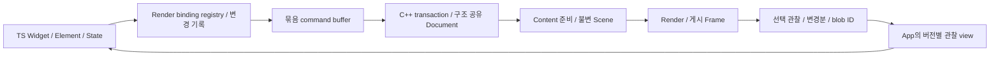

# work10 — 변경분 전달·데이터 공유 중심의 엔진 v2 개편

작성·갱신: **2026-11-10 KST** · 문서 상태: **OPEN / 설계·작업계획 작성 완료** · work10 구현: **미착수 / notVerified** · 제품 전체: **PARTIAL**

사용자 요청에 따라 `work9.md`, `work9-1.md`, `work9-2.md`, `work9-3.md`, `work9-4.md`, `work9-5.md`, `work9-a.md`, `work9-b.md`, `work9-c.md`를 **CLOSED / work10 이관**으로 종료한다. 이 문서가 이후의 실행 계약이다. 이전 문서의 구현·검증 기록과 체크박스는 당시 근거로 보존하며, 문서 종료를 미완료 기능·호환·성능·제품 전환의 완료로 해석하지 않는다. 남은 의무는 §8에 대응시킨다.

이번 작업은 **현재 소스·공급 메타데이터 검토와 계획 작성**이다. 제품 코드 변경·빌드·앱 실행·성능 재측정은 수행하지 않았다. 기존 변경사항과 열려 있는 사용자 앱은 유지한다.

## 1. 목표와 설계 결정

**JSI를 유지하고, TS의 변경 기록으로 C++의 기존 retained scene을 갱신한다.** 전체 중간 트리 생성·전체 비교, 연속 패킷 복사, 동일 데이터의 반복 디코딩을 줄인다. 이미 존재하는 Document/Scene/Frame과 App/Content/Render 소유권을 발전시키며 새 장면 엔진을 병렬로 만들지 않는다.

우선 해결할 사용자 흐름은 일반 Windows Demo의 날짜 선택기다. 새 월 진입·빠른 다중 월 이동·과거 월 연속 스와이프에서 준비 지연과 끊김이 남아 있다. 마지막 사용자 확인은 **“종료없이 계속 이동은 되는데 여전히 준비하는데 너무 오래걸림”**이다. 해당 입력 구간에서 종료가 재발하지 않았다는 확인과 성능 미수락을 구분한다. 근거는 [problem.md §22](problem.md#22-2026-11-10-과거-월-연속-스와이프의-잉크-참조-오류)다.

| 검토한 선택지 | 결정과 이유 |
| --- | --- |
| JSI를 FFI로 전면 교체 | 이번 개편에서 채택하지 않는다. 트리 구성·복사·디코딩은 호출 인터페이스만 바꿔도 남는다. |
| 노드마다 HostObject를 만들고 속성을 개별 호출 | 주 전달 경로로 채택하지 않는다. 수천 번의 경계 호출·락·수명 추적을 추가한다. JS 콜백·객체는 App owner에 둔다. |
| 전체 트리에 해시를 계산하고 같으면 건너뛰기 | 주 변경 감지로 채택하지 않는다. 해시 계산의 전체 방문과 외부 참조 무효화가 남는다. 해시는 불변 blob의 후보 조회에만 사용한다. |
| 영속 핸들·변경 기록·묶음 commit | **채택.** 변경 시점을 기록하고 바뀐 노드·연결·의존성만 전달한다. |
| 불변 native snapshot의 구조 공유 | **채택.** 기존 스냅샷은 읽기 전용으로 보존하고 수정한 page/node/child list만 새로 만든다. |
| 버전이 있는 관찰 결과·불변 blob ID | **채택.** 필요한 상태와 변경분만 보내고 같은 데이터는 한 번 검증·해석한다. |
| 모든 플랫폼을 SharedArrayBuffer 하나로 통일 | 채택하지 않는다. 동일한 논리 계약 아래 Windows native backing, Web transferable, Wasm 경계의 메모리 소유권을 각각 구현한다. |

**개발 우선 대상:** Windows App SDK와 Web single-worker/threaded. Android는 공통 wire 변경의 영향·지원 상태를 기록하고 해당 차수에서 공급을 갱신한다. Linux·iOS/macOS는 후속 범위다. Windows의 독립 HWND host를 복원하지 않는다.

**유지할 제품 계약:** 원래 Widget/Element/State·BuildContext/Key·Material/Cupertino의 TS 정책, controller/callback 순서, 원래 공개 API 기준, C++의 최종 layout/geometry/hit-test/gesture/편집 권위, 현재 App 로컬 paragraph 질의, 플랫폼별 실제 upstream 소스 수정 이식 의무. DatePicker의 원본 변환·생성 소유권도 유지한다. 임의 사용자 Widget callback을 C++로 옮기는 작업은 이 계획의 전제가 아니다.

## 2. 현재 소스에서 확인한 비용과 재사용 기반

| 구간·소스 | 이미 있는 기능 | 이번 개편의 대상 |
| --- | --- | --- |
| [capture.ts](Nelyx/runtime/app/capture.ts) `RenderSceneCapture` | WeakMap 설정 캐시, local/ancestor dirty, 동적 의존성, 정적 subtree 재사용 | 변경된 조상 경로의 SceneNode/자식 배열 재구성, dynamic 재캡처를 변경 기록으로 대체 |
| [scene.ts](Nelyx/runtime/engine-client/scene.ts) `records`·`diff` | 세대 핸들, accepted record/config 재사용, transaction 재확인 | 매번 allocate/visit·Map/Set·자식 배열·accepted 비교, mutable 설정 snapshot 복제 |
| [document.hpp](Nelyx/engine/core/scene/document.hpp)·[transaction.cpp](Nelyx/engine/core/protocol/transaction.cpp) | 불변 Node의 shared_ptr, 원자적 설치, 변경 노드 복사 | `Document(*current)`의 전체 slot/children 컨테이너 복사, 같은 노드의 명령별 복사, 전체 children 재구축·검증·형제 검색 |
| [client.ts](Nelyx/runtime/engine-client/client.ts)·[message-port.ts](Nelyx/runtime/engine-client/message-port.ts) | request/owner 검증, pending quota, async 요청 보호 | client의 `bytes.slice()`와 port의 추가 `slice()`를 명시적 버퍼 소유권으로 대체 |
| [host.cpp](Nelyx/engine/platform/windows/host.cpp) enqueue/응답 | App·Content·Render owner, bounded mailbox·ExternalLease | JS buffer→vector 복사, 응답 vector→새 JS ArrayBuffer memcpy |
| [codec.ts](Nelyx/runtime/engine-client/codec.ts)·[observation-cache.ts](Nelyx/runtime/engine-client/observation-cache.ts) | lazy observation row, 검증된 불변 blob 캐시·정확한 byte 비교 | lazy row를 위한 패킷 복사, 동일 bytes 재전송·비교, 반복 row/container 생성 |
| [scene.ts](Nelyx/runtime/engine-client/scene.ts) `observeScene` | 이벤트 polling 분리, 관찰 coalescing, 선택된 layout observer 질의 | 매번 observer 목록 검색, 별도 semantics/layout 왕복, publication마다 객체/인덱스 재구성 |
| [state.hpp](Nelyx/engine/core/state.hpp)·[scheduler.cpp](Nelyx/engine/core/scheduler/scheduler.cpp) | Document/LayoutOutput/Scene/Frame 공유, accepted·준비·게시 구분 | 공유 구조를 재사용하면서 변경 의존성·준비 취소·관찰 수명을 정교화 |

C++ Node가 이미 공유된다는 사실만으로 commit이 변경량에 비례한다고 볼 수 없다. 현재 `Document`는 최대 노드 수에 맞춘 slot 배열과 children 벡터들을 복사하고, transaction 검증은 children을 다시 만들며 여러 전역 검사를 수행한다. **TS 전체 순회를 제거한 뒤 C++에서 다시 전체 작업을 하는 경로까지 검토한다.** 다만 이 비용의 현재 실행 비중은 W10-00에서 따로 측정해야 한다.

### 2.1 문서 작성 시 기준점

| 항목 | 확인 내용·범위 |
| --- | --- |
| Core source identity | `sourceIdentity()` 재산출: `dea64e1fb0ab7a415de1659aaf31a132f76ca2263bc8c2d73b7cee9aee001cc3` |
| 현재 engine manifest | [engine-manifest.json](Nelyx/engine/dist/engine-manifest.json)의 sourceSha256 일치, ABI **2**, schema **2570296319**, **356 files**, `windows-app-sdk`·`threaded`·`single-worker` |
| 확인 한계 | 이번에는 전체 공급 파일 hash·설치본·App 번들을 다시 검증하지 않았다. 위 source identity는 모든 TS/App 입력의 검증을 대신하지 않는다. |
| 이전 기능 근거 | Range/editor·Curve/취소, Ink parking, date scroll·관찰·capture 및 Windows/Web 부분 확인은 [work9-c](work9-c.md)와 [problem.md](problem.md)의 해당 공급 기록에 한정 |
| 현재 제품 판정 | **compatible=false**, **performanceAccepted=false**, **resizePerformanceAccepted=false**, 전체 물리/display/scanout 수락 **notVerified** |
| 후속 플랫폼 | Android **stale/notVerified**, Linux·iOS/macOS **DEFERRED** |

예전 CPU profile·합성 decode 비교·마지막 frame timing은 원인 후보를 고르는 자료다. 새 구조의 FPS·표시 수락이나 현재 공급의 성능 기준값으로 복사하지 않는다.

## 3. 목표 데이터 흐름과 소유권



| 데이터 | 소유자·수명 |
| --- | --- |
| Widget/Element/State, 원래 theme·controller·callback | TS App. callback/function을 native 공유 메모리로 보내지 않음 |
| RenderObject와 native projection의 연결 | App registry. `(Source identity, partKey)`별 binding을 유지. 하나의 RenderObject가 여러 native 노드를 만드는 경우 포함 |
| accepted Document·layout·paint·hit-test·편집 상태 | 기존 C++ Core. 새 transaction은 별도 작업본에서 검증 후 원자 설치 |
| 게시 Scene/Frame | C++ 불변 snapshot. Content·Render·input·관찰 reader의 lease가 끝날 때 회수 |
| command·응답 저장소 | transport별 소유권 token/lease. 제출·사용·반환 상태를 명시하고 byte quota에 포함 |
| 관찰 결과의 JS facade | App. 내부 최신 view와 공개 API의 특정 시점 snapshot을 구분 |
| OS 입력·surface·clock·IME/UIA | 각 host. 입력 수신 경로가 장면 준비·큰 packet의 완료를 기다리지 않도록 유지 |

새 타입·모듈 이름은 아래의 **계획상 명칭**이다. 구현 완료 API로 간주하지 않는다. 가능한 기존 client/scene/state 소유자에 기능을 넣고, 책임 분리가 필요한 경우에만 파일을 만든다.

### 3.1 Render binding과 변경 기록

- `RenderBindingRegistry`가 기존 SceneReference/세대 핸들을 이어받는다. Source 객체와 native 노드가 항상 일대일이라고 가정하지 않는다. partKey는 렌더 결과 배열의 일시적 순서 대신 모듈이 정한 안정적인 역할을 사용한다.
- 모듈의 생성·설정 변경·parent data·adopt/drop/reparent·dispose 지점에서 변경을 기록한다. 최초 mount와 명시적 재동기화에는 전체 구축을 허용하고 정상 update에서는 변경 queue를 drain한다.
- `children/layout/paint/semantics/interaction/resource` revision을 분리한다. ancestor 제약·intrinsic·상속 theme/font·DPR·viewport 의존성은 영향 범위에 전파한다. 색상 변경이 자식 연결 재검사나 paragraph 재측정을 일으키지 않도록 한다.
- Ink·layer leader/follower·paint placement·inline paragraph child·tooltip target 등 **비트리 참조의 역방향 의존성**을 관리한다. 참조 대상의 generation·표시/parking 정책이 바뀌면 사용하는 설정도 무효화한다. hash/객체 identity만으로 생략하지 않는다.
- State가 살아 있는 parked page의 native 노드는 해제될 수 있다. 재표시 시 새 handle을 연결하고 참조를 재해석한다. 최근 Ink 수정의 `paintsChild`·살아 있는 feature의 표시 의존성·미장착 참조 거부를 보존한다.
- callback 교체는 가능한 JS registry 갱신으로 처리한다. Core가 관찰하는 control/gesture 정책이 달라지면 해당 revision도 전달한다. callbacks를 매번 설정 객체에 복제하지 않는다.
- 변경 기록은 payload를 기록 시점에 소유한다. 외부 mutable 배열·typed array를 그대로 붙잡아 두고 나중에 다른 값으로 encode하지 않는다. immutable 내부 값 또는 변경 시 한 번 캡처한 정규화 값으로 snapshot 의미를 지킨다.

**비용 목표:** 정상 변경 비용은 변경 노드 + 실제 의존성 + 바뀐 부모의 자식 목록에 비례한다. 전역 theme/font, 큰 reparent, 최초 mount처럼 넓은 무효화가 필요한 경우는 별도 집계한다. 모든 연산의 O(1)을 약속하지 않는다.

### 3.2 묶음 commit과 접수 상태

- `accepted`, `inFlight`, `nextDirty`를 구분한다. 전송 중 발생한 수정은 다음 묶음에 남기며 ACK 때 덮어쓰지 않는다. JS 객체의 현재 값과 accepted snapshot을 동일 객체의 제자리 변경으로 표현하지 않는다.
- 동일 transaction 안의 덮어쓰기 가능한 속성은 최종 값으로 합친다. create/delete/reparent, callback·편집·focus·명령 terminal·입력 이벤트의 순서는 보존한다. 일회성 명령을 속성처럼 합치거나 유실시키지 않는다.
- owner `{session, app, view, generation}`, node `{slot, generation}`, transaction ID와 base document revision을 검증한다. stale/rejected transaction은 부분 설치하지 않는다.
- provisional handle·resource는 거부/취소 시 회수한다. ACK 유실/timeout은 거부와 구분하고 기존 transaction 조회·멱등성 계약으로 terminal을 확정한다. 불확정인 요청의 slot/bytes를 재사용하지 않는다.
- credit 부족 시 bounded pending 상태와 재개 알림을 사용한다. 무제한 queue·즉시 재시도 루프를 만들지 않는다. 원래 입력·편집 명령에 필요한 처리 여유를 유지한다.

### 3.3 C++ Document와 검증의 구조 공유

- slot table을 page 단위 불변 저장소로 분리하고, 바뀐 page와 경로만 복사한다. page directory까지 매번 전체 deep copy하지 않는 구조를 사용한다. page 크기·간접 참조 비용은 W10-02의 실제 노드 규모에서 결정한다.
- child list는 부모별 불변 블록으로 공유한다. attach/detach/reorder는 해당 부모와 실제 영향 형제만 갱신한다. scene 전체 검색으로 형제를 찾거나 children 전체를 재생성하지 않는다.
- transaction의 edit table에서 같은 노드는 한 번 mutable copy를 만든다. 여러 설정 명령과 layoutRevision 갱신이 같은 Node를 반복 복제하지 않게 한다. rollback은 작업본을 버리는 것으로 끝나야 한다.
- semantic/editor 수·깊이·참조·자원·paint owner 등 파생 상태와 역방향 인덱스를 변경분으로 유지한다. 전역 의미를 가진 검사는 정확한 영향 폐쇄를 먼저 정의한다.
- **wire 범위·길이·유한수·generation·quota·cycle·참조·그래프 검증을 생략하지 않는다.** 기존 전체 검증기를 비교 기준으로 삼아 증분 검증과 결과/거부 동등성을 확인한다. 안전성이 입증되지 않은 복잡한 변경에는 명시적 전체 검증 경로를 남기고 호출 수·비용을 계측한다.
- 초기 구축·복구의 전체 검증과 작은 속성 변경의 검증을 구분한다. 검증 일부를 없애서 빠르게 만든 결과는 이 챕터의 완료가 아니다.

### 3.4 관찰 구독·delta·snapshot

- `onLayout`·focus·editing·semantics 등의 관심 핸들/필드를 등록·해제 시점에 유지한다. 매 publication마다 accepted 전체에서 observer 목록을 다시 찾지 않는다.
- 응답에 `baseVersion`, `nextVersion`, owner/generation과 **accepted document / active preparation / published document·metrics·device / property·font revision**을 구분해 담는다. 서로 다른 시점의 layout과 semantics를 단일 epoch라고 간주하지 않는다.
- 변경 row·삭제 tombstone·추가 blob만 전송한다. 변화 없는 필드와 고정 topology를 반복 전송하지 않는다. gap·eviction·generation 교체에는 명시적인 bounded full resync를 제공한다.
- layout/semantics는 같은 일관성 범위에서 묶어 요청할 수 있게 한다. 활성 준비용 질의와 게시 화면용 질의는 다른 역할로 식별한다. 큰 semantics 결과 때문에 작은 layout·입력 응답이 막히지 않게 응답 한도와 우선순위를 둔다.
- 내부 facade는 한 packet의 메타데이터와 row를 함께 교체해 일관되게 읽는다. 공개된 이전 snapshot을 뒤에서 바꾸지 않는다. 공개 동기 geometry·callback 시점 의미는 별도 호환 의무로 유지한다.
- lazy view가 대형 응답 전체를 장기 보유하는 경우를 계측한다. 필요한 작은 값의 명시적 복사와 snapshot lease를 선택해 retained bytes를 제한한다. JS 객체 freeze만으로 backing buffer가 읽기 전용이 된다고 가정하지 않는다.
- input/terminal 이벤트는 관찰 delta와 독립된 순서·ACK를 유지한다. coalescing으로 callback·편집·focus 이벤트를 버리지 않는다. UIA/ARIA/reader가 필요한 전체 semantics를 App 관찰 축소와 함께 삭제하지 않는다.

### 3.5 버퍼 소유권과 플랫폼별 경계

논리 상태는 `Writable → Sealed → InFlight → Retired → Reusable`로 둔다. Retired와 실제 재사용 가능 시점을 구분하고 reader·replay·runtime 참조가 모두 끝나야 재사용한다.

| 경계 | 개편 방식·필수 조건 |
| --- | --- |
| Windows native 응답→JS | 응답 vector 저장소를 `jsi::MutableBuffer` holder로 이동해 새 JS buffer로의 memcpy 제거. 넘긴 저장소를 Core/host가 다시 수정·재사용하지 않음 |
| Windows JS 요청→native | 내부 command arena에 직접 기록. submit 뒤 쓰기 접근을 확실히 종료할 수 있는 경로만 공유. pinned Hermes에서 detach/접근 차단을 보장하지 못하는 경계는 **한 번의 소유권 확보 복사**를 유지하고 나머지 중복 복사 제거 |
| Web App↔Worker | 소유한 ArrayBuffer를 transfer. 전송 전에 검증·retry에 필요한 작은 메타데이터를 별도 저장. detach된 DataView/bytes를 응답 처리에서 다시 읽지 않음 |
| JS↔Wasm | packet을 linear memory에 넣거나 결과를 분리하는 필요한 복사는 실제로 계수. Wasm heap 전체를 transfer하지 않음. memory grow 후 view 재생성·lease·세대 계약 유지 |
| Web threaded | 현재 shared memory와 owner 동기화를 유지. 별도 공유 ring은 이점과 bounded slot/Atomics 계약이 입증될 때만 채택하며 single-worker의 필수 조건으로 만들지 않음 |

현재 [JSI MutableBuffer 계약](https://github.com/microsoft/hermes-windows/blob/94aa5e1d40a4ce99df79d951cbe45310ec40680c/API/jsi/jsi/jsi.h)은 저장소 주소·크기의 안정성과 내용 접근의 동기화를 요구한다. 생성자 지원만으로 worker가 JSI Runtime/Value를 사용할 수 있는 것은 아니다. worker에는 native 저장소 holder만 넘긴다. finalizer는 임의의 Core/VM 객체를 재진입하지 않으며 session 종료 이후에도 안전한 ledger/allocator 수명을 가져야 한다.

[ArrayBuffer transfer](https://developer.mozilla.org/en-US/docs/Web/API/Web_Workers_API/Transferable_objects)는 송신 측 소유권을 분리한다. 따라서 현재 client의 전송 후 header 조회와 불확정 transaction 재확인까지 함께 고쳐야 한다. replay를 위해 변경 기록이나 봉인된 저장소를 bounded하게 보유하며, 복구 때만 필요한 재인코딩은 정상 전송 비용과 구분한다. [Wasm memory growth](https://developer.mozilla.org/en-US/docs/WebAssembly/Reference/JavaScript_interface/Memory/grow)는 non-shared buffer를 detach하고 shared view의 기존 길이를 확장하지 않으므로, 오래된 view를 재사용해서는 안 된다.

소유권 최적화는 내부 transport 경로부터 적용한다. 외부 caller가 가진 mutable bytes를 받는 기존 API에는 snapshot/복사 의미를 유지한다. 응답 buffer를 C++ Document/Node 저장소의 쓰기 가능한 alias로 노출하지 않는다. timeout만으로 native 작업이 종료되었다고 보고 credit/lease를 돌려주지 않는다. pool 포화·GC 지연·느린 reader에는 backpressure를 적용하고, 외부 buffer bytes도 memory ledger에 포함한다.

### 3.6 불변 blob과 반복 디코딩 제거

- 텍스트·paragraph/style·semantics label·paint/config 중 실제 반복 비용이 큰 블록부터 `{owner, blobId, generation, revision, kind}`로 등록한다. node handle과 blob ID 공간을 구분한다.
- byte 입력은 최초 등록 시 끝까지 검증해 정규화된 불변 표현으로 저장한다. 다음 commit/관찰에서는 ID를 참조한다. hash는 검색 후보를 좁히는 용도이고 충돌은 길이·정확한 내용 비교로 해결한다.
- font cohort·locale·scale·shape 등 결과에 영향을 주는 의존성을 key/revision에 포함한다. 캐시를 찾았다는 이유로 다른 owner/schema의 데이터를 수락하지 않는다.
- evict/reload/resync 후 미등록 ID는 명시적으로 복구하거나 거부한다. ID를 조용히 다른 내용에 재사용하지 않는다. accepted·준비·published·JS 관찰 reader가 가진 참조가 끝나야 회수한다.
- 캐시 한도는 entry 수와 bytes로 제한한다. 매 월 새 label이 생기는 흐름에서도 과거 월 수만큼 증가하지 않아야 한다. 기존 decode cache는 전환 중 비교/복구 경로로 사용하고 마지막 소비자 종료 후 정리한다.

### 3.7 새 월 준비와 렌더 진행

브리지 비용을 줄여도 새 Widget/Element 생성·테마 계산·paragraph 준비는 남는다. W10-06에서 build/capture/commit/prepare를 분리해 남은 비용을 해결한다.

- visible/현재 요구 월을 우선하고 예측 준비 범위·메모리를 제한한다. 이미 준비한 인접 월의 작업을 매 입력마다 취소·재시작하지 않는다. 오래된 준비의 결과는 generation/revision으로 차단한다.
- 반복 요청은 아직 실행하지 않은 중복 준비만 병합한다. 사용자 입력 delta·명령 terminal·페이지 변경 callback의 원래 순서를 보존한다.
- Content의 resumable 작업은 실제 예산에서 yield하고 취소·재개 상태를 유지한다. Render는 이전의 유효한 게시 snapshot으로 계속 진행하며 준비 완료를 동기 대기하지 않는다.
- Source build는 불필요한 rebuild 범위·반복 설정 생성부터 줄인다. 동기 사용자 callback이나 mount 도중 임의 await를 넣지 않는다. 부분 build를 공개하려면 별도 일관성 계약과 검증이 필요하다.
- 아직 준비되지 않은 새 월은 latency에 그대로 포함한다. 빈 공간을 오래 보이게 하거나 페이지 이동을 숨겨서 끊김이 사라졌다고 판정하지 않는다. 기존 Flutter 변환 컴포넌트의 동작·접근성·선택 상태를 보존한다.

## 4. 구현 챕터와 의존성

**실행 순서: W10-00 → 01 → 02 → 03 → 04 → 05 → 06 → 07.** W10-00의 측정이 다른 주병목을 확인하면 관련 챕터의 우선순위를 근거와 함께 갱신하되 소유권·수명 선행 조건은 생략하지 않는다. 각 챕터는 전체 구현·실제 소비자 연결을 모은 뒤 §5의 통합 검증을 적용한다.

| 챕터 | 구현 묶음·주요 수정 범위 | 챕터 종료 조건 |
| --- | --- | --- |
| **W10-00 기준선·계약** | 현재 diff/공급/App 입력 확인, request→App build→capture→commit→Content→게시 인과 계측. dirty/visited/복사 bytes/디코딩/GC/queue/lease 카운터와 §3 계약 구체화 | 동일 입력의 초기·재방문·빠른 월 이동 기준선, copy map·owner 상태도·프로토콜 변경 목록. 소스 추론과 실행 측정 구분 |
| **W10-01 TS 변경 기록** | capture/host/native-node/controls와 모듈 설정, SceneWriter registry·dirty journal·의존성·묶음 commit. 처음에는 현재 wire를 사용 | 정상 update에서 전체 SceneNode 구축/records 순회를 대체. GlobalKey·parking·Ink·callbacks·ACK 중 변경 보존, 실제 Demo 연결 |
| **W10-02 Core transaction 공유** | Document slot/child page, transaction edit table, 참조·파생 인덱스, 증분 검증·무효화 | 전체 복사·재구축 감소를 counters로 확인. 원자성·malformed 거부·기존 전체 검증 결과 동등성, 동일 노드 반복 clone 제거 |
| **W10-03 관찰 delta** | schema/codec/client/SceneWriter·Core snapshot 생성·App geometry/focus/semantics 소비. 구독·version·tombstone·resync | 미변경 데이터 재전송/객체화 제거, observer 전체 검색 제거. active/published 혼합·stale 결과 차단, 입력/접근성 보존 |
| **W10-04 버퍼 소유권** | Windows 응답 holder부터 적용, client/port lease·요청 arena·Web transfer·Wasm 경계·ledger | 실제 복사 bytes 감소, transfer 후 접근 0, 미확정 요청의 조기 재사용 0, timeout/GC/close/포화 검증. 필요한 복사는 명시 |
| **W10-05 불변 데이터 등록** | blob 등록/참조·네이티브 정규화·JS decode ID cache·budget/eviction. schema와 관련 공급 갱신 | 같은 revision의 반복 전송/디코딩 제거, collision·ID 재사용·font/owner 변경·복구 정확성 및 메모리 상한 |
| **W10-06 준비·Source build** | scheduler/layout/list/paragraph·builder 왕복·App rebuild 범위·달력 인접 월 준비. 기존 resume/coverage 보호 유지 | 빠른 왕복에서 불필요한 준비 재시작·큐 누적 제거, 오래된 결과 차단, 미방문 월 latency와 frame 진행을 함께 개선 |
| **W10-07 통합·성능·전환 정리** | 같은 공급의 설치 소비·Windows/Web 앱·물리 트랙패드·메모리·복구, 마지막 구 중간 경로 소비자 제거 | §6–7 결과와 실패/미실행을 명시. 자동 기능 PASS와 사용자 체감·표시 수락 분리. work9 후속 의무는 §8에 존속 |

전환 중 기존 전체 경로는 초기 구축·명시적 resync 또는 검증 비교에 한정한다. 운영 화면에서 신·구 장면을 매 프레임 동시에 만들어 비교하지 않는다. 혼합 실행이 필요하면 노드/owner의 권위와 사용 이유를 명시하고 W10-07에서 마지막 소비자를 확인한다. 제품 오류를 구 렌더러로 자동 fallback해 숨기지 않는다.

공통 wire 변경은 [protocol.json](Nelyx/engine/schema/protocol.json)을 기준으로 생성된 TS/C++ 상수를 함께 갱신한다. capability·schema/ABI 판정을 명시하고 미공급 조합은 시작 시 실패한다. Windows/Web은 같은 논리 의미를 사용하며 Android 구 공급이 새 protocol과 호환된다고 표시하지 않는다.

## 5. 챕터별 통합 검증 방식

1. 현재 diff·소비자 graph와 해당 챕터의 범위를 확정하고 구현·연결을 한 번에 모은다. 다음 구현을 막는 타입·문법·국소 compile·schema 문제만 중간 확인한다.
2. 챕터 구현 후 필요한 package/engine/App 공급을 한 번 갱신하고, 같은 공급으로 정적 검사·설치 소비·Windows/Web의 관련 흐름을 확인한다.
3. 독립적으로 확인 가능한 실패를 모아 원인별로 일괄 수정한다. 수정한 공급·실패 흐름·직접 영향 회귀를 다시 확인한다.
4. 구현 완료와 통합 확인 전 상태를 **구현 완료 / 검증 대기 / notVerified**로 구분한다. 완료 체크는 구현과 해당 검증을 모두 충족한 뒤 한다.
5. 이후 챕터는 이미 유효한 동일 입력의 PASS를 반복하지 않는다. wire·자원 수명·공급 입력 변경은 관련 target/profile로 확인 범위를 넓힌다.

| 변경 영역 | 필수 확인 |
| --- | --- |
| registry/journal | 무변경·단일 속성·children reorder·GlobalKey reparent·dispose/recreate·park/unpark·Ink/follower/paragraph 참조·전송 중 새 수정 |
| transaction | 여러 명령이 같은 node 수정·NACK/rollback·ACK 유실·budget·cycle·깊이·malformed·잘못된 generation·자원 참조·전체 검증 비교 |
| observation | 최초/full·delta·삭제·gap/resync·owner 교체·active≠published·metrics/font 변경·old snapshot 보존·layout listener·focus/IME/UIA/ARIA |
| buffer/blob | retained caller mutation·늦은 응답·double return·transfer/detach·memory grow·pool 포화·GC 지연·close/reload·collision·eviction·quota |
| 준비/달력 | 최초 표시·선택/입력/확인/취소·재개방·새 월·과거 연속·빠른 방향 반전·원래 월 복귀·hover/Ink·resize·bounded retention |
| 공통 회귀 | 목록 재방문·관성/종료·메뉴/overlay·Range/curved editor·controlled refusal·theme/route/image·입력 중 hide/close·복구 |
| 공급/설치 | source/manifest 전체 hash·ABI/schema·App 입력·font cohort·설치 package만 사용하는 선언/실행·Windows App SDK·Web 두 profile |

기존 [check-incremental-capture.mjs](Nelyx/eng/check-incremental-capture.mjs), [check-ink-parking.mjs](Nelyx/eng/check-ink-parking.mjs), [check-app-observations.mjs](Nelyx/eng/check-app-observations.mjs), [check-date-scroll-web.mjs](Nelyx/eng/check-date-scroll-web.mjs), [check-frame-reuse.mjs](Nelyx/eng/check-frame-reuse.mjs)를 현재 계약에 맞게 재사용한다. 검증의 목적은 객체 모양이 구현과 같은지 확인하는 것이 아니라 실제 의미·수명·작업량을 확인하는 것이다. 이미 폐기한 대규모 audit/fixture 체계를 복원하지 않는다.

## 6. 계측과 구조적 완료 조건

W10-00부터 선택적인 bounded 집계/표본을 사용하고, 계측 on/off 차이도 확인한다. 모든 frame의 상세 console 출력·무제한 로그는 만들지 않는다. 단계 시간은 중첩 여부와 clock domain을 표시하며 서로 다른 thread의 시간을 단순 합산하지 않는다.

| 지표 | 구분할 내용 |
| --- | --- |
| App | callback·Widget build·변경 수집·encode·관찰 적용 시간, 생성 객체/bytes·GC pause, 입력 callback queue age |
| transaction | 방문/dirty/의존 노드 수, clone한 Node/page/child list 수, validation 전체/증분 횟수·시간, accepted latency |
| transport | 경계별 copied bytes·transfer bytes·외부 backing bytes, queue/in-flight/replay/retired bytes·최고 age |
| decode | blob 신규/재사용/퇴거·전송 bytes·해석 횟수, row wrapper 수, retained snapshot bytes |
| Content | 준비 wall/CPU·builder wait·왕복·재시작/취소 이유, paragraph 신규/재사용, coverage 진행·최초 새 월 ready 시간 |
| Render·표시 | input 소비·frame CPU·lock wait/hold·GPU acquire/submit/present 대기·게시/표시 interval·deadline miss·최장 정지 |

**구조적 gate:**

- 무변경 상태에서 장면 설정의 전체 캡처·records 방문·transaction은 0이다. 필요한 입력·관성·animation/property·표시 처리는 별도로 진행한다.
- 동일한 작은 변경을 서로 다른 전체 노드 수에서 실행해 방문·할당·복사량이 무관한 노드 수에 따라 증가하지 않는지 확인한다. 최초 구축·전역 무효화·안전한 전체 검증 경로는 별도 계수한다.
- paint만 바뀐 노드가 children 전체 재생성·무관한 paragraph decode/measure를 일으키지 않는다. 동일 transaction에서 동일 node의 mutable clone은 한 번이다.
- Windows 응답의 vector→JS 추가 memcpy는 제거한다. client/port의 중복 복사는 owned 경로에서 제거하고, 요청 보호·Wasm 등 남는 복사에는 이유와 실제 bytes를 기록한다.
- 동일 owner/blob revision은 최초 등록·명시적 resync/eviction 복구 외에 재전송·재해석하지 않는다. 관찰 변화가 없으면 row 목록을 다시 만들지 않는다.
- 월을 계속 이동해도 node/blob/page/pool/JS wrapper/lease가 한도 내에서 안정된다. 사용자 timeout 후에도 작업 중인 holder는 정상 보유로 추적하고 terminal 뒤 회수한다.
- 정상 종료 시 worker/GPU/native reader와 JS/runtime holder를 정해진 순서로 drain한 뒤 owned lease·예약 bytes가 회수된다. 아직 살아 있는 reader를 무시하고 0으로 보고하지 않는다.

## 7. 성능 목표와 사용자 수락

아래 수치는 **측정 결과가 아닌 초기 목표**이며 [problem.md의 수락 목표](problem.md#73-제안하는-수락-목표)를 이어받는다. `T`는 확인한 표시 장치의 refresh interval이다. W10-00에서 하드웨어·창 크기/DPR·앱 데이터·입력 패턴·폰트 상태·cold/warm 조건을 고정한다.

- warm-resident scroll의 불필요한 builder/paragraph 재준비 0, input→Core 소비 및 App callback p95 ≤ T, 시간이 흐르며 queue age가 증가하지 않음.
- warm frame CPU p95 ≤ 0.5T를 지향한다. 표시를 관측한 경우 frame interval p95 ≤ 1.25T, p99 ≤ 2T, 입력→첫 반응 표시 p95 ≤ 2T를 목표로 한다. 최장 정지와 T/2T 초과 횟수도 별도 기록한다.
- 첫 방문·인접 월·메모리 퇴거 후 재방문을 구분한다. font/asset 준비가 끝난 새 월은 입력→유효 그리드 게시 p95 **100ms 이내를 초기 목표**로 두고, 준비 중 기존 화면의 입력/렌더 진행도 확인한다. 미달 시 build/전달/Content/표시 중 원인과 남은 작업을 기록한다.
- 정상 입력의 유실·중복 callback·잘못된 hit·잘못된 날짜 선택·stale 참조·크래시·white flash는 0이어야 한다. 준비 범위를 무한히 늘려 latency를 줄이는 방식은 메모리 gate를 통과하지 못한다.
- 자동 입력은 동일 경로 비교용이다. 물리 트랙패드의 손을 뗀 뒤 관성·빠른 방향 전환·과거 월 연속 이동과 사용자의 체감을 따로 확인한다.

`accepted`, `activated`, `published`, GPU `submitted/present` API 완료, compositor 관측, 실제 scanout은 다른 근거다. 마지막 timing 한 개나 마지막 256/1024개 ring만으로 전체 percentile을 만들지 않는다. 표본 수·기간·누락/덮어쓰기 여부를 기록한다. 표시를 측정하지 못했으면 표시/FPS 수락은 **notVerified**로 남긴다.

Windows의 사용자 재현 명령은 다음과 같다. 기능·공급이 준비된 뒤 해당 창에서 같은 입력으로 확인한다.

```powershell
node .\Nelyx\sdk\tooling\cli\src\main.mjs run --engine v2 --app .\sample\nelyx-demo-app\engine-v2 --target windows
```

구조적 gate와 기능 PASS만으로 `performanceAccepted`·`resizePerformanceAccepted`를 true로 올리지 않는다. scroll과 resize도 각각 판정한다. 앱 전체 호환·기본값 전환은 §8의 나머지 조건까지 충족해야 한다.

## 8. work9 종료와 잔여 의무 이관

이 절은 W10-00–07 뒤의 **남은 실행 backlog**다. 앞선 성능 개편의 한 챕터에 전체 API·OS 이식·모든 플랫폼 완료를 요구하지 않는다. 반대로 성능 개편 완료를 아래 항목의 완료로 확대하지 않는다. W9-00–14·W9A/W9B/W9C의 원래 의무는 아래 대응과 종료 문서의 상세 목록으로 보존한다.

| 새 ID | 이전 범위 | 남은 의무·완료 기준 |
| --- | --- | --- |
| **W10-R01 Core·공개 실행 계약** | W9C-01, [work9-c §3.2](work9-c.md#32-w9c-0102--core디자인접근성-잔여-계약) | 설정/invalidation/parent data의 모듈 소유, 동기 constraints/needsLayout/게시 전 geometry, custom delegate·relayout·paint/hit-test·rasterizer·PlatformView·snapshot singular transform, scroll/sliver/pan-zoom·editor custom physics/behavior·TapRegion 동기 재진입 의미. 마지막 TS 실행 소비자와 중앙 분기 정리 |
| **W10-R02 디자인·접근성·입력** | W9C-02, [work9-2](work9-2.md) | 원래 theme/painter·InkSparkle/shader·gradient/shadow/decoration·custom shape/border·controls/form/route/localization/assets·전체 catalog, controlled value/callback, 임의 semantics key/delegate·역할/병합·custom action·focus/range listener·OS feature ingress, UIA/실제 reader·국제 key/dead key/IME/Offstage·focus 재진입. 현재 날짜 선택기 생성 출처 보존 |
| **W10-R03 OS 소스·SDK·수명** | W9C-03, [native-api-ports](Nelyx/engine/platform/native-api-ports.md) | RNW 입력/capture/focus/IME/UIA/환경·서비스 등 실제 수정 이식과 소비자 교체. font/image/asset/network/service/VM·session/view·visibility/loss/reload/close·미확정 ACK/GPU holder. VM 언어 의미·공개 SDK AppDefinition/React/Renderer 주입 API 대응 |
| **W10-R04 CLI·설정·공급** | W9C-04, [work9-c §3.3](work9-c.md#33-w9c-0304--플랫폼-api서비스sdk도구) | `nelyx.app/1`·target descriptor·config/template 통합, 구 config·VM/renderer 옵션의 명시 실패, App/client ambient 의존성 분리, 설치본 create/doctor/build/run/dev/pack, Metro/compiler/asset 중립 helper 분리·출처/notice 보존 |
| **W10-R05 전체 앱 소비자** | W9C-05, [work9-c §3.4](work9-c.md#34-w9c-05--실제-앱의-남은-연결) | Testbed/Demo 전체 catalog·상세·drawer/navigation·form/modal·theme/font/image, Data Testbed/list/navigation/graphics·`/v2` 디자인·구 runner의 실제 이관, Android sample 잔여 화면·서비스 |
| **W10-R06 전체 기술 gate** | W9C-06·W9-13, [work9-3](work9-3.md) | 원래 **4 packages / 834 subpaths**·서명 의무를 분모 변경 없이 대응. 설치본 strict 선언·실제 graph/native run·복구/종료·Windows 및 Web 두 profile의 전체 관련 흐름. 명시 계약 변경과 미지원은 별도 판정 |
| **W10-R07 제품 전환·삭제** | W9C-07·W9-14, [work9-c §6](work9-c.md#6-w9c-0708-전환과-제거할-마지막-소비자) | target별 기술/API·설치/복구·물리/표시/성능 수락 뒤 일반 CLI/sample/template 기본값 전환. 별도 Widget/State tree·축소 `/v2` 디자인·구 TS/RN renderer·SDK/backend/runner·불필요 export/dependency의 마지막 소비자 종료 후 삭제 |
| **W10-R08 후속 플랫폼·전역 종료** | W9C-08, [work9-4](work9-4.md)·[work9-5](work9-5.md) | Android RN·Linux RNL·iOS RN·macOS RNM 소스 수정 이식·대체 host/입력/접근성/배포, Android 두 ABI 최신 공급·설치/run, 각 target 기술/제품 gate. 지원 범위 결정 또는 대체 완료 뒤 전역 legacy·생성 recipe·ownership·license·README/help 정합성 정리 |

플랫폼 API는 `upstream 고정 원본 → 이식 파일/함수 → Nelyx 수정 → 실제 소비자 교체 → 앱 동작`으로 추적한다. 기능 참고나 자체 구현만으로 이식 완료를 선언하지 않는다. Windows는 App SDK 단일 host, Web은 두 profile, 후속 개발 차수는 Android/Linux → iOS/macOS다. 과거 Android 선행 부분 구현은 유지하되 새 공통 공급의 확인으로 간주하지 않는다.

기존 Range/editor·Curve 완료 범위는 회귀 기반으로 이어받는다. W9C-00을 미착수로 되돌리지 않는다. 반대로 현재 공급과 다른 과거 PASS를 새 구조의 확인으로 복사하지 않는다. [work9-c §3.1](work9-c.md#31-w9c-00--첫-재개-구현-묶음)의 간헐 오류·장면 진행·budget 실패 추적과 [problem.md](problem.md)의 입력/표시 병목도 남은 원인 조사로 유지한다.

## 9. 실행 명령·공급·정리 규칙

아래는 **구현 후 변경 범위에 맞춰 선택할 명령**이다. 이번 계획 작성에서는 실행하지 않았다. Core 선언이 다음 구현을 막을 때만 먼저 공급하고, 전체 build/install/run은 챕터 끝에 모은다.

```powershell
# Core 소스·선언이 바뀐 경우
npm.cmd run build:core
# 디자인/SDK 및 최종 소비 공급이 필요한 경우; build:sdk는 Core 빌드를 포함
npm.cmd run build:sdk
# C++·wire·host·provider 등 engine 공급 입력이 바뀐 경우
npm.cmd run build:engine-v2
# 챕터의 정적 검사와 생성 schema 정합성
npm.cmd run check:types
npm.cmd run lint
npm.cmd run format:check
node .\Nelyx\engine\tools\generate-schema.mjs --check
git diff --check
# 갱신된 Web 앱 공급이 준비된 뒤의 관련 회귀
node .\Nelyx\eng\check-date-scroll-web.mjs --precision --burst --past-only --both
```

`build:sdk`와 별도 `build:core`를 같은 입력으로 연속 반복하지 않는다. engine build만으로 App 번들이 갱신된 것으로 간주하지 않는다. 각 run 전에 실제 사용하는 package·engine·App manifest를 확인한다. 설치 소비 검증은 현재 공급으로 최소 한 소비자를 구성하고 repository alias가 누락을 가리지 않게 한다.

- [저장소 지침](.github/copilot-instructions.md)에 따라 테스트별 **20분 timeout**, 보통 **30회 이내** 반복을 적용한다. 30회를 채우는 것이 목표가 아니다. 소규모 고정 seed의 변경/실패 시나리오로 정확성을 확인한다.
- 로그·profile·receipt/history JSON·이전 dist/staging/archive·독립 설치본·browser profile을 누적하지 않는다. 새 임시 자료와 실행 owner는 성공/실패/중단 모두 `finally`에서 회수한다.
- 현재 dist·실제 supplier/build cache·생성 원본/소유권 자료는 보존한다. 삭제 전 경로·workspace 소유 범위·process handle을 확인하고 사용자 변경을 덮어쓰지 않는다.
- 기존 정리 차단은 [work9-c §7.4–7.8](work9-c.md#74-이전-정리-미완료의-별도-인계)와 [problem.md](problem.md)의 `.nelyx/date-picker-port` 기록을 이어받는다. 과거 PID·경로의 현재 소유를 추정하지 않는다. 이번에는 확인/삭제를 재시도하지 않았으며 자동 승인 검토가 거부한 작업을 우회하지 않는다. 이 잔여물을 이번 개편의 빌드 선행 조건으로 확대하지 않는다.
- 기록은 이 문서의 현재 상태·챕터 결과·정확한 재개점으로 유지한다. 공급 identity·검증 범위·미실행·남은 문제를 짧게 남기고 과거 실행 수치를 새 결과로 덮어쓰지 않는다.

## 10. 완료 체크리스트와 정확한 시작점

- [x] 현재 소스의 전체 순회·C++ 복사·버퍼 소유권·관찰 경로를 검토하고 개편 구조를 선택했다.
- [x] work9 계열 9개 문서를 종료하고 미완료 의무·수락 경계를 work10으로 이관했다.
- [ ] W10-00 기준선·소유권/프로토콜 계약·계측을 현재 공급에서 확정했다.
- [ ] W10-01 변경 기록·의존성·묶음 commit을 실제 frontend에 연결했다.
- [ ] W10-02 C++ transaction 복사·검증을 정확성을 유지하며 증분화했다.
- [ ] W10-03 관찰 구독/delta/resync와 snapshot 의미를 구현했다.
- [ ] W10-04 transport별 버퍼 소유권·복사 제거·수명/quota를 확인했다.
- [ ] W10-05 blob 등록·정규화·ID 참조·회수로 반복 전송/디코딩을 줄였다.
- [ ] W10-06 새 월 준비·Widget build의 잔여 병목과 빠른 입력 중 진행을 개선했다.
- [ ] W10-07 같은 공급의 설치/기능/복구/종료와 실제 물리/표시/체감 결과를 각각 판정했다.
- [ ] W10-R01–R08의 남은 의무를 각 대상 범위에서 완료하거나 명시적인 지원 계약으로 확정했다.

**다음 시작점은 W10-00이다.** 현재 수정 소스·engine/App 공급을 다시 대조하고, 같은 Windows 일반 명령의 날짜 선택기에서 새 월 준비의 App/Content/Render 구간과 복사·방문·할당량을 구분한다. 그 결과와 §3의 소유권 계약을 확정한 뒤 W10-01을 한 챕터로 구현한다. 과거 work9의 “다음 시작점”이나 재개 요청은 실행 지시로 사용하지 않는다.

**재개 요청 예:** `work10.md의 W10-00부터 순서대로 진행해줘. 챕터 전체 구현과 소비자 연결을 모은 뒤 통합 검증하고, 문제를 일괄 수정해줘. JSI와 기존 Source 동작을 유지하면서 실제 새 월 준비 지연과 트랙패드 끊김을 해결해줘.`

**문서 확인:** work10의 40개 링크 중 로컬 경로·앵커의 존재, code fence, 구현 챕터 8개·잔여 의무 8개 묶음, 종료 문서 9개의 이관 안내를 확인했다. 변경 문서의 공백 검사와 Core source identity 불변을 확인했다. 제품 테스트·빌드·실행은 이번 범위에 포함하지 않았다.

**현재 판정:** 계획 작성 완료, 개편 구현·새 성능 검증 **미착수 / notVerified**. 제품 **PARTIAL**, `compatible=false`, `performanceAccepted=false`, `resizePerformanceAccepted=false`를 유지한다.
