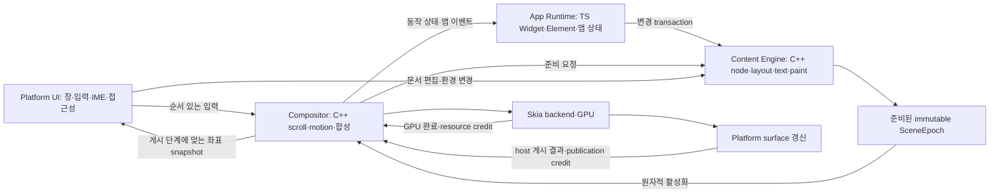

# Nelyx 엔진 v2 — 공통 C++ 백엔드 설계·구축 계획 — 1부: 구조·상태·입력 계약

작성·심화 검토·구현: **2026-11-04 KST** · 상태: **PARTIAL / Windows·두 Web host·화면·owner 연결 / 전체 backend·물리 입력·성능 미완료**

[전체 목차](work8.md) · **1부** · [2부](work8-2.md) · [3부](work8-3.md)

원문 범위: **§1–7**. 전체 설계의 절 번호와 W8 단계 식별자를 유지한다.

**이 문서의 주목표는 Nelyx 엔진 v2의 공통 C++ 백엔드를 구축하고 TypeScript UI Runtime·SDK에 연결하는 것이다.** C++ 백엔드가 render node·레이아웃·텍스트·입력·스크롤·애니메이션·retained scene·렌더링과 자원 수명을 소유한다. TypeScript는 Widget·Element·앱 상태와 UI 변경 선언을 맡고, 네이티브에서는 C++로, Web에서는 같은 C++ 코어를 Wasm으로 컴파일해 실행한다.

**Web은 COOP/COEP로 격리되지 않은 환경에서도 동작하도록 non-shared single-thread Wasm 공급을 필수로 포함한다.** 기본 loader는 실행 가능한 threaded profile을 우선하고, 격리/shared-memory capability가 없으면 single-worker profile을 선택한다. 같은 C++ 기능·정합성을 유지하되 Content와 Render의 병렬성·성능 보장은 profile별로 구분한다([§12.2](work8-2.md#122-web)).

**Web의 graphics/text provider는 npm 공식 `canvaskit-wasm`의 수정하지 않은 JS·Wasm 배포본을 사용한다.** 자체 C++ engine Wasm과 CanvasKit Wasm은 별도 module이며, 두 engine profile이 같은 CanvasKit 배포본을 사용한다. 기존 Nelyx 패치 빌드를 v2의 전제로 두지 않는다. 현재 설치된 npm `0.41.0`을 API 검토의 출발점으로 삼고 정확한 채택 버전·공개 API 정합성은 W8-00/02에서 고정한다.

구현 범위는 엔진의 상태 모델·ABI·TS 연결·호스트·빌드·공급·기능 검증이다. 연속 입력의 버벅임과 기존 성능 수락 기준은 재설계의 배경과 후속 제품 평가에 해당한다. 백엔드 구축 완료와 개별 증상의 해결·제품 성능 수락은 구분한다.

초기 설계 검토에서는 구현·빌드·앱 실행을 수행하지 않았다. 이후 `work8-1.md 작업해줘` 요청으로 아래의 공통 코어 구현·검증을 진행했다. 아래 설계 전체가 구현됐다는 뜻은 아니며, 구현한 API와 남은 계약을 이번 실행 현황에서 구분한다. [work7.md](history/26/11/04/work7-summary.md)의 실패·수정 후 물리 재확인 대기는 보존한다.

## 이번 실행의 구현·검증 상태

### 연결 실행 현황

**2026-11-04 KST: 재개 / Windows와 두 Web profile의 고정 배치 장면 연결.** 외출에 따른 중단 이후 사용자의 `이제 이어서 해줘` 요청으로 재개했다. 아래 host·CanvasKit·독립 owner·화면 연결을 구현했다. **W8 전체 백엔드는 PARTIAL**이며 전체 Widget·표준 layout·편집·Android port의 완료를 뜻하지 않는다.

| 경로 | 구현과 확인 범위 |
| --- | --- |
| 공통 C++ | 동시 dispatch 잠금, lock 밖 transaction staging·provider 준비, paint/UTF-8 text, 준비 document/provider 승인, C++ world 좌표·ancestor clip·게시 snapshot hit-test. Native/두 Wasm **69개 계약 검사 통과** |
| Windows | [HWND/Hermes host](Nelyx/engine/platform/windows/host.cpp)와 [Skia provider](Nelyx/engine/platform/windows/skia_provider.hpp). UI·Hermes App·Content·Render **서로 다른 4 OS thread**. SkParagraph/Picture·WebP CPU 준비와 Vulkan Graphite 표면. RTX 4060 Laptop GPU로 실제 장면·입력·resize/minimize/restore·종료 확인. `Ctrl+U`로 App 선언을 갱신하고 wheel/왼쪽 pointer drag로 스크롤 |
| Web threaded | [pthread bootstrap](Nelyx/engine/bindings/browser_owners.cpp), [owner](Nelyx/engine/platform/web/owner.ts), [coordinator](Nelyx/engine/platform/web/coordinator.ts). 별도 App Worker·engine coordinator·실제 Content/Render pthread, shared engine heap과 owner별 non-shared 공식 CanvasKit heap. READY와 실제 owner ID 확인 후 `contentIndependent=true` |
| Web single-worker | 별도 non-shared engine binary·App Worker·한 engine/CanvasKit owner에서 Content/Render 협력 실행. 비격리 배포의 기본 auto 선택. `contentIndependent=false`를 유지하고 Content 동기 점유 뒤 회복을 확인 |
| 공식 CanvasKit | 수정하지 않은 npm **0.41.0/full JS·Wasm**, 실제 OffscreenCanvas/WebGL2·Picture/Image/Paragraph. Single-worker는 local Picture, threaded 비텍스트는 public Picture serialize/import, 텍스트는 같은 hash의 고정 font와 public shaped glyph run 전달. Render에서 paragraph를 다시 layout하지 않음 |
| SDK·Testbed | [브라우저 surface API](Nelyx/sdk/src/runtime/engine-v2-browser.ts), [고정 배치 장면](sample/nelyx-testbed-app-2/src/v2-scene.ts), [App](sample/nelyx-testbed-app-2/src/v2-app.ts), [Web 진입점](Nelyx/engine/platform/web/main.ts). 새로 빌드한 공개 `@nelyx/sdk/engine-v2`·`@nelyx/core/v2`를 bundle에서 사용. 초기 SDK 명령 **277 = 실제 C++ transactionWork 277**, text 갱신 뒤 **278**, fallback **0**을 각 장면에서 대조 |
| 현재 공급 | [builder](Nelyx/engine/tools/build.mjs)가 Core/SDK를 먼저 빌드하고 Windows host·두 engine·worker/App·공식 CanvasKit·font/license·image·ICU·Hermes DLL과 ABI/전체 file hash/source identity manifest를 공급. 이전 schema dist와 임시/staging/이전 출력은 교체·finally 정리. Native runner는 source·file hash가 다르면 시작 실패 |

#### 실행 방법

저장소 루트에서 빌드한 뒤 원하는 host를 실행한다. Emscripten **4.0.22**는 `EMSDK` 또는 사용자 cache의 `.cache/tooling/emsdk`를 사용한다. Windows는 기존 `Nelyx/skia/vendor/inputs/windows-x64`와 `.nelyx/windows-hermes`의 고정 cohort를 hash로 확인하며 공급 누락 시 실패한다.

```powershell
npm.cmd run build:engine-v2
npm.cmd run run:engine-v2:windows
# 별도 터미널에서 Web을 실행할 때
npm.cmd run run:engine-v2:web
```

Web: `http://127.0.0.1:8192/isolated/`는 COOP/COEP가 있는 `auto → threaded`, `/plain/`은 비격리 `auto → single-worker`다. `?profile=single-worker|threaded`로 강제할 수 있으며 비격리 forced-threaded·요구 capability 누락·schema/asset hash 오류는 시작 실패다. Asset/초기화 오류를 다른 profile이나 TS renderer로 숨기지 않는다. Worker·transfer 가능한 OffscreenCanvas·worker WebGL2가 필요하다. 정적 배포는 현재 `engine/dist` 전체를 보존하고, 격리 route에서는 모든 worker/asset에 일관된 headers를 제공해야 한다. 정상 close 뒤 canvas 재사용 대신 새 canvas/session을 만든다.

#### 검증과 수락 경계

- [host 검사](Nelyx/engine/tests/hosts.test.mjs) **4개**: Native와 두 Web 실행·초기 작업/선언 집계·App/Content 50/100/200 ms 지연·실제 offset/frame 진행·content commit 뒤 scroll 보존·resize/zero/minimize/restore·idle·close, zero-size 시작/복귀·WebGL2 불가·forced-threaded/불일치/손상 공급 거부. Native는 지연 시작 때 UI에 입력을 예약하고 지연 중 C++ frame 합성 입장을 확인한다. GPU/WSI 완료 시점의 busy 여부는 별도로 보고하며 50 ms 안 GPU 완료/FPS를 수락하지 않는다. Web threaded는 Content 점유 중에도 flush·게시가 진행하고, single-worker는 App 점유 중 진행 및 Content 점유 뒤 회복한다. 각 검사 timeout은 **20분**이다.
- SDK/Main 전송 32 request/4 MiB, input admission 24 pending과 core 256 cap. 포화 시 예약된 Cancel을 보내고 다음 stream을 Begin으로 재개한다. 40개 동시 input으로 거부/Cancel·회복을 확인했다. Telemetry는 미회신 1개로 coalesce한다.
- [owner scheduler 검사](Nelyx/engine/tests/actors.test.mjs) **1개**: 실제 C++ Wasm에서 zero-size 수요가 있더라도 Content step은 한 번 후 멈추고, non-zero metrics와 host wake 뒤 준비를 재개한다. Main visibility/focus는 rAF 정지를 기다리지 않고 전달한다. Render는 public GrDirectContext/WebGL2 handle 하나를 resize 사이에 재사용하고 close에서 명시적으로 해제한다.
- [glyph 검사](Nelyx/engine/tests/glyphs.test.mjs) **1개/21 corpus**: 한글·Latin·혼합 문자열과 장면의 7 font size에서 분리된 두 공식 CanvasKit instance의 paragraph paint와 public glyph record를 CPU 픽셀 비교하여 차이 **0**. Slight hinting을 맞췄다. NotoSansKR 10,414,588 bytes가 text Picture 10,415,184 bytes에 복제되는 probe를 확인하여 glyph 전달을 사용한다. 전체 fallback·RTL·emoji·rich text·전용 paragraph API 의미의 이식은 미완료다.
- Native 종료는 UI가 HWND를 유지한 채 provider drain·실제 thread join 후 core ledger 0·정상 exit를 확인한다. Web 종료는 owner stop·Picture/surface/GPU context/font hold 0·core ledger 0 뒤 pthread workers와 App Worker를 종료한다. Vulkan out-of-date는 해당 frame을 실패 회수한 뒤 최신 metrics로 재구성하며 GPU/device loss를 성공으로 처리하지 않는다.
- Native GPU submit/WSI resource fence와 Web flush/publication을 구별한다. Web `gpuComplete='unobserved'`, 모든 실제 scanout은 `unobserved`다. Headless Chromium은 **SwiftShader WebGL2**로 기능 검증했다. 표시된 Chromium 창에서는 **AMD Radeon 780M/D3D11**의 threaded 화면·wheel·content 갱신·close를 직접 확인했다. Windows 일반 실행 명령에서도 화면·OS 주입 wheel/왼쪽 drag·Ctrl+U·정상 close를 직접 확인했다. 이는 hardware FPS/지연의 성능 증거가 아니다. 자동 input/화면 검사는 물리 trackpad/FPS·제품 성능 수락을 대신하지 않는다.
- Core/SDK build·전체 workspace 타입·Web adapter 타입·기존 input-geometry **2개**와 retained-input-geometry **7개**를 통과했다. Gallery → Mixed 및 활성화 실패 회귀를 유지하며 이를 v2 전체 Gallery 이식 완료로 세지 않는다. 생성본·lint/format·현재 supply source/file hash·공개 Core/SDK의 세 headless 공급 호출/ledger 0, package dry-run의 Core v2 파일 28개·SDK v2 파일 8개를 확인했다. 현재 supply는 manifest 제외 27개 파일이다. 문서 8개의 로컬 링크 275개/앵커 126개를 확인했다.

검증 명령은 `npm.cmd run test:engine-v2`, `npm.cmd run test:engine-v2:glyphs`, `npm.cmd run test:engine-v2:actors`, 현재 공급 빌드 후 `npm.cmd run test:engine-v2:hosts`다. 일반 App의 engine 기본값은 유지하고 v2는 위 별도 명령으로 실행한다. 나머지 W8-00 API 의미/Android ABI 확정, 최소 Android surface, 표준 layout/Widget/Key/편집/semantics·coverage와 전체 gesture 이식은 계속 진행할 범위다. 설계 근거는 [Emscripten runtime 수명](https://emscripten.org/docs/api_reference/emscripten.h.html), [Vulkan WSI 재구성](https://docs.vulkan.org/tutorial/latest/03_Drawing_a_triangle/04_Swap_chain_recreation.html), [CanvasKit 공개 타입](https://github.com/google/skia/blob/main/modules/canvaskit/npm_build/types/index.d.ts)과 설치된 고정 공급 source/API를 대조했다. 기존 `performanceAccepted=false`, `resizePerformanceAccepted=false`, work7의 물리 재확인 대기를 유지한다.


### 2부 작업 이후의 현재 상태

C++ layout continuation·text/image 측정·baseline·layout cache·별도 geometry snapshot과 intrinsic/dry query를 추가했다. 현재 Testbed는 v2 Widget/State/Key와 ACK 기준 diff로 선언하고 12행과 문단 32개를 C++/Content에서 처리한다. Native editing document·undo/composing·게시 caret/selection과 Windows TSF/UIA·Web DOM/ARIA를 연결했으며 전체 API/제품 이식은 PARTIAL이다. 네 font의 RTL/fallback/color emoji·line-index adapter와 coverage 코어도 포함한다. 구현/검증 수치·제약·미완료 항목은 **[2부 현황](work8-2.md#이번-작업의-구현검증-현황)**을 현재 기준으로 따른다. 위 1부 최초 연결 수치는 당시 고정 배치 장면의 기록이다.

### 공통 코어 구현

**1부 전체와 W8-00/01/03의 gate는 PARTIAL이다.** 아래 공통 코어와 실제 host 연결을 구현했으나 전체 기능표/플랫폼 이식은 남았다. 최초 headless 작업의 시작 HEAD는 `0e0379f`다.

| 구현한 경로 | 현재 기능과 확인 범위 |
| --- | --- |
| [canonical schema](Nelyx/engine/schema/protocol.json), [생성기](Nelyx/engine/tools/generate-schema.mjs) | little-endian·64-bit BigInt·tagged constraints/extent·명령/결과/입력 layout·상한·상태값을 고정. C++/TS 생성본 drift 검사 |
| [C ABI](Nelyx/engine/include/nelyx/engine.h), [C binding](Nelyx/engine/bindings/c_api.cpp) | size/version·major/schema·필수 capability 검사, opaque engine, 복사된 출력 buffer와 module release. C로 컴파일한 소비자 확인 |
| [document/lease](Nelyx/engine/core/scene/document.hpp), [transaction](Nelyx/engine/core/protocol/transaction.cpp) | staged create/properties/reparent/destroy/resource·최종 그래프/세대/깊이 검증·원자 설치·실패 rollback. Immutable node block·document/scene/frame hold |
| [protocol dispatcher](Nelyx/engine/core/protocol/engine.cpp) | ACK된 document와 active scene 분리·동일 ID/동일 bytes 재시도·ID 재사용 거부·bounded 결과 창/ACK 하한·동일 document의 개별 준비 ID/실패/late 결과 |
| [scheduler/input/scroll](Nelyx/engine/core/scheduler/scheduler.cpp) | tick 시작 cut·유한 quota·진행 중 준비와 최신 다음 수요·중간 scene 활성화·2 frame credit·게시 요청 coalescing·역순 완료 방어·hide/zero-size/restore·device 세대 |
| 같은 scheduler의 compositor overlay | scene 교체 시 scroll 보존·generation별 취소·nested 잔여 delta의 finite extent handoff·ScrollTo/선형 AnimateTo의 epoch 하한/충돌/대체/삭제/timeout terminal·opacity motion·forced redraw/idle |
| [physics](Nelyx/engine/core/input/physics.hpp) | 기존 `FrictionSimulation(0.135)`의 bounded friction branch를 double로 이식. OS-resolved/phase 불명 wheel은 추가 ballistic을 실행하지 않음. 전체 bouncing/clamping physics 이식은 아님 |
| [TS engine-client](Nelyx/runtime/engine-client/index.ts), [SDK facade](Nelyx/sdk/src/runtime/engine-v2.ts) | `@nelyx/core/v2`, `@nelyx/sdk/engine-v2` export·bundle/host major/schema 검사·view별 1 transaction·ACK timeout 후 query/동일 bytes retry·activation 실패/close/timeout 종료·전송/대기 상한 |
| [Wasm binding](Nelyx/engine/bindings/wasm.cpp), [TS adapter](Nelyx/runtime/engine-client/wasm.ts) | 별도 non-shared/shared-memory 빌드·module 소유 해제·memory growth 뒤 HEAP 재취득·출력 packet 복사. JS buffer/다른 module 포인터를 보관하지 않음 |
| [CMake](Nelyx/engine/CMakeLists.txt), [빌드](Nelyx/engine/tools/build.mjs), [계약 검사](Nelyx/engine/tests/contracts.test.mjs) | Windows x64 MSVC와 Emscripten **4.0.22**의 Native/single-worker/threaded headless 실행. Current `engine/dist`만 공급하고 staging/이전 dist/검증 임시는 finally에서 제거 |

Headless 검사는 cooperative 호출로 실행하고 `contentIndependent=false`를 보고한다. 실제 Windows/threaded host는 provider READY와 서로 다른 owner를 연결한 뒤 surface/independent capability를 제공한다. CreateNode의 13개 종류 인식을 표준 layout·paint·편집 전체 구현으로 세지 않는다. 지원 primitive의 C++ layout과 intrinsic/dry query·편집/semantics 연결을 제공하며, 지원 밖 조합·`appControlled`/raw observer·전체 tap/pinch·keyboard/IME·motion graph 이식은 남았다.

### 이번에 고정한 값

| 항목 | canonical 값/정책 |
| --- | --- |
| Wire | ABI major 2/minor 0, schema fingerprint, 64-byte header·16-byte 명령 TLV·416-byte 진단 state·216-byte node row·120-byte 입력. `float64`는 finite/절댓값 ≤ 1e12. Constraints `finite/unbounded/expand`, extent `finite/estimated/unbounded`를 별도 tag로 표현 |
| Tree/transaction | view 최대 8·node/view 4096·깊이 128·명령 4096·packet 1 MiB. Handle은 view 안의 slot+generation, 최종 그래프를 검증하며 overflow/wrap은 거부 |
| 입력 | **session 합산 256 = update 224 + boundary 예약 32**. 살아 있는 view 수로 view admission quota를 나누고 tick은 view당 32 packet. 포화 stream은 명시적으로 취소하며 received = consumed + canceled + rejected + queued, duplicate는 별도 |
| Content/scene | step당 최대 64 slot. 진행 중/ready 후보 합계 1·최신 다음 document 수요 1·active scene 1. 새 commit만으로 진행 중인 호환 준비를 취소하지 않음 |
| Frame/publication | view당 engine hold 2, 최대 8 view이므로 session 최대 16. Provider release와 관측된 GPU 완료를 구별하고 게시 대기 최신 1. Close는 미회수 provider hold를 보존하며 session close는 drain 전 `busy` |
| Result/event/command | view당 결과 32개 및 payload 1 MiB·event 256개/poll 32개·대기 scroll command 64개/최대 2초. Overflow는 view 종료, pending 명령은 `nextDeadline`로 timer 수요를 드러냄 |
| Memory | session 내부 reservation 64 MiB·resource 32 MiB·resource slot 1024. 공유 node/resource는 마지막 hold까지 유지. 진단 `reservedBytes`는 RSS가 아니며, CanvasKit/GPU/provider heap을 합산한 값도 아님 |
| Package/선택 | 새 npm package 없이 core/SDK의 명시 subpath 추가. 일반 App의 engine 선택·기본 import는 기존 경로를 유지. 별도 v2 host runner/현재 공급 제공. 일반 Widget resolver·제품 기본값 전환은 후속 작업 |

### 검증과 남은 작업

최신 검증·실행 명령·미완료 범위는 [연결 실행 현황](#연결-실행-현황)을 따른다. 전체 backend·기존 제품은 계속 PARTIAL이다. 최소 고정 배치 host의 화면/독립 실행 검사를 전체 Widget·Android·물리 입력·성능 검증으로 확장하지 않는다.

## 1. 설계의 기준과 결정

### 1.1 주목표 — 엔진 v2 C++ 백엔드 구축

**Nelyx의 공통 엔진 기능을 소유하고 실행하는 C++ 백엔드를 만든다.** 최종 산출물은 다음과 같다.

1. Render node·layout·text provider 계약·input/gesture·scroll·animation·scene·semantics·resource/scheduler를 갖춘 공통 C++ 엔진 코어.
2. TypeScript UI 선언을 전달하는 versioned ABI·transaction protocol·binding과 SDK 연결.
3. Native host에서 실행되는 C++ 빌드와 Web에서 같은 코어를 실행하는 Wasm 빌드·renderer 연결.
4. 실제 장면의 백엔드 실행·기능 정합성·수명·공급 identity를 확인하는 검사와 사용할 수 있는 패키지·runner.

백엔드의 완료 기준은 [§18.1](work8-3.md#181-엔진-v2-c-백엔드-완료-기준)에 둔다. 스크롤 체감이나 특정 FPS의 달성 여부는 별도의 제품 평가로 기록한다.

### 1.2 배경 — 기존 입력·화면 갱신 문제

트랙패드 연속 입력의 버벅임과 JS 작업·화면 갱신의 결합이 재설계의 계기다. 이를 참고해 상태 소유권·변경 전달·스케줄링을 정리하고, 입력·좌표·자원 수명을 일관되게 유지하는 구조를 설계한다.

기존 일반 사용 60fps·lazy load 중 일시적 jitter 허용 기준은 후속 제품 비교의 참고 기준으로 남긴다([work2 §4](history/26/11/02/work2-summary.md), [work6 §3](history/26/11/03/work6-summary.md), [work7 §1](history/26/11/04/work7-summary.md)). 해당 체감·성능 수락을 C++ 백엔드 구축의 주목표나 착수 조건으로 두지 않는다.

### 1.3 채택할 구조

| 항목 | v2 결정 |
| --- | --- |
| UI 작성 | TypeScript의 Widget·Element·State·Key·의존성 모델을 유지하고 새 엔진에 맞게 구현 |
| 화면의 계산 상태 | C++ render node가 constraints·geometry·텍스트 metrics·paint invalidation의 단일 소유자 |
| 연속 동작 | C++ compositor가 scroll position·표준 gesture·선언형 motion을 소유 |
| UI 전달 | 전체 frame command 재전송 대신 버전이 있는 render node 변경 transaction |
| 화면 갱신 | 준비된 콘텐츠로 이동·합성을 진행. Content와의 독립 실행은 native/threaded, 협력적 작업 분할은 Web single-worker |
| 실행 owner | Platform UI·App Runtime·Content Engine·Compositor/Render의 책임을 분리하고, 물리 thread 배치는 profile별로 지정 |
| 네이티브 호스트 | 자체 platform host + 기존 Hermes 계열의 검증 가능한 단일 runtime cohort로 시작 |
| 그래픽 | Native는 기존 Skia 공급, Web은 npm 공식 CanvasKit을 엔진의 retained scene 뒤에 renderer/text provider로 연결 |
| Web | 자체 engine만 threaded/non-shared로 두 빌드. npm CanvasKit은 별도 module로 두 profile에서 같은 원본 사용. Worker·자동 profile 선택 유지 |
| 호환성 | Widget 작성 경험과 디자인 자산을 우선 보존. 동기 RenderObject 확장·정확한 동기 geometry 조회까지 호환한다고 약속하지 않음 |

**C++ 서비스 함수를 늘리는 방식에서, C++가 장기 상태와 실행 일정을 소유하는 방식으로 바꾼다.** TS와 C++가 같은 render tree·scroll position·텍스트 layout을 각각 권위 있는 값으로 유지하지 않는다.

### 1.4 첫 백엔드 완료에 포함할 대상

| 대상 | 이번 백엔드의 필수 범위 | 별도 후속 범위 |
| --- | --- | --- |
| Windows x64 자체 host | 공통 모듈·TS 연결·[§16.2](work8-3.md#162-이식-범위를-잃지-않는-방법)의 필수 통합 장면·현재 SDK/runner 공급 | 제품 기본값 전환·물리 입력/성능 수락 |
| Web threaded Wasm | 같은 공통 모듈·TS 연결·필수 통합 장면·npm CanvasKit adapter·OffscreenCanvas 렌더링·배포 조건을 갖춘 공급 | 브라우저/장치별 제품 지원 확대 |
| Web non-shared single-worker Wasm | COOP/COEP 없는 배포에서 같은 필수 기능·통합 장면·OffscreenCanvas 렌더링·정상 종료. 기본 자동 선택과 별도 바이너리 공급 필수 | Content와 Render의 병렬성·threaded와 같은 FPS/지연은 보장하지 않음 |
| Android | W8-00에서 고정한 ABI 하나의 공통 계약·최소 scene·입력·surface·close/drain | 전체 Testbed·Material/Cupertino·물리 IME/접근성 제품 검증 |
| Apple/Linux | 공통 코어에 OS 의존성을 넣지 않는 port 경계 설계 | 실제 host·빌드·실행·제품 공급 |

두 Web profile의 최소 환경은 Wasm·Worker·transfer 가능한 OffscreenCanvas·worker WebGL2와 필요한 자산 로딩을 지원하는 브라우저다. **COOP/COEP 부재만으로 시작을 거부하지 않는다.** Worker/CSP·GPU 기능 부족은 별도 조건이며, worker 없이 browser main에서 전체 엔진을 실행하는 추가 port는 이번 필수 범위에 넣지 않는다.

필수 기능은 W8-00에서 목록을 고정한다. 두 Web profile은 같은 기능표를 사용하고 threaded 전용의 독립 실행 capability만 별도로 표시한다. 이후 미구현 항목을 `unsupported`로 바꾸는 것만으로 완료 분모에서 빼지 않는다. 범위를 바꾸면 이 표·[§16](work8-3.md#16-구현-순서와-단계별-완료-조건)·[§18](work8-3.md#18-백엔드-완료와-후속-제품-전환)의 완료 기준을 함께 수정하고 이유를 남긴다.

## 2. 현재 구조에서 확인한 출발점

초안·이전 심화 검토의 기준 HEAD는 `fc1331997e4f4de61f59e1f61cf127c2125406da`이고, 당시 시작 변경은 untracked `work8.md` 하나였다. COOP/COEP 추가 검토는 `44f048cb626372395b1af3767113c709317c0c94`의 깨끗한 작업 트리에서 시작해 관련 Web 소스·공급과 공식 문서를 대조했다. 이번 작업에서 실행한 성능 측정 결과는 없다.

3부 문서 재검토는 **`1c8c3251b9dbd470fae2df6bfbd9e90dc62cb40f`의 깨끗한 작업 트리**를 기준으로 수행했다. 현재 constraints·framework/runtime·CanvasKit loader/타입·runner 명령과 공식 platform 문서를 다시 대조했으며, 아래 보강은 구현 계약의 수정이다. 새 엔진의 실행 결과를 추가한 것은 아니다.

| 근거 | 확인한 사실 | v2에서 바꿀 책임 |
| --- | --- | --- |
| [ViewRuntime](Nelyx/src/hosting/runtime.ts)의 `queuePointer`, `schedulePump`, `buildPending`, `pump` | JS owner가 입력 drain·scene build·pending frame·renderer 입장을 연결 | 엔진 입력 소비와 compositor frame 생산을 App Runtime에서 분리 |
| [FrameworkRoot](Nelyx/src/framework/widgets/root.ts)의 `build` | `flushBuild → flushLayout → recordPaint → compose → capture`가 공통 JS 프레임 경로에 존재 | TS는 변경 선언, C++는 layout·기록·scene 활성화를 수행 |
| [PipelineOwner / RenderObject](Nelyx/src/framework/rendering/object.ts) | geometry·dirty 전파·layout·paint·hit-test의 핵심 소유가 TS에 있음 | 엔진에 지속되는 render node와 의존 그래프를 구축 |
| [ScrollPositionWithSingleContext](Nelyx/src/framework/widgets/scroll-position-with-single-context.ts) | 입력 delta·physics·ballistic activity가 framework 상태를 변경 | 표준 scroll model과 physics를 엔진으로 이전 |
| [FlexLayoutService](Nelyx/src/hosting/flex-layout.ts), [PointerTargetsService](Nelyx/src/hosting/pointer-targets.ts), [SceneCompositionService](Nelyx/src/hosting/scene-composition.ts) | native 숫자 계산·질의가 있어도 준비·TS 반영·기존 트리와의 연결이 남음 | native가 처음부터 같은 node·property·resource 상태를 보유 |
| [WindowsScrollCoordinator](Nelyx/skia/native/host/windows/WindowsScrollCoordinator.h) | 입력 batch·ACK·watermark·frame wake를 native에서 조율하지만 결과는 JS 프레임 경로로 연결 | 정상 이동의 진행 조건에서 JS ACK와 새 scene build를 제거 |
| [WindowsPrecisionTrackpad](Nelyx/skia/native/host/windows/WindowsPrecisionTrackpad.h) | DirectManipulation 수집과 접촉/관성 구분이 존재. 현재 momentum은 framework가 소유 | 수집 adapter를 재사용하되 표준 physics의 소유자를 v2 엔진으로 변경 |
| [CompositorFrameClock](Nelyx/skia/native/host/windows/CompositorFrameClock.h) | 현재 clock은 DWM timing과 waitable timer를 사용하며 표시 receipt를 제공하지 않음 | 관측 수준을 유지하면서 엔진 scheduler의 pacing 입력으로 사용 |
| [RuntimeLoop](Nelyx/sdk/native/windows-hermes/RuntimeLoop.h), [WindowSurface](Nelyx/sdk/native/windows-hermes/WindowSurface.h) | 자체 runtime owner·Win32 surface·비동기 GPU 작업의 출발점이 이미 있음 | 제품화가 끝난 호스트로 가정하지 않고, 새 엔진 port의 재사용 후보로 평가 |
| [loadCanvasKit](Nelyx/sdk/src/backends/browser/canvaskit.ts), [Web 공급 manifest](Nelyx/skia/packages/web/native-manifest.json), [npm 의존 설정](Nelyx/skia/packages/web/package.json) | 현재 npm 의존성은 `canvaskit-wasm@0.41.0`이지만 loader는 `m153-nelyx-paragraph.1`·전용 paragraph API/hash를 요구. npm 원본 JS/Wasm으로 바로 교체할 수 있는 상태가 아님 | v2는 npm 원본의 버전/파일 identity와 공개 API를 검증하는 loader·adapter로 구현. 기존 전용 API 강제는 이식 대상 |

[work5](history/26/11/03/work5-summary.md)·[work6](history/26/11/03/work6-summary.md)·[work7](history/26/11/04/work7-summary.md)의 C++ 후보들은 실제 native 실행 여부와 전체 경로의 이득을 구별해 평가했으며 기본 판정은 `NO_ADOPTION`이다. **현재처럼 TS가 매번 자료를 준비하고 C++ 결과를 다시 해석하는 경계에서는 국소 계산을 줄여도 전체 준비·전달·동기화 비용이 남을 수 있다.** 이는 구조 변경의 근거이지 C++ 구현 자체가 느리다는 일반 결론은 아니다.

특히 [work7 §11.9](history/26/11/04/work7-summary.md)는 연속 입력 producer가 멈추지 않으면 frame 입장이 계속 보류되던 starvation을 기록한다. 수정 전 공급의 사용자 물리 입력 결과는 실패였고, watermark 수정과 자동 회귀 뒤의 물리 재확인은 대기 중이다. 이전 자동 wheel 성공이나 더 오래된 특정 trackpad 실행의 성공으로 이 실패·재확인 대기를 덮지 않는다.

아직 확정하지 않은 항목은 센서부터 native 수집까지의 지연, UI dispatcher 점유, 현재 입력 패턴의 JS/GC·layout·paint·GPU 기여율, 실제 표시 지연이다. 새 기반을 설계하는 일과 이 기여율을 측정하는 일은 구분한다.

## 3. 새 엔진의 전체 흐름

기존 일반 경로에서는 native 입력을 받아도 화면의 새 상태를 만들기 위해 JS의 scroll·layout·paint 경로가 필요하다. v2는 **콘텐츠 변경 경로**와 **준비된 콘텐츠를 움직이는 경로**를 다음과 같이 연결한다.

이 흐름은 논리적 owner와 메시지의 관계다. Web single-worker에서는 Content와 Compositor가 한 engine event loop에서 순서대로 실행되며, 아래 경로가 물리적으로 병렬이라는 뜻은 아니다.



예를 들어 이미 준비된 ListView에서 손가락을 1px 움직였을 때:

1. Native 입력 adapter가 sample의 순서와 좌표 세대를 붙인다.
2. Compositor가 해당 scroll node의 위치와 property revision을 변경한다.
3. 현재 scene의 clip·transform·가시 영역을 갱신하고 native에서 합성한다.
4. Renderer credit이 있으면 surface 갱신을 진행한다.
5. App Runtime에는 버전이 있는 scroll snapshot을 알린다. 그 응답은 2–4의 진행 조건이 아니다.

이 경로에서 TS Widget build·TS layout·TS paint·전체 frame 직렬화는 필요하지 않다. 반면 새 child 생성, 줄바꿈 변경, layout 기반 animation, JS 사용자 코드의 결과가 필요한 콘텐츠는 content commit을 기다린다. C++로 옮겼다는 이유만으로 모든 작업이 compositor에서 처리되지는 않는다.

## 4. 실행 문맥과 상태 소유권

### 4.1 네 개의 주요 owner

| Owner | 소유 상태·작업 | 기다리지 않아야 하는 대상 |
| --- | --- | --- |
| Platform UI | HWND/COM·platform view·DirectManipulation 수집·IME document service·접근성 proxy·surface publication | JS 반환, 전체 layout, GPU fence의 CPU blocking wait |
| App Runtime | 단일 JS runtime·Widget/Element·State·의존성·사용자 callback·render 선언 작성 | GPU 완료. 엔진 상태의 동기 역질의로 UI thread를 호출하지 않음 |
| Content Engine | C++ render node·layout·paragraph·CPU display list·scene 준비·가상화 계획 | JS builder의 동기 반환, compositor가 가진 전역 lock |
| Compositor/Render | active scene·scroll/gesture·motion graph·property overlay·frame 선택·GPU context/submit | App commit·content layout 완료·앱 이벤트 ACK |

Windows 첫 구현에서는 이 owner들을 별도 실행 thread로 둔다. Fence 등 blocking API가 필요하면 제한된 completion worker가 기다리고 native ID로 완료를 전달한다. View마다 네 개씩 thread를 만들지 않으며, engine session의 실행 thread와 GPU device별 owner를 공유한다. 다중 view의 작업량은 별도로 제한해 한 view가 다른 view의 입력을 독점하지 않게 한다.

Web threaded도 Content와 Compositor의 실행 thread를 분리한다. Web single-worker는 두 owner의 mutable 상태·작업 큐를 구분하되 같은 non-shared Wasm instance/event loop에서 협력적으로 실행한다. Browser main·TS app worker는 그대로 분리하므로 App 응답 없이 준비된 scene을 움직일 수 있지만, 같은 engine worker를 점유하는 동기 Content 작업 중 독립 Render 진행은 보장하지 않는다. 이 capability 차이는 [§12.2](work8-2.md#122-web)/[16.1](work8-3.md#161-백엔드-연결을-확인하는-최소-수직-구현)에서 검사한다.

OS 객체의 thread affinity는 유지한다. DirectManipulation COM 호출과 DirectComposition 게시를 임의로 render thread로 옮기지 않는다. 따라서 **Platform UI 자체가 막혀 새 OS 입력을 받지 못하는 문제까지 이 구조만으로 해결된다고 약속하지 않는다.** Host의 UI 작업도 짧게 유지하고 실제 수집 지연을 측정한다.

### 4.2 공유 방식

- 한 mutable model에는 한 writer만 둔다. Content tree와 compositor의 motion state는 서로의 mutable 객체를 직접 수정하지 않는다.
- Scene은 준비 후 immutable하게 넘긴다. 내용과 layout이 고정된 scene 위에서 compositor가 별도의 transform·clip·effect·scroll property를 갱신한다.
- Snapshot은 immutable block을 공유하고 변경 block만 새로 만든다. 매 frame 전체 트리를 복사하지 않는다. 저장 공간은 active·준비 중·GPU 참조 중인 세대까지 합산한다.
- JSI Value·Runtime·JS 함수·반환 뒤의 JS buffer 포인터를 worker가 보유하지 않는다. Native 핸들과 복사한 값만 전달한다.
- UI와 compositor가 사용하는 짧은 inbox lock을 content layout·JS callback·GPU 대기 동안 잡지 않는다. Lock-free 구현 자체를 첫 목표로 삼지 않는다.
- 엔진 내부 자료구조와 C ABI 외부 protocol을 분리한다. 앱에 native 메모리 배치를 직접 노출하지 않는다.
- Web의 자체 engine Wasm과 CanvasKit Wasm은 서로 다른 heap/handle 영역이다. Engine의 공유 메모리라도 CanvasKit 객체·포인터를 공유하지 않는다. Adapter의 resource ID로 연결하고 각 module의 할당·해제 API를 따른다.

Content·decode·shader 준비 작업은 작은 취소 가능한 단위로 예약하고 compositor의 입력/credit 작업을 장시간 독점하지 않게 한다. Native로 옮긴 작업이 같은 CPU·allocator·GPU를 사용한다는 사실은 남는다. 실시간 thread 우선순위나 busy loop로 다른 작업을 굶기는 방식은 기본 정책으로 두지 않는다.

### 4.3 Scene의 기본값과 실행 중 property의 결합

Content가 작성한 기본 property와 compositor의 실행 중 overlay를 구분한다. Overlay는 `(ViewGeneration, NodeId, PropertyId, MotionId)`로 식별하고, frame마다 **scene 기본값 + 그 scene에 적용 가능한 overlay**를 평가한 immutable property snapshot을 만든다. Mutable overlay의 writer는 compositor 하나다.

새 scene 활성화는 compositor owner의 한 작업으로 실행한다. 같은 node/property의 진행 중 scroll·motion은 보존하고, 삭제·종류 변경·명시적 motion 교체에는 cancel terminal을 낸다. App의 기본값 변경이 실행 중 motion을 자동 덮어쓰지 않으며, 교체 의도는 base revision·command ID를 가진 명령으로 보낸다. Render·hit-test·semantics가 서로 다른 시점의 overlay를 읽지 않게 [§10](work8-2.md#10-hit-test편집접근성의-정합성)의 snapshot으로 연결한다.

## 5. 변경 transaction과 세대 계약

### 5.1 TS가 보내는 것은 render node의 변경이다

App Runtime은 `CreateNode`, `SetProperties`, `AttachChild`, `MoveChild`, `DetachNode`, `DestroyNode`, `SetEventPolicy`, `SetMotion`, `BindResource` 같은 검증 가능한 명령을 transaction으로 묶는다. 이 이름들은 전체 계약의 명칭이며, 이번에 구현한 명령의 정확한 형식·지원 범위는 [schema](Nelyx/engine/schema/protocol.json)와 [TS codec](Nelyx/runtime/engine-client/codec.ts)에 둔다. 명령을 인식하는 것과 전체 layout/gesture/provider 기능의 구현은 구별한다.

표준 node 종류는 Box/Flex/Stack/Wrap/Grid/Paragraph/Image/Clip/Transform/Effect/ScrollViewport/Sliver/Editable 등으로 시작한다. TS에는 native geometry의 권위 있는 사본을 가진 RenderObject를 다시 만들지 않는다. State·Element는 자신이 선언한 node handle과 마지막 승인된 선언을 기억한다.

Transaction 처리 순서는 다음과 같다.

1. App Runtime이 마지막으로 엔진이 승인한 document epoch를 기준으로 변경을 만든다.
2. 엔진이 schema·handle·범위·자원·예산·부모 관계를 검증하고 설치에 필요한 공간을 예약한다. 오류이면 NACK하고 이전 document와 active scene을 유지한다. 검증 중 만든 임시 node/resource도 회수한다.
3. 검증한 변경을 content document에 원자적으로 설치하고 `DocumentAccepted`를 반환한다. 이때 document epoch가 전진한다.
4. Content Engine이 필요한 layout·text·paint를 수행해 새 scene을 준비한다.
5. Compositor가 현재 환경에 맞는 scene을 원자적으로 활성화한다. 그 뒤 surface 갱신과 자원 retirement가 각각 진행된다.

`DocumentAccepted`는 layout 완료·화면 활성화·표시 성공을 의미하지 않는다. 후속 transaction의 base는 승인된 document epoch이며, active scene이 아직 이전 document를 보여줄 수 있다는 점을 API에 드러낸다.

검증은 transaction의 **최종 그래프**에 대해 단일 부모·순환 없음·view/session 소속·node 종류별 child/property 제약·살아 있는 resource generation을 확인한다. 명령 중간에 필요한 handle도 순서대로 검증하며, detach/move/destroy 조합으로 cycle·교차 view 참조·해제된 resource를 숨길 수 없다. 실패하면 document·handle 할당·resource hold·callback 등록을 함께 미적용으로 끝낸다.

TS reconciler도 마지막 ACK된 선언/handle과 전송 중 변경·최신 앱 선언을 구분한다. NACK 시 승인되지 않은 native handle을 재사용하지 않고 ACK된 base에서 최신 선언의 diff를 다시 만든다. 이 재동기화가 앱 `State`나 이미 실행한 사용자 callback을 되돌린다는 뜻은 아니다. 로컬 Element dispose와 native node/게시 route 회수를 구별하고, 늦은 이벤트는 callback generation으로 거부한다. 생성·reparent·삭제가 포함된 NACK에서도 State/Key·dispose 횟수와 native 수명이 어긋나지 않는지 W8-05에서 확인한다.

### 5.2 서로 다른 버전을 한 숫자로 합치지 않는다

| 식별자 | 의미 |
| --- | --- |
| `SessionGeneration / AppGeneration / ViewGeneration` | engine session·앱 reload·view의 생존과 교체 |
| `DocumentEpoch / TransactionId` | 승인된 콘텐츠 선언과 변경 순서 |
| `NodeId = slot + generation` | destroy 뒤 slot을 재사용해도 이전 node와 구별되는 핸들. 단순 detach/reparent는 identity를 유지 |
| `MetricsEpoch` | viewport·DPI·text scale 등 layout 환경 |
| `PreparationId` | 같은 document를 metrics/font/resource/device 변경으로 다시 준비하는 개별 시도. 시작 때 의존 revision을 고정 |
| `SceneEpoch` | layout·text·display list가 함께 준비된 콘텐츠 snapshot |
| `InputSequence / ScrollRevision` | native 입력 소비와 scroll 상태 변경 |
| `PropertyEpoch / MotionId` | scene 위에서 평가한 property snapshot과 개별 motion의 수명 |
| `SubmissionId / PublicationId` | GPU 제출과 port가 정의한 host 게시 요청. 둘은 별개의 사건 |
| `SurfaceCommitId` | port가 실제 완료를 관측·연결할 때만 제공하는 surface commit. 미관측은 값 없음 |
| `DocumentId / EditRevision / FocusSessionId` | 편집 문서·내용 변경·IME 접속 수명. render document epoch와 구분 |
| `DeviceGeneration / ResourceGeneration` | GPU 복구·자원 교체 |

64-bit ID를 JS Number로 무제한 확장하지 않는다. Wire format은 고정 endian·고정 폭 정수와 명시적인 offset/count/stride를 사용하고, JS에서는 두 `uint32` 또는 검증된 BigInt 표현으로 전달한다. 일반 float는 finite·범위·단위를 검사한다. 명령 bytes·node 수·깊이·문자열·자원 참조의 상한을 allocation 전에 검증한다. ID는 session/view 소속과 함께 검증하며 generation/sequence가 소진되면 명시적으로 세대를 교체하거나 실패한다. Wraparound로 이전 ID를 다시 유효하게 만들지 않는다.

**제약의 ‘상한 없음’과 실제 크기의 finite 검사를 구별한다.** Flutter도 [BoxConstraints](https://api.flutter.dev/flutter/rendering/BoxConstraints-class.html)의 기본 상한에는 `double.infinity`를 쓰고, [최종 RenderBox 크기](https://api.flutter.dev/flutter/rendering/RenderBox/debugAssertDoesMeetConstraints.html)는 `isFinite`로 검사한다. 현재 Nelyx의 [BoxConstraints](Nelyx/src/framework/rendering/constraints.ts)도 `Infinity`로 unbounded/expand를 표현한다. V2 wire에는 `finite / unbounded / expand`처럼 의미가 명시된 축별 표현을 두어 숫자 Infinity를 직접 전달할 필요가 없게 한다. 적용 가능한 min/max 관계·expand 해석을 검사하고 최종 박스 크기·그리기/입력 좌표는 유한값으로 제한한다. NaN·일반 좌표의 Infinity·매우 큰 수를 무한의 대용으로 쓰는 처리는 거부한다.

Scroll의 논리적 extent도 별도 계약이다. Flutter의 [maxScrollExtent](https://api.flutter.dev/flutter/widgets/ScrollMetrics/maxScrollExtent.html)는 unbounded일 수 있으므로 모든 ‘geometry’ 필드에 finite 검사를 일괄 적용하지 않는다. V2는 finite/estimated/unbounded extent의 값과 상태를 구별하고 실제 `pixels`·가시 coverage·paint 영역은 유한하게 유지한다. 필수 이식 범위의 extent 의미와 정확한 tag/필드를 W8-00/01에 고정하며, Native/두 Wasm codec의 왕복·잘못된 조합을 같은 corpus로 검사한다.

### 5.3 취소·coalescing·재진입

- 미전송 앱 상태는 마지막 승인된 선언을 기준으로 diff를 다시 계산해 합칠 수 있다. 이미 승인된 중간 mutation을 버린 채 다음 delta만 적용하지 않는다.
- Transaction은 view당 전송 중 하나로 시작하고 session 전체의 bytes·요청 수도 제한한다. 기다리는 동안 TS는 최신 선언 상태를 유지하고, ACK 뒤 새 diff를 만든다. 한 view의 scene 준비 지연으로 다른 view의 선언 전송을 막지 않는다.
- Scene 준비 작업은 시작 시점의 document/metrics를 고정한다. 새 document가 승인됐다는 이유만으로 진행 중인 유효 작업을 매번 취소하지 않는다. 진행 중 작업 1개와 최신 다음 수요 1개로 합쳐, 연속 변경 중에도 호환되는 중간 scene을 완료·활성화할 수 있게 한다. 활성화된 document epoch는 뒤로 가지 않는다. Metrics 불일치·view 종료·명시적 취소·실패한 결과는 활성화하지 않는다. Activation 취소가 승인된 document를 되돌리지는 않는다.
- Callback 중 tree 변경·view close·reparent가 발생하면 다음 transaction으로 반영한다. 현재 native 순회에 JS 재진입을 허용하지 않는다.
- 명시적으로 요구한 v2 capability가 없으면 시작 단계에서 실패한다. v2를 선택하고 v1 TS layout·paint로 조용히 돌아가지 않는다.

### 5.4 승인·후속 실패·재시도의 terminal

| 결과 | 상태와 후속 처리 |
| --- | --- |
| `DocumentRejected(reason, currentEpoch)` | 선언은 미적용. Base 충돌이면 현재 승인 상태와 재동기화한 뒤 새 diff를 만든다. 같은 실패 delta를 무한 재전송하지 않음 |
| `DocumentAccepted(epoch)` | 선언 설치 완료. App은 ACK된 선언을 새 base로 삼음. 화면에 나타났다는 뜻은 아님 |
| `SceneReady / ActivationReady / SceneActivated` | 각각 CPU 준비 완료·필수 자원 준비 완료·compositor 채택. 자원 준비는 [§9.4](work8-2.md#94-cpu-준비와-활성화-가능한-자원을-구분한다), host 게시 여부는 [§10.1](work8-2.md#101-화면과-같은-property를-사용한다)에서 따로 확인 |
| `SceneSkipped(supersededBy)` | 최신 document에 합쳐져 해당 중간 scene을 만들지 않음. 후속 epoch로 연결하며 승인된 mutation을 잃지 않음 |
| `SceneFailed(reason, epoch)` | 승인 뒤 layout·자원 준비 등이 실패. 기존 유효 scene을 유지하고 명시적 오류를 통지. 다음 수정 transaction은 실패 epoch 이후의 승인된 document를 기준으로 작성 |
| `ViewClosed / SessionLost(reason)` | 대상 세대가 종료돼 대기를 끝냄. SessionLost 이후에는 새 session에서 선언 전체를 재설치하며 이전 명령을 재생하지 않음 |

승인 뒤의 실패를 뒤늦은 NACK·묵시적 rollback으로 처리하지 않는다. 복구 가능한 자원 지연은 bounded retry, 결정적인 layout 오류는 새 수정 요청, 복구 불가능한 engine 오류는 session 종료로 구분한다. 각 승인 epoch의 scene 결과는 활성화·대체·실패·view/session 종료 중 하나로 수렴하고, `awaitActivated` 같은 대기는 영원히 pending으로 남지 않는다.

Document 결과와 준비 시도의 결과를 구별한다. 같은 `DocumentEpoch`도 metrics/font/device 복구로 여러 번 준비될 수 있으므로 비동기 결과에는 `PreparationId`와 고정한 의존 revision을 붙인다. 각 시도는 활성화·대체/취소·실패·view/session 종료 중 terminal 하나로 끝난다. `SceneReady`·`ActivationReady`는 중간 상태다. 새 시도의 late 결과로 이전 terminal을 다시 열거나 새 시도의 자원/credit을 회수하지 않는다. 문서의 활성화 대기는 `atLeastDocumentEpoch`인지 특정 시도인지 구별하며, superseded 연결·ViewClosed·실패도 반환한다.

ACK timeout이면 `(AppGeneration, ViewGeneration, TransactionId)`의 결과를 조회하거나 **동일 payload·동일 ID**로만 재시도한다. 다른 payload의 ID 재사용은 오류다. 엔진은 bounded 결과 창과 ACK된 하한을 유지한다. 창보다 오래된 ID는 `ResultExpired`를 반환해 재동기화하며 다시 적용하지 않는다. Promise 취소·호출자 timeout만으로 이미 승인된 변경을 취소했다고 간주하지 않는다.

### 5.5 C ABI와 transport의 최소 계약

- 초기화에서 ABI major/minor·schema·capability·renderer/port identity를 교환한다. Major 불일치·알 수 없는 필수 명령/기능은 거부하고, optional 확장은 길이가 있어야 건너뛸 수 있게 한다.
- 공개 C ABI에는 고정 폭 값·크기가 명시된 struct·opaque handle만 둔다. STL·JSI 타입·C++ 예외를 경계 밖으로 내보내지 않는다. Buffer를 할당한 모듈의 release API로 해제하고 에러 문자열의 소유 기간도 명시한다.
- In-process C struct와 wire bytes는 같은 메모리 배치라고 가정하지 않는다. Padding·alignment·pointer 폭·enum/bool 배치에 의존한 `memcpy` 직렬화를 피하고, wire endian·문자열 encoding·alignment·offset/count 산술과 공통 정수/float 폭을 schema에서 고정한다. ABI struct의 `size/version`과 wire byte length는 각각 검증한다.
- Native binding은 반환 전 입력을 엔진 소유 buffer로 복사하거나 명시적으로 소유권을 넘긴다. Wasm 메시지의 transferable buffer는 송신 측의 접근을 끝낸 뒤 전달한다. Shared memory는 slot 소유권·발행/회수 순서를 정의한다.
- Wasm linear memory의 offset을 외부 native 포인터처럼 쓰지 않는다. App/main↔engine은 두 Web profile 모두 비동기 packet 계약을 사용하고, non-shared profile은 엔진 소유 HEAP 자체 대신 별도 ArrayBuffer에 복사한 packet을 transfer한다. Shared transport는 threaded의 선택적 최적화이며 공통 ABI의 필수 조건이 아니다.
- Memory 확장 뒤 cached typed-array view가 유효하다고 가정하지 않고 다시 얻는다([Emscripten memory growth](https://emscripten.org/docs/tools_reference/settings_reference.html#allow-memory-growth)). Payload bytes·offset/count 곱셈·문자열 길이를 복사와 allocation 전에 검사한다.
- Node 생성·자원 acquire·callback 등록을 transaction staging에서 함께 rollback한다. `DestroyNode`는 새 명령의 접근을 막지만 기존 scene/GPU hold를 즉시 해제하지 않는다. Callback 해제와 slot 재사용도 generation 검사를 거친다.

## 6. 프레임 일정과 backpressure

### 6.1 엔진이 계속 움직일 수 있는 조건

Frame scheduler는 `input`, `motion`, `content-ready`, `surface-credit`, `metrics`, `visibility`, `forced-redraw`를 각각 원인으로 가진다. 새 content transaction이 없어도 scroll·motion 수요가 있으면 active scene으로 frame을 만든다.

매 tick에서:

1. Inbox의 현재 입력 watermark를 한 번 고정한다.
2. 그 watermark 이하의 순서 있는 입력을 tick별 packet/시간 예산 안에서 소비하고 `consumedThrough`를 기록한다. 예산이 먼저 끝나면 해당 prefix로 frame을 만들고 나머지는 다음 처리에 남긴다. 처리 중 들어온 최신 입력 때문에 현재 cut을 계속 늘리지 않는다.
3. 준비된 새 scene이 있으면 현재 metrics와 node 세대를 검증하고 활성화한다.
4. 현재 tick의 motion을 계산하고 frame용 property·게시 후보 hit-test·손상 영역을 갱신한다. 새 입력의 target 판정에는 [§10.1](work8-2.md#101-화면과-같은-property를-사용한다)의 게시 snapshot을 사용한다.
5. Credit이 있으면 최신 유효 상태를 렌더링·제출한다. 없으면 mutable frame packet을 쌓지 않고 최신 motion 상태와 dirty 이유를 유지한다.
6. Credit 또는 다음 motion tick에서 다시 진행한다. 입력 큐 전체가 0이 되기를 frame의 조건으로 삼지 않는다.

이 watermark는 **native compositor가 소비할 입력 범위**다. JS observer에게 모든 입력이 전달됐다는 ACK를 기다리는 장벽으로 사용하지 않는다. Content Engine도 입력 생산의 종료를 기다리지 않는다.

View별 처리 quota와 다음 wake를 두어 입력·content-ready·credit 중 어느 하나도 계속 밀리지 않게 한다. Motion은 순번과 실제 경과 시간으로 적분하고 packet 사이 큰 시간 간격의 substep/최대 처리량도 제한한다. 가짜 clock 검사에서 연속 producer와 연속 document 승인 양쪽에 대해 입력 소비·scene 활성화·frame 진행을 확인한다. 이는 특정 FPS가 아닌 scheduler의 기능 계약이다.

Web single-worker에서는 이 tick과 Content 작업을 유한한 단위로 나누고 browser의 다음 task/frame 기회로 반환한다([§12.2.4](work8-2.md#1224-single-worker-scheduler와-전송)). 같은 event loop의 미래 작업을 mutex/condition variable·동기 응답으로 기다리지 않는다. 논리 owner를 분리한 것만으로 동기 layout/paragraph 호출을 선점할 수 있다고 가정하지 않는다.

### 6.2 상한과 frame 교체

초기 계약은 view당 **준비 중/활성화 대기 scene 후보 합계 1개, active scene 1개, 엔진이 추적하는 제출 중 frame/hold 최대 2개**로 시작한다. 다음 content 수요는 scene 복제 없이 최신 목표만 보관하고, session/device 전체의 합산 한도도 둔다. Content document와 공유 block·retired resource까지 별도 합산하며, 숫자만 같다고 v1과 같은 메모리 비용이라고 주장하지 않는다. GPU가 더 적은 작업만 지원하면 실제 credit을 따른다. 이 상한을 browser/driver 내부의 실제 GPU queue 깊이까지 관측·제한했다는 뜻으로 사용하지 않는다.

- 미제출 frame은 최신 property 상태로 대체할 수 있다. 이미 제출한 recording·texture·fence는 port/provider의 안전한 회수 조건 전에 재사용하거나 해제하지 않는다. Native 외부 backing의 완료 대기와 provider가 내부 GPU 참조를 보유하는 공개 release 계약은 구분한다.
- `submissionAccepted`, `gpuComplete`, `publicationIssued`, 관측 가능한 `surfaceCommitted`, `retired`, 외부 display 관측을 별개 사건으로 기록한다. 지원되지 않는 단계는 `unobserved`이며 GPU 완료나 JS 메시지로 채우지 않는다.
- 오래된 scene의 GPU 작업이 끝나도 최신 metrics의 surface를 덮지 못한다. Stale frame은 drain 후 폐기한다.
- Forced redraw와 명시적인 frame callback은 독립 수요다. 같은 paint version이나 `present=unobserved`만으로 억제하지 않는다.
- 입력·motion·콘텐츠 변경이 없는 idle에서는 clock·GPU 작업을 멈춘다. Hide에서는 motion 정책을 정지/재개 계약에 따라 처리하고 입력 stream을 종료한다.
- Clock의 예측 deadline은 scheduling 정보다. Scanout이나 실제 표시 시각으로 기록하지 않는다.

Render 제출 credit과 host publication slot은 별도로 회수한다. GPU 완료가 관측되는 port도 UI dispatcher 앞에 surface 교체 요청을 무제한 쌓지 않으며, 게시 전 요청은 최신 유효 상태 1개로 합친다. 합쳐진 각 요청도 취소/대체 결과와 hold 회수를 마친다. Wake 예약은 pending bit로 합치고, consumer가 비운 뒤 새 일이 생긴 경합에서는 다시 예약해 lost wake를 방지한다.

Port별로 실제 GPU 완료 신호와 제출/게시를 다시 받을 수 있는 신호를 구분한다. Web provider가 GPU fence를 공개하지 않으면 `flush()`·rAF·메시지 반환으로 `gpuComplete`를 만들어 내지 않는다. 제출 credit·provider 객체의 안전한 release 조건·미관측 GPU 완료를 별도로 보고하고 [§9.4](work8-2.md#94-cpu-준비와-활성화-가능한-자원을-구분한다)의 수명을 따른다. 이 경우 최대 2개는 엔진 소유 packet/hold의 상한이며 물리 GPU in-flight 수의 보장이 아니다.

### 6.3 Metrics·숨김·복구의 진행 조건

Visibility·surface 크기·device 상태와 session 수명을 구별한다. 숨김/zero-size에서는 새 정상 frame 제출과 반복 clock을 중지하되 close·취소·ACK/credit·resource 해제는 계속 처리한다. 다시 보이거나 유효 크기로 바뀌면 App commit이 없어도 최신 metrics와 최신 승인 document로 준비/강제 redraw를 예약한다. Motion의 pause/resume·경과 시간 처리는 정책으로 고정하며 숨긴 시간을 무조건 적분해 재개 순간 이동시키지 않는다.

Metrics 변경은 `DocumentEpoch`를 올리지 않고 새 준비 수요와 `MetricsEpoch`를 만든다. 진행 시도와 최신 후속 수요를 제한하고 stale 결과는 게시하지 않는다. 연속 resize 중에는 기존 front의 metrics와 입력 rebase/cancel 정책을 드러내며, 맞지 않는 scene을 활성화해 진행률을 채우지 않는다. **마지막 metrics 변경 뒤에는 호환 scene의 준비·게시가 quota에 따라 진행돼야 한다.** 준비가 실패하면 bounded retry/명시적 실패 terminal로 끝내며 대기를 무한히 남기지 않는다. 연속 resize의 별도 성능 수락은 그대로 남긴다.

Device/context loss에서는 옛 device의 제출을 실패/취소하고 옛 완료를 새 credit과 분리한다. CPU document/resource에서 같은 profile로 복구하거나 명시적 실패로 끝낸다. Hide→zero-size→resize→restore, loss 중 close, idle 중 복구를 W8-03/08에서 검사하고, 종료 진행을 frame tick이나 JS 응답의 재개 조건에 묶지 않는다.

## 7. 입력·제스처·스크롤을 엔진 상태로 만든다

### 7.1 입력 packet

공통 packet은 device/source, sequence, phase, 좌표·delta의 단위, 수집 시각, 사용 가능한 원래 sample 시각, clock domain, metrics/view generation, button/modifier, contact/gesture ID를 가진다. 센서 시각을 제공하지 않는 경로에서는 host 수집 시각으로 표기한다. QPC·browser timestamp를 직접 빼지 않으며 단위·원점·보정의 유효 범위를 명시한다. 물리 pixel·logical 좌표·wheel line/page 단위의 변환은 metrics가 붙은 adapter 경계에서 한 번 수행한다.

Native ingress부터 compositor 소비 전까지의 합산 한도는 **256 packet**이다. 이번 canonical 코어는 session 합산 **update 224 + boundary/control 예약 32**로 고정하고 살아 있는 view 수로 admission quota를 나눈다. 후속 platform adapter의 ingress 대기도 이 합산 예산에 연결해야 하며, 별도 큐마다 256개를 허용해 총량을 숨기지 않는다.

Start/end/cancel·키·버튼·focus·metrics 경계는 순서를 보존한다. Compositor가 원래 sample을 순차 적용한 뒤 화면용 최신 property를 합칠 수는 있지만, 다른 target의 wheel을 먼저 더하거나 반전·velocity 정보를 잃는 합산은 하지 않는다. 포화 상태의 명시적인 stream cancel·입력 실패와 accounting을 정의하며 조용한 유실을 허용하지 않는다.

예약 슬롯까지 차면 ingress는 해당 stream의 admission을 닫고, 미소비 sequence 범위와 cancel/failure를 예약된 control 상태에 기록한다. 이는 큐 제한을 우회하는 별도 무제한 큐가 아니다. Native 소비·명시적 취소·admission 거부·대기 수의 합이 ingress 수신 수와 맞아야 하며 중복 packet은 별도 집계한다. Close·focus loss·credit·metrics 같은 제어 신호는 bounded mailbox의 최신 세대/종료 상태로도 전달해 data 포화가 종료를 막지 않게 한다.

별도 control mailbox에도 적용 경계의 input sequence/fence를 붙인다. 최신 metrics·focus 상태를 합치는 과정에서 반드시 수행해야 할 이전 stream cancel·focus session 종료를 없애지 않는다. 경계 이전 packet은 당시 snapshot/metrics로 소비하거나 취소하고, 경계 이후 packet만 새 상태로 받는다. Data 포화 중 focus 왕복·metrics 교체·close가 교차하는 경우에도 accounting과 terminal을 검사한다.

### 7.2 표준 gesture와 사용자 코드

Hit-test node에 pan 축·scroll chaining·capture·gesture 우선순위·앱 개입 여부를 선언한다. 표준 tap/drag/pan/pinch/scrollbar 동작은 C++ 상태 머신이 판정한다. 시작 시 target을 latch하고, detach·modal 전환·metrics 변경에서는 명시적으로 cancel/rebase한다.

V2 앱 이벤트는 기본적으로 **동작 결과의 비동기 통지**다. `ScrollSnapshot`은 해당 구간의 sequence 범위·offset·velocity·phase를 제공하고 frame 단위로 합칠 수 있다. 이것은 모든 원래 packet마다 동기 TS callback을 실행하는 v1 계약과 다르며, v2 API 변경으로 명시한다.

원래 sample을 모두 읽는 opt-in observer는 별도의 bounded batch를 사용한다. 앱이 소비하지 못하면 gap/overflow를 알리고 observer를 종료하거나 재구독시킨다. 관찰용 raw stream의 정체가 엔진 스크롤을 정지시키지 않는다. 문서 편집·키·버튼 등 의미 있는 ordered event를 scroll observer처럼 합치지 않는다.

사용자 JS가 매 update에서 반환값으로 gesture를 취소하거나 layout을 결정하는 기능은 `appControlled`로 선언한다. 이 경계는 앱 응답을 필요로 하므로 독립 진행을 보장하지 않는다. 표준 조작 전체를 이 경로로 보내거나 slow path를 숨기지 않는다.

App 결과 이벤트에도 bytes·개수·소비 지연 한도를 둔다. Snapshot/hover는 최신값으로 합칠 수 있지만 key·tap·편집 action을 임의로 버리지 않는다. Ordered event를 전달할 수 없으면 명시적 view/session 오류로 종료하고, 표준 scroll이 callback ACK를 기다리게 하거나 이벤트를 무한 적재하지 않는다. `appControlled` 응답 timeout은 해당 gesture를 cancel하며 늦은 응답을 거부한다. 이 timeout을 표준 native 조작의 대기 조건으로 재사용하지 않는다.

### 7.3 Physics와 관성의 단일 소유자

첫 Windows 구현은 현재 adapter처럼 DirectManipulation의 접촉 이동을 수집하고, 기존 framework physics의 수식·설정·종료 의미를 C++ scroll model로 옮긴다. OS 관성은 현재 protocol의 관측·취소 용도와 구분하고, 같은 입력에 OS 관성과 엔진 ballistic을 중복 적용하지 않는다.

다른 platform이 이미 관성이 반영된 scroll delta를 제공하면 source 정책에 `osResolved`를 표시해 엔진의 추가 ballistic을 끈다. `engineDriven`과 `osResolved`의 선택·전환을 trace에 남긴다. 마찰·가속도 변경으로 구조적 개선을 대신하지 않고, 최초 비교는 동일한 이동 감각으로 한다.

특히 Web wheel에는 OS momentum phase가 항상 있는 것으로 가정하지 않는다. Phase를 모르는 wheel은 받은 delta만 적용하고 임의 ballistic을 더하지 않는 정책부터 시작한다. OS-resolved 경로에는 엔진의 overscroll 복귀·관성 효과도 중복되지 않게 구분한다. Physics 이식은 동일 단위의 double·경과 시간·종료/반전 sample을 사용하며 허용 오차를 고정하고 fast-math로 의미를 바꾸지 않는다.

### 7.4 새 콘텐츠가 이전 스크롤로 되돌리지 않게 한다

Scroll position은 compositor가 권위를 가진다. App transaction은 묵시적으로 그 값을 덮지 않는다. 명시적인 `ScrollTo`·복원·anchor 보정만 별도 command ID와 적용 정책을 통해 변경한다.

새 scene은 layout 시점의 `baseScrollRevision`과 처리한 명령 ID를 포함한다. Activation에서는 현재 compositor offset을 content 좌표에 적용하고, layout이 요청한 anchor 보정은 해당 revision 관계를 확인해 한 번만 반영한다. 단순히 JS가 마지막으로 본 offset을 scene과 함께 복사해 최신 입력을 되감거나 delta를 두 번 더하지 않는다.

`ScrollTo/AnimateTo`는 대상 `NodeId`, command ID, `afterDocumentEpoch`, base scroll revision, gesture 충돌 정책을 가진다. 기본 정책은 사용자 gesture 시작 시 대기 중/진행 중 programmatic 명령을 cancel하고, 활성 gesture 중 들어온 programmatic 명령은 `rejectedBusy`로 끝내는 것이다. 앱의 명시적 `interruptGesture`만 현재 gesture를 cancel하고 적용한다. 아직 활성화되지 않은 node의 명령은 한도 안에서 activation을 기다리되 node 삭제·scene 실패·session 종료에는 terminal을 낸다. Node당 대기 목표는 최신 1개이며 대체된 명령에도 cancel을 반환한다. 적용 결과에는 scroll revision과 처리한 input sequence를 붙이고 적용 완료와 화면 게시 완료를 구별한다.

`afterDocumentEpoch`는 **해당 epoch 이상을 반영한 호환 scene**이라는 하한이다. 중간 scene이 skipped됐으면 그 후속 scene에서 같은 node generation을 확인해 실행하며 정확히 그 epoch의 scene만 영원히 기다리지 않는다. 대상 삭제·대체/실패·view close와 bounded activation timeout은 명시적 결과로 끝낸다. 현재 scroll revision과 충돌한 명령도 선언한 reject/rebase 정책을 적용하며 오래된 offset을 묵시적으로 복원하지 않는다.

Extent 변경은 `ExtentRevision`과 anchor key/화면 내 위치를 포함한다. Base scroll revision이 지난 보정값을 현재 offset에 그대로 더하지 않는다. 현재 anchor로 재계산하거나 재준비하며 새 범위의 clamp도 한 번만 적용한다. Nested scroll의 잔여 delta는 같은 sample에서 명시한 ancestor chain에 한 번만 넘긴다. 준비 범위 부족을 실제 content extent의 끝으로 오인해 ancestor로 보내지 않는다.

검증 예: scene A에서 입력 100까지 layout한 뒤 입력 101–120이 진행되는 동안 scene B가 준비돼도, B 활성화는 101–120의 이동을 보존해야 한다. 그 사이 도착한 명시적 `ScrollTo`는 command 순서와 사용자 gesture 중단 정책에 따라 한 번만 실행된다.


---

다음: [2부 — 렌더링·플랫폼·API 이식](work8-2.md)
