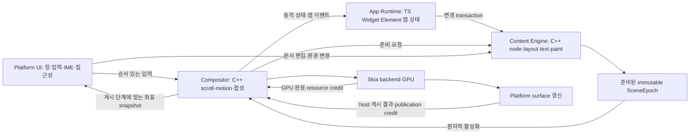

# Nelyx 엔진 v2 — 공통 C++ 백엔드 설계·구축 계획

작성·심화 검토: **2026-11-04 KST** · 상태: **DESIGN / 구현 미착수 / 성능·물리 입력 미검증**

**이 문서의 주목표는 Nelyx 엔진 v2의 공통 C++ 백엔드를 구축하고 TypeScript UI Runtime·SDK에 연결하는 것이다.** C++ 백엔드가 render node·레이아웃·텍스트·입력·스크롤·애니메이션·retained scene·렌더링과 자원 수명을 소유한다. TypeScript는 Widget·Element·앱 상태와 UI 변경 선언을 맡고, 네이티브에서는 C++로, Web에서는 같은 C++ 코어를 Wasm으로 컴파일해 실행한다.

**Web은 COOP/COEP로 격리되지 않은 환경에서도 동작하도록 non-shared single-thread Wasm 공급을 필수로 포함한다.** 기본 loader는 실행 가능한 threaded profile을 우선하고, 격리/shared-memory capability가 없으면 single-worker profile을 선택한다. 같은 C++ 기능·정합성을 유지하되 Content와 Render의 병렬성·성능 보장은 profile별로 구분한다(§12.2).

**Web의 graphics/text provider는 npm 공식 `canvaskit-wasm`의 수정하지 않은 JS·Wasm 배포본을 사용한다.** 자체 C++ engine Wasm과 CanvasKit Wasm은 별도 module이며, 두 engine profile이 같은 CanvasKit 배포본을 사용한다. 기존 Nelyx 패치 빌드를 v2의 전제로 두지 않는다. 현재 설치된 npm `0.41.0`을 API 검토의 출발점으로 삼고 정확한 채택 버전·공개 API 정합성은 W8-00/02에서 고정한다.

구현 범위는 엔진의 상태 모델·ABI·TS 연결·호스트·빌드·공급·기능 검증이다. 연속 입력의 버벅임과 기존 성능 수락 기준은 재설계의 배경과 후속 제품 평가에 해당한다. 백엔드 구축 완료와 개별 증상의 해결·제품 성능 수락은 구분한다.

이번 요청의 산출물은 검토·구체화한 설계 문서다. 엔진 구현·빌드·앱 실행·기본값 전환은 수행하지 않는다. [work7.md](history/26/11/04/work7-summary.md)의 구현·실패·수정 후 물리 재확인 대기 기록은 보존하며, 그 미완료 작업을 이 문서 검토로 완료 처리하지 않는다. 아래의 새 식별자·상태·API 이름은 모두 구현할 계약의 제안이다.

## 1. 설계의 기준과 결정

### 1.1 주목표 — 엔진 v2 C++ 백엔드 구축

**Nelyx의 공통 엔진 기능을 소유하고 실행하는 C++ 백엔드를 만든다.** 최종 산출물은 다음과 같다.

1. Render node·layout·text provider 계약·input/gesture·scroll·animation·scene·semantics·resource/scheduler를 갖춘 공통 C++ 엔진 코어.
2. TypeScript UI 선언을 전달하는 versioned ABI·transaction protocol·binding과 SDK 연결.
3. Native host에서 실행되는 C++ 빌드와 Web에서 같은 코어를 실행하는 Wasm 빌드·renderer 연결.
4. 실제 장면의 백엔드 실행·기능 정합성·수명·공급 identity를 확인하는 검사와 사용할 수 있는 패키지·runner.

백엔드의 완료 기준은 §18.1에 둔다. 스크롤 체감이나 특정 FPS의 달성 여부는 별도의 제품 평가로 기록한다.

### 1.2 배경 — 기존 입력·화면 갱신 문제

트랙패드 연속 입력의 버벅임과 JS 작업·화면 갱신의 결합이 재설계의 계기다. 이를 참고해 상태 소유권·변경 전달·스케줄링을 정리하고, 입력·좌표·자원 수명을 일관되게 유지하는 구조를 설계한다.

기존 일반 사용 60fps·lazy load 중 일시적 jitter 허용 기준은 후속 제품 비교의 참고 기준으로 남긴다([work2 §4](history/26/11/02/work2-summary.md), [work6 §3](history/26/11/03/work6-summary.md), [work7 §1](history/26/11/04/work7-summary.md)). 해당 체감·성능 수락을 C++ 백엔드 구축의 주목표나 착수 조건으로 두지 않는다.

### 1.3 채택할 구조

| 항목 | v2 결정 |
| --- | --- |
| UI 작성 | TypeScript의 Widget·Element·State·Key·의존성 모델을 유지하고 새 엔진에 맞게 구현 |
| 화면의 계산 상태 | C++ render node가 constraints·geometry·텍스트 metrics·paint invalidation의 단일 소유자 |
| 연속 동작 | C++ compositor가 scroll position·표준 gesture·선언형 motion을 소유 |
| UI 전달 | 전체 frame command 재전송 대신 버전이 있는 render node 변경 transaction |
| 화면 갱신 | 준비된 콘텐츠로 이동·합성을 진행. Content와의 독립 실행은 native/threaded, 협력적 작업 분할은 Web single-worker |
| 실행 owner | Platform UI·App Runtime·Content Engine·Compositor/Render의 책임을 분리하고, 물리 thread 배치는 profile별로 지정 |
| 네이티브 호스트 | 자체 platform host + 기존 Hermes 계열의 검증 가능한 단일 runtime cohort로 시작 |
| 그래픽 | Native는 기존 Skia 공급, Web은 npm 공식 CanvasKit을 엔진의 retained scene 뒤에 renderer/text provider로 연결 |
| Web | 자체 engine만 threaded/non-shared로 두 빌드. npm CanvasKit은 별도 module로 두 profile에서 같은 원본 사용. Worker·자동 profile 선택 유지 |
| 호환성 | Widget 작성 경험과 디자인 자산을 우선 보존. 동기 RenderObject 확장·정확한 동기 geometry 조회까지 호환한다고 약속하지 않음 |

**C++ 서비스 함수를 늘리는 방식에서, C++가 장기 상태와 실행 일정을 소유하는 방식으로 바꾼다.** TS와 C++가 같은 render tree·scroll position·텍스트 layout을 각각 권위 있는 값으로 유지하지 않는다.

### 1.4 첫 백엔드 완료에 포함할 대상

| 대상 | 이번 백엔드의 필수 범위 | 별도 후속 범위 |
| --- | --- | --- |
| Windows x64 자체 host | 공통 모듈·TS 연결·§16.2의 필수 통합 장면·현재 SDK/runner 공급 | 제품 기본값 전환·물리 입력/성능 수락 |
| Web threaded Wasm | 같은 공통 모듈·TS 연결·필수 통합 장면·npm CanvasKit adapter·OffscreenCanvas 렌더링·배포 조건을 갖춘 공급 | 브라우저/장치별 제품 지원 확대 |
| Web non-shared single-worker Wasm | COOP/COEP 없는 배포에서 같은 필수 기능·통합 장면·OffscreenCanvas 렌더링·정상 종료. 기본 자동 선택과 별도 바이너리 공급 필수 | Content와 Render의 병렬성·threaded와 같은 FPS/지연은 보장하지 않음 |
| Android | W8-00에서 고정한 ABI 하나의 공통 계약·최소 scene·입력·surface·close/drain | 전체 Testbed·Material/Cupertino·물리 IME/접근성 제품 검증 |
| Apple/Linux | 공통 코어에 OS 의존성을 넣지 않는 port 경계 설계 | 실제 host·빌드·실행·제품 공급 |

두 Web profile의 최소 환경은 Wasm·Worker·transfer 가능한 OffscreenCanvas·worker WebGL2와 필요한 자산 로딩을 지원하는 브라우저다. **COOP/COEP 부재만으로 시작을 거부하지 않는다.** Worker/CSP·GPU 기능 부족은 별도 조건이며, worker 없이 browser main에서 전체 엔진을 실행하는 추가 port는 이번 필수 범위에 넣지 않는다.

필수 기능은 W8-00에서 목록을 고정한다. 두 Web profile은 같은 기능표를 사용하고 threaded 전용의 독립 실행 capability만 별도로 표시한다. 이후 미구현 항목을 `unsupported`로 바꾸는 것만으로 완료 분모에서 빼지 않는다. 범위를 바꾸면 이 표·§16·§18의 완료 기준을 함께 수정하고 이유를 남긴다.

## 2. 현재 구조에서 확인한 출발점

초안·이전 심화 검토의 기준 HEAD는 `fc1331997e4f4de61f59e1f61cf127c2125406da`이고, 당시 시작 변경은 untracked `work8.md` 하나였다. COOP/COEP 추가 검토는 `44f048cb626372395b1af3767113c709317c0c94`의 깨끗한 작업 트리에서 시작해 관련 Web 소스·공급과 공식 문서를 대조했다. 이번 작업에서 실행한 성능 측정 결과는 없다.

| 근거 | 확인한 사실 | v2에서 바꿀 책임 |
| --- | --- | --- |
| [ViewRuntime](Nelyx/src/hosting/runtime.ts)의 `queuePointer`, `schedulePump`, `buildPending`, `pump` | JS owner가 입력 drain·scene build·pending frame·renderer 입장을 연결 | 엔진 입력 소비와 compositor frame 생산을 App Runtime에서 분리 |
| [FrameworkRoot](Nelyx/src/framework/widgets/root.ts)의 `build` | `flushBuild → flushLayout → recordPaint → compose → capture`가 공통 JS 프레임 경로에 존재 | TS는 변경 선언, C++는 layout·기록·scene 활성화를 수행 |
| [PipelineOwner / RenderObject](Nelyx/src/framework/rendering/object.ts) | geometry·dirty 전파·layout·paint·hit-test의 핵심 소유가 TS에 있음 | 엔진에 지속되는 render node와 의존 그래프를 구축 |
| [ScrollPositionWithSingleContext](Nelyx/src/framework/widgets/scroll-position-with-single-context.ts) | 입력 delta·physics·ballistic activity가 framework 상태를 변경 | 표준 scroll model과 physics를 엔진으로 이전 |
| [FlexLayoutService](Nelyx/src/hosting/flex-layout.ts), [PointerTargetsService](Nelyx/src/hosting/pointer-targets.ts), [SceneCompositionService](Nelyx/src/hosting/scene-composition.ts) | native 숫자 계산·질의가 있어도 준비·TS 반영·기존 트리와의 연결이 남음 | native가 처음부터 같은 node·property·resource 상태를 보유 |
| [WindowsScrollCoordinator](Nelyx/skia/native/host/windows/WindowsScrollCoordinator.h) | 입력 batch·ACK·watermark·frame wake를 native에서 조율하지만 결과는 JS 프레임 경로로 연결 | 정상 이동의 진행 조건에서 JS ACK와 새 scene build를 제거 |
| [WindowsPrecisionTrackpad](Nelyx/skia/native/host/windows/WindowsPrecisionTrackpad.h) | DirectManipulation 수집과 접촉/관성 구분이 존재. 현재 momentum은 framework가 소유 | 수집 adapter를 재사용하되 표준 physics의 소유자를 v2 엔진으로 변경 |
| [CompositorFrameClock](Nelyx/skia/native/host/windows/CompositorFrameClock.h) | 현재 clock은 DWM timing과 waitable timer를 사용하며 표시 receipt를 제공하지 않음 | 관측 수준을 유지하면서 엔진 scheduler의 pacing 입력으로 사용 |
| [RuntimeLoop](Nelyx/sdk/native/windows-hermes/RuntimeLoop.h), [WindowSurface](Nelyx/sdk/native/windows-hermes/WindowSurface.h) | 자체 runtime owner·Win32 surface·비동기 GPU 작업의 출발점이 이미 있음 | 제품화가 끝난 호스트로 가정하지 않고, 새 엔진 port의 재사용 후보로 평가 |
| [loadCanvasKit](Nelyx/sdk/src/backends/browser/canvaskit.ts), [Web 공급 manifest](Nelyx/skia/packages/web/native-manifest.json), [npm 의존 설정](Nelyx/skia/packages/web/package.json) | 현재 npm 의존성은 `canvaskit-wasm@0.41.0`이지만 loader는 `m153-nelyx-paragraph.1`·전용 paragraph API/hash를 요구. npm 원본 JS/Wasm으로 바로 교체할 수 있는 상태가 아님 | v2는 npm 원본의 버전/파일 identity와 공개 API를 검증하는 loader·adapter로 구현. 기존 전용 API 강제는 이식 대상 |

[work5](history/26/11/03/work5-summary.md)·[work6](history/26/11/03/work6-summary.md)·[work7](history/26/11/04/work7-summary.md)의 C++ 후보들은 실제 native 실행 여부와 전체 경로의 이득을 구별해 평가했으며 기본 판정은 `NO_ADOPTION`이다. **현재처럼 TS가 매번 자료를 준비하고 C++ 결과를 다시 해석하는 경계에서는 국소 계산을 줄여도 전체 준비·전달·동기화 비용이 남을 수 있다.** 이는 구조 변경의 근거이지 C++ 구현 자체가 느리다는 일반 결론은 아니다.

특히 [work7 §11.9](history/26/11/04/work7-summary.md)는 연속 입력 producer가 멈추지 않으면 frame 입장이 계속 보류되던 starvation을 기록한다. 수정 전 공급의 사용자 물리 입력 결과는 실패였고, watermark 수정과 자동 회귀 뒤의 물리 재확인은 대기 중이다. 이전 자동 wheel 성공이나 더 오래된 특정 trackpad 실행의 성공으로 이 실패·재확인 대기를 덮지 않는다.

아직 확정하지 않은 항목은 센서부터 native 수집까지의 지연, UI dispatcher 점유, 현재 입력 패턴의 JS/GC·layout·paint·GPU 기여율, 실제 표시 지연이다. 새 기반을 설계하는 일과 이 기여율을 측정하는 일은 구분한다.

## 3. 새 엔진의 전체 흐름

기존 일반 경로에서는 native 입력을 받아도 화면의 새 상태를 만들기 위해 JS의 scroll·layout·paint 경로가 필요하다. v2는 **콘텐츠 변경 경로**와 **준비된 콘텐츠를 움직이는 경로**를 다음과 같이 연결한다.

이 흐름은 논리적 owner와 메시지의 관계다. Web single-worker에서는 Content와 Compositor가 한 engine event loop에서 순서대로 실행되며, 아래 경로가 물리적으로 병렬이라는 뜻은 아니다.



예를 들어 이미 준비된 ListView에서 손가락을 1px 움직였을 때:

1. Native 입력 adapter가 sample의 순서와 좌표 세대를 붙인다.
2. Compositor가 해당 scroll node의 위치와 property revision을 변경한다.
3. 현재 scene의 clip·transform·가시 영역을 갱신하고 native에서 합성한다.
4. Renderer credit이 있으면 surface 갱신을 진행한다.
5. App Runtime에는 버전이 있는 scroll snapshot을 알린다. 그 응답은 2–4의 진행 조건이 아니다.

이 경로에서 TS Widget build·TS layout·TS paint·전체 frame 직렬화는 필요하지 않다. 반면 새 child 생성, 줄바꿈 변경, layout 기반 animation, JS 사용자 코드의 결과가 필요한 콘텐츠는 content commit을 기다린다. C++로 옮겼다는 이유만으로 모든 작업이 compositor에서 처리되지는 않는다.

## 4. 실행 문맥과 상태 소유권

### 4.1 네 개의 주요 owner

| Owner | 소유 상태·작업 | 기다리지 않아야 하는 대상 |
| --- | --- | --- |
| Platform UI | HWND/COM·platform view·DirectManipulation 수집·IME document service·접근성 proxy·surface publication | JS 반환, 전체 layout, GPU fence의 CPU blocking wait |
| App Runtime | 단일 JS runtime·Widget/Element·State·의존성·사용자 callback·render 선언 작성 | GPU 완료. 엔진 상태의 동기 역질의로 UI thread를 호출하지 않음 |
| Content Engine | C++ render node·layout·paragraph·CPU display list·scene 준비·가상화 계획 | JS builder의 동기 반환, compositor가 가진 전역 lock |
| Compositor/Render | active scene·scroll/gesture·motion graph·property overlay·frame 선택·GPU context/submit | App commit·content layout 완료·앱 이벤트 ACK |

Windows 첫 구현에서는 이 owner들을 별도 실행 thread로 둔다. Fence 등 blocking API가 필요하면 제한된 completion worker가 기다리고 native ID로 완료를 전달한다. View마다 네 개씩 thread를 만들지 않으며, engine session의 실행 thread와 GPU device별 owner를 공유한다. 다중 view의 작업량은 별도로 제한해 한 view가 다른 view의 입력을 독점하지 않게 한다.

Web threaded도 Content와 Compositor의 실행 thread를 분리한다. Web single-worker는 두 owner의 mutable 상태·작업 큐를 구분하되 같은 non-shared Wasm instance/event loop에서 협력적으로 실행한다. Browser main·TS app worker는 그대로 분리하므로 App 응답 없이 준비된 scene을 움직일 수 있지만, 같은 engine worker를 점유하는 동기 Content 작업 중 독립 Render 진행은 보장하지 않는다. 이 capability 차이는 §12.2/16.1에서 검사한다.

OS 객체의 thread affinity는 유지한다. DirectManipulation COM 호출과 DirectComposition 게시를 임의로 render thread로 옮기지 않는다. 따라서 **Platform UI 자체가 막혀 새 OS 입력을 받지 못하는 문제까지 이 구조만으로 해결된다고 약속하지 않는다.** Host의 UI 작업도 짧게 유지하고 실제 수집 지연을 측정한다.

### 4.2 공유 방식

- 한 mutable model에는 한 writer만 둔다. Content tree와 compositor의 motion state는 서로의 mutable 객체를 직접 수정하지 않는다.
- Scene은 준비 후 immutable하게 넘긴다. 내용과 layout이 고정된 scene 위에서 compositor가 별도의 transform·clip·effect·scroll property를 갱신한다.
- Snapshot은 immutable block을 공유하고 변경 block만 새로 만든다. 매 frame 전체 트리를 복사하지 않는다. 저장 공간은 active·준비 중·GPU 참조 중인 세대까지 합산한다.
- JSI Value·Runtime·JS 함수·반환 뒤의 JS buffer 포인터를 worker가 보유하지 않는다. Native 핸들과 복사한 값만 전달한다.
- UI와 compositor가 사용하는 짧은 inbox lock을 content layout·JS callback·GPU 대기 동안 잡지 않는다. Lock-free 구현 자체를 첫 목표로 삼지 않는다.
- 엔진 내부 자료구조와 C ABI 외부 protocol을 분리한다. 앱에 native 메모리 배치를 직접 노출하지 않는다.
- Web의 자체 engine Wasm과 CanvasKit Wasm은 서로 다른 heap/handle 영역이다. Engine의 공유 메모리라도 CanvasKit 객체·포인터를 공유하지 않는다. Adapter의 resource ID로 연결하고 각 module의 할당·해제 API를 따른다.

Content·decode·shader 준비 작업은 작은 취소 가능한 단위로 예약하고 compositor의 입력/credit 작업을 장시간 독점하지 않게 한다. Native로 옮긴 작업이 같은 CPU·allocator·GPU를 사용한다는 사실은 남는다. 실시간 thread 우선순위나 busy loop로 다른 작업을 굶기는 방식은 기본 정책으로 두지 않는다.

### 4.3 Scene의 기본값과 실행 중 property의 결합

Content가 작성한 기본 property와 compositor의 실행 중 overlay를 구분한다. Overlay는 `(ViewGeneration, NodeId, PropertyId, MotionId)`로 식별하고, frame마다 **scene 기본값 + 그 scene에 적용 가능한 overlay**를 평가한 immutable property snapshot을 만든다. Mutable overlay의 writer는 compositor 하나다.

새 scene 활성화는 compositor owner의 한 작업으로 실행한다. 같은 node/property의 진행 중 scroll·motion은 보존하고, 삭제·종류 변경·명시적 motion 교체에는 cancel terminal을 낸다. App의 기본값 변경이 실행 중 motion을 자동 덮어쓰지 않으며, 교체 의도는 base revision·command ID를 가진 명령으로 보낸다. Render·hit-test·semantics가 서로 다른 시점의 overlay를 읽지 않게 §10의 snapshot으로 연결한다.

## 5. 변경 transaction과 세대 계약

### 5.1 TS가 보내는 것은 render node의 변경이다

App Runtime은 `CreateNode`, `SetProperties`, `AttachChild`, `MoveChild`, `DetachNode`, `DestroyNode`, `SetEventPolicy`, `SetMotion`, `BindResource` 같은 검증 가능한 명령을 transaction으로 묶는다. 이는 **제안한 protocol 명령 이름이며 현재 API가 아니다.**

표준 node 종류는 Box/Flex/Stack/Wrap/Grid/Paragraph/Image/Clip/Transform/Effect/ScrollViewport/Sliver/Editable 등으로 시작한다. TS에는 native geometry의 권위 있는 사본을 가진 RenderObject를 다시 만들지 않는다. State·Element는 자신이 선언한 node handle과 마지막 승인된 선언을 기억한다.

Transaction 처리 순서는 다음과 같다.

1. App Runtime이 마지막으로 엔진이 승인한 document epoch를 기준으로 변경을 만든다.
2. 엔진이 schema·handle·범위·자원·예산·부모 관계를 검증하고 설치에 필요한 공간을 예약한다. 오류이면 NACK하고 이전 document와 active scene을 유지한다. 검증 중 만든 임시 node/resource도 회수한다.
3. 검증한 변경을 content document에 원자적으로 설치하고 `DocumentAccepted`를 반환한다. 이때 document epoch가 전진한다.
4. Content Engine이 필요한 layout·text·paint를 수행해 새 scene을 준비한다.
5. Compositor가 현재 환경에 맞는 scene을 원자적으로 활성화한다. 그 뒤 surface 갱신과 자원 retirement가 각각 진행된다.

`DocumentAccepted`는 layout 완료·화면 활성화·표시 성공을 의미하지 않는다. 후속 transaction의 base는 승인된 document epoch이며, active scene이 아직 이전 document를 보여줄 수 있다는 점을 API에 드러낸다.

### 5.2 서로 다른 버전을 한 숫자로 합치지 않는다

| 식별자 | 의미 |
| --- | --- |
| `SessionGeneration / AppGeneration / ViewGeneration` | engine session·앱 reload·view의 생존과 교체 |
| `DocumentEpoch / TransactionId` | 승인된 콘텐츠 선언과 변경 순서 |
| `NodeId = slot + generation` | destroy 뒤 slot을 재사용해도 이전 node와 구별되는 핸들. 단순 detach/reparent는 identity를 유지 |
| `MetricsEpoch` | viewport·DPI·text scale 등 layout 환경 |
| `SceneEpoch` | layout·text·display list가 함께 준비된 콘텐츠 snapshot |
| `InputSequence / ScrollRevision` | native 입력 소비와 scroll 상태 변경 |
| `PropertyEpoch / MotionId` | scene 위에서 평가한 property snapshot과 개별 motion의 수명 |
| `SubmissionId / PublicationId` | GPU 제출과 port가 정의한 host 게시 요청. 둘은 별개의 사건 |
| `SurfaceCommitId` | port가 실제 완료를 관측·연결할 때만 제공하는 surface commit. 미관측은 값 없음 |
| `DocumentId / EditRevision / FocusSessionId` | 편집 문서·내용 변경·IME 접속 수명. render document epoch와 구분 |
| `DeviceGeneration / ResourceGeneration` | GPU 복구·자원 교체 |

64-bit ID를 JS Number로 무제한 확장하지 않는다. Wire format은 고정 endian·고정 폭 정수와 명시적인 offset/count/stride를 사용하고, JS에서는 두 `uint32` 또는 검증된 BigInt 표현으로 전달한다. Float는 finite·범위·단위를 검사한다. 명령 bytes·node 수·깊이·문자열·자원 참조의 상한을 allocation 전에 검증한다.

### 5.3 취소·coalescing·재진입

- 미전송 앱 상태는 마지막 승인된 선언을 기준으로 diff를 다시 계산해 합칠 수 있다. 이미 승인된 중간 mutation을 버린 채 다음 delta만 적용하지 않는다.
- Transaction은 view당 전송 중 하나로 시작하고 session 전체의 bytes·요청 수도 제한한다. 기다리는 동안 TS는 최신 선언 상태를 유지하고, ACK 뒤 새 diff를 만든다. 한 view의 scene 준비 지연으로 다른 view의 선언 전송을 막지 않는다.
- Scene 준비 작업은 시작 시점의 document/metrics를 고정한다. 새 document가 승인됐다는 이유만으로 진행 중인 유효 작업을 매번 취소하지 않는다. 진행 중 작업 1개와 최신 다음 수요 1개로 합쳐, 연속 변경 중에도 호환되는 중간 scene을 완료·활성화할 수 있게 한다. 활성화된 document epoch는 뒤로 가지 않는다. Metrics 불일치·view 종료·명시적 취소·실패한 결과는 활성화하지 않는다. Activation 취소가 승인된 document를 되돌리지는 않는다.
- Callback 중 tree 변경·view close·reparent가 발생하면 다음 transaction으로 반영한다. 현재 native 순회에 JS 재진입을 허용하지 않는다.
- 명시적으로 요구한 v2 capability가 없으면 시작 단계에서 실패한다. v2를 선택하고 v1 TS layout·paint로 조용히 돌아가지 않는다.

### 5.4 승인·후속 실패·재시도의 terminal

| 결과 | 상태와 후속 처리 |
| --- | --- |
| `DocumentRejected(reason, currentEpoch)` | 선언은 미적용. Base 충돌이면 현재 승인 상태와 재동기화한 뒤 새 diff를 만든다. 같은 실패 delta를 무한 재전송하지 않음 |
| `DocumentAccepted(epoch)` | 선언 설치 완료. App은 ACK된 선언을 새 base로 삼음. 화면에 나타났다는 뜻은 아님 |
| `SceneReady / SceneActivated` | 각각 CPU 준비 완료와 compositor 채택. 필수 자원 준비는 §9.4, host 게시 여부는 §10.1에서 따로 확인 |
| `SceneSkipped(supersededBy)` | 최신 document에 합쳐져 해당 중간 scene을 만들지 않음. 후속 epoch로 연결하며 승인된 mutation을 잃지 않음 |
| `SceneFailed(reason, epoch)` | 승인 뒤 layout·자원 준비 등이 실패. 기존 유효 scene을 유지하고 명시적 오류를 통지. 다음 수정 transaction은 실패 epoch 이후의 승인된 document를 기준으로 작성 |
| `ViewClosed / SessionLost(reason)` | 대상 세대가 종료돼 대기를 끝냄. SessionLost 이후에는 새 session에서 선언 전체를 재설치하며 이전 명령을 재생하지 않음 |

승인 뒤의 실패를 뒤늦은 NACK·묵시적 rollback으로 처리하지 않는다. 복구 가능한 자원 지연은 bounded retry, 결정적인 layout 오류는 새 수정 요청, 복구 불가능한 engine 오류는 session 종료로 구분한다. 각 승인 epoch의 scene 결과는 활성화·대체·실패·session 종료 중 하나로 수렴하고, `awaitActivated` 같은 대기는 영원히 pending으로 남지 않는다.

ACK timeout이면 `(AppGeneration, ViewGeneration, TransactionId)`의 결과를 조회하거나 **동일 payload·동일 ID**로만 재시도한다. 다른 payload의 ID 재사용은 오류다. 엔진은 bounded 결과 창과 ACK된 하한을 유지한다. 창보다 오래된 ID는 `ResultExpired`를 반환해 재동기화하며 다시 적용하지 않는다. Promise 취소·호출자 timeout만으로 이미 승인된 변경을 취소했다고 간주하지 않는다.

### 5.5 C ABI와 transport의 최소 계약

- 초기화에서 ABI major/minor·schema·capability·renderer/port identity를 교환한다. Major 불일치·알 수 없는 필수 명령/기능은 거부하고, optional 확장은 길이가 있어야 건너뛸 수 있게 한다.
- 공개 C ABI에는 고정 폭 값·크기가 명시된 struct·opaque handle만 둔다. STL·JSI 타입·C++ 예외를 경계 밖으로 내보내지 않는다. Buffer를 할당한 모듈의 release API로 해제하고 에러 문자열의 소유 기간도 명시한다.
- Native binding은 반환 전 입력을 엔진 소유 buffer로 복사하거나 명시적으로 소유권을 넘긴다. Wasm 메시지의 transferable buffer는 송신 측의 접근을 끝낸 뒤 전달한다. Shared memory는 slot 소유권·발행/회수 순서를 정의한다.
- Wasm linear memory의 offset을 외부 native 포인터처럼 쓰지 않는다. App/main↔engine은 두 Web profile 모두 비동기 packet 계약을 사용하고, non-shared profile은 엔진 소유 HEAP 자체 대신 별도 ArrayBuffer에 복사한 packet을 transfer한다. Shared transport는 threaded의 선택적 최적화이며 공통 ABI의 필수 조건이 아니다.
- Memory 확장 뒤 cached typed-array view가 유효하다고 가정하지 않고 다시 얻는다([Emscripten memory growth](https://emscripten.org/docs/tools_reference/settings_reference.html#allow-memory-growth)). Payload bytes·offset/count 곱셈·문자열 길이를 복사와 allocation 전에 검사한다.
- Node 생성·자원 acquire·callback 등록을 transaction staging에서 함께 rollback한다. `DestroyNode`는 새 명령의 접근을 막지만 기존 scene/GPU hold를 즉시 해제하지 않는다. Callback 해제와 slot 재사용도 generation 검사를 거친다.

## 6. 프레임 일정과 backpressure

### 6.1 엔진이 계속 움직일 수 있는 조건

Frame scheduler는 `input`, `motion`, `content-ready`, `surface-credit`, `metrics`, `visibility`, `forced-redraw`를 각각 원인으로 가진다. 새 content transaction이 없어도 scroll·motion 수요가 있으면 active scene으로 frame을 만든다.

매 tick에서:

1. Inbox의 현재 입력 watermark를 한 번 고정한다.
2. 그 watermark 이하의 순서 있는 입력을 tick별 packet/시간 예산 안에서 소비하고 `consumedThrough`를 기록한다. 예산이 먼저 끝나면 해당 prefix로 frame을 만들고 나머지는 다음 처리에 남긴다. 처리 중 들어온 최신 입력 때문에 현재 cut을 계속 늘리지 않는다.
3. 준비된 새 scene이 있으면 현재 metrics와 node 세대를 검증하고 활성화한다.
4. 현재 tick의 motion을 계산하고 frame용 property·게시 후보 hit-test·손상 영역을 갱신한다. 새 입력의 target 판정에는 §10.1의 게시 snapshot을 사용한다.
5. Credit이 있으면 최신 유효 상태를 렌더링·제출한다. 없으면 mutable frame packet을 쌓지 않고 최신 motion 상태와 dirty 이유를 유지한다.
6. Credit 또는 다음 motion tick에서 다시 진행한다. 입력 큐 전체가 0이 되기를 frame의 조건으로 삼지 않는다.

이 watermark는 **native compositor가 소비할 입력 범위**다. JS observer에게 모든 입력이 전달됐다는 ACK를 기다리는 장벽으로 사용하지 않는다. Content Engine도 입력 생산의 종료를 기다리지 않는다.

View별 처리 quota와 다음 wake를 두어 입력·content-ready·credit 중 어느 하나도 계속 밀리지 않게 한다. Motion은 순번과 실제 경과 시간으로 적분하고 packet 사이 큰 시간 간격의 substep/최대 처리량도 제한한다. 가짜 clock 검사에서 연속 producer와 연속 document 승인 양쪽에 대해 입력 소비·scene 활성화·frame 진행을 확인한다. 이는 특정 FPS가 아닌 scheduler의 기능 계약이다.

Web single-worker에서는 이 tick과 Content 작업을 유한한 단위로 나누고 browser의 다음 task/frame 기회로 반환한다(§12.2.4). 같은 event loop의 미래 작업을 mutex/condition variable·동기 응답으로 기다리지 않는다. 논리 owner를 분리한 것만으로 동기 layout/paragraph 호출을 선점할 수 있다고 가정하지 않는다.

### 6.2 상한과 frame 교체

초기 계약은 view당 **준비 중/활성화 대기 scene 후보 합계 1개, active scene 1개, GPU 작업 중 frame 최대 2개**로 시작한다. 다음 content 수요는 scene 복제 없이 최신 목표만 보관하고, session/device 전체의 합산 한도도 둔다. Content document와 공유 block·retired resource까지 별도 합산하며, 숫자만 같다고 v1과 같은 메모리 비용이라고 주장하지 않는다. GPU가 더 적은 작업만 지원하면 실제 credit을 따른다.

- 미제출 frame은 최신 property 상태로 대체할 수 있다. 이미 제출한 recording·texture·fence는 완료 전에 재사용하거나 해제하지 않는다.
- `submissionAccepted`, `gpuComplete`, `publicationIssued`, 관측 가능한 `surfaceCommitted`, `retired`, 외부 display 관측을 별개 사건으로 기록한다. 지원되지 않는 단계는 `unobserved`이며 GPU 완료나 JS 메시지로 채우지 않는다.
- 오래된 scene의 GPU 작업이 끝나도 최신 metrics의 surface를 덮지 못한다. Stale frame은 drain 후 폐기한다.
- Forced redraw와 명시적인 frame callback은 독립 수요다. 같은 paint version이나 `present=unobserved`만으로 억제하지 않는다.
- 입력·motion·콘텐츠 변경이 없는 idle에서는 clock·GPU 작업을 멈춘다. Hide에서는 motion 정책을 정지/재개 계약에 따라 처리하고 입력 stream을 종료한다.
- Clock의 예측 deadline은 scheduling 정보다. Scanout이나 실제 표시 시각으로 기록하지 않는다.

GPU credit과 host publication slot은 별도로 회수한다. GPU가 빨리 끝나도 UI dispatcher 앞에 surface 교체 요청을 무제한 쌓지 않으며, 게시 전 요청은 최신 유효 상태 1개로 합친다. 합쳐진 각 요청도 취소/대체 결과와 hold 회수를 마친다. Wake 예약은 pending bit로 합치고, consumer가 비운 뒤 새 일이 생긴 경합에서는 다시 예약해 lost wake를 방지한다.

## 7. 입력·제스처·스크롤을 엔진 상태로 만든다

### 7.1 입력 packet

공통 packet은 device/source, sequence, phase, 좌표·delta의 단위, 수집 시각, 사용 가능한 원래 sample 시각, clock domain, metrics/view generation, button/modifier, contact/gesture ID를 가진다. 센서 시각을 제공하지 않는 경로에서는 host 수집 시각으로 표기한다. QPC·browser timestamp를 직접 빼지 않으며 단위·원점·보정의 유효 범위를 명시한다. 물리 pixel·logical 좌표·wheel line/page 단위의 변환은 metrics가 붙은 adapter 경계에서 한 번 수행한다.

Native ingress부터 compositor 소비 전까지의 합산 한도는 우선 기존 **256 packet**을 출발점으로 한다. Update용 슬롯과 boundary/control용 예약을 같은 총량 안에서 정한다. 정확한 분할·여러 view의 공정 배분은 W8-01에서 schema 상수로 확정한다. 별도 큐마다 256개를 허용해 총량을 숨기지 않는다.

Start/end/cancel·키·버튼·focus·metrics 경계는 순서를 보존한다. Compositor가 원래 sample을 순차 적용한 뒤 화면용 최신 property를 합칠 수는 있지만, 다른 target의 wheel을 먼저 더하거나 반전·velocity 정보를 잃는 합산은 하지 않는다. 포화 상태의 명시적인 stream cancel·입력 실패와 accounting을 정의하며 조용한 유실을 허용하지 않는다.

예약 슬롯까지 차면 ingress는 해당 stream의 admission을 닫고, 미소비 sequence 범위와 cancel/failure를 예약된 control 상태에 기록한다. 이는 큐 제한을 우회하는 별도 무제한 큐가 아니다. Native 소비·명시적 취소·admission 거부·대기 수의 합이 ingress 수신 수와 맞아야 하며 중복 packet은 별도 집계한다. Close·focus loss·credit·metrics 같은 제어 신호는 bounded mailbox의 최신 세대/종료 상태로도 전달해 data 포화가 종료를 막지 않게 한다.

### 7.2 표준 gesture와 사용자 코드

Hit-test node에 pan 축·scroll chaining·capture·gesture 우선순위·앱 개입 여부를 선언한다. 표준 tap/drag/pan/pinch/scrollbar 동작은 C++ 상태 머신이 판정한다. 시작 시 target을 latch하고, detach·modal 전환·metrics 변경에서는 명시적으로 cancel/rebase한다.

V2 앱 이벤트는 기본적으로 **동작 결과의 비동기 통지**다. `ScrollSnapshot`은 해당 구간의 sequence 범위·offset·velocity·phase를 제공하고 frame 단위로 합칠 수 있다. 이것은 모든 원래 packet마다 동기 TS callback을 실행하는 v1 계약과 다르며, v2 API 변경으로 명시한다.

원래 sample을 모두 읽는 opt-in observer는 별도의 bounded batch를 사용한다. 앱이 소비하지 못하면 gap/overflow를 알리고 observer를 종료하거나 재구독시킨다. 관찰용 raw stream의 정체가 엔진 스크롤을 정지시키지 않는다. 문서 편집·키·버튼 등 의미 있는 ordered event를 scroll observer처럼 합치지 않는다.

사용자 JS가 매 update에서 반환값으로 gesture를 취소하거나 layout을 결정하는 기능은 `appControlled`로 선언한다. 이 경계는 앱 응답을 필요로 하므로 독립 진행을 보장하지 않는다. 표준 조작 전체를 이 경로로 보내거나 slow path를 숨기지 않는다.

App 결과 이벤트에도 bytes·개수·소비 지연 한도를 둔다. Snapshot/hover는 최신값으로 합칠 수 있지만 key·tap·편집 action을 임의로 버리지 않는다. Ordered event를 전달할 수 없으면 명시적 view/session 오류로 종료하고, 표준 scroll이 callback ACK를 기다리게 하거나 이벤트를 무한 적재하지 않는다. `appControlled` 응답 timeout은 해당 gesture를 cancel하며 늦은 응답을 거부한다. 이 timeout을 표준 native 조작의 대기 조건으로 재사용하지 않는다.

### 7.3 Physics와 관성의 단일 소유자

첫 Windows 구현은 현재 adapter처럼 DirectManipulation의 접촉 이동을 수집하고, 기존 framework physics의 수식·설정·종료 의미를 C++ scroll model로 옮긴다. OS 관성은 현재 protocol의 관측·취소 용도와 구분하고, 같은 입력에 OS 관성과 엔진 ballistic을 중복 적용하지 않는다.

다른 platform이 이미 관성이 반영된 scroll delta를 제공하면 source 정책에 `osResolved`를 표시해 엔진의 추가 ballistic을 끈다. `engineDriven`과 `osResolved`의 선택·전환을 trace에 남긴다. 마찰·가속도 변경으로 구조적 개선을 대신하지 않고, 최초 비교는 동일한 이동 감각으로 한다.

특히 Web wheel에는 OS momentum phase가 항상 있는 것으로 가정하지 않는다. Phase를 모르는 wheel은 받은 delta만 적용하고 임의 ballistic을 더하지 않는 정책부터 시작한다. OS-resolved 경로에는 엔진의 overscroll 복귀·관성 효과도 중복되지 않게 구분한다. Physics 이식은 동일 단위의 double·경과 시간·종료/반전 sample을 사용하며 허용 오차를 고정하고 fast-math로 의미를 바꾸지 않는다.

### 7.4 새 콘텐츠가 이전 스크롤로 되돌리지 않게 한다

Scroll position은 compositor가 권위를 가진다. App transaction은 묵시적으로 그 값을 덮지 않는다. 명시적인 `ScrollTo`·복원·anchor 보정만 별도 command ID와 적용 정책을 통해 변경한다.

새 scene은 layout 시점의 `baseScrollRevision`과 처리한 명령 ID를 포함한다. Activation에서는 현재 compositor offset을 content 좌표에 적용하고, layout이 요청한 anchor 보정은 해당 revision 관계를 확인해 한 번만 반영한다. 단순히 JS가 마지막으로 본 offset을 scene과 함께 복사해 최신 입력을 되감거나 delta를 두 번 더하지 않는다.

`ScrollTo/AnimateTo`는 대상 `NodeId`, command ID, `afterDocumentEpoch`, base scroll revision, gesture 충돌 정책을 가진다. 기본 정책은 사용자 gesture 시작 시 대기 중/진행 중 programmatic 명령을 cancel하고, 활성 gesture 중 들어온 programmatic 명령은 `rejectedBusy`로 끝내는 것이다. 앱의 명시적 `interruptGesture`만 현재 gesture를 cancel하고 적용한다. 아직 활성화되지 않은 node의 명령은 한도 안에서 activation을 기다리되 node 삭제·scene 실패·session 종료에는 terminal을 낸다. Node당 대기 목표는 최신 1개이며 대체된 명령에도 cancel을 반환한다. 적용 결과에는 scroll revision과 처리한 input sequence를 붙이고 적용 완료와 화면 게시 완료를 구별한다.

Extent 변경은 `ExtentRevision`과 anchor key/화면 내 위치를 포함한다. Base scroll revision이 지난 보정값을 현재 offset에 그대로 더하지 않는다. 현재 anchor로 재계산하거나 재준비하며 새 범위의 clamp도 한 번만 적용한다. Nested scroll의 잔여 delta는 같은 sample에서 명시한 ancestor chain에 한 번만 넘긴다. 준비 범위 부족을 실제 content extent의 끝으로 오인해 ancestor로 보내지 않는다.

검증 예: scene A에서 입력 100까지 layout한 뒤 입력 101–120이 진행되는 동안 scene B가 준비돼도, B 활성화는 101–120의 이동을 보존해야 한다. 그 사이 도착한 명시적 `ScrollTo`는 command 순서와 사용자 gesture 중단 정책에 따라 한 번만 실행된다.

## 8. C++ render node·레이아웃·텍스트

### 8.1 Native render model

Content Engine에 node arena와 부모/자식 관계, 제약·baseline·intrinsic dependency, dirty queue를 둔다. TS의 Flutter식 개념을 참고하되 기존 TS RenderObject를 C++ 객체와 1:1로 왕복 호출하는 adapter를 만들지 않는다.

- 표준 layout은 C++ Content owner가 자식과 준비된 paragraph metrics를 조회하고 결과를 보유한다. Web의 외부 text provider 결과가 없으면 작업을 보류·재개하며, 임의 Widget/앱 코드에 layout을 돌려주지 않는다.
- Property 변경마다 layout·paint·composite·semantics 중 필요한 invalidation을 선언한다.
- 조상 제약이나 자식 크기에 의존하는 실제 변경 경로를 계산하고 영향 없는 branch를 재방문하지 않는다.
- Flex의 숫자 부분만 호출한 뒤 TS가 각 child를 다시 layout하는 구조를 v2 표준 경로로 사용하지 않는다.
- Intrinsic·baseline·dry layout의 의미와 cycle 방지·실패 원자성을 함께 구현한다. 이 부분을 생략한 제한 demo를 framework 전체 이식으로 세지 않는다.
- Scroll의 transform 변경은 layout dirty와 구별한다. 새 sliver coverage·가변 높이 측정·sticky header 등 콘텐츠 계산이 필요할 때만 Content Engine에 작업을 요청한다.

Derived layout/paint 결과는 작업의 document/metrics·입력 revision에 귀속한다. 준비 중 실패한 일부 metrics/display list를 기존 scene이나 다음 작업의 유효 cache로 게시하지 않는다. 작업 시작 뒤 새로 발생한 dirty revision을 이전 작업의 완료로 지우지 않으며, 실패한 branch는 유효한 이전 결과를 보유하거나 다음 수정에서 다시 준비한다.

### 8.2 Text service

Paragraph 구성·font fallback·shaping·줄바꿈·selection geometry·glyph/paragraph cache는 해당 Content text provider가 관리한다. Native는 SkParagraph를 직접 연결하고, Web은 Content owner의 worker에서 npm CanvasKit 공개 API를 호출하는 host adapter를 사용한다. App TS는 텍스트·style·locale·direction·font 참조를 선언하고 C++ layout은 버전이 있는 provider metrics를 사용한다.

Font 등록·fallback 변경·text scale·DPI·locale 변화는 관련 paragraph와 scene을 무효화한다. Font·text·width·style revision을 cache key에 포함하고, frame 밖에서 결과가 도착해도 이전 scene에 새 metrics를 끼워 넣지 않는다. Async font/image 준비가 실패하면 명시적인 오류·대체 콘텐츠 정책을 적용한다.

Core의 text 모듈은 paragraph provider 계약과 의존 관계를 정의한다. Web은 C++가 요청한 text/style/width/font revision의 bounded batch를 adapter에 넘기고 metrics·selection geometry·준비된 text resource를 돌려받는다. 대기 중 전역 lock을 보유하거나 App Runtime callback을 호출하지 않는다. 결과가 없으면 Content 작업을 재개 가능한 상태로 반환하며, 다른 epoch의 결과를 현재 geometry에 설치하지 않는다.

Mutable paragraph는 Content text provider에 남기고 render 쪽에는 준비된 immutable text paint record와 명시적인 font/resource hold를 전달한다. Web threaded에서는 Content/Render worker에 각각 같은 npm CanvasKit 배포본의 instance를 두고, Content에서 만든 text Picture를 공개 `serialize()`/`MakePicture()`로 넘기는 경로를 W8-02에서 검증한다. Single-worker에서는 같은 CanvasKit instance의 준비된 resource ID를 재사용할 수 있다. 직렬화 결과·font/image·glyph 보존과 실패·메모리 상한은 §12.2.6을 따른다. Paint 중 paragraph를 다시 layout하거나 mutable 객체를 worker 간 공유하지 않는다.

현재 [전용 paragraph patch](Nelyx/skia/eng/source-build/canvaskit-paragraph.patch)의 차이는 npm으로 전환하기 전에 다음과 같이 다룬다. **공개 API 존재와 의미 호환은 별개의 검사다.**

| 기존 전용 기능/가정 | npm 원본을 사용하는 v2의 이식 계약 |
| --- | --- |
| `nelyxParagraphApiVersion` 강제 | Nelyx 전용 export를 요구하지 않고 고정 npm 배포본의 공개 메서드·실제 결과를 검사 |
| `nelyxLineNumberAtUTF16` | 공개 `getLineNumberAt` 등으로 구현하되 실제 offset 단위를 corpus로 확인. 기존 UTF-8 변환을 그대로 복사하지 않음. 한국어·surrogate pair·결합 문자·RTL·줄 끝/caret 확인 |
| `unscaledAscent` 추가 field | 공개 metrics로 정확히 계산 가능한 범위를 확인. `ascent`를 복사해 동일 의미라고 표시하지 않고, 지원 불가 의미는 API 이식표에 명시 |
| `renderSoftHyphens` switch | 공개 API 조합·원문/표시문 index mapping으로 `manual/hidden`의 줄바꿈·표시·selection 의미를 재현할 수 있는지 확인. 속성을 전달하고 무시된 것을 지원으로 세지 않음 |

W8-00에서 필수 API와 의도한 차이를 고정하고 W8-02에서 npm 원본으로 실제 확인한다. 동등 구현이 안 되는 필수 기능은 gate를 열어 두고 API/범위를 이유와 함께 다시 설계한다. 이를 해결한다며 CanvasKit fork·자체 재빌드를 다시 전제로 넣지 않는다.

TS가 즉시 읽을 수 있는 geometry는 마지막 완료된 layout 또는 활성화 snapshot과 그 상태·버전을 함께 제공한다. `DocumentAccepted`만 받은 새 epoch의 geometry가 계산됐다고 표시하지 않는다. 현재 layout 완료를 얻으려고 frame 중 JS→native→JS 동기 callback을 만들지 않는다.

### 8.3 사용자 정의 layout·paint

세 가지 확장 경계를 제공한다.

| 확장 | 실행·제약 |
| --- | --- |
| 표준 node 조합·선언형 layout/effect | 일반 engine 경로. 우선 제공하는 확장 방식 |
| Native engine extension | 버전·node schema·thread·수명 계약을 구현한 C++/Wasm 모듈 |
| `AppDrivenBoundary` | TS가 외부에서 계산한 geometry/display list를 transaction으로 공급. 완료 전에는 기존 준비 결과 유지 |

`AppDrivenBoundary` 안의 사용자 코드가 느리면 그 콘텐츠의 갱신은 늦는다. 경계 전체의 이동·clip·opacity는 준비된 결과를 이용해 계속할 수 있다. 기존 임의 RenderObject subclass의 sync layout·paint·hit-test hook을 자동으로 독립 엔진 동작으로 바꾸지는 못한다.

첫 native extension은 정적 등록·schema 고정으로 시작한다. Native와 Wasm에서 같은 기능/수명 계약을 구현하며 동적 DLL/Wasm plugin loader는 필수 범위에 넣지 않는다. `AppDrivenBoundary`도 bounds·intrinsic/baseline 응답 범위·hit-test/semantics 데이터·자원 예산을 선언해야 한다. 엔진이 layout 중 TS에 추가 질의를 해야 하는 콘텐츠는 지원 경계를 제한하고 명시적인 오류를 내며 동기 callback으로 우회하지 않는다.

## 9. Retained scene과 렌더링

### 9.1 Scene에 오래 보유할 것

- Content 좌표의 display list/Picture와 자원 참조.
- Transform·clip·effect·scroll property tree와 의존 관계.
- 가시성·손상 영역·준비된 콘텐츠 범위.
- Hit-test 구조·semantics 내용과 node identity.
- Scene을 만든 document·metrics·font/resource 세대.

Compositor는 App Runtime에 scene의 paint 재생성을 요구하지 않는다. Scroll은 C++ property를 바꾸고, Native renderer는 필요한 가시 항목과 effect pass를 직접 처리한다. Web은 engine이 정한 frame packet을 같은 render worker의 JS adapter가 npm CanvasKit 공개 API로 실행한다. 준비된 Picture/resource를 재사용하고 App Widget build·TS layout·전체 paint 직렬화를 매 frame 반복하지 않는다. Wasm↔JS↔CanvasKit 호출/복사 비용은 Web 경계의 실제 비용으로 측정한다. 작업량은 가시 항목·변경 property·필요한 raster에 따라 증가한다. **C++라는 이유로 합성·hit test·GPU replay가 상수 시간이 된다고 가정하지 않는다.**

### 9.2 표준 motion

Transform·opacity·지원하는 clip·scroll physics·준비된 caret의 표시 여부는 compositor motion graph로 실행한다. 색/단순 material state도 paint record가 해당 property를 간접 참조할 수 있는 종류만 같은 경로를 지원한다. Picture에 값이 구워졌거나 새 mask/raster가 필요한 효과는 Content/Render 준비가 필요하다고 capability에 표시한다. TS는 시작/중단/목표·curve·duration과 event listener를 선언한다.

크기 변화로 재배치가 필요한 animation은 Content Engine의 layout을 사용한다. TS 임의 frame callback은 App Runtime에서 실행하되 다른 node의 native motion을 막지 않는다. Motion graph가 참조하는 node·resource가 사라지면 정확한 cancel terminal을 발생시킨다.

### 9.3 그래픽 backend

Native는 기존 Skia·Graphite/Ganesh·paragraph·shadow 수정·라이선스와 vendor 공급을 재사용한다. Web은 npm 공식 CanvasKit의 공개 surface/paragraph/Picture API와 라이선스를 사용하며 Native patch가 npm 배포본에도 반영됐다고 가정하지 않는다. v2 재설계와 별도의 GPU API 교체·JS VM 교체를 동시에 성능 개선으로 묶지 않는다.

처음에는 retained Picture의 native 재생과 정확한 전체 surface 갱신으로 시작할 수 있다. 이후 작업량 측정에 따라 tile/raster cache·부분 손상 갱신·effect pass 재사용을 추가한다. 복잡한 backdrop/blur·clip/shadow에서 damage를 확신할 수 없으면 정확한 큰 영역 재그리기를 선택한다. 작은 damage 수치만으로 시각 회귀를 감추지 않는다.

Layout·텍스트·scene 준비와 render thread가 같은 mutable Skia 객체를 함께 쓰지 않는다. Graphite recorder/context와 GPU 자원은 명시한 owner에서만 접근하고, content 쪽 CPU 기록과 immutable 결과의 전달 계약을 먼저 확정한다.

### 9.4 CPU 준비와 활성화 가능한 자원을 구분한다

`SceneReady`는 CPU layout/text/기록의 준비 상태다. 새 scene의 필수 image decode·font·GPU upload·effect 자원과 device generation을 검사한 뒤 `ActivationReady`로 넘긴다. 필수 자원이 부족하면 기존 유효 scene을 유지하며, 앱이 선언한 placeholder만 별도 정상 콘텐츠로 사용할 수 있다.

GPU upload·shader 준비도 render owner의 bounded 작업으로 예약하고 기존 motion 제출과 공정하게 나눈다. Driver 내부의 동기 compile/allocation 비용이 모두 취소 가능하거나 독립 thread에서 안전하다고 약속하지 않는다. 실제 점유는 계측하며 GPU API가 허용하지 않는 객체 공유로 우회하지 않는다. Device loss에서는 이전 GPU handle을 무효화하고 살아 있는 CPU document/기록에서 자원을 재구축한다. 옛 device의 late 완료가 새 credit·publication 상태를 변경할 수 없다.

## 10. Hit test·편집·접근성의 정합성

### 10.1 화면과 같은 property를 사용한다

Hit-test index의 node·clip·transform·scroll 참조는 해당 게시 frame의 scene/property와 공유한다. Scroll할 때 별도의 TS geometry 트리를 갱신하기 위해 전체 node를 재직렬화하지 않는다. Native 결과는 callback ID와 버전이 있는 route로 전달한다.

`InteractionSnapshot`에는 `SceneEpoch`, `PropertyEpoch`, `MetricsEpoch`, `SubmissionId`, `PublicationId`, `publicationStage`와 **관측 가능한 경우에만** `SurfaceCommitId`를 포함한다. Render에 사용한 동일 property 값을 immutable snapshot으로 봉인한다. Compositor의 최신 simulation 값과 마지막 게시용 값을 분리하며, 아직 게시하지 않은 미래 transform으로 새 target을 잡지 않는다.

| Port | Interaction용 snapshot을 넘길 수 있는 근거 | 보장하지 않는 관측 |
| --- | --- | --- |
| Windows | 정확한 submission과 연결한 surface 갱신·host 게시 API의 성공. 더 강한 완료 신호가 있으면 별도 stage로 표시 | `Commit` 반환·GPU copy 완료만으로 실제 DWM 표시/scanout을 확정하지 않음 |
| Web | 같은 frame의 draw/flush·event-loop 반환 또는 사용 가능한 commit 경계를 port가 식별하고 browser main에 게시 통지를 전달 | Worker 메시지·rAF·WebGL 제출을 browser compositor의 실제 표시 완료로 간주하지 않음 |

`PublicationId`는 host의 논리적 게시 순서이며 표시 receipt가 아니다. Web처럼 surface 완료를 관측할 수 없는 port는 `surfaceCommitted=unobserved`로 유지하고 API도 이 정합성 한계를 노출한다. Windows의 batch `Commit` 의미는 [DirectComposition Commit](https://learn.microsoft.com/en-us/windows/win32/api/dcomp/nf-dcomp-idcompositiondevice-commit), Web의 implicit/explicit 게시 경계는 [Emscripten WebGL context](https://emscripten.org/docs/api_reference/html5.h.html)를 따른다.

Platform UI는 마지막 게시 통지를 설치한 뒤 새 입력 packet에 그 `PublicationId`와 metrics를 붙인다. 일반 target/route의 판정자는 compositor이며 packet이 지정한 snapshot으로 hit test한다. UI의 IME·접근성 proxy도 같은 snapshot을 읽고 별도 권위 geometry를 만들지 않는다. 새 게시 이전에 수집한 입력을 새 snapshot으로 재해석하지 않으며, 진행 중 stream은 latch/capture한 node의 generation과 좌표 변환을 사용한다.

Snapshot은 마지막 게시용 1개와 admitted input/진행 stream·GPU/platform이 실제 참조하는 세대만 제한적으로 보유한다. Host의 snapshot lease는 교체 설치와 기존 packet/stream 소비가 끝난 뒤 회수해 수집과 retirement 사이의 race를 막는다. 이미 회수했거나 metrics가 맞지 않는 snapshot의 입력은 정의한 rebase 또는 cancel로 끝내며 임의의 새 target으로 보내지 않는다. Modal·view 폐쇄는 admission fence로 이전 route의 추가 동작을 막고 cancel을 전달한다. Node가 새 document에서 사라졌지만 이전 화면에 남아 있는 경우에도 callback을 재사용 slot으로 보내지 않는다. Publication·input 교차, 두 열·nested scroll·고정 header·회전/scale·singular transform을 검사한다.

### 10.2 편집 document

Native text-input service가 focus session별 **문서 값·selection·composing·revision의 단일 writer**가 된다. TS form state는 revision이 있는 편집 결과를 받고, 값 변경 요청은 별도의 command로 보낸다. 기존 controller의 값 대입도 승인 시점이 있는 v2 계약으로 이식한다.

Windows TSF·Android InputConnection 등 동기 질의가 필요한 platform 서비스는 해당 UI owner의 native document를 읽는다. JS를 동기 호출하지 않는다. Content Engine에는 순서 있는 edit transaction/immutable document revision을 전달해 paragraph·caret·selection layout을 준비한다. 다른 thread가 같은 문자열을 동시에 수정하지 않는다.

Web의 DOM/EditContext 연결은 browser main thread의 platform service가 같은 document revision 계약을 구현한다. 이 서비스는 browser 편집 이벤트를 순서 있게 전달하고 engine layout 결과로 후보창·selection geometry를 갱신한다. OS native text store와 동일한 C++ 객체를 DOM에서 직접 사용한다고 가정하지 않으며, app worker의 응답을 browser 편집 이벤트의 동기 조건으로 두지 않는다.

기본 입력 formatter는 선언형 native 규칙으로 제공한다. 사용자 JS 검증은 비동기 결과와 명시적 수정 transaction으로 처리한다. 매 키의 동기 JS 반환이 반드시 필요한 확장은 앱 의존 편집 경계로 표시하고, 그 비용·조합 취소 의미를 분리한다.

Focus 전환·한국어 composing·undo/redo·selection drag·자동 reveal·scroll 중 caret·detach 시 종료를 함께 검증한다. 오래된 JS 상태가 새 조합 문자열을 덮지 않도록 base revision 충돌을 거부한다. 후보창 좌표는 사용할 수 있는 최신 문서 layout과 interaction snapshot의 일치 여부를 확인한다.

Wire의 문서 offset은 UTF-16 code unit으로 고정하고 platform의 다른 offset 단위는 adapter에서 변환한다. Range가 문서 길이·surrogate 경계를 위반하지 않는지 검사하며 grapheme 단위 이동·삭제의 의미는 별도 text 계약으로 유지한다. Selection/composing·undo 기록·외부 값 교체도 `EditRevision`에 포함한다. 외부 교체는 `preserve/commit/cancel composing` 중 정책을 명시해야 하며 stale 명령이 새 조합을 덮지 못한다. Focus session 종료와 문서 폐기를 구분해 blur만으로 undo 문서를 잃지 않는다.

OS가 동기적으로 요구한 geometry에 맞는 최신 layout이 아직 없으면 port가 지원하는 일시적 layout 없음/재질의 통지를 사용한다. 옛 paragraph의 caret 위치를 새 edit revision의 정확한 값으로 돌려주지 않는다. 이 임시 상태와 재통지 경로를 실제 TSF/InputConnection/browser 편집에서 확인한다.

### 10.3 접근성

Semantics의 label·역할·상태·action은 content transaction으로 바꾸고, bounds는 동일한 scene/property 참조로 계산한다. 이동만으로 전체 semantics 내용을 다시 전송하지 않는다. Native UI proxy는 버전이 있는 snapshot으로 OS 질의에 응답한다.

Focus·값·선택 등 의미 변화는 motion-only bounds 갱신과 구별한다. 스크린 리더 action도 node generation·문서 revision을 확인한다. 구조·시각적 bounds는 해당 host publication보다 먼저 게시하지 않는다. OS에 이미 승인된 편집 값/focus는 document revision으로 즉시 응답할 수 있지만 layout/visual revision과 구분한다. 삭제된 node의 action을 다음 slot의 node로 보내지 않는다.

## 11. 가상화와 자원 수명

### 11.1 준비되지 않은 콘텐츠의 한계

Retained scene은 준비된 콘텐츠를 계속 움직이게 할 수 있지만, 아직 실행하지 않은 TS builder의 결과를 만들어 낼 수는 없다. Native layout이 있어도 JS에서 새 child를 생성해야 하면 그 경계가 남는다.

- Engine이 viewport·속도·방향·실제 준비 비용·메모리 여유로 다음 필요 범위를 계산한다.
- `NeedChildren` 요청은 list generation·key/index 범위·환경 revision을 포함하며 중복 요청을 합친다.
- TS builder 결과가 돌아오면 현재 요청과 key를 검증해 transaction으로 설치한다. Builder를 native layout stack에서 동기 호출하지 않는다.
- 고정/추정 extent와 anchor 보정의 계약을 정의하고, 실제 측정으로 extent가 바뀌면 현재 손가락 아래의 콘텐츠 위치를 보존한다.
- 데이터와 표현을 선언형 item template로 제공할 수 있는 list는 native가 새 항목을 구성할 수 있게 한다. 모든 사용자 Widget을 자동으로 template으로 번역한다고 약속하지 않는다.

### 11.2 준비 범위를 넘어갈 때의 정책

Scene은 viewport보다 넓은 `preparedCoverage`와 준비된 display list/resource를 가진다. Prefetch 범위는 예산 안에서 방향·속도에 따라 조정하며, 전 페이지 상주를 전제로 하지 않는다.

기본 정책은 준비된 유효 영역의 끝에서 visual offset을 제한하고 콘텐츠 준비를 요청하는 것이다. 단일 scroll model 안에서 `requestedOffset`과 `visualOffset`을 구분하고 요청·적용·defer·extent clamp·ancestor handoff를 집계한다. 외부에 보이는 `pixels`는 적용된 visual 값이며 미적용 요청을 화면 위치로 보고하지 않는다.

초기 deferred 정책은 **활성 gesture 중 한 viewport 이내의 최신 목표 1개**만 보유하는 것이다. 반전 시 이전 방향의 미적용 목표를 먼저 버리고 현재 visual 위치에서 반대 이동을 적용한다. End/cancel/hide에서는 잔여 목표와 그에 따른 ballistic을 버린다. Phase가 없는 wheel은 현재 sample의 적용분만 유지하며 미적용 목표를 누적하지 않는다. 준비 완료가 같은 gesture에 도착한 경우에만 W8-03에서 고정한 속도 한도로 현재 목표를 따라가며, 과거 sample을 몰아 재생하거나 손을 뗀 뒤 뒤늦게 jump하지 않는다. 명시적인 programmatic scroll은 별도 command 수명과 목적지 준비 정책을 따른다.

빈 콘텐츠 위를 계속 이동하거나 미준비 영역을 정상 frame처럼 세는 정책은 기본값으로 두지 않는다. Placeholder를 허용하는 list는 앱이 placeholder·추정 extent·접근성 의미를 명시한다. 이 콘텐츠 준비 지연은 `contentUnavailable`로 관측해 일반 준비 구간의 motion과 분리한다.

### 11.3 예산과 해제

기존 Gallery의 bounded section 정책·editor keep-alive와 [work7 §3.3](history/26/11/04/work7-summary.md)의 자원 예산을 비교 출발점으로 삼는다. Scene prefetch용 Picture/raster를 추가하면 기존 Element retention과 합산한 비용을 공개한다. 예산 확대만으로 v2 개선을 만들지 않는다.

엔진의 메모리 장부는 document/node·scene block·paragraph/font·display list·image decoded bytes·CPU/GPU raster·frame backing·protocol/inbox로 나눈다. 공유 객체는 실제 소유량과 참조 수를 구별한다. 초기 한도는 W8-01에서 정하고 W8-04/05의 실제 장면으로 확인한다.

Node/scene 개수만이 아닌 bytes 한도와 일시적 peak를 적용한다. §5의 staging document·준비 중 scene·옛 interaction snapshot·GPU retirement backlog가 동시에 남는 경우도 포함한다. 예산 초과 시 optional 준비를 줄이거나 admission을 명시적으로 거부한다. Required/visible 자원까지 포화되면 view 오류를 보고하며 상한을 몰래 늘리지 않는다. 입력 raw observer·App 이벤트·edit 전달·작업 결과 큐도 장부와 한도에서 제외하지 않는다.

자원은 다음 참조가 모두 없어져야 해제된다: document, 준비 scene, active scene, interaction/semantics snapshot, GPU in-flight, platform 사용. 압박 시 optional prefetch·raster·화면 밖 기록부터 회수한다. 보이는 콘텐츠·focus editor·GPU 참조를 무시하고 제거하지 않는다.

종료는 입력 admission 종료 → stream cancel/문서 session 종료 → App/Content 전송 봉인 → 준비 작업 취소 → GPU와 platform consumer drain → snapshot/resource 해제 → 각 owner 종료 순서다. JS가 정지한 상태에서도 native 종료가 무한히 ACK를 기다리지 않도록 timeout·실패 terminal을 정의한다. Device loss·hide·zero-size·resize·late callback도 같은 세대 계약을 따른다.

Reload도 정식 수명 경계다. App generation을 교체하고 이전 callback·transaction·focus/편집 session을 종료한 뒤 새 runtime을 연결한다. 마지막 준비 frame을 잠시 유지할 수 있지만 이전 앱으로 입력을 보내지 않는다. 새 첫 scene의 게시와 old-generation 자원 drain을 확인하며, reload를 창 재생성이나 종료 누락으로 대신하지 않는다.

Timeout은 실패 판정이며 GPU/platform이 아직 쓰는 메모리를 해제해도 된다는 허가가 아니다. Fence 완료·device 폐기 등 안전한 해제 조건을 확인한 뒤 drain한다. JS owner가 반환하지 않는 상황은 runtime의 검증된 interrupt/종료 경로가 필요하고, 안전한 회수가 불가능하면 engine session/host를 실패 종료한다. 강제 thread 종료 뒤 같은 session에서 reload를 성공 처리하지 않는다. 지연·late callback·cleanup 실패를 포함한 실패 종료도 테스트한다.

## 12. 호스트와 플랫폼 경계

### 12.1 Windows를 첫 완성 경로로 만든다

기존 [windows-hermes host](Nelyx/sdk/native/windows-hermes/)의 runtime loop·window·입력·서비스·GPU 연결에서 재사용 가능한 코드를 추출한다. VM/compiler/JSI/CRT·Skia native 공급 cohort를 고정하고, v2 선택을 로그와 현재 package manifest에서 확인한다. 현재 자체 host의 존재를 전체 Testbed·IME·접근성·reload가 이미 검증됐다는 뜻으로 사용하지 않는다.

V2의 normal input/frame 경로는 Fabric event→JS→render 제출을 거치지 않는다. SDK는 플랫폼 서비스·자산·실행 도구의 adapter가 되고 common engine의 schedule을 대신 소유하지 않는다. React Native embedding이 필요하면 나중에 같은 engine API의 host adapter로 제공할 수 있으나 v2의 필수 기반은 아니다.

Resize에서는 기존 front를 유지하고 새 metrics에 맞는 scene·surface가 준비된 뒤 게시한다. 이전 크기 frame의 late 완료가 새 surface를 덮지 않게 한다. 정확성과 resize 성능은 구별하며 기존 `resizePerformanceAccepted=false`를 설계만으로 변경하지 않는다.

### 12.2 Web

Web에서도 공통 node·layout·text provider·scroll·scene 코어를 Wasm으로 컴파일한다. **자체 engine Wasm과 npm 공식 CanvasKit Wasm을 분리하고 host adapter로 연결한다.** Engine은 document·layout 결과·scroll·motion·scene·자원 수명의 권위 상태를 소유하고 CanvasKit은 graphics/text provider를 담당한다. Engine에 Skia를 함께 링크하는 이전 안은 사용자의 npm 배포본 사용 방침에 맞춰 변경한다. npm 배포와 JS/Wasm 초기화 경계는 [Skia CanvasKit 안내](https://skia.org/docs/user/modules/canvaskit/)·[공식 quickstart](https://skia.org/docs/user/modules/quickstart/)를 따른다.

#### 12.2.1 필수 실행 profile과 기능 경계

| 항목 | `threaded` | `single-worker` |
| --- | --- | --- |
| 최소 환경 | §1.4 + cross-origin isolation·공유 Wasm memory/atomics·pthread 실행 가능 | §1.4. COOP/COEP·SharedArrayBuffer 불필요 |
| Browser main / App | DOM·입력·IME/접근성 proxy / 별도 TS app worker | 동일. Wasm single-thread가 앱 전체를 browser main에서 실행한다는 뜻은 아님 |
| Engine 실행 | Emscripten runtime worker와 pthread들이 한 engine/document와 shared linear memory를 사용. Content와 Render thread 분리 | 별도 engine worker 하나의 non-shared Wasm instance. Content와 Render를 같은 event loop에서 순차 실행 |
| CanvasKit 실행 | Content worker의 CPU text/Picture instance와 Render worker의 GPU instance. 같은 npm 버전/배포 variant·공개 API 사용 | 같은 engine worker의 별도 CanvasKit module. 준비된 paragraph/Picture를 local resource ID로 재사용 |
| 공통 기능 | 같은 node/layout/text·scroll/physics·scene·편집/semantics protocol·resource/drain 계약 | 동일. v1 TS layout·paint로 대체하지 않음 |
| 실행 capability | `appIndependent=true`, `contentIndependent=true` | `appIndependent=true`, `contentIndependent=false` |
| 성능 제한 | Thread/전송·engine↔JS↔CanvasKit adapter·Picture 준비/전달·browser/GPU 비용은 여전히 존재 | 같은 adapter 비용에 더해 긴 동기 Content·decode·shader 작업 동안 입력 소비·motion/render가 지연될 수 있음 |

위 capability는 구현 후 실제 검사로 보고할 값이다. 두 profile 모두 C++가 권위 상태를 소유하며 worker마다 독립 engine/document를 만들지 않는다. Single-worker의 성능 저하는 허용하되 입력 유실·scene 역행·편집 불일치·무한 대기·자원 누수는 허용하지 않는다. Browser main이 막히면 두 profile 모두 새 입력 전달이 늦어질 수 있다.

#### 12.2.2 두 빌드와 공급 identity

[Emscripten pthreads](https://emscripten.org/docs/porting/pthreads.html)는 threaded/non-threaded를 한 바이너리에서 전환할 수 없으며 별도 빌드 후 runtime에서 선택해야 한다고 명시한다. **두 빌드는 자체 engine에 해당하고 npm CanvasKit을 두 종류로 재빌드하는 계획이 아니다.** 런타임의 thread 수만 1로 줄이거나 shared memory를 일반 ArrayBuffer로 바꾸는 방식은 fallback 구현이 아니다.

- Threaded는 자체 엔진과 필요한 engine dependency의 compile/link에 맞는 `-pthread` 설정을 사용한다. Non-shared는 같은 엔진 소스를 pthread/shared-memory 없이 별도로 compile/link한다. 공통 코어에는 executor/provider port를 두고 `std::thread` 생성·futex wait·thread join이나 Skia object가 Web 빌드의 필수 의존이 되지 않게 한다.
- Engine profile마다 별도 object/library 출력·JS glue·Wasm·필요한 worker 파일과 manifest를 만든다. Threaded object/library를 non-shared link에 재사용하지 않는다. Source revision·engine ABI/schema·provider protocol은 맞추고 toolchain·flags·memory 공유 여부·각 파일 hash를 identity에 포함한다.
- CanvasKit은 고정 npm 버전·선택한 공식 배포 variant의 JS/Wasm을 사용한다. Package lock의 integrity·배포 entrypoint·JS/Wasm 입력 hash를 확인하고, 기본 variant와 `full` 등의 파일을 섞지 않는다. JS의 정상적인 번들링 결과는 제품 빌드 identity로 추적하되 upstream source/binding/Wasm을 직접 패치하거나 재빌드하지 않는다. 채택 배포본의 실제 non-shared 실행·필수 paragraph/codec 기능은 두 engine profile에서 확인한다.
- 배포 index와 SDK/template은 두 engine profile과 공통 npm CanvasKit 자산을 공급한다. Loader/bootstrap은 SharedArrayBuffer 없이도 로드돼야 하며, 선택 전에 threaded engine glue를 정적 import하거나 두 engine Wasm을 모두 instantiate하지 않는다. 선택한 engine profile과 필요한 CanvasKit module instance만 초기화한다.
- 기존 전용 CanvasKit manifest를 v2의 npm identity로 재사용하지 않는다. W8-02에서 engine toolchain·flags·worker asset 경로·CSP·공개 CanvasKit 초기화 방식을 확정하고, engine/CanvasKit 각각의 실제 HEAP buffer·owner·파일 identity를 검사한다. Single-worker 실행에서 pthread worker나 필수 SAB 의존이 없는지도 확인한다.

#### 12.2.3 자동 선택과 시작 실패

아래 `webExecution` 이름·값은 **구현할 설정 계약**이며 현재 CLI option이 아니다. V2 Web의 기본값은 `auto`다.

| 요청 | 선택/실패 규칙 |
| --- | --- |
| `auto` | 공통 최소 환경을 확인하고 threaded capability가 모두 있으면 `threaded`, 격리/shared-memory/threading capability가 없으면 `single-worker`를 선택 |
| `single-worker` | 격리 여부와 관계없이 non-shared 빌드를 선택. 재현·호환성 검사에도 사용 |
| `threaded` | 모든 threaded capability와 해당 공급을 요구. 부족하면 이유를 반환하고 시작 실패 |

1. 먼저 공통 worker bootstrap/메시지 왕복과 main/실제 engine runtime worker의 `crossOriginIsolated === true`를 확인한다. 미격리면 SAB 생성/공유 probe·threaded 자산 로딩을 건너뛰고 single-worker를 선택한다. 격리되면 SAB 가용성·공유 Wasm memory/atomics·공유 메시지 왕복을 확인하며 전역 객체의 존재만으로 성공을 판정하지 않는다. 공통 graphics probe는 임시 canvas에서 하고 실제 view canvas에 미리 context를 만들지 않는다. Probe 자원 정리·thread pool 준비·canvas 이전 순서도 W8-02에서 검증한다.
2. 격리 판정은 header 문자열의 유무보다 실제 실행 context를 따른다. Header가 있어도 embedding/Permissions-Policy 등으로 isolation이 안 되면 `auto`는 single-worker다. COOP/COEP가 모두 없는 일반 정적 호스팅도 필수 성공 대상이다([cross-origin isolation 조건](https://developer.mozilla.org/en-US/docs/Web/API/Window/crossOriginIsolated)).
3. 자동 대체는 session 생성·실제 canvas 이전·document 승인 전에 확인한 capability 부족에만 적용한다. HTTP/해시/ABI 오류·잘못된 worker URL·Wasm 초기화 예외·OOM을 통째로 잡아 fallback하지 않는다. 공통 Worker/CSP·OffscreenCanvas/WebGL2 부족이나 요청한 필수 capability 부족은 명시적 시작 오류다.
4. `requestedProfile`, `selectedProfile`, `selectionReason`, engine/CanvasKit 각각의 실제 memory 종류·owner 배치·기능 capability·artifact identity를 SDK에 보고한다. `auto`가 non-shared를 선택하는 것은 허용된 v2 profile 선택이다. 앱이 `contentIndependent`를 필수로 요구하면 그 환경에서 실패해야 한다.
5. 선택은 session 동안 고정한다. Threaded↔non-shared live heap/handle 이식은 하지 않는다. 시작 실패 뒤 재시도는 이전 worker/port를 정리하고 새 session/view 세대에서 수행한다. Canvas 이전/context 생성 후에는 같은 canvas를 되돌려 재사용할 수 있다고 가정하지 않는다.

선택한 profile에서도 배포에 남아 있는 COEP/CSP·자산 CORS/CORP·MIME·HTTPS가 필요한 API의 조건을 적용한다. Non-shared는 shared-memory 요구를 없애는 실행 방식이며 자산 접근 권한을 바꾸지 않는다.

#### 12.2.4 Single-worker scheduler와 전송

- Native/threaded에서 별도 thread가 진행하는 Content 작업을 single-worker에서는 재개 가능한 작업 단위와 유한한 quota로 실행한다. 입력 watermark·motion/credit·scene 활성화·Content 각각에 진행 기회를 주어 연속 입력과 연속 commit 어느 쪽도 다른 쪽을 굶기지 않게 한다. 짧은 작업만 영원히 우선해 새 콘텐츠가 준비되지 않는 것도 실패다.
- 한 Wasm 호출은 유한한 작업 뒤 반환한다. Layout 순회·decode 준비 등은 가능한 경계에서 나누고 남은 작업을 다음 browser task/frame 기회에 예약한다. 무한 C++ loop·`Atomics.wait`·동기 메시지 응답 대기나 끝없이 이어지는 Promise microtask로 event loop를 점유하지 않는다. 임의의 동기 paragraph/driver 호출을 자동 선점할 수는 없으므로 그 점유·반환 뒤 회복을 측정한다([Emscripten event loop](https://emscripten.org/docs/porting/emscripten-runtime-environment.html)).
- App↔engine은 MessagePort와 standalone transferable ArrayBuffer로 transaction·결과·snapshot을 전달한다. Wasm HEAP에서 packet을 복사하고 송신자는 transfer 뒤 buffer를 사용하지 않는다. 재시도에 필요한 동일 payload는 bounded 보관하거나 다시 인코딩하며, 소유권 반환/실패 terminal도 정의한다.
- Main→engine 입력은 App 응답과 무관하게 전달한다. 전송 전에 bytes·packet 수/credit을 제한하고 observer snapshot·wake를 합친다. 단순히 수신 배열의 길이만 제한해 이미 `postMessage`된 task가 무한 누적되게 하지 않는다. Down/up/cancel·edit·transaction 순서는 보존하고, 큐 포화 정책은 §7/11.3과 같다.

#### 12.2.5 Canvas·게시·DOM 서비스

OffscreenCanvas와 Worker 사용 자체를 shared-memory 요구와 묶지 않는다. 격리가 없어도 공통 최소 환경을 통과하면 single-worker가 직접 렌더링한다. 실제 canvas는 context 생성 전에 선택된 render owner로 한 번 이전하고 CanvasKit surface/WebGL2 context는 그 owner에 고정한다. Web의 JS adapter는 같은 render worker에서 CanvasKit 공개 API를 호출하며 browser main이나 App Runtime의 응답을 매 draw의 조건으로 두지 않는다. Canvas 이전과 context 모드의 제한은 [HTML OffscreenCanvas/transfer 계약](https://html.spec.whatwg.org/multipage/canvas.html#dom-canvas-transfercontroltooffscreen)을 따른다. 고정 npm build가 만든 실제 WebGL version·GPU surface를 W8-02에서 확인하며, 자동 software surface 대체를 WebGL2 실행 증거로 세지 않는다.

Web render tick은 implicit 게시에 필요한 event loop 반환 또는 실제 지원되는 explicit commit을 수행한다. Native의 blocking loop로 draw만 반복하는 것을 화면 갱신으로 인정하지 않는다. Worker rAF 가용성·visibility·idle·hide/resume에 맞게 비동기 예약하고, 필요하면 main에서 bounded tick을 전달한다. Worker 메시지/rAF/WebGL submit은 실제 표시 완료 receipt가 아니다(§10.1). Context loss는 기존 CPU document에서 같은 profile로 복구하며 thread profile 변경으로 숨기지 않는다.

Browser 기본 조작은 main thread에서 결정해야 한다. Engine 영역의 `touch-action`은 gesture 시작 전에 설치하고, wheel listener의 cancel 가능 여부·페이지 scroll 허용·pointer capture 정책도 게시된 설정으로 처리한다. App/engine worker의 비동기 답을 받은 뒤 이미 진행된 browser pan/zoom을 취소할 수 있다고 가정하지 않는다([W3C Pointer Events](https://www.w3.org/TR/pointerevents3/#the-touch-action-css-property)). DOM focus·IME·clipboard 등은 main-thread adapter capability와 실패 결과를 제공한다. Worker 내부 gesture 성공만으로 DOM focus/편집 성공을 대신하지 않는다.

Web port의 첫 gate는 W8-01에서 두 engine profile의 headless 코어 compile·protocol 왕복이다. W8-02에서는 npm CanvasKit과 두 engine 공급물의 연결·작은 실제 화면·§16.4 배포 선택을 확인한다. 이를 native framework 이식이 끝난 뒤까지 미루지 않는다.

#### 12.2.6 Engine↔CanvasKit adapter와 retained 자원

- C++는 node/layout·가시 항목·transform/clip/opacity·frame 선택을 결정한다. Adapter는 버전이 있는 resource 변경 batch와 frame packet을 받아 공개 CanvasKit API로 준비/재생한다. Resource bytes는 변경 때 보내고 준비된 Picture/path/paint/image ID를 재사용한다. JS adapter에 두 번째 render tree·scroll physics·layout 권위를 만들지 않는다.
- Engine linear-memory offset을 CanvasKit의 포인터로 전달하지 않는다. 원시 값·복사한 byte packet·module-local resource ID로 연결하고 CanvasKit 할당/객체는 해당 instance의 공개 release/`delete()` API로 회수한다. Engine의 shared heap과 CanvasKit heap·worker별 복제된 font/cache·직렬화 staging bytes를 ledger에 합산한다.
- Content의 CanvasKit paragraph/Picture는 같은 worker에 남긴다. Threaded에서 전달할 text paint record는 같은 npm 버전/variant 사이의 공개 Picture 직렬화로 준비하고, Render의 `MakePicture()` 성공·font/glyph/emoji·image 보존을 확인한 뒤 `ActivationReady`로 넘긴다. Raw SKP를 native/Web 공통 wire ABI나 버전을 넘는 영구 cache로 취급하지 않는다. 직렬화 실패·decode 실패·bytes 초과는 명시적 scene/resource 실패로 끝내고 기존 유효 scene을 유지한다.
- `serialize()`/`MakePicture()`의 API 존재는 현재 npm 타입에서 확인했지만 이 font/resource 전달 경로는 아직 실행 검증 전이다. W8-02에서 필수 text/image corpus가 통과하지 않으면 공급 gate를 닫지 않고 공개 API 기반 준비 형식을 다시 설계한다. Draw 중 paragraph를 다시 layout해 미준비 자원을 숨기는 방식으로 통과시키지 않는다.
- Engine owner도 browser task에 반환해 JS adapter·CanvasKit 초기화/작업·credit 통지가 실행될 수 있어야 한다. Threaded C++의 무한 blocking loop 때문에 같은 worker의 adapter가 실행되지 않는 구조를 피한다. Content provider 지연 중 Render는 이미 준비된 CanvasKit resource로 진행한다.
- Frame마다 engine→JS packet 수/bytes·CanvasKit 호출 수·resource 생성/재사용·복사/직렬화·provider 대기·순수 엔진/adapter/GPU 점유를 나누어 확인한다. npm 사용은 공급 단순화의 결정이며, 이전 단일 module 안과 같거나 더 빠르다는 성능 주장은 검증 전에는 하지 않는다.

### 12.3 Android·Apple·Linux

Platform UI·vsync·surface·text-input·semantics 서비스만 각 OS port로 구현한다. Common engine에 Java/Kotlin·Objective-C·GTK·RN 타입을 포함하지 않는다. Android 입력 수집도 표준 엔진 경로로 연결하고, JavaScript bridge 호출이 gesture frame 생산의 필수 단계가 되지 않게 한다.

W8-02에서 Android의 같은 최소 scene 실행도 확인해 window/event loop 가정의 편향을 일찍 찾는다. 전체 Testbed 이식·물리 IME/접근성·제품 배포는 후속 platform gate로 구분한다. Apple/Linux의 기존 미검증 상태를 v2 Windows 성공으로 채우지 않는다.

## 13. 공개 API와 기존 코드의 이식

### 13.1 보존할 경험과 바꿀 계약

| 현재 작성 방식/기능 | v2 방향 |
| --- | --- |
| Widget 구성·State·Key·의존성·theme | 사용 경험을 우선 보존하고 새 reconciler에서 node transaction 생산 |
| Material/Cupertino 속성·자산·아이콘·테마 데이터 | 재사용. 렌더링 내부·gesture·motion 연결은 v2로 이식 |
| TS RenderObject의 동기 layout/paint/hitTest subclass | Native node 조합·engine extension·AppDrivenBoundary로 명시적 이식 |
| ScrollController의 즉시 정확한 `pixels` 조회 | 버전이 있는 마지막 snapshot 조회. 명령과 처리 결과는 비동기 ACK |
| `jumpTo/animateTo` | 순서 있는 engine command와 완료/cancel terminal. 사용자 gesture 충돌 정책 포함 |
| 임의 TS frame callback | App Runtime callback. 지원되는 motion은 native graph로 선언 |
| TextEditingController 값/selection 동기 변경 | Revision을 포함한 edit command와 결과 snapshot |
| layout 뒤 geometry 조회 | Scene/Metrics epoch가 붙은 비동기 query 또는 cached snapshot |
| v1 packet별 동기 input callback | v2 결과 이벤트·선택적 raw observer·앱 의존 gesture를 구별 |

핵심은 앱에서 보기 편한 동일 이름을 붙이는 일이 아니라 **언제 읽은 값이고 누가 최종 적용했는지**를 분명히 하는 것이다. 명령 ACK·motion 종료·surface 게시·display 관측을 모두 `complete` 하나로 표현하지 않는다.

### 13.2 점진 이식의 경계

V1과 v2는 build/run 시작 시 engine major를 선택하는 **별도 실행 제품**으로 비교한다. 한 view의 일부 widget은 v1 RenderObject, 나머지는 v2 native tree로 조용히 섞지 않는다. 이식 중 필요한 TS 경계는 v2 protocol 안의 명시적 AppDrivenBoundary로 한정한다.

첫 이식은 primitive→paragraph/image→표준 control→scroll/list→editable→overlay/navigation→확정한 Material/Cupertino API 순서다. W8-00에서 현재 export·Testbed 사용 목록으로 필수 이식 범위를 고정한다. 지원하지 않는 control은 명시적인 미지원 결과를 내고, v1 fallback으로 화면을 채운 것을 v2 완료로 세지 않는다. 공개 import 경로는 가능한 범위에서 유지하지만 의미가 달라지는 API는 migration 목록과 타입으로 드러낸다.

기존 Flutter→TypeScript 변환·생성 소스도 새 runtime을 대상으로 재검토한다. Widget API·테마 데이터의 생성은 재사용할 수 있지만, 생성된 TS RenderObject 구현을 그대로 연결해 native node마다 TS layout callback을 부르는 우회 이식은 하지 않는다. Node/property schema와 codec은 같은 계약에서 생성하고 canonical source·생성 책임을 하나로 유지한다.

## 14. 다른 선택지를 채택하지 않은 이유

| 선택지 | 판단 |
| --- | --- |
| TS 엔진을 유지하고 scheduler·C++ kernel을 계속 보완 | 개별 문제 수정에는 유효하지만 JS가 화면 실행의 공통 관문인 소유 구조가 남음. v2의 최종 기반으로 선택하지 않음 |
| TS 전체를 AOT/다른 VM으로 변경 | 실행 비용을 줄일 가능성은 있으나 input·layout·paint·제출의 대기 관계와 상태 중복은 별도로 남음 |
| C++ renderer만 두고 TS가 매 frame 전체 command 생성 | 렌더러는 native여도 JS frame 생산이 계속 필요해 이번 재설계 목표를 충족하지 못함 |
| 모든 Widget·State·앱 callback까지 C++로 작성 | TS UI SDK의 사용 경험을 크게 버리며, 앱 코드가 느릴 때와 화면 실행의 분리를 자동으로 해결하지도 않음 |
| OS native scroll control 위에 화면을 얹기 | 특정 platform의 scroll에는 유효하지만 custom canvas·nested gesture·공통 text/semantics와 통합할 새 계약이 필요 |
| C++ authoritative engine + TS 선언·상태 | 채택. 엔진이 지속 상태를 보유하고 JS를 기다리지 않는 일반 이동 경로를 만들 수 있음. API 변경·thread·자원·이식 비용은 감수 |

독립 합성과 준비 scene을 나누는 구조는 Chromium의 compositor/main-thread 분리와 active/pending content 운용에서도 확인할 수 있다([Chromium How cc Works](https://chromium.googlesource.com/chromium/src/+/main/docs/how_cc_works.md)). Firefox APZ는 콘텐츠 준비와 독립적인 이동뿐 아니라 displayport 범위 밖의 미준비 영역·hit detection·scroll handoff 문제도 설명한다([Firefox APZ](https://firefox-source-docs.mozilla.org/gfx/AsyncPanZoom.html)). **이 자료에서 Nelyx에 적용할 원리를 추론한 것이며, 두 엔진의 구현 전체를 복제하거나 같은 성능을 보장하는 것은 아니다.**

Windows `MANUALUPDATE`는 `Update` 호출로 콘텐츠 갱신을 진행해야 한다는 계약이다([Microsoft DirectManipulation options](https://learn.microsoft.com/en-us/windows/win32/api/directmanipulation/ne-directmanipulation-directmanipulation_viewport_options)). 따라서 native 수집 scheduling을 계속 검증해야 하며, 엔진을 C++로 옮겼다는 이유로 그 지연이 사라졌다고 가정하지 않는다.

## 15. 소스 구조와 의존 방향

다음은 **새로 만들 경로의 설계안**이다. 이 문서 작성에서 디렉터리나 파일을 생성한 것은 아니다.

```text
Nelyx/
  engine/
    include/nelyx/          # versioned C ABI, opaque handles, capability
    core/
      protocol/            # transaction, validation, epochs, terminal
      scene/               # document, immutable scene, property tree
      layout/              # constraints, flex, sliver, intrinsic/baseline
      text/                # paragraph, font dependency, query
      input/               # route, gesture, scroll model, physics
      animation/           # native motion graph
      semantics/           # scene-linked semantic model
      resources/           # budgets, leases, pressure, retirement
      scheduler/           # input cut, content demand, frame credit
    render/skia/           # scene replay, Graphite/Ganesh, GPU lifetime
    render/canvaskit-web/  # npm CanvasKit public-API adapter, module-local resources
    platform/              # windows, android, apple, linux, web host ports
    bindings/              # runtime-owner JSI binding, Wasm messaging
    tests/                 # core contract, differential, host integration
  runtime/
    framework/             # v2 TS Widget/Element/State/reconciler
    engine-client/         # schema codec, commands, snapshots, errors
    extensions/            # AppDrivenBoundary and declared contracts
  sdk/                     # runner, assets, OS service facade, tooling
  skia/                    # existing vendor sources, patches, supply tooling
packages/material/         # common v2 primitives/motion으로 이식
packages/cupertino/
sample/nelyx-testbed-app-2/ # 동일 기능·동일 입력으로 제품 비교
```

의존 방향은 TS framework→engine-client→ABI, engine core→abstract ports, platform/render adapter→해당 OS/Skia다. Core는 SDK·RN·JSI·Win32를 import하지 않는다. 기존 `Nelyx/skia/native/core`의 검증된 계산·자원 코드를 옮기거나 연결할 수 있지만, 새 엔진의 스케줄·render model을 Skia adapter의 부속 서비스로 넣지 않는다.

소스 생성·공급은 canonical 파일 한 곳에서 수행하고 generated/install 사본을 직접 수정하지 않는다. 신규 npm package 수와 공개 export 재배치는 W8-01에서 확정하되, 내부 경계를 만들기 위해 앱의 import 전체를 무조건 바꾸지는 않는다. `v2`는 엔진 설계 세대이며 이 문서가 npm publish나 버전 승격을 수행하지 않는다.

## 16. 구현 순서와 단계별 완료 조건

**공통 C++ 코어 → ABI·TS binding → Native/Wasm 실행 → 엔진 기능과 UI 이식 → 통합 검증·공급 순서로 백엔드를 구축한다.** 작은 실제 화면으로 연결과 수명을 일찍 확인하고 모듈별 구현을 확대한다. 현재 트랙패드 증상의 재현·물리 확인·FPS 측정을 백엔드 착수의 선행 조건으로 두지 않는다.

| 단계 | 작업과 산출물 | 완료 조건 |
| --- | --- | --- |
| W8-00 | C++ 백엔드의 모듈·소유권·ABI·대상별 빌드 범위 확정, 기존 소스·공급·API 이식표 작성 | §1.4/16.2의 필수 범위와 §16.3의 결정표 고정. npm CanvasKit 버전/variant와 §8.2 전용 API 대체·의도한 차이 명시 |
| W8-01 | 독립 engine core·C ABI·transaction·handle·resource ledger·가짜 clock/renderer 구축 | Native와 threaded/non-shared headless Wasm에서 같은 protocol/실패 계약 통과. ACK 유실·중복 ID·승인 뒤 실패·예산 초과·멱등 회수 확인 |
| W8-02 | Windows 자체 host의 고정 배치 box·text·image·clip, 두 Web profile·npm CanvasKit adapter·자동 loader·최소 Android port | 실제 surface·입력·정상 종료. 두 engine+공식 CanvasKit module 연결·공개 text API·Picture/font/image 전달·canvas affinity·§16.4 초기 배포 검사 확인 |
| W8-03 | Retained scene·scheduler·frame credit·native input/scroll/motion 모듈 구현 | 실제 surface/게시 snapshot·완료/drain 연결. §16.1의 profile별 독립/협력 실행·연속 input/commit·busy에서 bounded 진행, starvation/lost wake 없음 |
| W8-04 | Native render node·표준 layout·paragraph·invalidation·scene activation 구현 | Intrinsic/baseline·텍스트 차등·metrics/extent 변경. 새 scene이 scroll/motion을 되감지 않으며 실패 후 다음 수정으로 복구 |
| W8-05 | TS Widget/Element reconciler·render transaction·list builder/coverage 이식 | Key/State/의존성·reparent·부분 실패·가변 높이·반전·준비 지연·메모리 한도 유지 |
| W8-06 | Hit-test·focus·native editing document·semantics 연결 | Gallery 두 열→Mixed 편집→Gallery 복귀, 한국어 composing/undo·키·접근성 action과 종료 정합성 |
| W8-07 | 표준 control·motion·overlay/navigation·Material/Cupertino 이식 | 필수 기능/API 표의 실제 지원 범위 확인. 표준 control이 매 frame JS paint나 appControlled로 돌아가지 않음 |
| W8-08 | 두 Web profile의 통합 기능과 Android 최소 port·공통 계약, 대상별 graphics 복구 검증 | §1.4/16.4의 필수 범위·실제 백엔드 작업·기능 회귀 확인. Android 전체 제품과 물리 입력/IME/접근성은 별도 상태 |
| W8-09 | Testbed에서 C++ 백엔드 통합 기능·작업 집계·TS fallback·수명 검증 | §18.1의 구현/실행/정합성 조건 확인. 최종 공급 gate는 W8-10 뒤 닫고 미지원·미검증/후속 제품 평가를 구분 |
| W8-10 | 백엔드 package·SDK·CLI·template·README 공급 정리 | Native/두 Wasm profile의 실제 설치·실행 identity 일치. V2 명시 선택·Web auto/강제 profile과 비격리 배포 사용법 제공 |

W8-02는 고정 constraints/배치의 최소 node·text provider와 host를 연결하며 완전한 layout/Widget 이식 완료를 주장하지 않는다. W8-04가 표준 layout 의미·invalidation을 완성하고 W8-05 이후가 앱의 builder/State를 연결한다. W8-03의 caret는 준비된 record의 blink overlay 검사이며 실제 편집은 W8-06에서 구현한다.

W8-08의 platform 확대는 Windows 통합 검증과 일부 독립 진행할 수 있지만 platform 미검증을 통합 PASS로 묶지 않는다. 기본값 전환·v1 제거와 체감·성능 평가는 백엔드 공급 이후 §18.2의 후속 제품 단계에서 판단한다.

### 16.1 백엔드 연결을 확인하는 최소 수직 구현

처음 필요한 화면은 TS transaction으로 만든 box·text·image·clip과 native 입력으로 갱신되는 node다. Native와 Web/Wasm에서 같은 node/protocol이 실제 렌더링·자원 해제까지 이어지는지 확인한다. W8-03에서는 scroll 영역·버튼 motion·텍스트/caret overlay를 추가해 각 엔진 모듈을 연결한다.

필수 연결 검사는 다음을 확인한다.

- TS가 생성·변경·삭제한 node가 C++ document·scene·renderer에 순서대로 반영된다.
- Native/Wasm의 capability·실제 작업 집계와 TS 요청이 일치하고, 요구 기능을 v1 TS 경로로 대체하지 않는다.
- Input·frame credit·content-ready가 해당 native owner에서 처리되고, 제출·완료·취소·stale 결과가 정확하게 종료된다.
- Resize·view close·실패 rollback에서 handle·resource·GPU 참조가 drain된다.

App/Content의 50/100/200ms 지연, 연속 producer/commit, renderer busy 실험은 scheduler·motion 모듈의 **필수 기능 검사**다. 실행 profile별 판정은 다음과 같다.

| 검사 | Native / Web threaded | Web single-worker |
| --- | --- | --- |
| App worker/runtime 지연 | 준비 범위의 입력 소비·property revision·서로 다른 상태의 실제 surface 갱신이 지연 중 진행 | 같은 계약. Engine 진행에 App ACK가 필요하지 않음 |
| Content 지연 | 별도 compositor가 준비된 scene으로 지연 중 계속 진행 | 협력적 지연/분할 작업 사이에는 입력·Render·Content가 진행. 같은 worker를 50/100/200ms 동기 점유시키면 그 구간 정지는 허용하고 `contentIndependent=false`로 확인. 반환 뒤 회복·순서·최신 상태 제출·drain은 필수 |
| 연속 input/commit·renderer busy | 입력 생산 종료 없이 frame 진행, 반복 commit 중 중간 scene 활성화. Busy 중 입력 소비·credit 반환 뒤 최신 상태 제출 | 같은 순서·포화·진행 계약을 유한 task/quota로 검사. 병렬 실행 수치나 특정 FPS는 요구하지 않음 |

준비 범위 밖은 `contentUnavailable`로 분리한다. 두 Web profile의 지연 결과를 합쳐 하나의 독립 진행 PASS로 보고하지 않는다. Single-worker의 동기 점유 허용은 일반 scheduler의 무한 loop·불필요한 blocking wait·회복 실패를 허용하는 규칙이 아니다. 이 실행 계약은 백엔드 완료에 포함하지만, 특정 FPS·물리 트랙패드 체감 수락과 혼동하지 않는다.

작은 scene의 성공은 연결 검증이다. 이후 모듈 구현·Testbed 통합·공급까지 수행해야 백엔드가 완료되며, 성능·물리 입력 수락은 별도로 남긴다.

### 16.2 이식 범위를 잃지 않는 방법

다음 표를 Windows와 **두 Web profile 각각**의 필수 기능표의 최소 틀로 사용한다. W8-00에서 현재 API·Testbed 사용 목록을 연결해 빠진 필수 항목을 채우고, Android에는 §1.4의 최소 port 범위를 적용한다.

| 기능 | 필수 확인 장면/실패 경계 | 구현 단계 |
| --- | --- | --- |
| TS 선언·State/Key·의존성 | 같은 Key의 상태 보존·reparent·dispose·상속 값 변경·NACK 재동기화 | W8-05 |
| Layout·text | Box/Flex/Stack/Wrap/Grid·bounded/unbounded constraints·intrinsic/baseline·다국어/emoji·fallback font 교체·DPI/text scale | W8-04 |
| Paint·자원 | image decode 실패/교체·clip/transform·opacity·shadow·필수 effect·동일 자원 공유/회수·device loss | W8-02/04/08 |
| 입력·scroll/motion | 양 열·nested scroll·반전/종료·programmatic 충돌·실제 extent와 coverage 경계·§16.1의 profile별 지연/진행 | W8-03/05 |
| List/sliver | 가변 높이·anchor·빠른 방향 변경·느린/실패 builder·stale NeedChildren·bounded retention | W8-05 |
| Focus·편집 | Mixed 12 fields/36 buttons·재클릭 없는 키·한국어 composing/commit/undo·selection/clipboard·scroll 중 caret | W8-06 |
| Semantics | 실제 OS/browser proxy 질의·action·focus/value revision·게시 전후 bounds·삭제 node 거부 | W8-06/08 |
| Controls·navigation | W8-00 필수 API 목록·hover/focus/pressed·Material/Cupertino·overlay/modal·route 종료·입력 차단 | W8-07 |
| 다중 view·수명 | 두 view의 quota·독립 close·resize/hide/zero-size·reload·late 완료·실패 종료/drain | W8-03/06/09 |
| 공급·개발 실행 | assets/font/image/shader 공급·현재 package 설치·engine/두 Web profile 선택·실행 identity·§16.4 비격리 성공/명시 요구 실패 | W8-02/10 |

각 항목은 필수 여부·예상 owner/capability·확인 위치와 함께 `notStarted`, `implemented`, `sourceVerified`, `runtimeVerified`, `unsupported`를 **대상별** 기록한다. 물리 입력·체감·성능 검증은 별도 열로 둔다. 필수 항목에 `runtimeVerified`가 없는 경우 그 대상의 백엔드 gate는 미완료다. Progress는 이 루트 work 문서의 짧은 현황에만 반영하고 별도 plans/migrations/checkpoint 기록을 누적하지 않는다.

### 16.3 구현 전에 값/정책을 고정할 결정표

| 결정 | 고정할 내용 | 확정 기한 |
| --- | --- | --- |
| 대상·필수 API | §1.4의 OS/ABI·두 필수 Web profile과 공통 최소 환경·§16.2의 필수 export/장면과 의도한 API 차이 | W8-00 종료 전 |
| ABI/schema | Canonical schema 경로·생성기·version 협상·wire endian/문자열·handle·error/terminal·release API | W8-01 검증 전 |
| 자원·큐 상한 | Node/depth·transaction bytes·256 input의 슬롯 분할·App/observer/edit/result 큐·scene/retired bytes·session/device 합산 | W8-01 검증 전 |
| 실패·재시도 | 결과 창/ACK 하한·timeout·bounded resource retry·base conflict 재동기화·reload/host 실패 종료 | W8-01 검증 전 |
| Scheduler·scroll | Tick/content task quota·single-worker 재개 경계와 최대 동기 점유 관측·wake 경합·clock/time 단위·physics 오차·deferred catch-up 속도·gesture/command/anchor 충돌 | W8-03 검증 전 |
| 게시·geometry | Port별 publication stage/관측 신호·snapshot 보유 한도·metrics 전환/입력 rebase·Web DOM 기본 조작 정책 | W8-02 최소 경로, W8-06 통합 전 |
| Graphics/Wasm 공급 | Native Skia 공급·engine별 toolchain/flags/manifest·npm CanvasKit 버전/variant/integrity·공개 API 대체·module별 heap/worker·Picture/font/image 전달·auto/배포 실패 분류 | W8-02 종료 전 |

표의 값이 아직 미정이라는 사실을 구현자가 임의로 추측해 채운 것으로 숨기지 않는다. 해당 단계에서 canonical 상수/타입과 계약 검사로 고정한 뒤 다음 의존 단계로 넘어간다. 지금 문서의 제안 값은 검증된 최적값이나 기존 제품보다 큰 예산을 허용한 결정이 아니다.

### 16.4 Web 비격리 배포와 profile 검증표

다음은 **구현 후 통과해야 할 검사**이며 현재 실행 결과가 아니다. HTTPS 또는 localhost의 실제 응답 header와 page/worker context를 사용한다. `crossOriginIsolated`나 SAB 전역을 mock한 검사만으로 비격리 실행을 수락하지 않는다.

| 배포/요청 조건 | 필수 결과 |
| --- | --- |
| 유효 COOP+COEP·threaded capability 충족, `auto` | `threaded` 선택·shared memory·실제 Content/Render 작업·작은 화면·정상 drain |
| **COOP/COEP 모두 없음**, `auto` | page/worker의 실제 isolation=false. **`single-worker` 자동 선택 후 화면·입력·font/image·정상 종료 성공**. Threaded 자산/SAB 없이 동작 |
| COOP 또는 COEP 한쪽만 설정 / header가 있어도 정책·embedding 때문에 isolation=false | `auto`는 single-worker. 남아 있는 COEP/CORS 등 자산 제한을 지키며 동작; header 존재만으로 threaded를 고르지 않음 |
| 격리 환경에서 `single-worker` 강제 | 실제 non-shared memory와 engine worker 하나에서 실행. 두 profile에 같은 protocol/기능 corpus 적용 |
| 비격리 환경에서 `threaded` 또는 `contentIndependent` 필수 요구 | 명확한 capability 오류로 시작 실패. 부분 view·pending Promise·worker 누수 없음 |
| 공통 Worker가 CSP로 차단되거나 OffscreenCanvas/worker WebGL2가 없음 | 해당 최소 환경 부족으로 실패. COOP/COEP 누락과 다른 원인을 보고 |
| 선택된 profile의 파일 누락·HTTP/해시/ABI/cohort 오류·초기화 예외 | 공급/시작 오류로 실패. 다른 profile로 바꿔 잘못된 공급을 숨기지 않음 |
| npm CanvasKit의 고정 JS/Wasm·공개 paragraph API | 두 engine profile에서 같은 npm 원본/variant를 사용. 전용 `nelyxParagraphApiVersion` 없이 §8.2의 text/caret/soft-hyphen corpus와 공개 지원 범위 확인 |
| Threaded Content→Render의 Picture/text/font/image 전달 | 같은 CanvasKit npm build 사이의 직렬화/복원·바이트 상한·resource 수명·정확한 glyph/paint 확인. Module-local handle 교차 사용 없음 |
| Canvas 이전/context 생성 실패·재시도·옛 worker의 late 메시지 | 실패 terminal·port/worker 정리·세대 차단. 필요시 새 canvas/view로 시작하며 이전 engine 중복 실행 없음 |
| 두 profile의 resize·hide/resume·context loss·reload/close | 같은 profile에서 복구/실패·resource credit·게시 geometry·drain 정합성 확인 |

W8-02는 이 표의 초기 선택·공급·작은 화면을 확인하고, W8-03은 §16.1 scheduler를, W8-08은 두 profile에서 §16.2의 전체 필수 장면과 복구를 확인한다. 격리된 개발 서버만 성공하거나 threaded만 실행한 결과로 Web 백엔드를 완료하지 않는다.

## 17. 백엔드 검증·공급과 후속 제품 평가

### 17.1 기존 제품의 재현 명령

다음은 현재 존재하는 **v1 재현·비교용 명령**이다. 후속 제품 비교에 참고하며 백엔드 구축의 착수 조건은 아니다. 이 문서에서는 실행하지 않았다.

```powershell
# 사용자의 평소 실행 경로
npm.cmd run run:windows --workspace @nelyx/testbed-2

# work7의 수정 공급을 확인할 때의 별도 C++ scroll 경로
npm.cmd run run:windows:cpp -- --module=scroll
```

V2 실행 선택·테스트 script 이름·CLI option은 구현 전이다. W8-01/02에서 parser→capability→실제 host→실행 보고를 연결한 뒤 사용 가능한 명령으로 문서화한다. `--engine=v2` 같은 미구현 option을 현재 사용할 수 있는 명령으로 안내하지 않는다.

### 17.2 계층별 검사

백엔드 완료 검증은 공통 C++ 코어·ABI·TS 연결·Native/Wasm 빌드·실제 실행·기능·자원 수명·공급을 중심으로 한다. 아래의 물리 확인과 제품 성능 비교는 별도 평가이며, 서로 다른 검증을 하나의 완료 상태로 합치지 않는다.

| 계층 | 확인할 내용 | 대신할 수 없는 확인 |
| --- | --- | --- |
| Core contract | handle 재사용·schema/overflow·승인 전 rollback/승인 뒤 실패·중복 ID/ACK 유실·bounded queue·dirty 전파·physics 재생 | 실제 platform input·GPU·display |
| Differential | 같은 constraints·text·sample stream에서 v1 의미와 비교. 의도한 v2 API 차이는 명시 | 전체 제품 성능 |
| Host integration | 실제 frame credit·resize·late completion·IME/semantics proxy·device loss·close/drain | 사용자의 물리 트랙패드 체감 |
| 구조 실험 | §16.1의 profile별 독립/협력 진행·계속 생산되는 입력/commit·renderer busy 회복 | 전체 Testbed 성능 |
| Web 배포 | §16.4의 실제 격리/비격리 응답·profile 선택·memory/worker·두 빌드의 실제 기능 실행 | 다른 profile의 지원·제품 성능 |
| Testbed 제품 | 전체 기능·양 열 범위·편집 복귀·공급 identity·메모리와 실제 surface 갱신 | 다른 장치·다른 OS의 지원 수락 |
| 물리 확인 | 같은 일반 실행에서 접촉 시작·연속·반전·관성·재접촉·체감 | 모든 장치·장시간·scanout 보장 |

Node 검사는 저장소 지침대로 **20분 timeout**, 즉 `--test-timeout=1200000`을 사용한다. 새로운 core 검사는 구현 계약에 맞춰 만들고, 기존 `test:input-geometry`, `test:retained-input-geometry`, frame backpressure/visual commit·scroll·runtime close·native shadow 회귀는 관련 경로 변경 시 유지·이식한다. 검증이 실패하면 범위를 확인해 수정하고, 통과한 검사를 이유 없이 수백 번 반복하지 않는다.

Native/Wasm 계약 검사는 같은 입력 corpus를 사용한다. Layout/physics의 double 오차·text metrics/font 조건을 비교 전에 고정하고, 의도한 API 차이·platform font 차이를 명시한다. 필수 잘못된 packet·순서·동시성 interleaving·포화·OOM/device loss를 한정된 결정적 fixture로 검사한다. 지원 toolchain에서는 sanitizer로 use-after-free/data race를 확인하되 source 검사나 sanitizer 통과를 실제 host 실행으로 대신하지 않는다. Native 검사에도 20분 실행 한도를 적용한다.

Web의 thread/memory·owner·선택 사유와 실제 C++ layout/scroll/compose 작업 수를 profile별로 대조한다. CanvasKit의 공개 graphics/text 호출은 선택한 provider 실행으로 별도 집계하며 v1 TS layout/paint fallback과 구분한다. Single-worker를 v1 TS fallback으로 집계하거나, threaded 미실행을 non-shared의 성공으로 감추지 않는다.

### 17.3 후속 제품 성능 비교 — 백엔드 완료와 별도 평가

이 절은 백엔드 구축 후 제품을 평가할 때의 참고 절차다. 기존 스크롤 문제 해결·60fps·물리 trackpad 확인을 백엔드 구현 완료의 조건으로 추가하지 않는다.

아래 60fps 제품 기준은 native/threaded의 평가에 적용한다. Web single-worker는 §16.2/16.4의 기능·정합성 검사를 통과하면 비격리 환경의 기능 지원으로 공급할 수 있고, 60fps 달성을 그 지원의 전제조건으로 두지 않는다. 성능 측정은 같은 브라우저/콘텐츠/graphics·profile과 격리 조건을 명시해 별도로 비교하고, 낮은 FPS/Content 점유 지연을 공개한다. 기능 지원을 threaded와 같은 성능 수락으로 표시하지 않는다.

- 기준 조건은 현재 모니터·해상도·배율·창 크기·Release·optimized·Hermes bytecode·같은 콘텐츠/기능/physics다. VM 교체·AOT·진단 instrumentation을 동시에 섞지 않는다.
- V1 RNW와 v2 자체 host의 차이는 host 교체까지 포함한 제품 비교로 표기한다. 지원 가능한 장면에서는 v1 자체 host와도 같은 VM cohort로 비교해 engine 기여를 분리한다. 그 control이 없으면 모든 이득을 엔진 단독 효과라고 단정하지 않는다.
- 주 장면은 [work6](history/26/11/03/work6-summary.md)의 All components 양 열 전체 예열·top→실제 bottom·중간 section coverage다. 새 v2 관측도 같은 표시 ID·extent·resource 준비와 실제 표시 구간을 확인한다. 작은 반복 구간이나 eager 전환으로 대신하지 않는다.
- Mixed의 버튼·hover·focus·한국어 입력·편집 복귀와 일반 ListView/Cupertino, 정지→시작→10초 이상 연속→반전→관성→재접촉을 포함한다.
- 기본은 기준/후보 **3쌍**이다. 실행 중 빌드·다른 성능 도구를 병렬 수행하지 않는다. 실제 trackpad와 OS wheel은 입력 source를 구별하고 서로의 실행 증거로 대체하지 않는다.
- Surface에 실제로 반영된 서로 다른 이동 상태의 갱신 수/시간과 대상·표본을 기록한다. CPU callback·native wake·제출·반복된 동일 화면만으로 60fps를 계산하지 않는다.
- Warm 일반 이동은 60fps 기준으로 판단하고, 새 콘텐츠 준비 구간의 일시적 jitter는 별도로 표시해 허용한다. 준비 후에도 계속되는 정지·입력 불응·지속적인 60fps 미만은 허용 예외로 처리하지 않는다.
- 입력 수집→엔진 소비→property 반영→submit→surface commit의 지연과 CPU/GPU·p95/p99·max는 원인 분석값이다. 센서/scanout 시각을 관측하지 못하면 추정값을 해당 시각으로 이름 붙이지 않는다.
- 메모리는 같은 장면·이동·복귀에서 ledger와 process/GPU 관측을 함께 본다. 모든 위젯 keep-alive·무제한 tile·많은 frame queue로 얻은 FPS를 같은 예산의 개선으로 쓰지 않는다.

일반 사용 기준을 만족하면 **관측된 platform·scene·입력 source의 범위로** 수락할 수 있다. 미관찰 scanout이나 개별 GC 시간을 추가로 알아야 한다는 이유만으로 이 수락을 무조건 막지 않는다. 반대로 자동 surface 수치가 좋아도 사용자가 실제 연속 입력의 정지를 확인하면 해당 물리 입력 경로를 성공으로 표시하지 않는다.

### 17.4 공급과 정리

현재 canonical source·engine ABI·runtime/compiler·Skia vendor·native library/Wasm·SDK·설치본·실행 package의 identity를 연결한다. V2 선택과 실제 native node/layout/scroll/compose 작업을 장면 안에서 확인한다. Native 작업 0·관측 누락·v1 fallback은 실행/성능 판정 실패 또는 명시적인 control이며 성공이 아니다.

Web package에는 두 engine profile의 현재 공급물·공통 npm CanvasKit 자산·배포 index를 포함하고 module/profile별 실행 identity를 연결한다. npm 버전·variant·lock integrity·배포 byte identity와 자체 engine ABI를 따로 확인한다. 이는 과거 dist 사본 보관과 다르며, 정리 과정에서 필수 non-shared 공급을 삭제하지 않는다. SDK/template·문서는 기본 `auto`와 비격리 지원 조건·강제 선택·공개 API 차이·시작 실패 사유를 함께 제공한다.

필요한 작은 진단은 opt-in·bounded로 만들고 일반 성능 실행에서는 끈다. 임시 fixture·runner entry·staging은 한 실행 범위에서만 만들고 성공·실패·중단 시 finally로 정리한다. 현재 dist/package만 남기며 과거 receipt·로그·설치본·별도 archive를 누적하지 않는다. `Nelyx/docs/plans/`·`Nelyx/docs/migrations/`를 생성하거나 복구하지 않는다.

V1 제거·파일 이동·큰 cleanup은 이식 gate 통과 후 대상 목록과 preview를 먼저 확인하는 별도 단계다. 설계 문서 작성이나 새 core prototype을 이유로 현재 코드를 일괄 삭제하지 않는다.

## 18. 백엔드 완료와 후속 제품 전환

### 18.1 엔진 v2 C++ 백엔드 완료 기준

1. **공통 코어:** §1.1의 엔진 모듈과 상태 소유권이 실제 C++ 코드로 구현되고, TS와 중복된 권위 상태 없이 작동한다. §16.1의 profile별 App/Content 지연·연속 input/commit·busy 검사가 독립/협력 진행·회복을 확인한다.
2. **연결:** Versioned ABI·transaction·TS binding·SDK가 초기화·변경·질의·오류·종료를 연결한다. 명시적으로 요구한 capability 누락은 시작 단계에서 실패하고, Web `auto`의 비격리 선택은 허용된 single-worker로 처리한다. ACK 유실·승인 뒤 실패·재동기화에도 선언을 중복 적용하거나 대기를 무한히 남기지 않는다.
3. **실행:** Windows와 Web threaded/non-shared single-worker 각각이 같은 코어 계약과 §16.2의 필수 통합 장면을 실행하며 Android는 §1.4의 최소 port 검사를 통과한다. Web은 §16.4의 COOP/COEP 없는 자동 실행도 필수다. 장면 안의 native/Wasm 작업과 SDK 요청·TS fallback을 대조한다. 선택하지 않은/수요가 없는 모듈은 control로 구분한다.
4. **정합성·수명:** 고정한 필수 기능·세대/순서·승인 전 rollback/승인 뒤 복구·게시 단계와 입력 geometry·자원 예산·GPU/platform drain의 검사가 통과한다. 필수 미지원/미검증을 목록에서 빼서 통과시키지 않는다.
5. **공급:** 재현 가능한 빌드·현재 package·설치본·runner가 같은 backend identity를 사용하고, 사용자가 v2를 명시적으로 선택해 실행할 수 있다. Web은 두 engine profile과 수정하지 않은 npm CanvasKit 공급·자동/강제 선택·공개 text/graphics API·실제 worker·격리/비격리 headers·자산 조건에서 확인하며 headless compile만으로 완료하지 않는다.

백엔드 구현 완료와 제품의 물리 입력·체감·성능 수락은 별도 상태로 보고한다. 물리 확인이나 특정 FPS가 미검증이라는 이유만으로 백엔드 구현 작업을 미완료로 고정하지 않으며, 반대로 백엔드 완료를 제품 성능 개선의 증거로 쓰지 않는다.

### 18.2 후속 제품 기본값 전환과 v1 정리

백엔드 공급 뒤 일반 제품의 기본값을 전환할 때는 platform별로 다음 조건을 별도 확인한다.

1. **구조:** Native/threaded는 준비된 표준 화면의 입력·motion·합성에 App/Content 응답이 필요하지 않다. Single-worker는 App 독립·Content와의 협력 실행 및 동기 점유 뒤 회복을 제공한다. §16.1의 profile별 실제 지연 실험과 C++ 작업으로 확인한다.
2. **정확성:** 해당 platform 기능표·Testbed·입력/geometry·편집/접근성·자원/drain의 필수 회귀가 통과했다.
3. **체감·성능:** Native/threaded는 현재 설정의 일반 사용 60fps와 실제 연속 입력의 사용자 확인을 해당 범위에서 받는다. Single-worker의 기능 지원은 60fps 수락에 종속하지 않고 성능·지연 제한을 명시한다(§17.3). Lazy 준비 예외와 남은 미검증은 profile별로 공개한다.
4. **공급:** SDK·CLI·template·현재 설치본과 실행 package가 같은 engine을 선택하고 실제로 실행한다.
5. **이식:** 공개 API 변경과 미지원 기능이 타입·문서·migration 목록에 드러나며, 사용 가능한 기존 앱의 이식 경로가 있다.

위 gate 전에는 기존 normal 제품을 유지하고 v2를 별도 후보로 실행한다. 특정 platform gate가 통과하면 그 platform의 기본값을 전환할 수 있지만 다른 platform까지 제품 지원 완료로 표시하지 않는다. V1 제거는 사용되는 기능과 이식 범위를 확인한 뒤 수행한다.

**이 작업의 완료 대상은 Native와 Web/Wasm에서 사용할 수 있는 Nelyx 엔진 v2 C++ 백엔드다.** 상태 소유권·ABI·TS 연결·기능·수명·공급을 구현·검증하고, 그 기반 위의 제품 체감·성능과 기본값 전환은 별도로 평가한다.

## 19. 작성 시점의 상태

| 항목 | 현재 상태 |
| --- | --- |
| 저장소 지침·기존 work 기록·관련 소스 검토 | 완료 |
| 주목표 | 엔진 v2 공통 C++ 백엔드 구축으로 정리 |
| 기존 스크롤·성능 요구 | 짧은 배경과 후속 제품 평가로 분리 |
| v2 책임·실행 owner·protocol·스크롤/scene 정합성 설계 | 기본 property/overlay·승인 뒤 실패·연속 commit starvation·재시도 계약 구체화 |
| UI API·custom extension·편집/접근성·가상화·Web 경계 | 게시 관측 수준·입력 route·편집 revision·coverage 정책·worker/context 조건 구체화 |
| Web COOP/COEP 부재 지원 설계 | Non-shared single-worker를 필수 범위로 변경. 별도 빌드·기본 auto·capability/공급 오류 구분·Content 점유 제한·실제 비격리 검사 정의 |
| Web CanvasKit 공급 방침 | npm 공식 배포본 사용으로 변경. 자체 engine/CanvasKit module 분리·retained adapter·전용 text API 이식·Picture 전달의 초기 검증 gate 정의 |
| 구현 순서·최소 수직 구현·백엔드 완료·후속 제품 전환 | 플랫폼/두 Web profile별 필수 범위·기능표·독립/협력 실행 gate·기능 지원과 성능 수락 구분 |
| 문서의 로컬 링크·코드 블록·공백 검사 | 통과 |
| 새 engine/runtime·ABI·Wasm 공급·CLI 구현 | 미착수 |
| 새 성능 측정·앱 빌드/실행·물리 트랙패드 확인 | 이번 작업에서 수행하지 않음 |
| 일반 App 기본값·기존 후보 판정 | 변경 없음: TS / NO_ADOPTION |
| 기존 제품 수락 | PARTIAL, `performanceAccepted=false`, `resizePerformanceAccepted=false` 유지 |
| v2 성능·물리 입력 수락 | notVerified |

심화 검토에서 수정한 핵심은 다음과 같다.

| 발견한 빈틈 | 반영한 계약 |
| --- | --- |
| 새 document마다 준비 취소 시 scene 활성화 starvation | 고정된 진행 작업과 최신 후속 수요·중간 활성화·연속 commit 회귀 (§5.3/6/16.1) |
| DocumentAccepted 뒤 오류·ACK 유실 시 상태 불명 | 승인 전/후 실패 분리·bounded 멱등 결과·재동기화·명령 terminal (§5.4/5.5) |
| Content 기본값과 compositor 상태가 충돌 | Property identity/overlay·scroll 명령/anchor·motion 교체 규칙 (§4.3/7.4/9.2) |
| GPU 제출·host 게시·실제 표시의 혼동 | Port별 publication stage·관측 없는 commit ID 금지·입력 snapshot 고정 (§6.2/10.1) |
| 입력·App 이벤트·게시 작업의 숨은 무제한 대기 | 합산 상한·포화 accounting·처리 quota·lost wake/종료 경합 (§6/7/11.3) |
| 미준비 list의 반전·손 뗌 이후 이동 의미 미정 | Requested/visual 분리·한 viewport 목표·end/cancel 폐기·ancestor handoff (§7.4/11.2) |
| Web 최소 compile과 제품 실행의 간격 | Profile마다 하나의 engine/document·context affinity·DOM 조작·실제 배포 gate (§12.2/16.4) |
| COOP/COEP 부재 시 선택 모드라 동작을 보장하지 못함 | Non-shared 공급·기본 auto·같은 필수 기능표·비격리 실배포 성공을 완료 기준에 포함 (§1.4/12.2/16.4/18.1) |
| Pthread 바이너리의 thread만 끄는 전환 불가 | 같은 소스를 별도 compile/link하고 profile별 manifest·memory·worker identity 검사 (§12.2.2) |
| npm 의존성이 있어도 실제로는 전용 CanvasKit을 요구 | v2는 수정하지 않은 npm 배포본 사용. 자체 engine 두 빌드와 공통 CanvasKit 공급·module/worker별 heap·공개 API 이식·준비 resource 재생으로 변경 (§8.2/9.1/12.2.2/12.2.6) |
| Single-thread에도 Content 독립 실행을 요구하는 모순 | Owner 책임과 물리 thread 분리·협력적 scheduler·동기 점유 제한·profile별 검사/성능 공개 (§4.1/6.1/12.2.4/16.1/17.3) |
| Header 검사·광범위한 catch로 잘못된 공급을 숨김 | 실제 context probe·시작 전 capability 선택·명시 요구/공급 오류 실패·session 고정과 canvas 수명 (§12.2.3/16.4) |
| 지원 범위를 줄이면 완료로 보일 위험 | 대상별 필수 범위·API/기능표·미정 결정 기한·필수 unsupported 차단 (§1.4/16/18.1) |

다음 구현 요청의 시작점은 **W8-00 → W8-01 → W8-02 → W8-03**이다. C++ 백엔드의 경계·코어·연결·실행부터 구현하며, 기존 성능 비교의 반복이나 물리 입력 확인을 기다리는 일로 착수를 대체하지 않는다.
